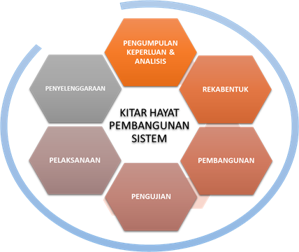

# 1.1 Pengenalan Kepada Kitar Hayat Kejuruteraan Pembangunan Sistem Aplikasi

**Pengenalan Kepada Metodologi Kejuruteraan Sistem Aplikasi**

Bab ini merupakan pengenalan dan penerangan ringkas kepada Kitar Hayat
Pembangunan Sistem (SDLC). Bab ini juga menerangkan Ekosistem Pembangunan Sistem
Sektor Awam yang terdiri daripada Metodologi Pembangunan Sistem dan aspek-aspek
pertimbangan yang mempengaruhi kepada dalam kejayaan pelaksanaan projek
pembangunan sistem.

**1.1 Pengenalan Kepada Kitar Hayat Kejuruteraan Pembangunan Sistem Aplikasi**

Merujuk kepada *[ISTQB
Certification](http://istqbexamcertification.com/what-are-the-software-development-life-cycle-sdlc-phases/)*
, model kitar hayat pembangunan sistem aplikasi (SDLC) adalah terdiri 6 fasa
utama iaitu fasa pengumpulan keperluan dan analisis, fasa reka bentuk, fasa
pembangunan (*coding*), fasa pengujian, fasa pelaksanaan (*deployment*) dan fasa
penyelenggaraan seperti digambarkan dalam **Rajah 1**. Setiap fasa mempunyai
siri aktiviti melalui penggunaan teknik-teknik tertentu bagi penghasilan
dokumentasi serahan.

**Rajah 1: Kitar Hayat Pembangunan Sistem Aplikasi**

Terdapat 2 elemen utama yang perlu difahami dalam SDLC iaitu:
 a) Perlu memahami fasa-fasa dalam SDLC, langkah-langkah yang perlu dilakukan
 dalam projek pembangunan sistem aplikasi dan teknik-teknik yang diperkenalkan
 dalam penghasilan serahan yang tertentu.
 b) Perlu memahami bahawa model SDLC melibatkan serahan yang dihasilkan dalam
 setiap fasa. Serahan dalam setiap fasa akan digunakan sebagai input kepada fasa
 berikutnya.
