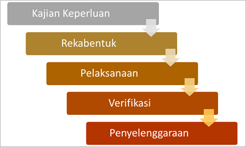
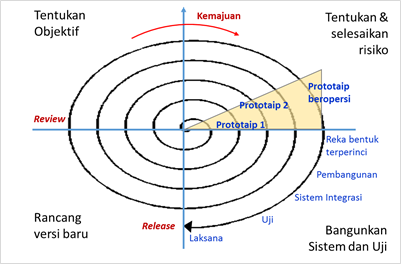
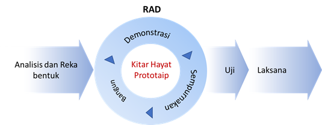
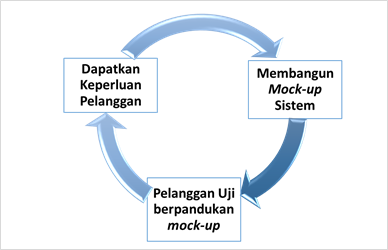
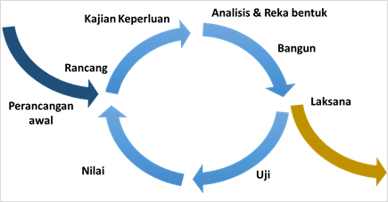
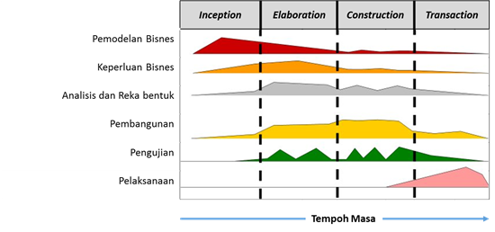

# 1.2 Metodologi Pembangunan Sistem Aplikasi

Metodologi Pembangunan Sistem Aplikasi adalah satu rangka kerja yang digunakan
untuk menstruktur, merancang dan mengawal proses pembangunan sistem aplikasi.
Terdapat pelbagai metodologi pembangunan sistem aplikasi yang telah
diperkenalkan. Kesesuaian sesuatu metodologi pembangunan sistem aplikasi adalah
bergantung kepada jenis organisasi, keupayaan dan keperluan teknikal, serta
jenis dan pasukan projek. Antara model yang sering digunakan adalah:

**a) Metodologi *Waterfall***

Metodologi waterfall juga dikenali Metodologi Jujukan *Linear*. Model ini
menerapkan kawalan yang ketat terhadap setiap fasa di dalam SDLC. Semakan dan
pengesahan serahan dilakukan secara formal dengan pemegang taruh pada setiap
penghujung fasa. Sesuatu fasa seterusnya tidak akan dimulakan sekiranya semakan
dan pengesahan serahan bagi fasa semasa tidak disempurnakan.

**Rajah 3 : Metodologi *Waterfall***

**b) Metodologi *Spiral***

Metodologi ini adalah gabungan konsep berulang di dalam Metodologi *Prototype*
dan aspek kawalan yang sistematik seperti yang terdapat pada metodologi Jujukan
*Linear*. Metodologi ini memberi fokus kepada penilaian produk dan meminimumkan
risiko dalam pembangunan sistem. Model ini memecahkan skop projek kepada
segmen-segmen yang kecil bagi memudahkan semakan dan perubahan dilakukan.

**Rajah 4 : Metodologi *Spiral***

**c) Metodologi *Rapid Application Development (RAD)***

Putaran *RAD* merangkumi 4 fasa utama iaitu perancangan keperluan, reka bentuk,
pembangunan dan pelaksanaan. Fasa ini dilaksanakan oleh sekumpulan pembangun
aplikasi yang mahir yang bekerjasama rapat dengan pengguna sepanjang tempoh
pembangunan. Teknik dan *tools* yang digunakan merupakan faktor utama kejayaan
RAD. Matlamat utama metodologi ini adalah menghasilkan sistem yang berkualiti
tinggi secara cepat dengan memberikan penekanan terhadap keperluan pengguna.

**Rajah 5 : Metodologi *RAD***

**d) Metodologi *Prototype***

Metodologi ini terdapat sesuai digunakan jika pengguna sistem sukar
mengenalpasti keperluan sistem. Terdapat 3 fasa penting dalam metodologi
*Prototype* iaitu fasa keperluan pengguna, fasa pembangunan dan fasa pengujian.
Proses ini diulang sehinggalah sistem lengkap dibangunkan. Metodologi ini
mengaplikasikan proses perubahan lelaran *(iterative modification process)*
sehingga sistem prototaip berkembang dan memenuhi kehendak pengguna.

**Rajah 6 : Metodologi *Prototype***

**e) Metodologi Pembangunan Berperingkat (*Incremental Development*)**

Pendekatan ini mengaplikasikan metodologi *waterfall* dalam pembangunan utama
sistem (*system core*) dan diikuti dengan metodologi *Prototype* secara lelaran
*(iterative)*. Pembangunan secara prototaip sehinggalah prototaip menjadi sistem
aplikasi yang lengkap mengikut kehendak pengguna.

**Rajah 7 : Metodologi *Incremental Development***

**f) Metodologi *Rational Unified Process (RUP)***

Metodologi *RUP* adalah proses pembangunan sistem yang menyediakan satu
pendekatan berdisiplin dalam menetapkan tugas dan peranan sesesuatu pasukan
pembangunan sistem. Matlamat *RUP* adalah untuk memastikan produk yang
dihasilkan menepati kehendak pengguna dan di dalam lingkungan peruntukan dan
jadual yang dianggarkan. *RUP* menggunakan 4 fasa utama iaitu *Inception,
Elaboration, Construction* dan *Transaction*.

**Rajah 8 : Metodologi *RUP***
