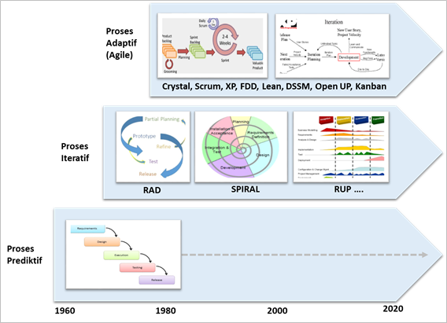

# 1.3 Klasifikasi Metodologi Pembangunan Sistem Aplikasi

Metodologi-metodologi pembangunan sistem aplikasi yang digunakan boleh
diklasifikasikan kepada 3 model utama iaitu model yang berasaskan kepada proses
prediktif, model yang berasaskan kepada proses iteratif dan model yang
berasaskan kepada proses adaptif. Model-model ini menentukan pendekatan dalam
proses pembangunan sistem aplikasi.

**Model Prediktif**, proses pembangunan sistem aplikasi berlaku dalam satu siri
fasa-fasa secara tersusun. Selepas keperluan sistem dipersetujui, reka bentuk
sistem dibuat dan diikuti dengan pengaturcaraan. Akhirnya, sistem diuji sebagai
pengesahan pematuhan kepada keperluan. Metodologi *Waterfall* termasuk dalam
kategori model ini.

**Model Iteratif** merupakan model yang berasaskan penemuan (*discovery-based*)
di mana pada peringkat awal dokumen keperluan sistem lebih ringkas berbanding
dengan model prediktif. Bermula dengan dokumen asas yang menerangkan apa yang
hendak dibangunkan, keperluan sebenar sistem akan dikenalpasti dan ditemui
semasa proses iteratif. Metodologi *Spiral*, *RAD* dan *RUP* termasuk dalam
kategori model ini.

**Model Adaptif** merupakan evolusi daripada model prediktif dan model iteratif.
Model ini juga dikenali metodologi *Agile*. Model ini membolehkan organisasi
menyelesaikan masalahnya secara holistik melalui persekitaran pembangunan sistem
yang transparen dan adaptif. Persekitaran ini diwujudkan melalui pembentukan
pasukan pembangunan yang menekankan kolaboratif antara pihak bisnes (SME) dan
pihak ICT untuk menghasilkan sistem yang selari dengan strategi organisasi
dengan cepat. Tanpa melengkapkan dokumen keperluan lebih awal, aktivti
pengaturcaraan akan dilaksanakan secepat mungkin dan akan terus dinilai oleh
SME. Kelemahan atau kekurangan yang ditemui kemudiannya akan terus dibetulkan
oleh pihak ICT. Ini bermakna perubahan kepada keperluan sistem boleh berlaku di
semua fasa pembangunan sistem dan dokumen-dokumen sistem dimuktamadkan selepas
pihak SME berpuas hati dengan produk yang dibangunkan. Metodologi *Scrum*,
*Extreme Programming* (XP) dan *Lean* termasuk dalam kategori model ini. **Rajah
9** merupakan model-model Metodologi Pembangunan Sistem Aplikasi.

**Rajah 9 : Model Klasifikasi Metodologi Pembangunan Sistem Aplikasi**

Sumber : Trail Ridge Consulting, LLC

**Rujukan**
 1. Capers Jones (2010). Software Engineering Best Practices.McGraw-Hill
    Companies
2. Uml-diagrams.org (2009-2017). Activity Diagrams.
   https://www.uml-diagrams.org/activity-diagrams.html.
3. Leffingwell, Dean (2011), Agile Software Requirements : Lean Requirements
   Practices For Teams, Programs, And The Enterprise.
