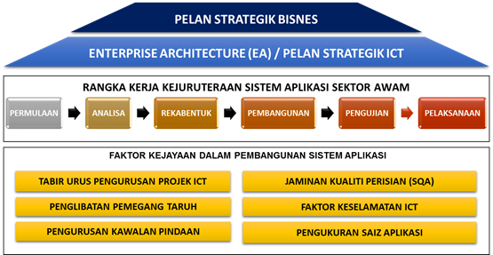

# 1.4 Ekosistem Pembangunan Sistem Aplikasi Sektor Awam

Ekosistem Pembangunan Sistem Aplikasi Sektor Awam mengambil kira elemen-elemen
lain dalam persekitaran ICT dan hubungannya dengan metodologi dan pendekatan
pembangunan sistem aplikasi di agensi-agensi Sektor Awam. Ekosistem tersebut
digambarkan dalam **Rajah 10**. Aspek pertimbangan utama dalam pembangunan
sistem aplikasi adalah Anggaran Keperluan Sumber, Pengurusan Kawalan Pindaan,
Penglibatan Pemegang Taruh, Jaminan Kualiti Perisian (SQA), Keselamatan Aplikasi
dan Tadbir Urus. Aspek-aspek ini perlu dipacu bersama-sama metodologi
pembangunan sistem aplikasi ke arah mencapai Pelan Strategik ICT dan Pelan
Strategik Bisnes yang dirancang.

**Rajah 10 : Ekosistem Kejuruteraan Pembangunan Sistem Aplikasi Sektor Awam**
