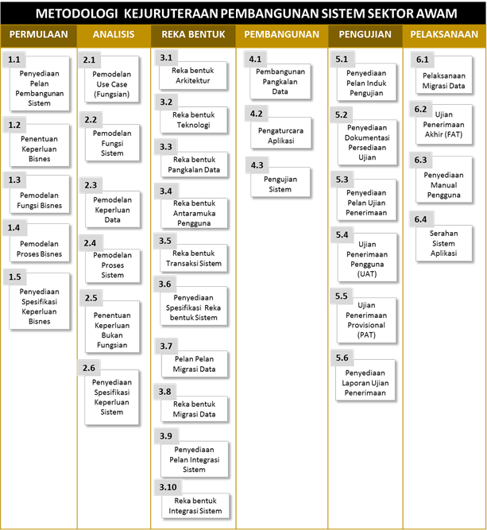

# 1.5 Metodologi Kejuruteraan Sistem Aplikasi Sektor Awam

Metodologi Kejuruteraan Sistem Aplikasi Sektor Awam dibangunkan dengan
mengambilkira tinjauan dan pengalaman ke atas metodologi pembangunan sistem yang
telah diamalkan dalam industri dan sektor awam. Metodologi ini merangkumi 6 fasa
utama iaitu: fasa pemulaan projek (*initiation*), fasa analisa (*analysis*),
fasa reka bentuk (*design*), fasa pembangunan (*construction*), fasa Pengujian
(*testing*) dan fasa pelaksanaan (*implementation*). **Rajah 11** merupakan
Metodologi Pembangunan Sisem Aplikasi Sektor Awam yang menunjukkan hubungan
antara fasa dan aktiviti dalam setiap fasa.

**Rajah 11 : Metodologi Kejuruteraan Pembangunan Sistem Aplikasi Sektor Awam**

**Fasa 1 : Permulaan Projek**

Fasa permulaan projek memberikan penekanan kepada komunikasi dan komitmen
Pemegang Taruh dan organisasi yang bertanggungjawab membangunkan sesuatu projek
selepas sesuatu permintaan diterima. Fasa ini dibahagikan kepada 2 aktiviti
utama iaitu:

a) Penyediaan Pelan Pembangunan Sistem / Piagam Pelanggan Penyediaan Pelan
Pembangunan Sistem (PPS) adalah penting sebagai komitmen pasukan projek dengan
pemilik sistem dan pemegang taruh. Butiran komitmen merangkumi skop, tujuan,
keperluan sumber, tempoh projek dan faedah/impak sistem kepada bisnes
organisasi. Pelan Pembangunan Sistem perlu mendapat persetujuan bersama antara
pasukan pembangun dan pemilik sistem.

b) Kajian Keperluan Bisnes Penentuan Keperluan Bisnes memberikan tumpuan ke atas
aktiviti mengumpul keperluan bisnes sesuatu organisasi (organisasi pemegang
taruh). Ini untuk memastikan sistem yang dibangunkan menepati keperluan
organisasi Pemegang Taruh secara menyeluruh (contoh: menepati visi, misi dan
objektif agensi) dan menepati keperluan organisasi secara spesifik.
Proses-proses yang berlaku di dalam aktiviti ini adalah mendefinisikan unit
Bisnes dan Peranan, Pemodelan Fungsi dan Proses Bisnes. Hasil daripada aktiviti
ini ialah D02 Spesifikasi Keperluan Bisnes.

**Fasa 2 : Analisis**

Matlamat utama fasa ini adalah melaksana analisis ke atas keperluan secara
terperinci untuk menghasilkan **D02 Spesifikasi Keperluan Bisnes** Output bagi
aktiviti ini adalah **D03 Spesifikasi Keperluan Sistem** yang menyatakan
keperluan bagi sistem dari perspektif pembangun sistem. Ia menyatakan
perkara-perkara atau item-item yang perlu ada didalam sesuatu sistem bagi
merealisasikan keperluan bisnes atau pemegang taruh. Proses-proses yang berlaku
di dalam aktiviti ini adalah pemodelan use case (fungsian), pemodelan keperluan
data dan pemodelan proses sistem.

**Fasa 3 : Reka bentuk**

Berdasarkan keperluan sistem yang diperolehi di dalam Fasa Analisis, arkitektur
keseluruhan sistem akan dihasilkan. Arkitektur sistem ini mendefinisikan
komponen, perlakuan dan antaramuka komunikasi bagi sesuatu sistem. Fasa ini juga
menerangkan tentang bagaimana sistem ini akan dihasilkan. Ia merangkumi
aktiviti-aktiviti seperti reka bentuk arkitektur; reka bentuk sistem; reka
bentuk pangkalan data, serta penentuan teknologi yang akan digunakan. Output
kepada fasa ini adalah **D04 Spesifikasi Reka bentuk Sistem**.

**Fasa 4 : Pembangunan**

Aktiviti-aktiviti yang dilaksanakan di dalam fasa pembangunan adalah berkaitan
proses penghasilan dan pengujian sistem oleh pasukan pembangun. Fasa pembangunan
merealisasikan SDS yang dihasilkan dalam fasa reka bentuk. Komponen dan fungsi
sistem dibangunkan melalui proses pengaturcaraan dan diintegrasikan untuk
menghasilkan sesuatu produk atau sistem. Aktiviti-aktiviti yang dilaksanakan di
dalam fasa ini adalah pembangunan pangkalan data, pengaturcaraan sistem dan
pengujian sistem. Di dalam fasa ini, proses penghasilan sistem aplikasi adalah
matlamat utama.

**Fasa 5 : Pengujian**

Aktiviti-aktiviti yang dilaksanakan di dalam fasa pengujian adalah berkaitan
dengan penyediaan pelan ujian dan dokumentasi berkaitan ujian, serta pelaksanaan
pengujian penerimaan oleh pengguna ke atas sistem. Pengujian yang dimaksudkan
adalah Ujian Penerimaan Pengguna (UAT) dan Ujian Penerimaan Sementara (PAT).
Ujian ini dilaksanakan sebagai validasi ke atas sistem aplikasi yang dibangunkan
berdasarkan keperluan pengguna dan keperluan sistem bagi memastikan keperluan
tersebut dipenuhi sebelum sistem aplikasi dilaksanakan.

**Fasa 6 : Pelaksanaan**

Aktiviti utama di dalam fasa pelaksanaan adalah melaksanakan aktiviti ke arah
persediaan pelaksanaan sistem. Aktiviti-aktiviti yang dilaksana di dalam fasa
ini adalah migrasi data, ujian penerimaan akhir, persediaan manual pengguna dan
laporan serahan sistem.
