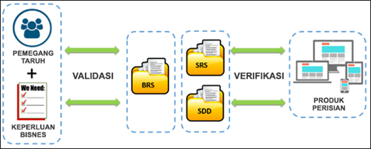
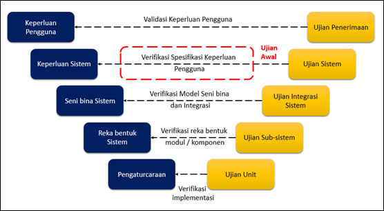

# 1.6 Faktor Kejayaan Dalam Pembangunan Sistem Aplikasi

Ekosistem Kejuruteraan Sistem Aplikasi Sektor Awam telah menggariskan beberapa
faktor kejayaan dalam pembangunan sistem iaitu Tadbir Urus Pengurusan Projek
ICT, Pengurusan Kawalan Pindaan, Jaminan Kualiti Perisian (SQA), Faktor
Keselamatan ICT, Pengukuran Saiz Sistem Aplikasi dan Penglibatan Pemegang Taruh.
Aspek-aspek utama ini perlu dititikberat dalam melaksana metodologi kitar hayat
pembangunan sistem ke arah mencapai matlamat bisnes yang ditetapkan.

**1.6.1 Tadbir Urus Pengurusan Projek ICT**

Merujuk kepada Buku Metodologi PRrISA Panduan Pengurusan Projek ICT Sektor Awam,
2016 yang diterbitkan oleh MAMPU, tadbir urus projek adalah penting bagi
memastikan kejayaan projek ICT. Ianya meliputi penubuhan struktur pasukan projek
pembangunan dan jawatankuasa pemantauan projek.

Organisasi Pasukan Projek Pembangunan diketuai oleh Pengurus Projek dengan
bantuan Pejabat Pengurusan Projek (PMO) yang berfungsi sebagai penyelaras kepada
2 pasukan utama projek seperti berikut:

**a) Pasukan Pembangunan**

Pasukan pembangunan bertanggungjwab dalam melaksana aktiviti mengkaji,
menganalisa, membangun sistem aplikasi dan melaksana pengujian sistem

**b) Pasukan SME**

Pasukan SME bertanggungjawab dalam menyedia input D03 Spesifikasi Keperluan
Sistem dan melaksana pengujian penerimaan ke atas sistem

Jawatankuasa pemantauan projek adalah terdiri 2 jawatankuasa utama iaitu:

**a) Jawatankuasa Pemandu Projek**

Jawatankuasa Pemandu Projek bertanggungjawab memutuskan strategi dan halatuju
projek pembangunan yang terdiri daripada keperluan sumber manusia, kewangan dan
proses. Jawatankuasa ini juga memantau pelaksanaan projek secara keseluruhan.

**b) Jawatankuasa Teknikal Projek**

Jawatankuasa Teknikal Projek bertanggungjawab memperaku halatuju, serahan dan
strategik, menyelesai isu-isu teknikal, menyelaras dan memantau pelaksanaan
mengikut skop projek yang dipersetujui.

**1.6.2 Penglibatan Pemegang Taruh**

Penglibatan pemegang taruh sepanjang aktiviti pembangunan sistem aplikasi dikira
sebagai faktor utama bagi memastikan kejayaan dalam pembangunan dan pelaksanaan
sistem aplikasi. Di samping menyumbang kepada kualiti sistem yang dibangunkan,
penglibatan pemegang taruh juga dapat menyelesaikan strategi pengurusan
perubahan ke arah penggunaan sistem aplikasi yang dibangunkan.

**Faedah Yang Diperolehi**

a) Meningkatkan kualiti sistem dan ketetapan kepada kehendak dan keperluan
pengguna dalam menyokong peranan dan bisnes agensi

b) Meningkatkan kefahaman dan penerimaan sistem aplikasi yang dibangunkan

c) Dengan penglibatan SME dalam mengenalpasti keperluan sistem dalam konteks
fungsi organisasi, ini dapat mengurangkan masa pembangunan

d) Memupuk perasaan pemilikan sistem baru, dengan penglibatan pengguna dalam
proses pembangunan akan menyebabkan penggunan lebih komited untuk menggunakan
sistem dan untuk memastikan kejayaannya semasa pelaksanaan.

**Kategori Pemegang Taruh**

Dalam pelaksanaan pembangunan sistem agensi sektor awam, terdapat 5 kategori
pemegang taruh iaitu:

**a) Penganjur Projek**

Penganjur projek adalah Ketua Jabatan/Agensi yang melulus dan memberi peruntukan
bagi pembangunan sistem aplikasi. Sokongan dari pengurusan atasan agensi adalah
faktor utama yang membawa kepada kejayaan pembangunan dan pelaksanaan sistem
aplikasi.

**b) Pemilik Projek**

Pemilik projek adalah Ketua Bahagian yang memiliki fungsi dan mempunyai kuasa
terhadap dasar dan prosidur sistem aplikasi yang sedang dibangunkan. Mereka
bertanggungjawab dalam memastikan sistem yang dibangunkan memenuhi keperluan
jabatan.

**c) *Subject Matter Expert (SME)***

SME adalah kumpulan pegawai rujukan kepada fungsi bisnes agensi berkaitan dengan
sistem yang akan dibangunkan.

**d) Ahli Pasukan Projek**

Pasukan pengguna yang terlibat dalam menyatakan keperluan sistem, terlibat dalam
reka bentuk sistem dan pengujian sistem. Mereka akan menjadi pegawai penghubung
antara pengguna akhir sistem dan pasukan pembangun.

**e) Penasihat Projek**

Pengurusan atasan agensi yang memberi nasihat dalam keperluan pengguna dan
sepanjang pentadbiran dan pengurusan projek dilaksanakan. Selalunya penasihat
projek akan mempengerusi Mesyuarat Jawatankuasa Projek.

**1.6.3 Pengurusan Kawalan Pindaan**

Permintaan pindaan adalah permohonan untuk membuat pelarasan semula skop atau
keperluan sistem yang telah dipersetujui. Permintaan perubahan ini amat penting
diuruskan bagi memastikan tiada kesan kelewatan dalam pembangunan sistem
aplikasi yang sedang berlaku. Permintaan pindaan keperluan biasanya berpunca
dari sebab-sebab berikut:

a) Masalah yang dilaporkan dikenalpasti sebagai ralat yang mesti diperbetulkan.

b) Peningkatan sistem yang diminta dari pihak pengguna.

c) Pertukaran standard, polisi atau akta berkaitan bisnes yang membawa kepada
perlunya sistem diubahsuai.

d) Permintaan daripada pengurusan kanan yang memerlukan pertambahan atau
pengubahsuaian fungsi sistem.

Buku Metodologi PPrISA Panduan Pengurusan Projek ICT Sektor Awam, 2016 yang
diterbitkan oleh MAMPU, menggariskan pendekatan bagi kawalan pindaan di bawah
Fasa Pelaksanaan dan Kawalan, menjelaskan perkara berikut:

a) Borang *Change Request* – borang standard yang perlu diisi oleh pihak
mengguna bagi membuat permintaan pindaan dan sokongan daripada pemilik sistem

b) Penyata Pindaan – keperluan untuk mendaftar permintaan pindaan, kelulusan
tindakan, kaedah penyelesaian dan status tindakan

c) Log Penyelesaian Isu – catatan kelulusan penyelesaian ke atas pindahaan dan
aktiviti yang telah dilaskanakan

d) Lembaga kawalan perubahan – Lembaga /peringkat yang membincangkan dan
meluluskan permintaan kawalan

e) Aliran Proses Kawalan Pindaan – menjelaskan aliran kerja permintaan pindaan.

**1.6.4 Jaminan Kualiti Perisian (SQA)**

SQA adalah satu pendekatan yang terancang dan sistematik untuk menilai kualiti
dan pematuhan kepada standard aplikasi, proses dan prosedur. Ini termasuklah
proses bagi menjaminan bahawa standard dan prosedur yang diwujudkan dipatuhi
sepanjang aktiviti kitar hayat pembangunan sistem. SQA berbeza daripada ujian
kerana ia adalah berorientasikan pencegahan manakala ujian adalah
berorientasikan pengesanan. SQA adalah proses semakan bermula dari peringkat
awal pembangunan, dengan ini dapat membantu dalam mengenal pasti masalah awal
seterusnya menyumbang ke arah peningkatan kualiti sistem. Terdapat 2 item utama
yang perlu dibincangkan dalam pelaksanaan SQA iaitu ciri-ciri sistem aplikasi
yang berkualiti diukur berdasarkan atribut kualiti perisian dan aktiviti
pengujian verifikasi dan validasi bagi memastikan sistem aplikasi yang
dihasilkan berkualiti dan memenuhi ciri-ciri kualiti perisian.

**a) Atribut Kualiti Perisian**

Kualiti sistem aplikasi ditentukan oleh atribut kualiti seperti **Jadual 3**.

**Jadual 3 : Atribut Kualiti Perisian**

| **Attribut** | **Keterangan** | **Contoh** |
|---|---|---|
| Atribut fungsian (*Functional attributes*) | Input dan output produk perisian | i. Sistem dapat memenuhi keperluan pengguna dengan tepat (*correctness*). ii. Sistem mengawal capaian modul mengikut peranan pengguna (*authentication*). iii. Sistem memaparkan maklumat sulit kepada pengguna tertentu sahaja (*integrity*). Aspek keselamatan telah diambil berat semasa pembangunan sistem (*security*) |
| Atribut operasi (*Operational attributes*) | Syarat operasi sesuatu produk perisian | i. Sistem berupaya memberikan tindak balas (*latency or response time*) dalam masa yang ditetapkan ii. Sistem dapat menampung kapasiti (*capacity*) pengguna serentak yang ditetapkan iii. Sistem dapat beroperasi walaupun melebihi kapasiti pengguna yang ditetapkan. |
| Atribut kebolehgunaan (*Usability attributes*) | Sejauh mana produk perisian boleh digunakan dan disesuaikan dengan produk perisian | i. Sistem mudah digunakan (*ease of use*) oleh pengguna ii. Sistem mudah dipelajari (*ease of learn*) oleh pengguna iii. Sistem mudah disesuaikan (*customizable*) mengikut keperluan operasi pengguna iv. Sistem sedia berkolaborasi dengan aplikasi lain (*interoperability*) |
| Atribut perniagaan (*Business attributes*) | Kos pembangunan, penggunaan serta perubahan produk perisian | i. Kos pembangunan sistem ii. Kos penyelenggaraan system iii. Penjimatan kos apabila produk atau komponennya boleh diguna semula (*reusability*) iv. Penjimatan kos apabila produk boleh digunakan pada platform berbeza (*portability*) |
| Atribut struktur (*Structural attributes*) | Struktur dalaman produk perisian | i. Sistem yang dibangunkan berupaya untuk diuji (*testability*) ii. Sistem mudah diadaptasi (*adaptability*) mengikut perubahan keperluan pengguna iii. Pembangunan sistem mengambil kira struktur kemodularan (*modularity*) |

**b) Verifikasi dan Validasi**

Verifikasi adalah proses semakan dokumentasi dan reka bentuk sistem (*static
testing*) untuk memastikan produk yang telah dibangunkan mematuhi keperluan yang
ditetapkan (*system was built right*) dalam setiap fasa pembangunan sistem.
Antara tujuan verifikasi adalah untuk menghasilkan keperluan yang betul, tepat,
lengkap dan konsisten. Validasi adalah aktiviti bagi memastikan produk yang
dihasilkan memenuhi spesifikasi keperluan (*right system built*) melalui proses
pengujian dinamik. Rujuk rajah di bawah.

**Rajah 12 : Proses Verifikasi dan Validasi**

Pengujian Verifikasi dan Validasi (V&V) hendaklah dilaksanakan oleh pasukan
pembangunan sistem itu sendiri, pada setiap fasa kitaran hayat pembangunan
sistem. Rajah di bawah menunjukkan 4 jenis pengujian yang perlu dilaksanakan
iaitu:

****

**Rajah 13 : Jenis-Jenis Pengujian V&V**

**Jadual 4 : Jenis-Jenis Pengujian IV&V**

| **Jenis Ujian** | **Keterangan** |
|---|---|
| Pengujian Awal (*Early Testing*) | Jenis pengujian adalah Ujian Statik dalam fasa permulaan projek. Pendekatan ujian adalah secara review atau/dan *walkthrough* ke atas keperluan fungsian (*functional*) dan bukan fungsian (*non-functional*) seperti yang dinyatakan dalam SRS. Artifak yang terlibat adalah seperti: • Dokumen tender • Cadangan tender daripada pembekal yang dilantik. • *Software Requirement Specification (SRS)*. |
| Ujian Unit (*Unit Testing*) | Aktiviti pengujian bagi menilai unit terkecil (*lowest level*) di dalam sistem seperti kod program, *function* dan sebagainya |
| Ujian Integrasi (*Integration Testing*) | Aktiviti pengujian dengan sistem-sistem dalaman dan sistem-sistem luaran yang terlibat secara terus dengan aplikasi yang sedang dibangunkan. |
| Ujian Sistem (*System Testing*) | Aktiviti pengujian yang terlibat adalah Pengujian *Functional* dan *Non-Functional* untuk keseluruhan modul yang dibangunkan |
| Ujian Penerimaan (*Acceptance Testing*) | Ujian Penerimaan Pengguna terbahagi kepada tiga (3) seperti turutan berikut: • Ujian Penerimaan Pengguna (UAT) • Ujian Penerimaan Sementara (PAT) • Ujian Penerimaan Akhir (FAT) |

Penggunaan SQA dalam proses pembangunan sistem akan membawa kepada faedah-faedah
berikut:

a) Memastikan standard dan prosedur dipatuhi.

b) Mewujudkan dokumentasi system yang seragam dan mudah difahami.

c) Memastikan masalah dapat ditemui awal dan diuruskan dengan sewajarnya.

d) Memantau dan menambah baik proses pembangunan perisian.

**1.6.5 Faktor Keselamatan ICT**

Elemen keselamatan dalam pembangunan sistem aplikasi adalah perlu diambil kira
dalam proses kitaran hayat pembangunan sistem aplikasi. Sistem aplikasi sering
terdedah kepada serangan kerana wujudnya kelemahan semasa aktiviti reka bentuk
dan pengaturcaraan. Kelemahan sistem aplikasi boleh menyebabkan ia boleh
diubahsuai oleh pihak yang tidak bertanggungjawab sehingga sistem aplikasi
tersebut tidak dapat beroperasi dengan baik. Tindakan pencegahan adalah penting
untuk mengurangkan ancaman ke atas sistem aplikasi. Aspek yang perlu diambilkira
dalam menjamin keselamatan sistem adalah:

**a) Prinsip umum Pembangunan Sistem Terselamat**

Keselamatan sistem boleh diancam pada mana-mana aktiviti sepanjang kitaran
hayatnya, sama ada secara sengaja atau tidak sengaja oleh "orang dalam" atau
oleh "orang luar" yang tidak mempunyai hubungan dengan organisasi.
Penambahbaikan kelemahan yang dikesan pada peringkat awal sepanjang kitar hayat
sistem aplikasi adalah lebih kos efektif daripada membangun dan mengeluarkan
versi/patch keselamatan baru untuk sistem beroperasi. Untuk dianggap selamat,
sistem mestilah mempunyai ciri-ciri:

**i) Kebergantungan (*Dependability*)**

Sistem yang dibangunkan boleh beroperasi dengan lancar di bawah semua keadaan
dan platform, termasuklah sekiranya terdapat serangan atau pelbagai niat jahat.

**ii) Dipercayai (*Trustworthiness*)**

Sistem boleh dipercayai walaupun terdapat kelemahan yang sengaja dieksploitasi
untuk mengganggu pengoperasian sistem. Sistem yang boleh dipercayai mesti
mengandungi logik yang boleh menghalang sebarang pencerobohan jahat.

**iii) Daya Tahan (*Resilience*)**

Sistem yang berdaya tahan adalah sistem yang mampu menentang serangan atau dapat
dipulihkan dengan cepat sekiranya ada serangan yang tidak boleh ditolak/
ditahan.

**b) Ciri-Ciri Keselamatan Utama Pembangunan Sistem**

Terdapat 7 ciri-ciri keselamatan yang perlu diambilkira bagi memastikan sistem
aplikasi adalah selamat. Ciri-ciri tersebut adalah seperti berikut:

**i) Keselamatan Tahap Sistem**

Sistem dapat mengawal akses aplikasi pada peranan setiap pengguna. Biasanya
sistem dikawal berasaskan paparan pilihan menu yang berbeza mengikut peranan
pengguna.

**ii) Keselamatan Row-Level**

Pengguna hanya dapat melihat data yang dibenarkan mengikut peranan mereka di
dalam aplikasi yang sama.

**iii) *Single Sign-On (SSO)***

Satu proses pengesahan pengguna yang membolehkan pengguna memasukkan id
penggguna dan kata laluan mereka pada satu sistem sahaja tetapi pengesahan
tersebut memberi kebenaran kepada pengguna untuk mengakses sistem lain yang
berkaitan pada sesi yang sama tanpa perlu log masuk ke sistem tersebut. SSO akan
mengurangkan bilangan ID Pengguna/ kata laluan yang perlu diingat dan memerlukan
login pada setiap aplikasi yang diperlukan.

**iv) Parameter Keistimewaaan Pengguna**

Parameter keistimewaan pengguna digunakan untuk memperibadikan ciri dan
keselamatan kepada pengguna individu atau peranan pengguna. Parameter
keistimewaan pengguna disimpan ke profil pengguna dan boleh diakses pada
keseluruhan sistem. Ianya sangat fleksibel, dapat mengawal, menambah atau
menyembunyi pilihan pengguna. Contoh: walaupun semua pengguna boleh mengakses
aplikasi yang sama, tetapi hanya pengguna tertentu sahaja yang boleh melihat
pilihan untuk mengemaskini data.

**v) Pilihan Pengesahan Fleksibel (*Flexible Authentication Options*)**

Sistem aplikasi yang dibangunkan sepatutnya menawarkan pelbagai pilihan kaedah
pengesahan pengguna, sistem sepatutnya fleksibel untuk menggunakan kaedah
pengesahan yang sedia ada tanpa perlu wujud atau mengubah kaedah pengesahan
semasa.

**vi) Sumber Data Pengguna (*User Specific Data Source*)**

Ciri keselamatan ini adalah sama dengan row-level keselamatan, tetapi di
peringkat pangkalan data. Aplikasi yang dibangunkan boleh mengakses sumber data
yang berbeza bergantung kepada pengguna. Contoh: Apabila berlaku penggabungan 2
syarikat yang mengguna sistem yang sama. Syarikat A perlu akses pangkalan data
local, manakala pekerja syarikat B perlu akses data dari pangkalan data
berlainan.

**vii) Pengauditan Aktiviti Sistem**

Pengauditan aktiviti sistem membolehkan pembangun log aktiviti pengguna akhir
untuk setiap aktiviti *Sign On / Sign Off*. Ini membolehkan sistem menjejaki
dengan cepat dan merekod log masuk dan keluar pengguna, fungsi yang dicapai dan
aktiviti yang dilakukan terhadap data.

**1.6.6 Kepentingan Pengukuran Saiz Sistem**

Dalam perancangan pembangunan projek yang melibatkan pembangunan sistem
aplikasi, langkah pertama yang perlu dilakukan ialah membuat anggaran 4
parameter utama iaitu saiz sistem, usaha pembangunan (*development effort*),
masa dan kos. Kesemua parameter ini merupakan input utama bagi pelan keseluruhan
projek.

Apabila saiz sistem tidak diukur dengan tepat, maka kebiasaannya anggaran usaha
pembangunan, masa dan kos adalah hanya berdasarkan kepada pengalaman dan
rekod-rekod sejarah yang lepas. Pengalaman dan rekod-rekod sejarah tersebut pula
dikumpulkan berdasarkan kepada cadangan pihak kontraktor di mana kadang-kadang
kos yang ditawarkan boleh dipersoalkan sama ada berpatutan atau sebaliknya. Oleh
yang demikian, adalah sangat penting saiz sistem diukur dengan lebih tepat dan
secara saintifik serta mematuhi piawaian antarabangsa.

Apabila membuat perancangan projek-projek ICT yang melibatkan pembangunan sistem
baru atau peningkatan sistem sedia ada, pihak pengurusan memerlukan jawapan
kepada tiga persoalan asas berikut:

a) Berapakah jumlah kos yang terlibat?

b) Berapa lama masa diambil untuk menyiapkan projek?

c) Siapa akan melaksanakannya dan adakah pilihan yang dibuat akan mengurangkan
kos atau mempercepatkan pelaksanaan projek?

Jawapan kepada persoalan bisnes ini dapat diberikan sekiranya saiz sistem yang
hendak dibangunkan diketahui. Pengiraan saiz sistem merupakan salah satu
aktiviti dalam kejuruteraan sistem untuk membuat anggaran saiz sistem aplikasi
yang hendak dibangunkan. Terdapat beberapa kaedah pengiraan saiz perisian,
antaranya ialah COSMIC Function Points, Mk II Function Points, Nesma Function
Points, FiSMA Function Points dan kaedah IFPUG. Kaedah yang paling terkenal
ialah kaedah IFPUG yang juga dikenali dengan Function Point Analysis (FPA). FPA
dimiliki dan diselenggara oleh IFPUG (*International Function Point Users
Group*) iaitu sebuah organisasi bukan berasaskan keuntungan yang telah
ditubuhkan pada 1986. FPA ini mematuhi standard pengukuran fungsian sistem
aplikasi ISO/IEC 14143-1:2007. Metrik pengukuran *function points* (FP) telah
menjadi standard de facto untuk analisis ekonomik sistem aplikasi, sebagai
penanda aras kepada produktiviti dan kualiti sistem aplikasi dan lain-lain
pengukuran yang berkaitan. Keterangan yang terperinci mengenai *function points*
dan kaedah IFPUG FPA akan diterangkan dalam Bab 8.

Persoalan yang selalu ditanya apabila membuat inisiatif berkaitan pembangunan
sistem aplikasi ialah berapa besar atau berapa kompleks sistem aplikasi yang
hendak dibangunkan. Adakah sistem yang hendak dibangunkan bersaiz kecil,
sederhana atau besar? Apabila kaedah FPA diaplikasikan, penentuan kategori saiz
sistem dapat ditentukan dengan yakin dan jelas. Capers Jones Pengarang buku
*Software Engineering Best Practices - Lessons from Successful Projects in the
Top Companies (2010)*, menyatakan perisian kategori kecil ialah perisian yang
kurang daripada 100FP, kategori sederhana bagi perisian bersaiz antara 100FP
hingga 999FP dan kategori besar bagi perisian bersaiz 1000FP ke atas. Apabila
saiz sistem dapat diketahui, maka kos, tempoh masa dan usaha pembangunan dapat
ditentukan dengan merujuk kepada jadual standards antarabangsa mengikut negara
atau mengikut standards organisasi sekiranya ada.

FP sudah dan sedang diterima secara meluas sebagai metrik standards untuk
mengukur saiz perisian. Kefahaman mengenai saiz perisian merupakan kunci kepada
kefahaman produktiviti dan kualiti dalam proses pembangunan sistem. Tanpa metrik
pengukuran saiz perisian yang saintifik dan boleh dipercayai, produktiviti (FPs
sebulan kerja) atau kualiti (kecacatan per FP) tidak akan dapat dikira. Dengan
FP, pemantauan kemajuan dalam produktiviti dan kualiti pembangunan sistem di
setiap fasa pembangunan dapat ditambah baik. Apabila perubahan kepada
produktiviti dan kualiti dikira dan diplot mengikut masa, organisasi boleh fokus
kepada kekuatan dan kelemahan. Fokus kepada kekuatan dan pembetulan serta
penambahbaikan kepada kelemahan akan menjadikan proses pembangunan sistem lebih
efektif.

Penggunaan pengukuran saiz fungsian sistem aplikasi yang dibangunkan akan
menyediakan maklumat-maklumat tambahan yang akan membantu dalam kejayaan dalam
pengurusan projek pembangunan sistem aplikasi. Antara maklumat-maklumat tersebut
adalah seperti berikut:

**a) Produktiviti**

i) Jam per *function point*, membolehkan organisasi membandingkan produktiviti
antara projek-projek atau pun membandingkan dengan *standards* industri.

ii) Produktiviti Keseluruhan, merujuk kepada *function point* per bilangan
sumber manusia terlibat (*total work effort*) yang memboleh organisasi mentadbir
dan memantau pelaksanaan projek secara efektif.

iii) Kadar pengeluaran/serahan *(rate of delivery)*, membolehkan pihak
pengurusan membuat perancangan dan analisis masa untuk promosi, atau untuk
pelaksanaan projek.

**b) Kualiti**

i) Saiz fungsian perisian dalam bentuk *function points* boleh digunakan sebagai
alat untuk membuat anggaran jadual pelan perancangan projek yang lebih tepat.

ii) Metrik tahap kesempurnaan projek boleh dikira dengan membandingkan bilangan
function points berasaskan fungsian yang diminta pengguna berbanding bilangan
function points berasaskan fungsian yang diserahkan.

iii) Metrik kadar perubahan kepada skop projek. Organisasi boleh menggunakan
maklumat ini untuk membuat justifikasi kepada permohonan bajet tambahan atau
perubahan kepada tarikh serahan projek.

iv) Kadar kecacatan produk. Ianya boleh digunakan untuk perancangan dan
pemantauan di setiap fasa pembangunan perisian bagi memastikan kecacatan yang
dikenalpasti dibetulkan sebelum produk dilaksanakan.

**c) Kewangan**

i) Kos per *function point* yang boleh digunakan membuat anggaran kos
pembangunan aplikasi dan membantu membuat keputusan dalam pemilihan perisian.

ii) Kos pembetulan perisian per *function points*. Ianya digunakan untuk
mengukur kos pembetulan perisian selepas dilaksanakan dalam tempoh tertentu.

iii) Nilai aset perisian organisasi merupakan satu metrik yang penting untuk
menilai aset perisian kepunyaan organisasi.

**d) Penyelenggaraan**

i) *Maintainability* merupakan *effort* dalam bentuk kos penyelenggaraan per
*function point* – boleh digunakan untuk membuat perancangan dan pemantauan kos
penyelenggaraan aplikasi.

ii) *Reliability* ialah bilangan kegagalan aplikasi berbanding dengan saiz
fungsiannya, boleh digunakan untuk mengukur tahap kebolehpercayaan aplikasi.

iii) Bilangan sumber manusia per *function points* untuk membuat
penyelenggaraan.

---

**Rujukan**

1. Hassan Gomma (2011). Software Modelling and Design . Cambridge Univerity
   Press
2. Ali Mili & Fairouz Tahier (2011). Software Testing. John Wiley & Sons. Inc.
