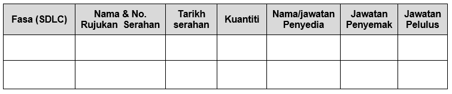
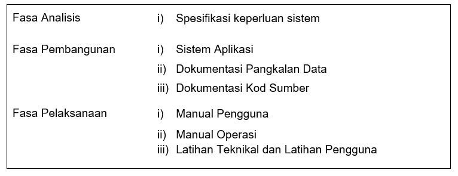
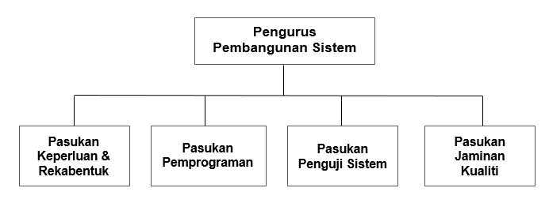
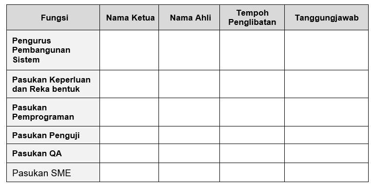
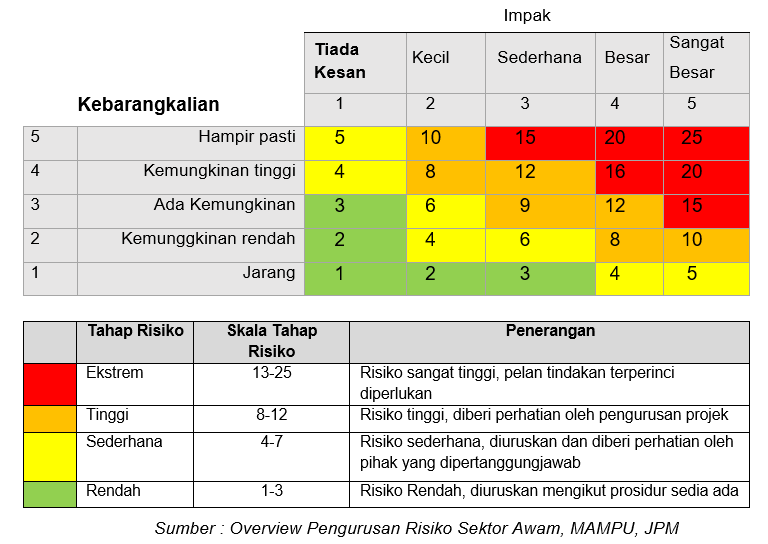
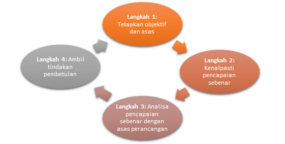
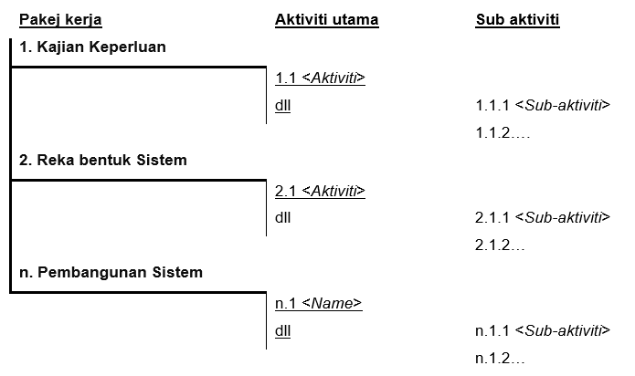
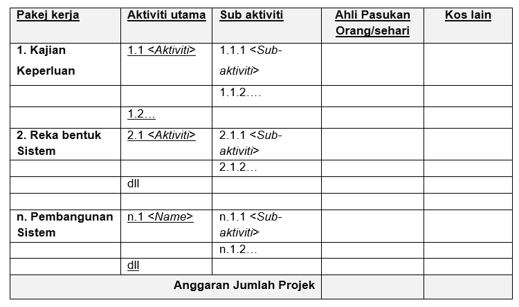
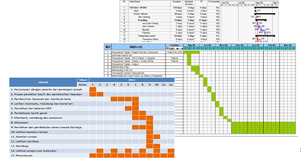

# 2.2 Perancangan Pembangunan Sistem

**2.2.1 Pengenalan**

Perancangan pembangunan sistem perlu dilaksanakan secara menyeluruh dan
terperinci bagi membolehkan pasukan pembangunan dan organisasi mengurus,
melaksana dan memantau pembangunan sistem aplikasi. Perancangan pembangunan
perlu didokumenkan dalam Pelan Pembangunan Sistem Aplikasi. Proses penyediaan
pelan ini sewajarnya bermula setelah pasukan mengenalpasti skop keperluan
bisnes, bagi memastikan perancangan dapat dilakukan dengan tepat. Pelan ini juga
perlu dibangunkan sejajar dengan pelan perancangan projek ICT yang berkaitan.

**Dokumen Rujukan** kepada aktiviti Perancangan Pembangunan adalah **D02
Spesifikasi Keperluan Bisnes**, sekiranya dokumen ini dibangunkan awal.

**Dokumen Serahan** kepada aktiviti Perancangan Pembangunan adalah **D01 Pelan
Pembangunan Sistem**.

| Bil. | Nama Dokumen | Muat Turun |
|---|---|---|
| 1. | D01 - Contoh Penyelesaian Dokumen Pelan Pembangunan Sistem |  |

**2.2.2 Penglibatan Pemegang Taruh**

Pemegang Taruh utama yang akan terlibat dalam perancangan adalah ketua pasukan
pembangunan sistem dan pemilik sistem aplikasi yang dilantik berdasarkan
sumber-sumber yang telah ditetapkan. Oleh kerana perancangan meliputi pendekatan
pelaksanaan sistem, adalah penting perancangan mendapat komitmen dan perhatian
kepada semua ahli pasukan dan persetujuan oleh pemilik sistem.

Cadangan penglibatan kategori pemegang taruh adalah seperti berikut:

a) Pemilik Sistem.

b) Ketua Pasukan Pembangunan Sistem.

c) Ketua SME.

**2.2.3 Faktor Kejayaan**

Untuk memastikan kejayaan perancangan, faktor kejayaan utama yang perlu
dipertimbangkan sebelum dan semasa aktivti dilaksanakan adalah seperti berikut:

a) Menetapkan pemilik sistem.

b) Memperolehi komitmen daripada pemegang taruh utama.

c) Kes bisnes untuk pembangunan sistem diluluskan.

d) Pasukan pembangunan yang mencukupi.

**2.2.4 Penyediaan Pelan Pembangunan Sistem [F1.1]**

Keterangan Pelan Perancangan Sistem merupakan perincian strategi dan pendekatan
yang akan digunakan sebagai panduan oleh organisasi dan pasukan projek. Rujuk
kepada **D01 Pelan Pembangunan Sistem** untuk melihat format dokumen yang
terlibat di mana pengisian kandungan-kandungannya adalah seperti langkah-langkah
di bawah.

**Objektif**

a) Menetapkan tempoh berdasarkan peruntukan sumber yang diberikan

b) Sebagai panduan dalam mengendalian pembangunan sistem

c) Panduan dalam pemantuan projek pembangunan

**Langkah-langkah**

**Langkah 1 : Tetapkan Pengenalan Projek**

Pengenalan projek akan menerangkan gambaran ringkas mengenai projek secara
keseluruhannya yang terdiri daripada tujuan projek, skop projek dan serahan
projek.

**a) Tujuan Projek**

Terangkan tujuan projek yang menentukan jangkaan hasil projek yang bersama-sama
dengan kekangan keperluan pembangunan (persekitaran, standard, . Tujuan boleh
juga diekstrak daripada Cadangan Projek yang didokumenkan dalam D02 Spesifikasi
Keperluan Bisnes yang dihasilkan. Utamakan tujuan projek berdasarkan aspek
berikut:

i) Matlamat Fungsian organisasi

ii) Matlamat Bisnes (kecekapan & faedah)

iii) Matlamat Kualiti (kualiti produk atau perkhidmatan)

Terangkan juga rasional yang menyebabkan projek pembangunan perlu dilaksanakan
seperti keperluan baru, perluasan (roll-out) atau memperbaiki
proses/perkhidmatan yang disediakan oleh organisasi. Pernyataan ringkas mengenai
masalah perkakasan, masalah perisian dan sebagainya disenaraikan bagi menguatkan
lagi tujuan projek.

Contoh tujuan projek:

| Tujuan projek ini adalah untuk membangunkan aplikasi telefon pintar bagi mencari lokasi tempat makan di Malaysia. Aplikasi ini dapat membantu rakyat atau pelancong semasa percutian di Malaysia. Aplikasi ini akan menjimat masa carian, menyedia pelbagai pilihan lokasi dengan pelbagai jenis makanan yang terdapat di Malaysia. |
|---|

**b) Skop Projek**

Jelaskan apakah yang akan (atau tidak akan) dihasilkan oleh projek bagi mengelak
perubahan pada masa depan dalam mencapai tujuan atau matlamat projek. Skop
projek perlulah dipersetujui dan akan dijadikan sebagai sempadan (boundary)
untuk pelaksanaan pembangunan aplikasi dan asas untuk mengukur kejayaan projek.

**Contoh Skop projek:**

| Antara skop projek yang telah dikenalpasti bagi mencapai tujuan projek adalah: i) Merangkumi semua lokasi restoran/tempat makan diseluruh Malaysia yang didaftarkan dibawah agensi pelancongan. ii) Akses aplikasi melalui semua jenis telefon pintar (Android dan IOS) |
|---|

**c) Serahan Projek**

Menyenaraikan jangkaan serahan projek mengikut fasa pembangunan sistem yang
berkaitan. Butiran serahan yang perlu meliputi nama serahan, tarikh serahan,
kuantiti serahan, penyedia, pengesah dan pelulus serahan. Setiap dokumen serahan
perlu mendapat pengesahan atau kelulusan daripada pemilik projek bagi memastikan
kualiti dan ketepatan maklumat yang disediakan.

Jadual di bawah sebagai panduan dalam penyenaraian serahan projek :

Contoh Serahan Pembangunan Sistem Aplikasi adalah:

**Langkah 2 : Tetapkan Maklumat Pengendalian Projek**

Maklumat bagi pengendalian projek seperti model proses, struktur organisasi dan
peranan merupakan input penting dalam penyediaan Pelan Pembangunan Sistem.
Kerangka bagi maklumat tersebut adalah seperti berikut:

**a) Model Proses**

Menerangkan proses pembangunan sistem yang akan digunakan yang mengambilkira
kitaran hayat pembangunan sistem (SDLC). Model proses perlu mengambilkira:

i) Proses Pembangunan

Nyata dan jelaskan proses pembangunan sistem aplikasi, kenalpasti juga
modul/release/fasa aplikasi yang dirancang, objektif dan aktiviti pembangunan
yang akan dilaksanakan di setiap modul/release/fasa.

ii) Metodologi Pembangunan

Nyata dan jelaskan kaedah pembangunan sistem yang akan digunakan (*waterfall,
agile, spiral* dll). Ini termasuklah keterangan manual, tools/alat dan prosedur
yang akan digunakan dalam menyokong kaedah yang digunakan.

iii) Standard

Nyatakan standard yang akan digunakan untuk mempersembahkan keperluan, reka
bentuk, coding, kes pengujian, prosedur pengujian dan keputusan pengujian
penerimaan.

iv) Reusable Product

Terangkan pendekatan yang digunakan untuk mengenalpasti, menilai dan melapor
peluang untuk customize atau mengintegrasi dengan aplikasi sedia ada.

**b) Struktur Organisasi Pasukan**

Pasukan Pembangunan sistem adalah salah satu fungsi/komponen dalam Struktur
Organiasasi Projek ICT. Pelan Pembangunan Sistem yang dibangunkan hanya
memperincikan pasukan pembangunan sistem. Kenalpasti pasukan kerja yang terlibat
dalam pasukan pembangunan sistem. Pasukan ini sekurang-kurangnya terdiri
daripada sub-pasukan seperti berikut:

i) Pasukan Keperluan dan Analisis

ii) Pasukan Reka bentuk (Pangkalan Data & Fungsian)

iii) Pasukan Migrasi/Integrasi (Jika berkaitan)

iv) Pasukan Pengujian

v) Pasukan Jaminan Kualiti

Sediakan rajah struktur organisasi pasukan projek digambarkan dengan menggunakan
sama ada carta organisasi atau rajah matriks yang dapat menggambarkan bidang
kuasa, tanggungjawab dan komunikasi di dalam projek.

**Rajah 15 : Contoh Struktur Pasukan Pembangunan Sistem**

**c) Tetapkan Peranan dan Tanggungjawab**

Pengurus Projek Pembangunan perlu dilantik sebagai ketua dan bertanggungjawab
dalam merancang dan mengurus pelaksanaan aktiviti pembangunan sistem. Manakala
pelaksanaan akan/boleh diagihkan kepada sub-pasukan mengikut fungsi. Setiap
sub-pasukan boleh terdiri daripada ketua pasukan dan ahli pelaksana. Setiap ahli
pasukan hendaklah dikenalpasti perlu mengambilkira tahap kemahiran/kepakaran dan
tempoh masa yang diperuntukkan dalam projek untuk anggaran tempoh dan kos
projek.

Contoh: Jadual Peranan dan Tanggungjawab

**Jadual 5 : Contoh Jadual Penerangan Keahlian Pasukan Pembangunan**

**Langkah 3 : Tetapkan Proses Pengurusan**

Proses pengurusan merupakan penerangan faktor yang perlu diambilkira bagi
melancarkan pengurusan pelaksanaan projek. Faktor tersebut adalah Andaian,
Kebergantungan dan Kekangan; Risiko; Tahap Kebarangkalian Risiko dan Tahap
Impak; serta Pemantauan dan Kawalan.

**a) Andaian, Kebergantungan dan Kekangan**

Menjelaskan andaian sebagai asas dalam pembangunan pelan projek, kebergantungan
ke atas pelan projek dan kekangan terhadap pelan projek seperti tempoh projek,
peruntukan sumber, kualiti dan fungsi.

i) Andaian Projek adalah peristiwa atau keadaan yang dijangka berlaku sepanjang
tempoh projek pembangunan sistem aplikasi dan memberi kesan positif atau negatif
terhadap objektif projek.

ii) Kebergantungan projek adalah kebergantungan kejayaan projek dengan aktiviti
luaran yang lain, ianya juga perlu dikenalpasti bagi memastikan pelaksanaan
pembangunan perisian berjalan lancar.

iii) Kekangan projek adalah apa-apa yang menghadkan tindakan projek pembangunan
sistem aplikasi. Kekangan perlu mengambilkira 3 aspek iaitu masa, sumber dan
kualiti kerana ketiga-tiga aspek ini yang akan memandu kejayaan projek.

**b) Senaraikan Risiko**

Risiko projek adalah peristiwa atau keadaan yang tidak pasti, jika ia berlaku,
ia akan memberi kesan ke atas tujuan/objektif projek. Risiko dalam pembangunan
sistem aplikasi berpunca dari sumber dalaman dan luaran.

i) Risiko dalaman yang dimaksudkan adalah:

• Risiko yang berkaitan dengan objektif projek antara pengurus projek, ahli
pasukan dan pemilik projek. Sekiranya objektif projek tidak ditakrifkan dengan
jelas pada permulaan projek, adalah sangat sukar bagi projek itu mencapai
keputusan

• Risiko yang berkaitan dengan takrifan saiz projek. Takrifan saiz yang salah
atau tidak tepat mengakibatkan salah arahtuju pembangunan projek, seperti
perubahan tempoh masa pembangunan projek, pertambahan kos dan lain-lain.

• Risiko yang berkaitan dengan kompleksiti projek. Sekiranya pasukan telah dapat
memahami kompleksiti projek dengan tepat mengakibatkan tambahan masa, sumber
bagi memahami bsines yang diperlu dibangunkan.

• Risiko yang berkaitan dengan definisi pelan projek. Sekiranya pelan projek
tidak mengambilkira kompleksiti, saiz, kemahiran dan pengalaman ahli pasukan
dalam fungsi masing-masing akan mengakibatkan risiko kegagalan projek

ii) Risiko luaran pula adalah risiko diluar kawalan pasukan projek. Risiko
berkaitan dengan politik, perundangan dan berkaitan dengannya. Masalah teknikal
diluar kawalan juga salah satu risiko luaran. Sekiranya projek adalah bergantung
kepada teknologi yang masih belum siap, projek ini potensi berisiko, maka
penyelesaian alternatif perlu dikenalpasti.

**c) Tahap Kebarangkalian Risiko dan Tahap Impak**

Pengurusan risiko perlu diberi tumpuan untuk mengenal pasti, menilai risiko dan
menguruskan risiko tersebut untuk meminimumkan kesan ke atas projek. Penilaian
risiko perlu dibuat bagi mengenalpasti impak risiko kepada projek. Tahap
kebarangkalian risiko (exposure) dinilai berdasarkan formula berikut :

Tahap risiko (exposure) = Kebarangkalian (probability / likelihood) x Impak atau
kesan risiko (impact)

Kedua-dua kebarangkalian dan impak akan dinilaikan mengikut skala yang
ditetapkan.

**Jadual 6 : Skala Impak dan Tahap Risiko**

**d) Pemantauan dan Kawalan**

Pemantauan dan kawalan merupakan faktor penting dalam pengurusan projek.
Kepentingan pemantauan dan kawalan dalam projek adalah untuk memastikan projek
mencapai kemajuan seperti dirancang dan tindakan yang diambil apabila perubahan
kepada pelan asal diperlukan. Bagi memastikan pemantauan dan kawalan
dilaksanakan secara berkesan, projek perlu menetapkan penggunaan mekanisma atau
pendekatan yang bersesuaian.

Mekanisma pemantauan ini perlu mengambil kira:

i) Struktur pelaporan

ii) Kaedah dan kekerapan pelaporan

iii) Format templat pelaporan

Proses dalam melaksanakan pemantauan dan kawalan adalah sebagaimana berikut:

**Rajah 16 : Proses Pemantauan Dan Kawalan Projek**

Merujuk kepada Ir. Wan Ibrahim Wan Yusoff, buku bertajuk 77 Tips Projek Berjaya
perkara yang perlu dipantau atau dikawal adalah:

i) Kemajuan mengikut pelan perancangan mengawal dari segi pelaksanaan status
aktiviti, mengenalpasti isu/masalah dan tindakan pembetulan

ii) Peruntukan, kawalan dari aspek berapa banyak telah dibelanja dan yang
tinggal, dan adakah baki kos yang tinggal bagi menyiapkan kerja

iii) Skop dikawal dari aspek pelaksanaan aktiviti masih dalam skop ataupun
diluar skop dan juga kenalpasti perubahan yang melibatkan tambahan skop

iv) Kualiti, pastikan kerja menepati spesifikasi, sekira wujudnya di luar
spesifikasi, apakah tindakan perlu diperbetulkan, dipantau dan perlu dikawal.

**Langkah 4 : Menetapkan Proses Teknikal**

Proses Teknikal merupakan penerangan faktor yang perlu diambilkira bagi
melancarkan pelaksanaan pembangunan sistem aplikasi. Faktor tersebut adalah
Pendekatan, teknik dan alat bantu; Dokumen aplikasi dan Dokumentasi Fungsi
sokongan.

**a) Pendekatan, teknik dan alat bantu**

Nyatakan pendekatan, teknik dan alat bantu akan digunakan dalam proses
pembangunan sistem aplikasi. Merujuk kepada contrux.com pendekatan, teknik dan
alat bantu perlulah mengambilkira item berikut:

i) Persekitaran sistem

Nyatakan apakah perkakasan, sistem pengoperasian dan pengurusan pangkalan data
yang akan digunakan dan spesifikasi yang diperlukan bagi persekitaran
pembangunan, pengujian dan produksi.

ii) *Tools* Perisian

Nyatakan tools yang akan digunakan bagi tujuan analisis, reka bentuk, kawalan
kod sumber, pembangunan sistem, debugging aids, defect tracking dan lain-lain.

iii) Metodologi pembangunan

Nyatakan pendekatan dalam kajian keperluan sistem, metodologi dalam reka bentuk
dan penggunaan notasi, bahasa pengaturcaraan, piawaian pengaturcaraan, piawaian
dokumentasi, prosedur integrasi sistem, dan sebagainya.

iv) Jaminan kualiti

Nyatakan kaedah jaminan kualiti serahan bermula daripada semakan kesinambungan
keperluan dan reka bentuk, ujian unit, menyemak logik kod (debugger), ujian
sistem, ujian regrasi dan ujian bukan fungsian lain yang berkenaan.

**b) Dokumen Aplikasi**

Senaraikan semua dokumentasi berkaitan pembangunan perisian yang perlu
disediakan termasuk bila sasaran siap, disemak dan ditandatangani. Antara
dokumen yang berkaitan adalah:

i) Spesifikasi Keperluan Bisnes (BRS)

ii) Spesifikasi Keperluan Sistem (SRS)

iii) Spesifikasi Reka bentuk Sistem (SRS)

iv) Pelan Induk Pengujian

v) Pelan Ujian (UAT & PAT)

vi) Laporan Ujian Penerimaan

vii) Pelan Integrasi Sistem

viii) Pelan Migrasi Sistem

ix) Manual Pengguna

**c) Dokumen Sokongan**

Nyatakan dokumentasi rujukan lain yang menyokong usaha kejayaan pembangunan
sistem. Antaranya adalah :

i) Pengurusan Konfigurasi

Dokumen yang akan digunakan bagi merekod dan mengawal semua versi serahan
projek.

ii) Pengurusan Risiko

Dokumen yang akan digunakan bagi merekod dan mengawal risiko yang telah dikenal
pasti.

iii) Pengurusan Perubahan

Dokumen yang akan digunakan bagi merekod dan mengawal perubahan skop dan
komponen projek.

iv) Pelan Jaminan Kualiti

Dokumen yang akan digunakan bagi merekod dan mengawal kualiti produk.

v) Senarai Semak Instalasi Sistem (Deployment)

Dokumen yang akan digunakan bagi merekod semua proses pengujian dan produksi.

vi) Pelan Latihan Pengguna

Dokumen yang akan digunakan bagi merekod perancangan latihan sistem kepada
teknikal dan pengguna akhir sistem.

**Langkah 5 : Menetap Pakej Kerja, Jadual Dan Peruntukan**

Menetapkan pakej kerja, jadual dan peruntukan secara jelas dan terperinci adalah
penting dalam kerja-kerja pemantauan dan kawalan pembangunan sistem secara
berkesan.

**a) Pakej Kerja**

Terangkan pakej kerja yang mesti diselesaikan untuk melengkapkan sesuatu sistem
aplikasi. Kenal pasti setiap pakej kerja dan gambarkan pecahan pakej kerja
melalui struktur perincian kerja.

**Rajah 17 : Contoh Perincian Kerja**

**b) Pakej Kerja dan Kebergantungan**

Kebergantungan menerangkan hubungan antara dua atau lebih aktiviti-aktiviti
dalam pakej kerja yang sama atau dari pakej kerja yang lain. Oleh itu, pengurus
pembangunan sistem perlu mengenal pasti kebergantungan antara aktiviti-aktiviti
atau pakej kerja untuk merangka jadual projek yang tepat. Sebagai contoh, pakej
kerja bagi membangunkan modul pengurusan rekod secara elektronik, pakej kerja
tersebut bergantung kepada kesediaan pakej kerja pengkelasan rekod yang perlu
diselesaikan terlebih dahulu.

**c) Anggaran Keperluan Sumber**

Anggaran sumber adalah dijumlah dari setiap aktiviti, pakej kerja dan
keseluruhan projek. Kenalpasti anggaran usaha ahli pasukan dan anggaran kos bagi
sumber-sumber lain seperti perkakasan dan perisian.

Contoh: Anggaran sumber

**Jadual 7 : Contoh Anggaran Jumlah Projek**

**d) Peruntukan Kos**

Sumber dan jumlah peruntukan yang diperlukan bagi menjalankan projek perlu
dinyatakan. Pembahagian dan perincian peruntukan mengikut aktiviti – aktiviti
utama seperti pembangunan aplikasi, perkakasan dan penyediaan dokumen kajian
keperluan perlu dinyatakan. Keperluan peruntukan boleh dibentangkan dalam bentuk
jadual dan / atau menggunakan satu atau lebih angka (seperti histogram).

**e) Jadual Perancangan**

Tentukan jadual projek menggunakan carta bar atau carta Gantt, mengenal pasti
tarikh pencapaian utama, pencapaian, input luaran untuk projek (dan sebarang
kebergantungan luaran yang lain), tempoh setiap pakej kerja dipecahkan kepada
kepada aktiviti dan sub aktiviti.

**Rajah 18 : Contoh Jadual Perancangan Projek**

2 kaedah untuk mengira anggaran masa yang diperlukan untuk pembangunan sistem
iaitu:

i) Berasaskan masa yang diperuntukkan dalam fasa perancangan untuk membuat
anggaran masa yang diperlukan dalam fasa berikutnya

Mengikut standard industri bagi sistem aplikasi yang tipikal, usaha yang
diperuntukkan dalam fasa perancangan adalah sebanyak 15% , 20% untuk fasa
analisis, 30% untuk fasa reka bentuk dan 35% untuk fasa pelaksanaan. Walau
bagaimanapun, peratusan ini lebih tepat sekiranya kita mempunyai rekod-rekod
dari pengalaman lepas yang boleh dijadikan asas kepada pengiraan anggaran masa
yang diperlukan.

ii) Function Point Analysis

Pengiraan anggaran masa secara saintifik menggunakan pendekatan analisis
function point lebih tepat dan lebih dipercayai (reliable). Berdasarkan
keperluan bisnes, analyst akan membuat pengiraan awal saiz sistem aplikasi. Saiz
sistem aplikasi dalam ukuran function point ini akan ditukar kepada jumlah usaha
diperlukan untuk membangunkan sistem dalam bentuk bilangan person-months.
Anggaran usaha ini kemudiannya diterjemahkan kepada anggaran jadual masa dalam
bentuk bilangan bulan daripada awal hingga tamat projek.

**Langkah 6 : Komponen Tambahan**

Komponen tambahan adalah perkara yang ada hubung kait dalam pelaksanaan projek.
Contoh komponen tambahan adalah seperti pelan keselamatan, pelan latihan, pelan
perolehan perkakasan dan perisian, pelan-pelan fasiliti, pelan pemasangan, pelan
penyelenggaraan dan komponen-komponen lain yang berkaitan.

**Langkah 7 : Lampiran Pelan Pembangunan**

Sistem akan mempunyai dokumen sokongan yang dirujuk dalam pelaksanaan projek.
Dokumen ini boleh dijadikan lampiran kepada pelan pembangunan sistem. Contoh
dokumen lampiran adalah minit mesyuarat, surat-surat dan sebagainya.

---

**Rujukan**

1. Gary, B. S. & Harry, J. R. (2012). System Analysis and Design. Ninth Edition.
   Boston: Course Technology

2. Dennis, A., Wixom, B. H., & Roth, R. M. (2012). Systems Analysis and Design.
   Fifth Edition. USA: John Wiley & Sons, Inc.

3. Wiegers, K., E. & Joy, B. (2013). Software Requirements. Third Edition.
   Washington: Microsoft Press

4. Risks in Information Systems Development Projects, Ozren Ðurkovic Lazar
   Rakovic, Management Information Systems, Vol. 4 (2009)

5. Ir. Wan Ibrahim Wan Yusoff, 77 tips kejayaan projek (www.pengurusnprojek.com
   ) "SW Development Plan" template, www.computing.dcu.ie/~ltuohey/CA305_2007...
   /ExampleDevPlanTemplate.doc
