# 2.3 Kajian Keperluan Bisnes

**2.3 1 Pengenalan**

Kajian keperluan bisnes adalah merupakan aktiviti asas yang perlu dilaksanakan
untuk memahami halatuju dan objektif organisasi, mengenalpasti keperluan bisnes
dan skop yang perlu diliputi bagi tujuan pembangunan sistem aplikasi. Kajian
keperluan ini adalah berpandukan model bisnes organisasi seperti dalam **Rajah
19.**

**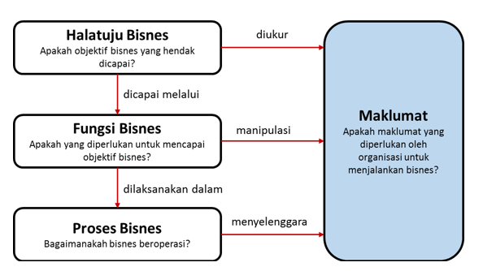**

**Rajah 19 : Model Bisnes Organisasi**

Aktiviti utama yang terlibat dalam kajian keperluan bisnes adalah seperti
berikut:

1. Penentuan Keperluan Bisnes.
2. Pemodelan Fungsian Bisnes.
3. Pemodelan Proses Bisnes.

**Dokumen Rujukan** kepada aktiviti kajian keperluan bisnes adalah Permintaan
daripada pemegang taruh samada melalui Pelan Strategik ICT atau E*nterprise
Architecture* (EA) organisasi, mesyuarat, kertas kerja, kelulusan Jawatankuasa
Pemandu Organisasi atau Jawatankuasa di peringkat Sektor Awam.

**Dokumen Serahan**  kepada aktiviti kajian keperluan bisnes adalah **D02
Spesifikasi Keperluan Bisnes.**

| Bil. | Nama Dokumen | Muat Turun |
|---|---|---|
| 1. | D02 - Contoh Penyelesaian Dokumen Spesifikasi Keperluan Bisnes |  |

**2.3.2 Penglibatan Pemegang Taruh**

Pemegang taruh utama yang terlibat dalam kajian keperluan adalah pemilik
prosidur atau proses, pengurusan atasan dan pengguna. Memandangkan kajian
keperluan bisnes merupakan aktiviti asas dan utama dalam pembangunan sistem,
maka penglibatan SME yang berautoriti dan kompeten sangat diperlukan. Oleh
demikian, pemilihan SME amat penting dalam memastikan kejayaan kajian keperluan
bisnes. Pemegang taruh boleh terdiri dari pada kategori berikut:

1. Pemilik sistem.
2. Pengurusan atasan.
3. Pembiaya projek.
4. Pengguna sistem.
5. Organisasi yang akan berinteraksi dengan sistem.

**2.3.3 Faktor Kejayaan**

Untuk memastikan aktiviti kajian keperluan bisnes berjaya dilaksanakan, faktor
kejayaan utama yang perlu dipertimbangkan sebelum dan semasa aktivti
dilaksanakan adalah seperti berikut:

a) SME yang dilantik arif dengan keperluan bisnes dan penglibatan yang
berterusan.

b) Pasukan kajian mempunyai kemahiran dalam berkomunikasi.

c) Keperluan bisnes didokumenkan dengan tepat dan mendapat pengesahan pemilik

**2.3.4 Penyediaan Pelan Pembangunan Sistem [F1.1]**

Keterangan

Pelan Perancangan Sistem merupakan perincian strategi dan pendekatan yang akan
digunakan sebagai panduan oleh organisasi dan pasukan projek. Rujuk kepada **D01
Pelan Pembangunan Sistem** untuk melihat format dokumen yang terlibat di mana
pengisian kandungan-kandungannya adalah seperti langkah-langkah di bawah.

Objektif

- Menetapan tempoh berdasarkan peruntukan sumber yang diberikan
- Sebagai panduan dalam mengendalian pembangunan sistem
- Panduan dalam pemantuan projek pembangunan

**Langkah-langkah**

**Langkah 1 : Fomulasi Kes Bisnes**

a) Kenalpasti kes bisnes bagi keperluan pembangunan sistem. Kes bisnes perlu
menyatakan sebab-sebab yang membawa kepada keperluan pembangunan sistem.

b) Hasrat yang telah dikemukakan oleh pemegang taruh akan dipindahkan kepada
Apendiks 1 Borang Permohonan Pembangunan Sistem dan digunakan sebagai input
utama kepada pembangunan sistem.

c) Hasrat pemegang taruh mungkin berpunca dari persekitaran bisnes semasa yang
berkaitan dengan faktor berikut

i) Perubahan dalam proses bisnes;

ii) Perubahan dalam teknologi;

iii) Perubahan dalam undang-undang, akta atau prosedur; dan

iv) Pematuhan kepada piawaian baru.

**Langkah 2 : Fahami Keperluan Bisnes**

Fahami keperluan bisnes akan menjawab kepada enam (6) soalan asas kepada sistem
baru yang hendak dibangunkan iaitu:

i) Apakah objektif projek ini?

ii) Apakah perubahan yang perlu dilakukan ke atas bisnes untuk mencapai objektif
projek ini

iii) Bila dan apakah urutan proses berlaku?

iv) Di mana proses/fungsi yang dilakukan?

v) Siapakah yang menjalankan proses/fungsi yang dikenalpasti.

vi) Apakah dokumen, borang, e-mel, laporan, prosedur yang terlibat dalam proses
tersebut?

**Langkah 3 : Lakukan Pemilihan SME**

Pemilihan SME dan penglibatan mereka amat penting bagi menjayakan kajian
keperluan bisnes. SME yang dipilih perlu mempunyai ciri-ciri berikut:

a) Berpengetahuan dalam proses bisnes;

b) Merupakan personel utama dalam proses bisnes;

c) Berkemampuan untuk menterjemah dan melaksanakan strategi berkaitan;

d) Mempunyai visi mengenai halatuju bisnes; dan

e) Menyokong objektif projek

**Langkah 4 : Pilih Teknik Pengumpulan Maklumat**

Terdapat pelbagai teknik untuk pengumpulan maklumat dan mengenalpasti keperluan
bagi pembangunan sistem iaitu:

| ***Brainstorming*** | a) Sesi percambahan fikiran bagi mencetuskan idea/strategi; b) Boleh menghasilkan berbagai pilihan/cadangan dengan cepat; c) Dipengaruhi oleh faktor pengalaman dan kreativiti kumpulan; d) Kaedah yang baik bagi mengumpulkan idea; dan e) Dijalankan dalam persekitaran yang tidak terikat dengan peraturan. |
|---|---|
| ***Focus Group*** | a) Satu kumpulan persekitaran interaktif untuk mendapatkan idea tentang peluang produk / sistem; b) Dipandu oleh moderator; c) Boleh dijalankan pada bila-bila masa dalam kitaran hayat; dan d) Sesuai untuk mengkaji keperluan baru dan membuat penilaian ke atas produk. |
| **Pemerhatian** | a) Melihat bagaimana sistem membantu pengguna dalam melaksanakan kerja seharian dan menilai samada sistem perlu diganti atau dinaik taraf; b) Membantu menyediakan aliran kerja keseluruhan pengguna; dan c) Kaedah yang baik bagi mengumpulkan idea. |
| **Temuduga** | a) Membantu untuk membina hubungan baik dengan pihak berkepentingan; b) Memudahkan tindakan susulan dan penjelasan; c) Kaedah yang ringkas dan mudah; d) Memudahkan pemerhatian terus non-verbal behaviour; dan e) Bergantung kepada pengetahuan pengguna dan kepakaran penemuduga. |
| **Tinjauan dan Soalselidik** | a) Set soalan untuk dijawab; b) Jawapan dinilai dan digunakan bagi menentukan keperluan; c) Kaedah soalan secara terbuka dan tertutup digunakan; dan d) Maklumat dapat dikumpulkan daripada bilangan kumpulan sasar yang lebih besar. |
| ***Joint Application Design*** **(JAD)** | a) Pasukan projek, pengguna dan pengurusan bekerjasama; b) Boleh mengurangkan *scope creep* sebanyak 50%; dan c) Dijalankan oleh fasilitator mahir dalam teknik JAD. |

**Langkah 5 : Sediakan Arkitektur Bisnes**

a) Arkitektur Bisnes adalah suatu dokumentasi berkaitan bisnes yang menerangkan
mengenai organisasi dan digunakan untuk menentukan objektif organisasi yang
lebih strategik. Arkitektur bisnes digunakan sebagai salah satu sumber rujukan
dalam pengurusan keperluan (*Requirements Management*) pembangunan aplikasi.
Arkitektur bisnes merupakan salah satu kerangka di dalam *Enterprise
Architecture* (EA) yang dibangunkan oleh organisasi

b) Arkitektur bisnes di atas menunjukkan ianya akan menjawab persoalan mengenai:

i. Kenapa perlu dilakukan?
ii. Apa yang perlu dilakukan?
iii. Bagaimana ianya dilaksanakan?
iv. Dengan apa ianya dilaksanakan?

c) Persoalan yang perlu dijawab dalam Arkitektur bisnes akan diterjemahkan ke
dalam bentuk kerangka bisnes sebagaimana dibawah. Kerangka bisnes adalah
berorentasikan perkhidmatan organisasi dan penyelesaian kepada keperluan bisnes
yang dapat menghalang dari berlakunya konflik antara pemegang taruh.

Contoh arkitektur bisnes yang boleh dibangunkan adalah seperti berikut:

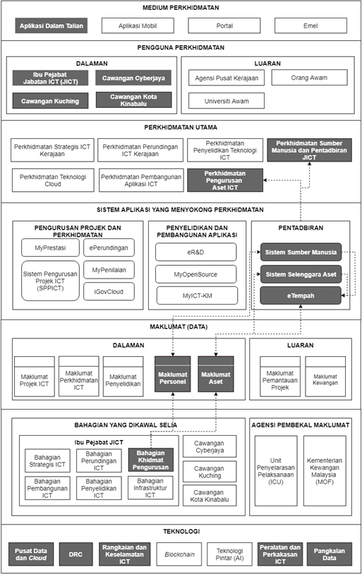

**Rajah 20 : Contoh Arkitektur Bisnes**

**Langkah 6 : Sediakan Arkitektur Maklumat**

a) Arkitektur maklumat adalah reka bentuk berstruktur bagi persekitaran
maklumat. Model konsep maklumat digunakan bagi melaksanakan aktiviti yang
melibatkan struktur maklumat yang kompleks. Fokus utama arkitektur maklumat
adalah untuk mengumpul, menstrukturkan, melabelkan kandungan maklumat secara
berkesan dan mampan (*sustainable*). Tujuan utama arkitektur maklumat adalah
bagi membantu dalam penggunaan dan pengaliran maklumat.

b) Arkitektur maklumat berkait rapat dengan ekologi dan persekitaran maklumat.
Ekologi maklumat merangkumi konteks (*context*), kandungan (*content*), dan
pengguna (*users*).

i) Konteks (*Context*): Sasaran bisnes, peruntukan, politik, persekitaran,
teknologi, sumber dan kekangan.

ii) Kandungan (*Content***)**: Objektif, dokumentasi dan jenis data, jumlah
data, struktur data terkini, pemilik data dan tadbir urus data.

iii) Pengguna (*Users***)**: Pemegang taruh, tugas, keperluan, cara carian dan
penggunaan maklumat dan pengalaman.

c) Arkitektur maklumat dikenal pasti dengan menentukan jenis kumpulan maklumat
yang berkaitan dengan domain bisnes, unit organisasi yang mengumpul atau
memproses data berkenaan, dan juga peranan serta tanggungjawab organisasi
tersebut ke atas jenis data yang telah dikenal pasti. Berikut adalah keterangan
lanjut berkenaan elemen-elemen di dalam arkitektur maklumat :

i) Pengguna

Kenal pasti unit organisasi atau personel yang terlibat dengan jenis kumpulan
maklumat dan proses yang berkenaan dengan domain bisnes. Pengguna boleh terdiri
daripada pegawai yang bertanggungjawab seperti pemilik data dan pentadbir
bahagian, nama jabatan, bahagian sehingga ke unit yang terkecil.

ii)Proses

Kenal pasti proses utama yang terlibat dalam domain bisnes serta interaksi
dengan sistem lain. Proses utama boleh berpandukan kepada fungsi-fungsi bisnes
tahap 1 dalam Pemodelan Fungsi Bisnes [F1.3].

iii) Kumpulan Maklumat

Tentukan Kumpulan maklumat yang berkaitan dengan domain bisnes, contohnya
seperti maklumat kewangan, maklumat sumber manusia, maklumat gaji dan pelbagai
lagi. Elakkan daripada menyenaraikan nama maklumat secara terperinci.

Contoh arkitektur maklumat yang boleh dibangunkan adalah seperti berikut:

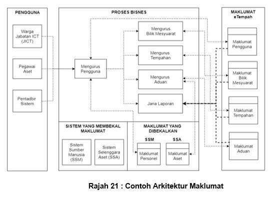

**Langkah 7 : Dokumenkan Maklumat**

Dokumenkan maklumat yang dikumpul dari pihak SME. Susunkan maklumat mengikut
kategori berikut:

a. Halatuju Bisnes - terdiri daripada senarai objektif dan strategi bisnes
   termasuk bisnes unit yang terlibat
b. Keperluan Bisnes - terdiri daripada senarai proses/fungsi utama keperluan
   bisnes
c. Model Data Luar - terdiri daripada senarai maklumat utama mengikut perspektif
   pemegang taruh
d. Bisnes Unit dan Definisi Peranan - terdiri daripada peranan dan data elemen

**Rujukan**

a. Gary, B. S. & Harry, J. R. (2012). System Analysis and Design. Ninth Edition.
   Boston: Course Technology
b. Dennis, A., Wixom, B. H., & Roth, R. M. (2012). Systems Analysis and Design.
   Fifth Edition. USA: John Wiley & Sons, Inc.
c. Wiegers, K., E. & Joy, B. (2013). Software Requirements. Third Edition.
   Washington: Microsoft Press.

**2.3.5 Pemodelan Fungsi Bisnes [F1.3]**

**Keterangan**

Permodelan Fungsi Bisnes adalah teknik untuk mengenal pasti fungsi yang sedang
dan akan dijalankan oleh organisasi. Teknik ini menghasilkan model fungsi bisnes
organisasi kepada pengguna yang direpresentasi dalam bentuk hirarki fungsi
bisnes.

**Objektif**

- Mengenal pasti fungsi-fungsi yang dijalankan untuk mencapai objektif bisnes.
- Menghasilkan model fungsi yang tepat dan memenuhi keperluan sesebuah
  organisasi.

**NOTASI FUNGSI BISNES**

**Jadual 9 : Notasi Fungsi Bisnes**

| **Elemen** | **Keterangan** |
|---|---|
| \| ID Fungsi Bisnes Nama Fungsi Bisnes \| \|---\| Fungsi Bisnes | · Digunakan bagi mewakili setiap fungsi bisnes. · Labelkan ID Fungsi Bisnes (rujuk notasi di bawah) dan Nama Fungsi Bisnes di dalam notasi dengan menggunakan ayat yang bermula dengan kata kerja. |
| ID Fungsi Bisnes Nama Fungsi Bisnes |  |
| Sintaks Nama Fungsi **<kata kerja><kata nama>** | · Nama fungsi bisnes hendaklah dimulakan dengan kata kerja dan diikuti kata nama. Contoh: Merekod Aset. |
| ID Fungsi Bisnes **BF - FF - SF - FTA** | · Digunakan sebagai konvensyen nama bagi setiap fungsi bisnes yang dibangunkan. · Keterangan Kandungan ID: **BF**   = Ringkasan Nama Teknik **FF** = Ringkasan Nama Fungsi **SF** = Ringkasan Nama Subfungsi **FTA** = Ringkasan Nama Fungsi Asas |
| Penghubung antara fungsi mendatar atau menegak 1. | · Penghubung antara fungsi dan sub fungsi menggunakan garis lurus mendatar atau menegak |
| Keterangan Fungsian Bisnes **<pemegang taruh>** **<kata kerja > <prestasi/kekerapan> <peristiwa>** **<syarat-syarat>** | · Pernyataan yang akan menerangkan suatu fungsian bisnes. |

**Langkah-langkah**

**Langkah 1 : Lakukan Analisis Keperluan Bisnes**

a. Laksanakan analisis ke atas maklumat yang didokumenkan dalam proses Penentuan
   Keperluan Bisnes [F1.2] untuk mengenal pasti fungsi-fungsi bisnes. Fungsi
   bisnes terdiri daripada fungsi utama (*root function*) dan sub-sub fungsi.
   Fungsi utama boleh diperolehi dengan mengenal pasti apa yang perlu dilakukan
   untuk mencapai misi organisasi atau tujuan utama projek dibangunkan. Sub
   fungsi ialah fungsi yang perlu dilaksana untuk merealisasikan fungsi utama
   atau fungsi-fungsi di atasnya mengikut hierarki fungsi. Semua fungsi ini
   dapat dikenal pasti melalui perkataan kata kerja yang bersifat aktif, kukuh,
   tepat dan difahami dalam dokumen kes bisnes.

Contoh cabutan sebahagian daripada kes bisnes:

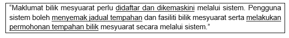

b. Perkataan yang bergaris merupakan perkataan berbentuk kata kerja yang boleh
   menentukan fungsi yang dilaksanakan oleh bisnes. Analisis ini akan
   menghasilkan

senarai fungsi yang akan digunakan dalam langkah seterusnya.

**Langkah 2 : Modelkan Fungsi Bisnes**

Fungsi utama dan sub fungsi diwakilkan dalam bentuk rajah berstruktur yang
dihasilkan melalui proses penguraian fungsi (*function decomposition*). Proses
penguraian fungsi ini dilaksanakan ke atas semua fungsi bisnes bermula dari
fungsi utama diikuti dengan sub fungsi tahap pertama, kedua dan seterusnya
(bergantung kepada kompleksiti sistem) sehingga sub fungsi terkecil. Sub fungsi
terkecil ini tercapai apabila fungsi tersebut mempunyai ciri-ciri seperti
berikut:

a. Bermakna dan memenuhi keperluan pengguna
b. Merupakan transaksi yang lengkap
c. Tidak memerlukan langkah atau fungsi lain bagi memulakan atau melengkapkannya
   (*self-contained*)
d. Menjadikan aplikasi bisnes dalam keadaan yang konsisten.

Subfungsi terkecil ini juga dikenali sebagai Fungsi Asas (*elementary
transactional function)* yang digunakan sebagai asas kepada pengiraan awal saiz
sistem aplikasi.

Berikut ialah langkah-langkah dalam pemodelan fungsi bisnes:

a. Kenal Pasti Fungsi Utama Bisnes

Fungsi utama boleh diperolehi dengan mengenalpasti apa yang perlu dilakukan
untuk mencapai misi atau tujuan projek ini hendak dibangunkan. Fungsi utama ini
berada di tahap 0. Berikan nama fungsi dan ID fungsi dengan menggunakan notasi
yang ditetapkan pada Sintaks Nama Fungsi dan ID Fungsi Bisnes. Contoh:

b. Kenalpasti dan susun sub fungsi di bawah fungsi utama yang berada di tahap 1
   dalam rajah hierarki fungsi. Berikan nama dan ID setiap fungsi dengan
   menggunakan notasi Sintaks Nama Fungsi dan ID Fungsi Bisnes yang ditetapkan.

**Jadual 10 : Keterangan Label Fungsi Bisnes**

| Bil | Label | **Keterangan** |
|---|---|---|
| 1 | ID Fungsi Bisnes | Setiap fungsi bisnes perlu dilabelkan mengikut *naming convention* seperti yang diterangkan dalam notasi Fungsi Bisnes. ID fungsi bisnes perlu dilabelkan bermula dengan fungsi utama sehingga fungsi asas dicapai. Contoh ID fungsi bisnes bagi sub fungsi adalah sebagaimana berikut: **BF - BM - MP** Keterangan: **BF -** Nama teknik yang digunakan iaitu Fungsi Bisnes **BM -** Singkatan nama bagi fungsi utama iaitu Bilik Mesyuarat **MP -** Singkatan nama bagi sub fungsi iaitu Mengurus Pengguna |
| 2 | Nama Fungsi Bisnes | Nama fungsi bisnes adalah berdasarkan kepada naming convention yang telah ditetapkan dalam notasi fungsi bisnes yang bermula dengan **kata kerja** dan diikuti **kata nama**. Contoh kata kerja: · Mengurus · Menjana · Mengemaskini Contoh kata nama: · Bilik Mesyuarat · Tempahan · Aduan |

Contoh Rajah Hierarki Fungsian Bisnes bagi sistem tempahan bilik mesyuarat
(eTempah) adalah seperti berikut:

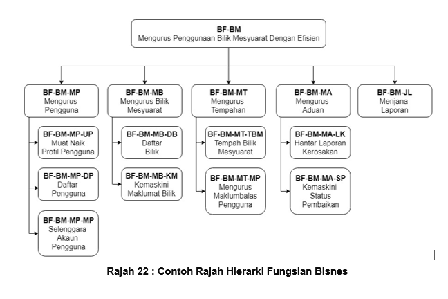

c. Kenalpasti dan susun sub fungsi yang menyokong kepada semua fungsi di tahap
   1. Berikan nama dan ID fungsi dengan menggunakan notasi yang ditetapkan.
   Proses ini diulangi bagi semua tahap dalam rajah hierarki fungsi sehingga
   fungsi asas dicapai. Rajah hierarki fungsi boleh disediakan dalam bentuk
   menegak, mendatar atau hibrid.

**Langkah 3 : Sertakan Keterangan Fungsi Bisnes**

Hierarki fungsi yang disediakan akan lebih mudah difahami jika disertakan dengan
keterangan bagi setiap fungsi tersebut berpandukan format yang telah ditetapkan
dalam notasi fungsi bisnes. Keterangan fungsi adalah penerangan ringkas mengenai
apa yang dijalankan oleh fungsi tersebut dalam menyokong fungsi di atasnya.
Keterangan bagi fungsi ini boleh disediakan bersama SME bagi memastikan
keterangan yang disediakan adalah tepat.

**Langkah Penyediaan Keterangan Fungsi**

a) Pastikan setiap fungsi yang dihasilkan telah mempunyai ID dan nama fungsi. ID
fungsi dan nama fungsi disusun dalam jadual sebagaimana contoh di bawah dan
diberi keterangan yang tepat untuk fungsi tersebut.

b) Contoh keterangan fungsi bisnes mengikut notasi yang telah ditetapkan adalah
sebagaimana berikut:

<pemegang taruh> <kata kerja> <prestasi/kekerapan> <peristiwa>

<syarat-syarat>

Contoh:

Pemegang taruh - Pentadbir

Kata kerja – meluluskan

Prestasi/kekerapan – apabila menerima

Peristiwa – permohonan penggunaan bilik

Syarat-syarat – jika terdapat kekosongan

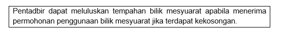

c. Senaraikan fungsi yang perlu diberikan keterangan bermula dengan sub fungsi
   yang berada di tahap 2 sehingga fungsi ke fungsi asas. Jika fungsi yang
   berada di tahap 1 merupakan fungsi asas, fungsi tersebut perlu diberikan
   keterangan fungsi.

**Jadual 11 : Contoh Keterangan Fungsi Bisnes**

**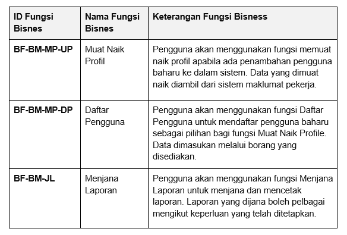**

**Langkah 4 : Kenalpasti Dan Senaraikan Pengguna Yang Terlibat**

a. Pengguna boleh dikenalpasti melalui keterangan fungsi yang telah disediakan.
   Keterangan fungsi boleh memberi gambaran yang lebih jelas mengenai peranan
   pengguna dan ianya boleh dikumpulkan dalam satu kumpulan yang sama.
b. Sebagai contoh, keterangan fungsi Mengurus Bilik Mesyuarat dan Mengurus Aduan
   menggambarkan peranan yang dilakukan oleh Pegawai Aset Jabatan. Fungsi lain
   yang akan melibatkan Pegawai Aset Jabatan boleh dikumpulkan di bawah satu
   peranan pengguna yang sama.
c. Senaraikan semua pengguna-pengguna yang telah dikenalpasti dan nyatakan
   keterangan bagi setiap pengguna tersebut. Rujuk kepada langkah 3a – perkara
   iii di dalam Penyediaan Spesifikasi Keperluan Bisnes [F1.5] untuk keterangan
   lanjut berhubung dengan kaedah untuk menghasilkan senarai pengguna tersebut.

**Langkah 5 : Semak Dan Tambah Baik Model Fungsi Bisnes**

a. Fungsi-fungsi kerja yang telah dikenal pasti dalam langkah 2 perlu disemak
   dan ditambah baik mengikut keperluan. Dalam usaha untuk melengkapkan model
   fungsi bisnes yang telah dihasilkan, pasukan pembangun perlu melibatkan SME
   bagi mendapatkan input yang lebih tepat. Pelbagai pendekatan boleh dilakukan.
   Bagi tujuan pembangunan sistem yang besar dan kompleks teknik JAD adalah
   lebih praktikal.

b.Pendekatan semakan yang sering digunakan adalah:

i. Semak dengan kitar hayat entiti bisnes/maklumat yang berkaitan.

    Gunakan dokumen proses kerja atau SOP untuk menyemak kitaran hayat entiti
    bisnes dan dibandingkan dengan model fungsian yang telah dihasilkan.
    Perhatikan bagaimana entiti-entiti digunakan dalam aktiviti-aktiviti kerja
    organisasi. Bandingkan entiti ini dengan fungsi model bisnes yang telah
    dihasilkan. Tambah baik model fungsi jika perlu.

ii. Semak dengan strategi dan peristiwa bisnes.

Senaraikan fungsi-fungsi yang bertindak balas terhadap peristiwa penting bisnes
dan gunakan senarai tersebut sebagai perbandingan dengan model fungsian yang
 telah dihasilkan.Ini adalah untuk menentukan sama ada terdapat fungsi-fungsi
 lain yang belum diambil kira dalam model fungsian.

iii. Semak dengan peranan individu

Gunakan peranan yang dimainkan oleh individu untuk dibandingkan dengan model
fungsian bagi memastikan tiada fungsi individu yang tertinggal dalam model
fungsian.

**Langkah 6 : Muktamadkan Model Fungsi Bisnes Dengan SME**

Model fungsi bisnes yang telah dihasilkan perlu dibentangkan kepada SME supaya
model tersebut diterima dan dimuktamadkan.

**Langkah 7 : Sediakan Model Fungsi Bisnes Secara Iteratif**

a. Penyediaan dan pembangunan Pemodelan Fungsi Bisnes perlu dilaksanakan secara
   iteratif bagi meningkatkan tahap komprehensif dan keperincian fungsi yang
   direkodkan.
b. Pengemaskinian perlu dilakukan berdasarkan input yang diperolehi dalam
   penyediaan Model Proses Bisnes.

**Langkah 8 : Dokumenkan Fungsi Bisnes**

a. Dokumen dan masukkan hasil Pemodelan Fungsi Bisnes (Hierarki Bisnes) dan
   Senarai Pengguna yang telah disediakan ke dalam D02 Spesifikasi Keperluan
   Bisnes.
b. Rujuk kepada Penyediaan Spesifikasi Keperluan Bisnes [F1.5] bagi
   mengenalpasti ruangan di mana maklumat-maklumat dan model tersebut perlu
   diletakkan

**Rujukan**

1. Gary, B. S. & Harry, J. R. (2012). System Analysis and Design. Ninth Edition.
   Boston: Course Technology
2. Dennis, A., Wixom, B. H., & Roth, R. M. (2012). Systems Analysis and Design.
   Fifth Edition. USA: John Wiley & Sons, Inc.
3. Wiegers, K., E. & Joy, B. (2013). Software Requirements. Third Edition.
   Washington: Microsoft Press

**2.3.6 Pemodelan Proses Bisnes [F1.4]**

**Keterangan**

Pemodelan proses bisnes merupakan teknik yang digunakan untuk membangunkan Model
Proses Bisnes. Model proses bisnes yang direpresentasi melalui Rajah Aliran
Proses (*Process Flow Diagram* (PFD)) menerangkan bagaimana gabungan
aktiviti-aktiviti yang berbeza menyokong kepada satu-satu proses bisnes. PFD
menggambarkan kompleksiti dan susunan aktiviti-aktiviti bisnes dijalankan sama
ada secara berjujukan, selari atau serentak. Setiap aktiviti yang telah
diplotkan di dalam rajah akan diperincikan di dalam jadual Definisi Aktiviti
Fungsi Bisnes.

**Objektif**

- Menghasilkan PFD *to-be* berdasarkan Fungsi Asas yang telah dikenal pasti di
  dalam Pemodelan Fungsi Bisnes[F1.3].
- Menyediakan Definisi Aktiviti Fungsi Bisnes yang memerincikan lagi keterangan
  bagi setiap aktiviti yang terkandung dalam PFD.

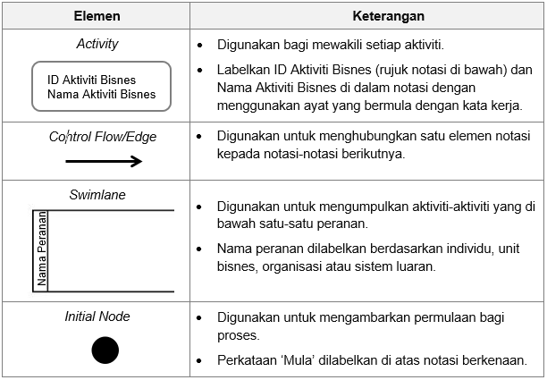

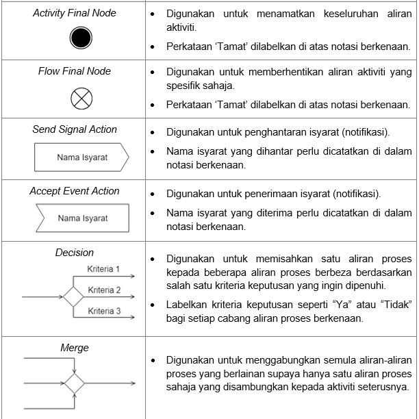

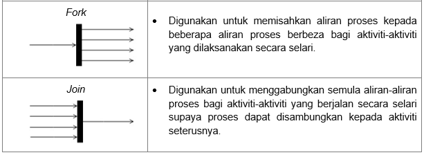

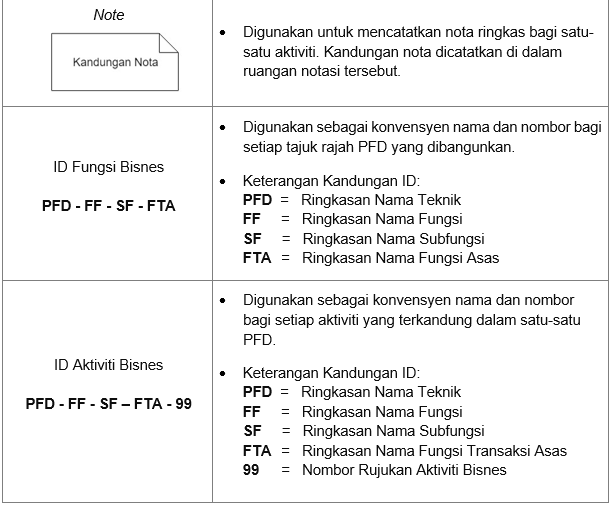

**Langkah-langkah**

**Langkah 1 : Kenal Pasti Fungsi-Fungsi Asas**

1. Berdasarkan Hirariki Fungsian Bisnes yang telah disediakan di dalam Pemodelan
   Fungsi Bisnes [F1.3], kenal pasti setiap Fungsi Asas yang terlibat.
2. Setiap Fungsi Asas yang telah dikenalpasti akan digunakan sebagai rujukan
   untuk menyediakan PFD dan juga Definisi-definisi Keperluan Bisnes yang
   berkaitan.

Pada kebiasaanya, setiap satu Fungsi Asas akan diwakili oleh satu PFD sahaja.
Namun begitu, Fungsi-fungsi Asas boleh digabungkan di dalam satu PFD sekiranya
proses yang terlibat adalah ringkas, ataupun satu-satu Fungsi Asas boleh juga
dipecahkan kepada beberapa PFD sekiranya proses terbabit adalah kompleks.

**Langkah 2 : Kenal Pasti Pengguna Yang Terlibat**

a. Rujuk kepada Senarai Pengguna yang telah disediakan pada langkah 4 di dalam
   Pemodelan Fungsi Bisnes [F1.3] dan langkah 3a – perkara iii di dalam
   Penyediaan Spesifikasi Keperluan Bisnes [F1.5].
b. Kenal pasti setiap pengguna yang terlibat dengan satu-satu PFD yang akan
   disediakan.
c. Pengguna-pengguna tersebut diwakilkan dengan menggunakan notasi *swimlane*
   yang akan dibangunkan di dalam langkah selanjutnya (langkah 3b).

**Langkah 3 : Labelkan Tajuk Dan Lukiskan *Swimlane* Bagi Pengguna Yang
Terlibat**

a. Catatkan ID Fungsi Bisnes dan Nama Fungsi Asas di sebelah atas rajah (di atas
   notasi *swimlane*) sebagai tajuk kepada PFD yang ingin dibangunkan. Rujuk
   kepada ruangan notasi di atas bagi kaedah untuk menyediakan tajuk tersebut.
b. Lukiskan *swimlane* yang mewakili setiap pengguna yang terlibat dengan proses
   dan PFD berkenaan. Notasi ini boleh dilukis sama ada secara mendatar
   (*horizontal*) ataupun secara menegak (*vertical*). Contoh penyediaan
   *swimlane* adalah seperti rajah berikut.

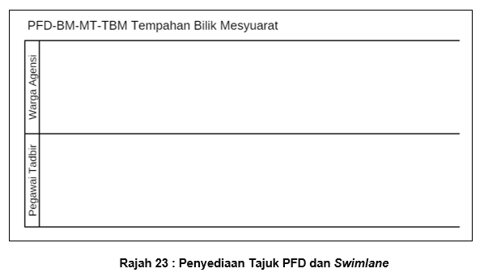

**Langkah 4 : Sediakan Aliran Proses Bisnes**

a. Mulakan setiap aliran proses dengan menggunakan notasi *Initial Node* .
b. Lukis dan plotkan aktiviti-aktiviti bisnes dengan menggunakan notasi
   *Activity*. Catatkan setiap notasi tersebut dengan ID Aktiviti Bisnes dan
   Nama Aktiviti Bisnes seperti yang telah dinyatakan di dalam ruangan notasi di
   atas. Contoh penyediaan aktiviti bisnes adalah seperti berikut:

    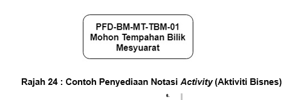

c. Lukiskan, sekiranya perlu, notasi *Send Signal Action* dan *Accept Event
   Action* bagi sebarang penghantaran dan penerimaan notifikasi. Setiap notasi
   *Send Signal Action* perlu diikuti dengan notasi *Accept Event Action* di
   mana notasi-notasi tersebut tidak boleh diplotkan secara bersendirian.
   Catatkan keterangan di dalam ruangan notasi-notasi tersebut seperti contoh
   berikut:

    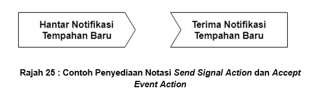

d. Aliran proses boleh dipisahkan atau digabungkan dengan menggunakan
   notasi-notasi di bawah :
 *i) Decision* Memisahkan satu aliran proses kepada beberapa aliran proses
 berbeza. Walaupun notasi ini memisahkan kepada beberapa aliran proses, hanya
 satu aliran sahaja yang akan digunakan berdasarkan kepada kriteria keputusan
 atau guard yang ingin dipenuhi. Labelkan setiap kriteria keputusan pada setiap
 aliran proses yang keluar dari notasi ini. Pastikan Nama Aktiviti Bisnes di
 dalam notasi sebelum dapat menggambarkan maksud setiap kriteria keputusan yang
 akan digunakan. Contoh penggunaan notasi Decision adalah seperti berikut:

    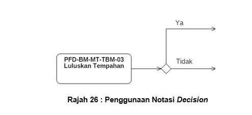

    ii) *Merge*

    Menggabungkan semula aliran-aliran proses berlainan yang terpisah akibat
    penggunaan notasi *Decision* atau *Fork.* Penggunaan notasi ini diperlukan
    supaya hanya satu aliran proses sahaja yang akan dipanjangkan kepada
    aktiviti bisnes seterusnya. Notasi ini menerima mana-mana aktiviti bisnes
    yang telah selesai dilaksanakan tanpa perlu menanti aktiviti-aktiviti lain
    yang sedang di dalam tindakan.

    iii) *Fork*

    Memisahkan aliran proses kepada beberapa aliran proses berbeza. Perbezaannya
    dengan notasi *Decision* ialah notasi ini membolehkan aliran-aliran proses
    yang berbeza dilaksanakan secara selari tanpa perlu melalui sebarang
    kriteria keputusan.

    iv) *Join*

    Menggabungkan semula aliran-aliran proses bagi aktiviti-aktiviti berbeza
    yang berjalan secara selari melalui penggunaan notasi *Fork* di aliran
    sebelumnya. Penggunaan notasi ini diperlukan supaya hanya satu aliran proses
    sahaja yang akan disambungkan kepada aktiviti bisnes seterusnya. Notasi ini
    perlu menerima dan menantikan terdahulu kesemua aktiviti bisnes yang berkait
    dengannya selesai dilaksanakan sebelum aliran proses bersambung kepada
    aktiviti bisnes berikutnya.

e. Penerangan dan catatan tambahan bagi satu-satu aktiviti diwakili dengan
   notasi *Note*.
f. Tamatkan aliran proses sama ada dengan mengunakan notasi *Activity Final
   Node* atau *Final Flow Node*. Contoh penggunaan notasi Nod-nod tersebut
   adalah seperti berikut :

    i) Notasi *Activity Final Node*
     Berdasarkan kepada contoh dalam rajah di bawah, notasi *Activity Final
     Node* digunakan untuk menamatkan keseluruhan proses sekiranya salah satu
     daripada aliran proses yang berkriteria ‘Lulus’ atau ‘Tidak Lulus’ selesai
     dilaksanakan.

    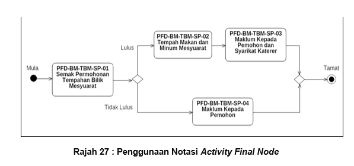

    ii) Notasi **Final Flow Node**  Berdasarkan kepada contoh dalam rajah di
    bawah, notasi *Final Flow Node* digunakan untuk menamatkan salah satu aliran
    proses sahaja berdasarkan kriteria yang telah dipenuhi. Aliran-aliran proses
    yang lain masih lagi perlu dilaksanakan sebelum proses keseluruhan
    ditamatkan.

    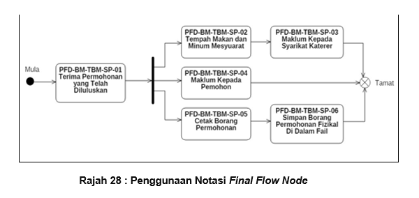

    **Langkah 5 : Sediakan Hubungan Di Antara Notasi-Notasi**

**a.** Hubungkan notasi-notasi *Initial Node, Activity, Decision, Merge, Fork,
Join, Send Signal Action*, *Accept Event Action* dan *Final Nodes* dengan
menggunakan notasi *Control Flow* ataupun nama umumnya, *Edge

* . Contoh penyediaan hubungan dengan menggunakan notasi *Control Flow/Edge* adalah seperti rajah berikut:

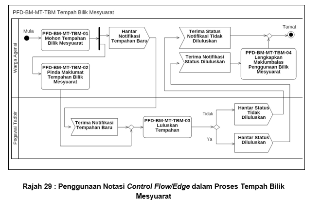

b. Bagi notasi *Note*, notasi ini dihubungkan dengan notasi-notasi lain
   menggunakan garisan putus-putus. Contoh penggunaan hubungan di antara notasi
   *Note* dengan notasi lain adalah seperti berikut:

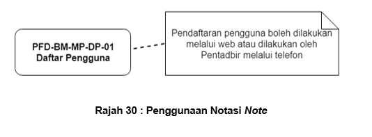

**Langkah 6 : Lengkapkan Definisi Aktiviti Fungsi Bisnes**

a. Isi dan lengkapkan jadual Definisi Aktiviti Fungsi Bisnes bagi setiap
   aktiviti di dalam Rajah Aliran Proses. Maklumat-maklumat di dalam Definisi
   Aktiviti Fungsi Bisnes bukan sahaja menerangkan berkenaan dengan keperluan
   fungsian bisnes tetapi ia juga boleh membantu dalam mengenal pasti keperluan
   bukan fungsian dan keperluan maklumat/data yang berkaitan dengan aktiviti
   bisnes berkenaan.

b. Isikan maklumat-maklumat berikut:

Jadual 13 : Keterangan Label Definisi Aktiviti Fungsi Bisnes

| **Label** | **Keterangan** |
|---|---|
| ID Fungsi Bisnes | Masukkan ID fungsi bisnes seperti yang dinyatakan dalam jadual notasi di atas. |
| Nama Fungsi Bisnes | Masukkan nama fungsi bisnes berdasarkan fungsi asas yang dipilih dari rajah Hierarki Fungsi Bisnes. |
| ID Aktiviti Bisnes | Masukkan ID aktiviti bisnes seperti yang dinyatakan dalam jadual notasi di atas. |
| Nama Aktiviti Bisnes | Masukkan nama aktiviti bisnes yang terlibat berdasarkan Rajah Aliran Proses yang telah dibangunkan. |
| Keterangan Aktiviti | Nyatakan keterangan secara ringkas aktiviti bisnes yang terlibat. |
| Aktor | Tentukan aktor yang melaksanakan aktiviti bisnes berkenaan. |
| Tanggungjawab | Nyatakan unit organisasi yang bertanggungjawab kepada aktiviti bisnes terlibat (disyorkan untuk merekodkan tahap Unit Organisasi yang terkecil seperti cawangan, unit, sektor, seksyen dan lain-lain). |
| Kekerapan | Nyatakan nilai kekerapan aktiviti bisnes tersebut dilaksanakan dalam satu-satu jangkamasa tertentu. |
| Unit Kekerapan (jam/hari/bulan) | Nyatakan unit untuk mengukur kekerapan pelaksanaan aktiviti bisnes berkenaan. Contoh, rekodkan unit kekerapan kepada setiap hari, minggu ataupun setiap bulan berdasarkan keperluan. |
| Aktiviti Bisnes Sebelum dan Selepas | Masukkan nama aktiviti bisnes yang sebelum dan selepas bersekali dengan nombor rujukan aktiviti masing-masing. |
| Kaedah Operasi | Terangkan secara terperinci bagaimana aktiviti tersebut dilaksanakan. Pengisian di dalam Kaedah Operasi boleh merangkumi keterangan berkenaan aktiviti bisnes yang terlibat, keperluan migrasi dan integrasi sistem dengan sistem luaran (entiti luar). |
| Penggunaan Maklumat | Senaraikan maklumat atau data yang digunakan untuk dipapar, disimpan, dihapus atau/dan dikemaskini (CRUD). Maklumat atau data yang disenaraikan boleh terdiri sama ada dari sistem yang ingin dibangunkan, serta maklumat atau data dari sistem luaran (entiti luar) yang diperlukan bagi proses integrasi dan migrasi. |
| Polisi dan Dasar Berkaitan | Senaraikan polisi dan dasar yang perlu dipatuhi dan berkaitan dengan aktiviti yang terlibat, contohnya seperti Surat Pekeliling Perkhidmatan, Arahan Perbendaharaan, Manual Prosedur Kerja dan *Standard Operating Procedure* (SOP). |
| Kaedah Alternatif | Nyatakan kaedah alternatif yang perlu diambil sekiranya sistem yang akan dibangunkan menghadapi isu dan masalah sementara. |
| Ciri-ciri Kualiti (Keperluan Bukan Fungsian) | Nyatakan ciri-ciri kualiti bagi aktiviti berkenaan sama ada dari segi masa pemprosesan, ketersediaan, kebolehcapaian dan keselamatan. |
| Catatan Tambahan | Isikan catatan tambahan berkenaan aktiviti bisnes yang terlibat. |

c. Rujuk Apendiks 2 Template Definisi Aktiviti Fungsi Bisnes

**Langkah 7 : Muktamadkan Model Proses Bisnes Dengan SME**

a. Rajah Aliran Proses dan Definisi Fungsi Bisnes yang telah disediakan perlu
   disemak dan disahkan oleh pihak SME. Semakan perlulah mengambil kira
   perkara-perkara seperti di bawah :

    i. Rajah Aliran Proses dan Definisi Fungsi Bisnes yang disediakan perlulah
       komprehensif, lengkap, terperinci dan memenuhi keperluan semua fungsi
       bisnes yang terlibat.
    ii. Ketepatan aliran proses dan hubungan dengan aktor
    iii. Ketepatan definisi fungsi/proses bisnes dan aktor-aktor yang terlibat

b. Pihak SME dan juga pasukan pembangunan perlu mempunyai kefahaman yang jelas
   semasa proses semakan berkenaan dengan perkara-perkara berikut :

    i. Fungsi dan aktiviti bisnes yang akan dibangunkan
    ii. Kaitan fungsi bisnes dan aktiviti yang dibangunkan

**Langkah 8 : Sediakan Model Proses Bisnes Secara Iteratif**

a. Penyediaan dan pembangunan Model Proses Bisnes perlu dilaksanakan secara
   iteratif bagi meningkatkan tahap komprehensif dan keperincian maklumat yang
   direkodkan.
b. Pengemaskinian juga perlu dilakukan kepada maklumat di dalam Pemodelan Fungsi
   Bisnes [F1.3] berdasarkan input yang diperolehi dalam penyediaan Model Proses
   Bisnes.

**Langkah 9 : Dokumenkan Proses Bisnes**

a. Dokumen dan masukkan hasil Pemodelan Proses Bisnes (Rajah Aliran Proses dan
   Definisi Fungsi Bisnes) yang telah dibangunkan ke dalam D02 Spesifikasi
   Keperluan Bisnes.
b. Rujuk kepada Penyediaan Spesifikasi Keperluan Bisnes [F1.5] bagi
   mengenalpasti ruangan di mana model tersebut perlu diletakkan.

**Rujukan**

1. Alan Dennis, Barbara Haley Wixom, David Tegarden (2012). Systems Analysis and
   Design with UML Version 2.0, Second Edition.
2. Uml-diagrams.org (2009-2017). Activity Diagrams.
   https://www.uml-diagrams.org/activity-diagrams.html.

**2.3.7 Penyediaan Spesifikasi Keperluan Bisnes [F1.5]**

**Keterangan**

Spesifikasi Keperluan Bisnes (BRS) adalah merupakan dokumen yang digunakan untuk
merekod segala keperluan bisnes *to-be* yang diperolehi daripada pemegang taruh
seperti pengguna, organisasi dan SME sebagai panduan bagi fasa-fasa pembangunan
sistem yang selanjutnya. Rujuk kepada **D02 Spesifikasi Keperluan Bisnes** untuk
melihat format dokumen yang terlibat di mana pengisian kandungan-kandungannya
adalah seperti langkah-langkah di bawah.

**Objektif**

- Menyediakan Keperluan Pengurusan Bisnes yang diperoleh daripada Penentuan
  Keperluan Bisnes [F1.2].
- Menyediakan Keperluan Pengoperasian Bisnes yang terdiri daripada Keperluan
  Fungsi Bisnes dan Keperluan Proses Bisnes hasil daripada aktiviti yang
  dilaksanakan di dalam Pemodelan Fungsi Bisnes [F1.3] dan Pemodelan Proses
  Bisnes [F1.4].

**Langkah-langkah**

**Langkah 1 : Sediakan Pengenalan Kepada Keperluan Bisnes**

Sedia dan lengkapkan pengenalan bisnes bagi perkara-perkara berikut:

a. Tujuan Bisnes

    Terangkan secara ringkas hasrat dan tujuan bisnes baru yang ingin dicapai
    oleh satu-satu organisasi melalui sistem yang akan dibangunkan.

b. Skop Bisnes

    Tentukan skop bisnes dengan mengenalpasti nama-nama dan liputan domain
    bisnes yang akan dirangkumkan di dalam sistem. Skop ini juga boleh
    ditentukan dengan mengambil kira organisasi, sama ada dalam atau luar,
    ataupun sistem-sistem lain yang terlibat secara langsung dengan domain
    bisnes yang telah ditetapkan.

c. Gambaran Keseluruhan Bisnes

    Jelaskan secara rumusan domain bisnes yang akan dirangkumkan dalam sistem.
    Terangkan struktur organisasi-organisasi utama yang berkaitan dengan domain
    bisnes berkenaan serta hubungannya di antara satu sama lain ataupun dengan
    entiti luar sekiranya berkaitan. Penggunaan rajah adalah digalakkan untuk
    menerang struktur organisasi berkenaan.

d. Senarai Pemegang Taruh

    Senaraikan pemegang-pemegang taruh yang terlibat dengan domain bisnes yang
    telah dipilih. Pemegang taruh boleh terdiri daripada seseorang individu,
    kumpulan ataupun unit organisasi. Contoh pengisian bagi senarai pemegang
    taruh adalah seperti jadual berikut:

    Jadual 14 : Contoh Senarai Pemegang Taruh

    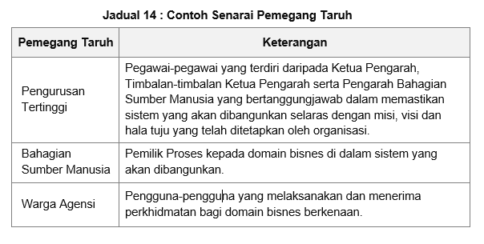

**Langkah 2 : Nyatakan Keperluan Pengurusan Bisnes**

Nyata dan sediakan perkara-perkara yang diperlukan di bawah **Keperluan
Pengurusan Bisnes** seperti berikut:

a. Objektif Bisnes
 Senarai dan terangkan matlamat dan hasil bisnes yang ingin dicapai melalui
 pelaksanaan sistem yang akan dibangunkan. Pernyataan objektif perlulah spesifik
 dan mempunyai parameter yang boleh diukur berdasarkan kepada ciri-ciri
 S.M.A.R.T. (*Smart, Measureable, Achievable, Realistic & Time-Bound*).
b. Arkitektur Bisnes

    Sertakan rajah Arkitektur Bisnes organisasi dan hubungannya dengan sistem
    aplikasi yang akan dibangunkan. Rujuk kepada langkah 5 di dalam **Penentuan
    Keperluan Bisnes [F1.2]** untuk mendapatkan penerangan lanjut berkenaan
    dengan penyediaan Arkitektur Bisnes.

c. Arkitektur Maklumat
 Sertakan rajah Arkitektur Maklumat organisasi dan hubungannya dengan sistem
 aplikasi yang akan dibangunkan. Rujuk kepada langkah 6 di dalam Penentuan
 Keperluan Bisnes [F1.2] untuk mendapatkan penerangan lanjut berkenaan dengan
 penyediaan Arkitektur Maklumat.

**Langkah 3 : Sediakan Keperluan Pengoperasian Bisnes**

Keperluan Pengoperasian Bisnes terdiri daripada perkara-perkara berikut:

a. Pemodelan Fungsi Bisnes

    i. Penggunaan Notasi

        Senaraikan notasi-notasi yang akan digunakan untuk menyediakan Model
        Fungsi. Rujuk kepada Pemodelan Fungsi Bisnes [F1.3] untuk menyediakan
        senarai notasi berkenaan.

    ii. Model Fungsi Bisnes

        Sediakan Model Fungsi Bisnes yang terdiri daripada Rajah Hierarki Fungsi
        serta keterangan bagi fungsi-fungsi berkenaan. Sila rujuk kepada
        langkah-langkah di dalam Pemodelan Fungsi Bisnes [F1.3] bagi penyediaan
        Model Fungsi Bisnes.

    iii. Senarai Pengguna

        Berbeza dengan senarai pemegang taruh pada langkah 1, senarai pengguna
        merupakan perincian yang lebih lanjut kepada individu, kumpulan atau
        unit organisasi yang terlibat secara terus dengan fungsi bisnes.
        Daripada Model Fungsi yang telah disediakan, kenal pasti dan senaraikan
        pengguna-pengguna yang terlibat serta keterangan ringkas mengenai
        peranannya di dalam fungsi bisnes berkenaan. Contoh pengisian bagi
        senarai pengguna adalah seperti jadual berikut:

b. Pemodelan Proses Bisnes

    i. Penggunaan Notasi

        Senaraikan notasi-notasi yang akan digunakan untuk menyediakan Proses
        Aliran Kerja. Sila rujuk kepada bab Pemodelan Proses Bisnes [F1.4] untuk
        menyediakan senarai notasi berkenaan.

    ii. Model Proses Bisnes

        - Aliran Proses Bisnes

        Aliran Proses Bisnes digambarkan dengan menggunakan Rajah Aliran Proses.
        Sila rujuk kepada langkah 1 sehingga 3 di dalam Pemodelan Proses Bisnes
        [F1.4] bagi penyediaan Rajah Aliran Proses.

        - Definisi Fungsi Bisnes

        Sedia dan lengkapkan Definisi Aktiviti Fungsi Bisnes bagi setiap
        aktiviti yang telah disediakan di dalam Rajah Aliran Proses. Sila rujuk
        kepada langkah 4 di dalam Pemodelan Proses Bisnes [F1.4] dan format
        templat di Apendiks 2 - Templat Definisi Aktiviti Fungsi Bisnes

**Langkah 4 : Kirakan Saiz Sistem Aplikasi**

Pengenalan kepada kepentingan pengiraan saiz sistem aplikasi telah diperjelas
dan diterangkan di dalam **1.6.5 Kepentingan Pengukuran Saiz Sistem Aplikasi**.
Manakala kaedah pengiraan saiz sistem aplikasi pula telah diterangkan di dalam
**Bab 8 Pengiraan Saiz Sistem Aplikasi.** Sehubungan dengan itu**,** laksanakan
pengiraan saiz awal sistem aplikasi berdasarkan kepada elemen-elemen yang telah
dikenalpasti di dalam BRS. Rujuk kepada bab 8 di dalam **Langkah-langkah
Pengiraan Saiz Fungsian Sistem Aplikasi di Fasa Permulaan Projek** untuk
mendapatkan penerangan terperinci berkenaan kaedah serta contoh pengiraan awal
saiz sistem aplikasi.

**Langkah 5 : Sertakan Dokumen-dokumen Sokongan Sebagai Lampiran**

Sertakan dokumen-dokumen sokongan, sekiranya ada, yang perlu dirujuk seperti
pekeliling, minit mesyuarat, borang-borang fizikal, surat-surat dan sebagainya.

**Langkah 6 : Lakukan Semakan Dan Pengesahan Ke Atas Dokumen BRS**

Dokumen BRS perlu dilakukan semakan oleh Ketua Pasukan Analisis dan Reka bentuk,
atau pegawai-pegawai yang lain yang bersesuaian. Setelah semakan dilakukan,
dokumen BRS yang telah disediakan perlu disahkan oleh Ketua SME dan Pengurus
Projek atau Pengarah Bahagian atau pegawai-pegawai yang lain yang bersesuaian.

**Rujukan**

1. ISO/IEC/IEEE 29148-2011 Systems and software engineering — Life cycle
   processes — Requirements engineering (2011)
2. Dokumen BRS Projek Sistem Bahagian Pengurusan Hartanah Versi 2 (2016)
3. Dokumen BRS Projek Sistem ePPAx (2016)
