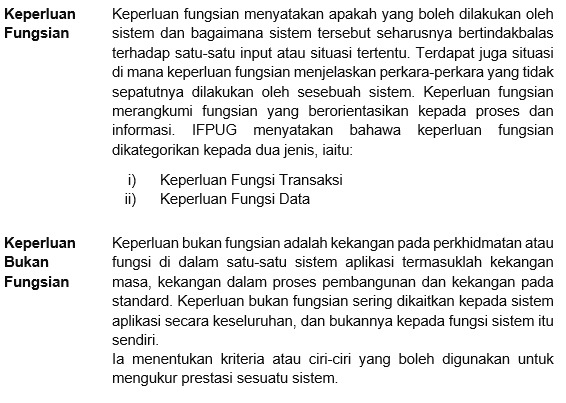

# 3.2 Pengenalan

Fasa analisis keperluan sistem merangkumi aktiviti-aktiviti analisis terhadap
keperluan bisnes yang dikenalpati dalam fasa permulaan projek dan menterjemahkan
keperluan tersebut kepada keperluan sistem bagi tujuan pembangunan sistem baru
ataupun penambahbaikan sistem sedia ada. Keperluan sistem adalah keterangan
terperinci sistem aplikasi yang akan dibangunkan dari aspek fungsian,
perkhidmatan dan kekangan operasi sistem. Dokumen keperluan sistem seharusnya
menentukan dengan tepat apakah yang perlu dibangun dan dilaksanakan serta secara
tidak langsung, ia akan dijadikan sebagai satu tanda persetujuan di antara
pemegang taruh dengan pasukan pembangunan sistem aplikasi. Keperluan sistem
aplikasi pada kebiasaannya diklasifikasikan kepada dua jenis keperluan, iaitu:

Penghasilan keperluan sistem perlu melalui kajian yang terperinci ke atas
maklumat keperluan bisnes yang telah diperolehi. Pelaksanaan kajian terperinci
ini melibatkan empat (4) aktiviti berikut:

1. Pemodelan *Use Case*
2. Pemodelan Keperluan Data
3. Pemodelan Proses Sistem
4. Penentuan Keperluan Bukan Fungsian

**Dokumen Rujukan** kepada Fasa Analisis adalah **D02 Spesifikasi Keperluan
Bisnes.**

**Dokumen Serahan**  kepada Fasa Analisis adalah **D03 Spesifikasi Keperluan
Sistem.**
