# 3.5 Pemodelan Use Case (Fungsian) [F2.1]

**Keterangan**

Pemodelan *Use Case* adalah teknik bagi mengenalpasti keperluan fungsian bagi
sesuatu sistem. Teknik ini menterjemahkan fungsi-fungsi bisnes yang terdapat
dalam Hierarki Fungsian Bisnes hasil daripada **Pemodelan Fungsi Bisnes [F1.3]**
dan aktiviti-aktiviti proses bisnes yang terdapat dalam Rajah Aliran Proses
Bisnes (PFD) daripada **Pemodelan Proses Bisnes [F1.4]**.

Hasil pemodelan *Use Case* dipersembahkan dalam bentuk Rajah *Use Case* yang
menerangkan fungsian sistem secara menyeluruh dan komprehensif. Rajah *Use Case*
menerangkan tabiat sistem iaitu bagaimana sistem berinteraksi dengan pengguna
atau sistem luaran untuk mencapai matlamat fungsi bisnes.

Pemodelan *Use Case* terdiri daripada set berikut:

a. Koleksi aktor yang berinteraksi dengan sistem;
b. Koleksi interaksi antara *Use Case* dalam sistem; dan
c. Lain-lain komponen yang menjelaskan gambarajah *Use Case*.

**Objektif**

- Mengenalpasti fungsi-fungsi sistem yang perlu dibangunkan dalam menyokong
  fungsi bisnes; dan
- Menghasilkan Rajah *Use Case* yang menerangkan bagaimana sistem berinteraksi
  dengan pengguna atau sistem yang lain untuk mencapai matlamat fungsi bisnes.

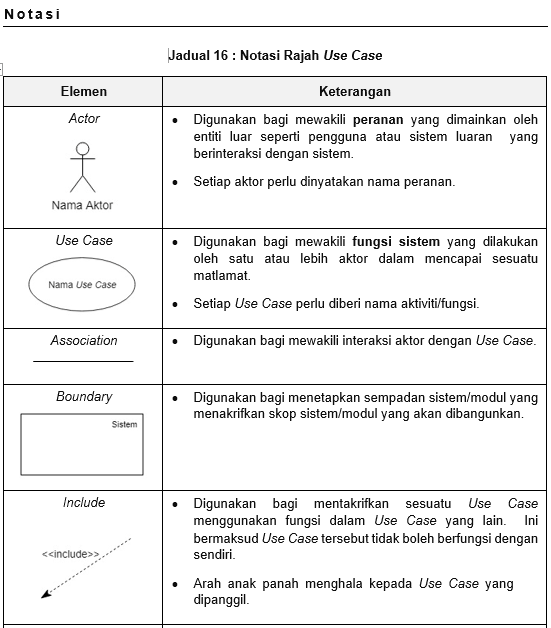

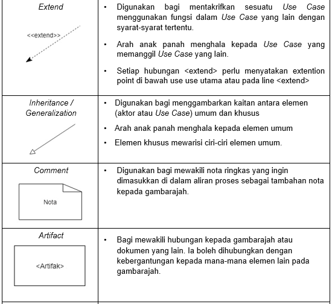

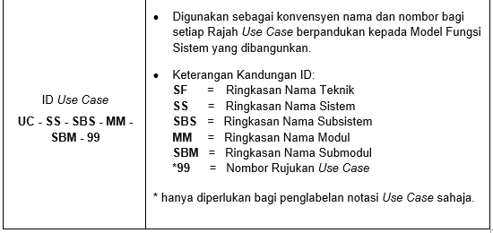

**Langkah-langkah**

**Langkah 1 : Terjemahkan Peranan (PFD) Kepada Aktor**

---

a. Pilih salah satu Rajah Aliran Proses Bisnes (PFD) yang didokumenkan dalam BRS
   yang dihasilkan dari fasa Pemodelan Proses Bisnes[F1.4].
b. Terjemahkan **Peranan** (*swimlane*) dalam PFD kepada **Aktor** dalam Rajah
   *Use Case*. Penentuan aktor sistem adalah lebih tertumpu kepada peranan
   pengguna di dalam sistem aplikasi berbanding dengan nama jawatan seseorang
   individu. **Contoh :**

    Rujuk kepada **Pemodelan Proses Bisnes [F1.4]** yang menerangkan aliran
    proses bagi Permohonan Tempahan Bilik Mesyuarat. PFD tersebut mempunyai dua
    *swimlane* iaitu Warga Agensi dan dan Pegawai Tadbir. Contoh penterjemahan
    peranan kepada aktor adalah seperti jadual berikut:

    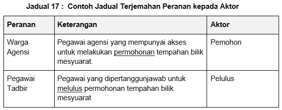

c. Lakarkan koleksi Aktor yang dikenalpasti sebagai komponen dalam Rajah *Use
   Case*. Dalam melakarkan aktor, syarat-syarat berikut perlu dipatuhi

    i. Aktor terletak di luar sempadan sistem/modul
    ii. Aktor boleh memain peranan sebagai sebagai pelaksana kepada *Use Case*
        dan juga penerima hasil daripada tindakan *Use Case* dalam berinteraksi
        dalam sistem

d. Laksanakan pengkhususan Aktor. Multi-Aktor boleh dikumpulkan (*inherit
   behaviour*) bagi menjelaskan peranan aktor dalam Rajah *Use Case*.

Contohnya:

Bagi kes pegawai yang diberi peranan untuk menyemak kekosongan, pegawai yang
diberi peranan membuat tempahan dan pegawai yang melulus tempahan. Bagi pegawai
yang diberi peranan membuat dan melulus tempahan beliau perlu berdaftar dengan
sistem.

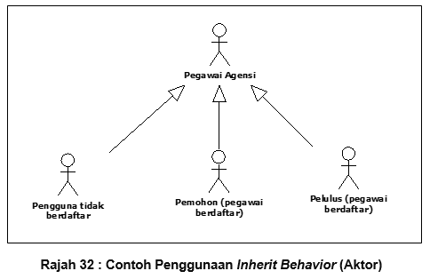

**Langkah 2 : Terjemahkan Aktiviti Kepada *Use Case***

---

1. Analisis aktviti-aktiviti yang terdapat dalam PFD yang dipilih.
2. Terjemahkan aktiviti-aktiviti tersebut kepada beberapa *Use Case* dalam Rajah
   *Use Case* yang dilakarkan. Dalam terjemahan kepada *Use Case* ianya tidak
   terikat samada satu aktiviti kepada satu *Use Case* atau beberapa
   aktiviti-aktiviti kepada satu *Use Case* atau satu aktiviti kepada beberapa
   *Use Case*. Pastikan semua aktiviti dalam PFD telah diambilkira dalam
   mengenalpati *Use Case.* Ciri-ciri yang perlu diambilkira dalam melakar *Use
   Case* adalah:

    i. *Use Case* perlulah lengkap, bermakna dan memberi hasil kepada pengguna.
    ii. Elakkan daripada penstrukturan *Use Case* dalam peringkat tinggi kerana
        ini *Use Case* sukar difahami.
    iii. *Use Case* boleh dipecahkan berdasarkan kepada kompleksiti fungsinya
         dan juga penggunaan fungsi secara berulang.
    iv. *Use Case* yang dikenalpasti perlu dilakarkan di dalam sempadan Sistem
        atau Modul.

3. Senaraikan *Use Case* yang dikenalpasti. Namakan, labelkan dan sediakan
   keterangan setiap *Use Case* seperti Jadual di bawah.

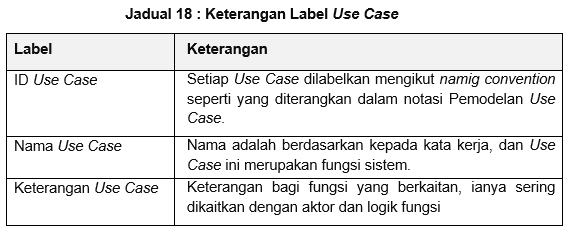

**Langkah 3 : Sediakan Hubungan-hubungan Di Antara Aktor Dengan *Use Case***

---

a. Lukiskan Aktor yang diterjemahkan dalam langkah 1 menggunakan notasi
b. Lukiskan *Use Case* yang dikenalpasti dari langkah 2 menggunakan notasi *Use
   Case* dan labelkan setiap *Use Case*.
c. Lakarkan sempadan sistem/modul merangkum semua *Use Case* yang dilukiskan
   menggunakan notasi *Boundary*. Manakala *Actor* perlu berada di luar
   sempadan.
d. Lakarkan hubungan antara Actor dan *Use Case*. Hubungan ini menunjukkan
   interaksi aktor kepada *Use Case*. Dalam hubungan ini notasi *association*
   sahaja digunakan.
e. Sediakan keterangan setiap use case yang dilakarkan.

Contoh:

Menterjemahkan Proses Tempahan Bilik Mesyuarat (PFD-BM-MT-TBM) kepada **Rajah
Use Case UC-BM-MT-TBM.** Berikut adalah Rajah Aliran Proses yang telah
dibangunkan dalam **Pemodelan Proses Bisnes[F1.4]** bagi proses PFD-BM-MT-TBM
Tempah Bilik Mesyuarat.

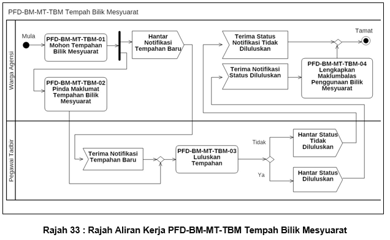

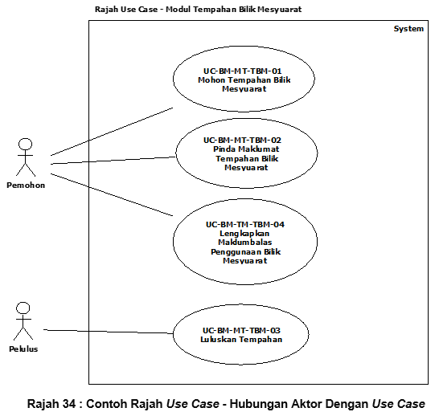

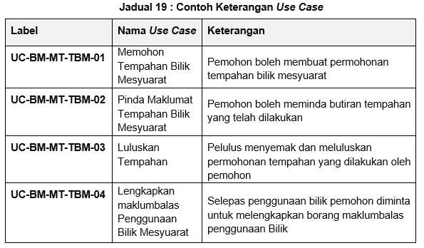

**Langkah 4 : Perincikan Hubungan Antara *Use Case***

---

a. Menganalisis Rajah *Use Case* yang dihasilkan dari langkah 3 supaya bermakna
   kepada pasukan pembangunan. Analisis dilakukan berpandukan kepada kriteria
   berikut:

    i. Adakah terdapat *Use Case* yang mempunyai hubungan urutan yang boleh
       dikongsi?.
    ii. *Use Case* yang mempunyai interaksi dengan banyak aktor perlu di
        pecahkan untuk mengelakkan *Use Case* yang terlalu banyak fungsi.
    iii. *Use Case* tidak boleh beroperasi secara tersendiri tanpa tindakan
         daripada aktor atau dihubungkan dengan *Use Case* yang lain.
    iv. *Use Case* yang tiada tindakan oleh aktor, bukan *Use Case* utama tetapi
        ianya sub *Use Case* yang akan menggambarkan urutan proses.

b. Penentuan hubungan antara *Use Case* adalah berpandukan kepada 3 jenis
   hubungan seperti berikut:

    i. Pengkhususan (Specializes) – *Use Case* boleh mewarisi *Use Case* yang
       lain. Ini bertujuan untuk mengelak kompleksiti dan definisi semula
       langkah-langkah dan penambahan proses, kita boleh laksanakan pengkhususan
       kepada *Use Case* Hubungan ini hanya untuk mengumpulkan *Use Case* yang
       berkaitan. Contoh:

        > Tempahan Bilik Mesyuarat boleh dilakukan dengan dua cara, iaitu secara online yang disediakan atau tempahan boleh dilakukan secara emel kepada Pegawai Tadbir tempahan.

        > 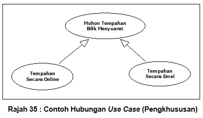

    ii. <Include> – *Use Case* yang mempunyai langkah proses disediakan oleh
        *Use Case* yang lain dipanggil <include>. Ini bermaksud *Use Case*
        tersebut tidak boleh berfungsi dengan sendiri.
    iii. Contoh:

        > *Use Case* Mohon Tempahan Bilik Mesyuarat perlu memanggil fungsi Semak kekosongan Bilik bagi melengkapkan proses.

        > 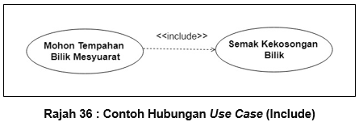

    iv. <Extend> – *Use Case* yang memberi nilai tambah kepada *Use Case* yang
        lain. Ianya digunakan bagi mentakrifkan sesuatu *Use Case* menggunakan
        fungsi dalam *Use Case* yang lain dengan syarat-syarat tertentu. Contoh:
        Fungsi Pinda Maklumat Tempahan hanya akan digunakan sekiranya pemohon
        ingin melakukan perubahan kepada maklumat tempahan yang telah dibuat
        sebelum ini berkenaan

        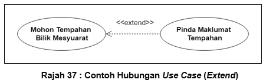

c. Lakarkan keseluruhan Rajah *Use Case* yang dihasilkan selepas tindakan yang
   telah dilakukan seperti di atas. Contoh Rajah *Use Case* yang lengkap adalah
   seperti dalam rajah di bawah.

    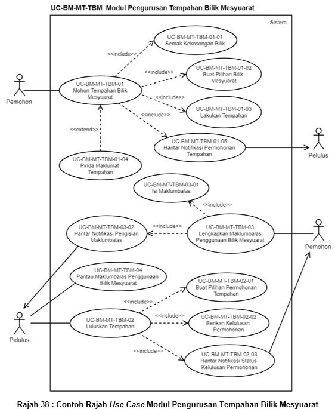

**Langkah 5 : Dapatkan Pengesahan SME**

---

a. Semak Rajah *Use Case* yang dihasilkan dengan SME. Semakan perlulah
   mengambilkira

    i. Lengkap – mengambilkira semua fungsi yang perlu
    ii. Terperinci – peringkat perincian yang dihasilkan
    iii. Hubungan antara *Use Case*
    iv. Nama dan keterangan
    v. Aktor-aktor yang terlibat

b. Rajah *Use Case* yang dihasilkan perlulah difahami oleh kedua-dua pihak iaitu
   pasukan pembangunan dan SME iaitu:

    a. Pasukan Pembangunan

Fahami fungsi sistem yang akan dibangunkan.

a. a. SME

Fahami kaitan proses bisnes dengan fungsi yang dibangunkan.

**Langkah 6 : Dokumenkan Rajah *Use Case***

---

Dokumenkan hasil Pemodelan *Use Case* (Rajah *Use Case* dan keterangan *Use
Case*) ke dalam **D03 Spesifikasi Keperluan Sistem.**

**Rujukan**

---

1. [https://www.uml-diagrams.org/use-case-subject.html](https://www.uml-diagrams.org/use-case-subject.html)
2. Alan Dennis, Barbara Haley Wixom, David Tegarden (2012). Systems Analysis and
   Design with UML Version 2.0, Second Edition.
