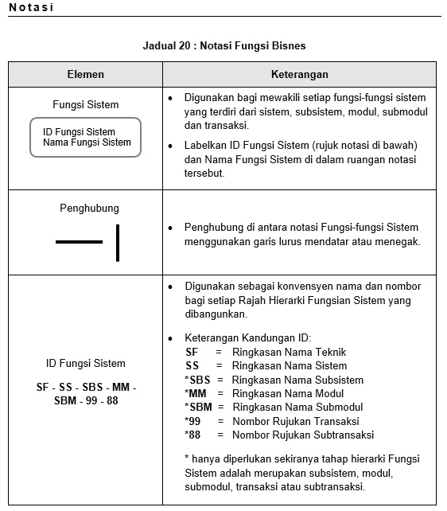
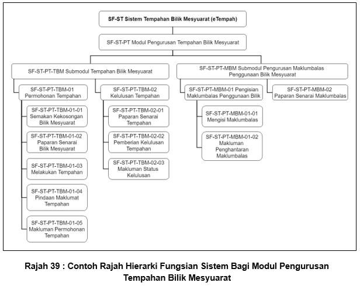
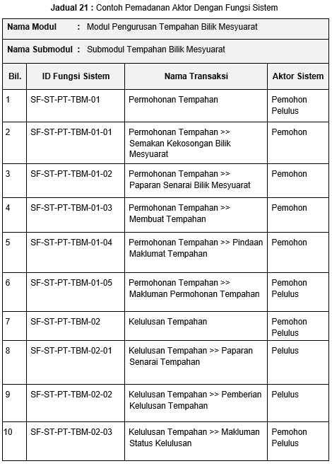

# 3.6 Pemodelan Fungsi Sistem [F2.2]

**Keterangan**

Pemodelan Fungsi Sistem adalah teknik untuk mengenal pasti dan menstruktur
fungsi-fungsi di dalam sistem yang ingin dibangunkan. Teknik ini adalah
berpandukan kepada rajah-rajah *Use Case* yang telah disediakan dalam
**Pemodelan *Use Case* [F2.1]** dan Rajah Hierarki Fungsi Bisnes di dalam
**Pemodelan Fungsi Bisnes [F1.3].**

Hasil Pemodelan Fungsi Sistem direpresentasi dalam bentuk Rajah Hierarki
Fungsian Sistem. Rajah ini memaparkan struktur sistem di mana tahap heirarkinya
bermula dari sistem itu sendiri dan diikuti oleh subsitem-subsistem,
modul-modul, submodul-submodul dan transaksi-transaksi yang berkaitan dengannya.
Rajah Hierarki Fungsian Sistem akan diiringi dengan senarai peranan-peranan
pengguna yang terlibat di bawah satu-satu transaksi sistem.

**Objektif**

- Menyediakan Rajah Hierarki Fungsian Sistem yang memaparkan struktur fungsi
  sistem yang ingin dibangunkan.
- Menyediakan Jadual Pemadanan Aktor dengan Fungsi Sistem pada tahap transaksi.

**Langkah-langkah**

**Langkah 1 : Terjermahkan Model *Use Case* Kepada Fungsi Sistem**

---

a. Fungsi-fungsi Sistem terbahagi kepada lima tahap, iaitu:

    i. Sistem
    ii. Subsistem
    iii. Modul
    iv. Submodul
    v. Transaksi

        Namun begitu, satu-satu sistem tidak semestinya perlu merangkumi
        kelima-lima tahap tersebut oleh kerana pemilihan tahap Fungsi Sistem
        adalah bergantung kepada saiz dan juga kompleksiti aplikasi yang ingin
        dibangunkan. Bagi aplikasi yang bersaiz besar dan sangat kompleks,
        struktur aplikasinya berkemungkinan memerlukan kesemua tahap Fungsi
        Sistem seperti yang dinyatakan di atas. Manakala aplikasi yang bersaiz
        kecil pula perlu sekurang-kurangnya mengandungi struktur pada tahap
        sistem, modul dan transaksi sahaja.

b. Pendekatan yang diambil untuk membangunkan Model Fungsi Sistem adalah secara
   *bottom-up* di mana ia dimulakan dengan mengenal pasti Fungsi Sistem di tahap
   transaksi dahulu.
c. Sekiranya sistem aplikasi yang hendak dibangunkan adalah besar dan kompleks,
   Model Fungsi Sistem boleh disediakan secara berasingan mengikut subsistem,
   modul atau submodul bagi tujuan kekemasan serta mengelakkan rajah hierarki
   menjadi terlalu besar dan kompleks.
d. Dengan merujuk kepada semua *Use Case* yang telah disediakan di dalam
   Pemodelan *Use Case* [F2.1], kenal pasti setiap *Use Case* yang terlibat
   khususnya *Use Case* yang berinteraksi secara terus dengan aktor-aktor.
e. Setiap *Use Case* yang berinteraksi secara terus dengan aktor akan terus
   diterjemahkan sebagai Fungsi Sistem pada tahap transaksi bagi satu-satu modul
   atau submodul. *Use Case* sebigini dikategorikan sebagai *Use Case*
f. *Use Case* yang tidak berinteraksi secara terus dengan aktor perlu juga
   dianggap sebagai salah satu komponen Fungsi Sistem pada tahap transaksi,
   tetapi kedudukan lokasinya mungkin berbeza dan berada di bawah modul atau
   submodul yang berlainan. *Use Case* sebegini berinteraksi dengan *Use Case*
   induk melalui hubungan seperti *include, extend* dan *generalization*.
   Kedudukan di mana komponen Fungsi Sistem ini diletakkan adalah bergantung
   sama ada *Use Case* sebegini adalah :

    i. Transaksi Am

Transaksi Am merupakan komponen Fungsi Sistem yang diterjemahkan dari *Use Case*
yang berhubung bukan sahaja dengan satu *Use Case* induk malah juga dengan *Use
Case* induk yang lain di dalam modul/submodul yang berbeza. Kesemua Transaksi Am
yang telah dikenalpasti akan dikumpulkan di bawah satu modul atau submodul yang
umum. Sebagai contoh, transaksi seperti Carian Pengguna dan Muat Naik Dokumen
akan diletakkan di bawah Modul atau Submodul Penyelenggaraan.

ii. Transaksi Khusus

Transaksi Khusus merupakan komponen Fungsi Sistem yang diterjemahkan dari *Use
Case* yang hanya berhubung dengan *Use Case* induk yang berkait dengannya sahaja
dalam satu-satu transaksi atau submodul yang sama. *Use Case* tersebut tidak
akan berkongsi dan berhubung dengan *Use Case* induk yang berada di bawah modul
atau submodul yang lain. Kedudukan Transaksi Khusus ini akan diletakkan di bawah
modul atau submodul yang ia terlibat.

g. Setelah satu-satu Fungsi Sistem pada tahap transaksi selesai dilakukan,
   terjemahkan pula tajuk Rajah *Use Case* kepada Fungsi Sistem pada tahap modul
   atau/dan submodul. Gunakan Rajah Hierarki Fungsi Bisnes yang disediakan di
   Pemodelan Fungsi Bisnes [F1.3] sebagai rujukan untuk menentukan struktur dan
   kedudukan satu-satu Fungsi Sistem pada tahap modul dan submodul itu berada.

h. Sekiranya sistem aplikasi yang dibangunkan adalah kompleks dan memerlukan
   kedua-dua Fungsi Sistem pada tahap modul dan juga submodul, pastikan semua
   submodul yang telah dikenalpasti adalah berkaitan dan dikumpulkan di bawah
   modul yang relevan dengannya.

i. Fungsi Sistem pada tahap subsistem hanya dikenalpasti sekiranya satu-satu
   sistem aplikasi yang dibangunkan itu adalah besar dan terdapat keperluan
   untuk sistem tersebut dipecahkan kepada sub-subsistem yang berasingan. Bagi
   kes ini, kumpulkan semua Fungsi Sistem pada tahap modul, submodul dan
   transaksi yang berkaitan dengan subsistem yang sesuai.

j. Kandungan Fungsi Sistem pada tahap sistem adalah merupakan nama sistem
   aplikasi yang telah dipersetujui dan dipilih oleh
   kementerian/jabatan/agensi/organisasi yang terbabit. Perlu diingati bahawa
   Fungsi Sistem pada tahap ini hanya boleh terdiri dari satu komponen sahaja
   bagi satu-satu sistem aplikasi.

**Langkah 2 : Sediakan Hubungan Di Antara Fungsi-fungsi Sistem**

---

a. Sebelum hubungan-hubungan dilukis, pastikan Fungsi-fungsi Sistem diletakkan
   dalam kedudukan hierarki berbentuk hibrid di mana pada kebiasaanya
   Fungsi-fungsi Sistem pada tahap sistem, subsistem dan modul ditempatkan
   secara menegak (*vertical*), manakala Fungsi Sistem pada tahap submodul dan
   transaksi pula berada dalam kedudukan mendatar (*horizontal*). Namun begitu,
   kedudukan Fungsi Sistem pada setiap tahap-tahap ini boleh berubah dan
   bergantung kepada kompleksiti dan saiz sistem aplikasi ataupun rajah hierarki
   yang ingin dibangunkan.
b. Lakarkan hubungan di antara semua Fungsi-fungsi Sistem bermula dari tahap
   sistem, subsistem, modul, submodul sehingga ke tahap transaksi.
   Hubungan-hubungan ini dilukiskan dengan menggunakan notasi Penghubung sama
   ada ia merupakan garis mendatar atau menegak. Contoh hubungan di antara
   Fungsi-fungsi Sistem bagi Modul Pengurusan Tempahan di bawah Sistem Tempahan
   Bilik Mesyuarat (eTempah) adalah seperti rajah hierarki berikut:

**Langkah 3 : Padankan Aktor Sistem Dengan Fungsi Sistem**

---

a. Rujuk kepada aktor-aktor dengan setiap *Use Case* yang berinteraksi di antara
   satu sama lain dalam Pemodelan *Use Case* (Fungsian) [F2.1] sebelum satu-satu
   pemadanan dilakukan. Pemadanan setiap aktor sistem dengan Fungsi Sistem
   dikenalpasti berdasarkan kepada hubungan semua aktor yang terlibat dengan
   satu-satu *use case*.
b. *Use Case* yang telah dikenalpasti kemudiannya diterjemahkan kepada Fungsi
   Sistem pada tahap transaksi, seperti yang telah diperjelaskan dalam Langkah
   1.
c. Aktor-aktor sistem yang telah dipadankan dengan setiap Fungsi Sistem pada
   tahap transaksi boleh dipapar sama ada dengan menggunakan jadual matriks
   ataupun jadual-jadual lain yang bersesuaian. Contoh jadual yang boleh diguna
   pakai dalam pemadanan aktor sistem dengan transaksi adalah seperti berikut:

**Langkah 4 : Kemaskini ID *Use Case***

---

Kemaskini ID *Use* Case Sementara di dalam rajah-rajah *Use Case* yang telah
dibangunkan di **Pemodelan Use Case [F2.2]** kepada ID *Use Case* seperti notasi
di atas yang berlandaskan kepada struktur ID Fungsi Sistem yang telah
disediakan.

**Langkah 5 : Muktamadkan Model Fungsi Sistem Dengan SME**

---

a. Rajah Hierarki Fungsian Sistem dan Jadual Pemadanan Aktor dengan Fungsi
   Sistem yang telah disediakan perlu disemak dan disahkan oleh pihak SME.
   Semakan perlulah mengambil kira perkara-perkara seperti di bawah :

    i. Lengkap dan terperinci
    ii. Ketepatan Fungsi Sistem dan hubungannya dengan aktor sistem

b. Pihak SME dan juga pasukan pembangunan perlu mempunyai kefahaman yang jelas
   semasa proses semakan berkenaan dengan Fungsi-fungsi Sistem terlibat
   merangkumi sistem, subsistem, modul, submodul dan transaksi yang ingin
   dibangunkan.

**Langkah 6 : Sediakan Model Fungsi Sistem Secara Iteratif**

---

Penyediaan dan pembangunan Model Fungsi Sistem perlu dilaksanakan secara
iteratif bagi meningkatkan tahap komprehensif dan keperincian rajah hierarki dan
maklumat yang direkodkan. Perubahan dan pindaan perlu dilakukan berdasar kepada
sebarang tambahan baharu kepada keperluan bisnes dan sistem.

**Langkah 7 : Dokumenkan Model Fungsi Sistem**

---

a. Dokumen dan masukkan hasil Pemodelan Fungsi Sistem (Rajah Hierarki Fungsian
   Sistem dan Jadual Pemadanan Aktor dengan Fungsi Sistem) yang telah
   dibangunkan ke dalam D03 Spesifikasi Keperluan Sistem.
b. Rujuk kepada Penyediaan Spesifikasi Keperluan Sistem [F2.6] bagi
   mengenalpasti ruangan di mana model tersebut perlu diletakkan.

**Rujukan**

---

1. Gary, B. S. & Harry, J. R. (2012). System Analysis and Design. Ninth Edition.
   Boston: Course Technology
2. Dennis, A., Wixom, B. H., & Roth, R. M. (2012). Systems Analysis and Design.
   Fifth Edition. USA: John Wiley & Sons, Inc.
3. Wiegers, K., E. & Joy, B. (2013). Software Requirements. Third Edition.
   Washington: Microsoft Press
