# 3.7 Pemodelan Keperluan Data [F2.3]

**Keterangan**

Analisis Keperluan Data ialah kaedah yang digunakan untuk memodelkan maklumat
yang diperlukan oleh sistem aplikasi. Model maklumat ini menerangkan jenis
maklumat yang diperlukan, pola capaian maklumat dan peraturan bisnes yang
menghubungkan antara maklumat-maklumat tersebut. Teknik yang digunakan bagi
perwakilan model maklumat ialah Rajah Hubungan Entiti, atau lebih dikenali
sebagai Entity Relatioship Diagram (ERD). Rajah ER yang dihasilkan merupakan
model maklumat konsepsual yang bebas daripada sebarang teknologi dan
penyelesaian teknikal. Model ini menerangkan komponen data yang terdiri daripada
entiti, atribut dan hubungan di antaranya. Bilangan entiti, atribut dan hubungan
di antaranya akan digunakan untuk membuat pengiraan saiz sistem aplikasi dari
aspek keperluan data.

**Objektif**

- Menyediakan model maklumat yang tepat berdasarkan keperluan di sesebuah
  organisasi. Model maklumat ini boleh dijadikan rangka kerja/panduan untuk
  menaiktaraf aplikasi sedia ada, atau pembangunan sistem aplikasi yang baharu
  di organisasi berkenaan.
- Menyediakan model yang tidak bersandar dengan mana-mana pelaksanaan teknikal
  dan teknologi.
- Mengumpul, mendefinisikan dan memahami elemen-elemen maklumat yang diperlukan
  dan hubungkait di antaranya.
- Mendapatkan saiz sistem aplikasi dari aspek fungsi data (*data function*).

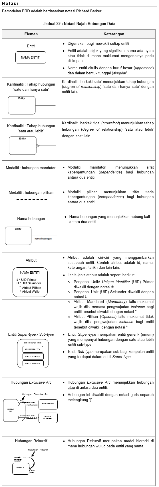

**Langkah-langkah**

**Langkah 1 : Kenalpasti Entiti, Atribut, Pola Capaian Dan Peraturan Bisnes
(*Business Rule*)**

---

a. Kenal pasti dan senaraikan calon entiti dan atribut.daripada proses pemodelan
   fungsi bisnes (rujuk Apendiks 2 Definisi Aktivii Fungsi Bisnes). Contoh
   cabutan sebahagian daripada kes bisnes:

    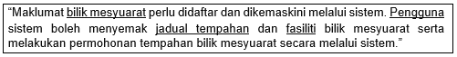

b. Perkataan yang bergaris merupakan perkataan sebagai calon entiti dan atribut
   yang boleh digunakan dalam pemodelan maklumat. Maklumat yang dikenalpasti
   diterjemahkan kepada elemen pemodelan maklumat.
c. Pola capaian merujuk kepada bagaimana operasi CRUD dilaksanakan ke atas data.
d. Perkasa asas (*fundamental)* dan penting dalam pemodelan maklumat ialah
   memahami peraturan bisnes dalam konteks sistem yang hendak dibangunkan.
   Maklumat mengenai bagaimana sesuatu sistem itu bertindak dalam situasi
   tertentu dikenali sebagai peraturan bisnes (contohnya, sekiranya pengguna
   hendak membuat tempahan aset tetapi tidak memilih sebarang aset untuk
   ditempah, maka permohonan tersebut akan terbatal).
e. Peraturan bisnes juga merujuk kepada ketetapan/syarat yang perlu dipatuhi,
   termasuklah peraturan yang ditetapkan mengikut sesuatu akta, pekeliling dan
   undang-undang yang berkuatkuasa.

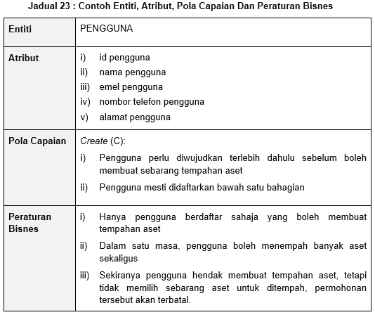

**Langkah 2 : Bina Model Maklumat**

---

a. Lukiskan setiap entiti tunggal (bukan jenis Entiti *super-type* dan
   *sub-type*) yang telah dikenalpasti. Contoh entiti adalah seperti rajah
   berikut.

    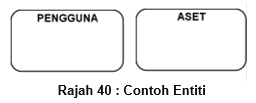

b. Senaraikan atribut yang telah dikenalpasti berpandukan peraturan-peraturan
   yang berikut.

    i. Nama entiti dalam bentuk tunggal (*singular*), manakala atribut biasanya
       ditulis dengan huruf kecil.
    ii. Simbol * diletakkan di hadapan atribut yang dipilih menjadi Atribut
        Mandatori (wajib diisi).
    iii. Simbol ° diletakkan di hadapan atribut yang dipilih menjadi Atribut
         Pilihan (tidak wajib diisi).
    iv. Simbol # diletakkan di hadapan atribut yang dipilih menjadi UID Primer
        (UID yang paling kerap digunakan).

        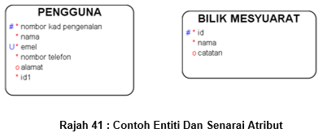

    v. Simbol U diletakkan di hadapan atribut yang dipilih menjadi UID Sekunder
       (UID selain daripada UID Primer).
    vi. Dalam satu entiti, satu atau lebih atribut boleh dijadikan Pengenal Unik
        UID.
    vii. UID/Kombinasi UID yang paling kerap digunakan akan menjadi UID Primer,
         manakala UID/Kombinasi UID yang lain akan menjadi UID Sekunder.
    viii. Maklumat yang disimpan dalam UID/Kombinasi UID mestilah unik (maklumat
          yang sama tidak boleh disimpan dua kali).

**Langkah 3 : Kenal Pasti Hubungan Antara Entiti**

---

a) Berdasarkan peraturan bisnes yang disenaraikan, kenalpasti hubungan antara
entiti-entiti tersebut dalam aspek kardinaliti dan modaliti.
b) Tentukan nama hubungan yang sesuai antara entiti-entiti tersebut. Contoh
diberikan seperti rajah dibawah.

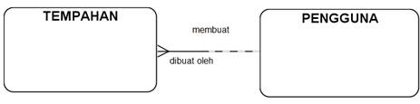

**Rajah 42 : Contoh Nama Hubungan Entiti**

Jika dibaca dari kiri ke kanan:

i) Kardinaliti hubungan menunjukkan setiap TEMPAHAN dibuat oleh satu, dan hanya
satu PENGGUNA. Ini bermaksud pada satu-satu tarikh dan masa tertentu, tempahan
aset hanya boleh dibuat oleh seorang pengguna sahaja.

ii) Dari segi modaliti, hubungan adalah mandatori (mesti) iaitu rekod TEMPAHAN
tidak boleh diwujudkan tanpa wujudnya rekod PENGGUNA.

iii) Bacaan adalah ‘setiap TEMPAHAN mesti dibuat oleh satu, dan hanya satu
PENGGUNA’.

Jika dibaca dari kanan ke kiri:

i) Kardinaliti hubungan menunjukkan setiap PENGGUNA membuat satu atau lebih
TEMPAHAN.
ii) Dari segi modaliti, hubungan adalah pilihan. Ini bermaksud rekod pengguna
boleh wujud tanpa membuat sebarang tempahan bilik mesyuarat, dan beberapa
tempahan bilik mesyuarat boleh dibuat oleh pengguna.
iii) Bacaan adalah ‘setiap PENGGUNA mungkin membuat satu atau lebih TEMPAHAN’.

c) Lengkapkan ERD dengan melukis hubungan di antara dua entiti, dan pastikan
setiap hubungan dilengkapi dengan tiga perkara asas berikut iaitu nama hubungan
(ditulis dalam huruf kecil), kardinaliti dan modaliti.
Contoh ERD yang dihasilkan adalah seperti yang di bawah.

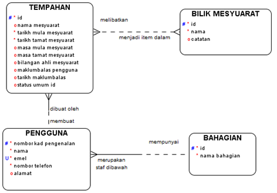

**Rajah 43 : Contoh Rajah Hubungan Entiti (ERD)**

**Langkah 4 : Perkemaskan Model Maklumat**

---

a) Setelah model maklumat siap dilukis, semak sekali lagi model ini dengan
maklumat yang terdapat dalam proses pemodelan fungsi bisnes (rujuk Apendiks 2
Definisi Aktiviti Fungsi Bisnes dan Apendiks 5 Definisi Aliran Data) bagi
memastikan semua maklumat yang diperlukan tidak tercicir. Lengkapkan ERD
tersebut dengan menambah entiti-entiti yang baru (jika ada).
b) Perkemaskan lagi ERD tersebut dengan menggunakan teknik-teknik di bawah
sekiranya perlu:

i) Wujudkan Intersection Entity bagi menyelesaikan hubungan banyak-ke-banyak
(many-to-many) di antara dua entiti. Contoh adalah seperti rajah dibawah.

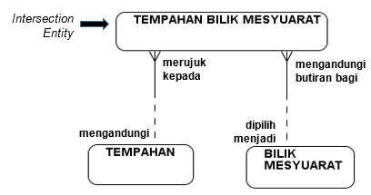

**Rajah 44 : Contoh Intersection Entity**

Contoh ERD yang telah diperkemas dengan mewujudkan Intersection Entity ‘TEMPAHAN
BILIK MESYUARAT’ bagi menyelesaikan hubungan banyak-ke-banyak (many-to-many)
adalah seperti berikut.

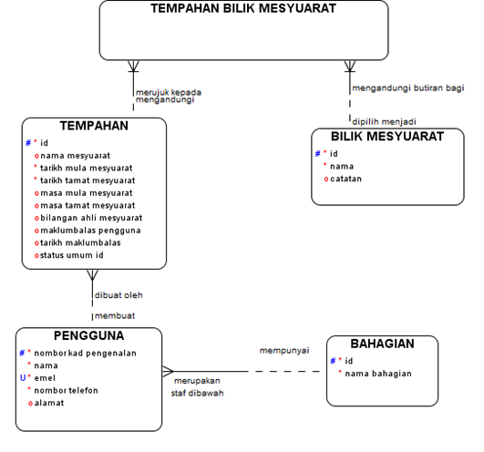

**Rajah 45 : Contoh Hubungan Entiti (ERD) – Intersection Entity**

ii) Wujudkan Entiti Super-type dan Sub-type jika terdapat entiti dalam kumpulan
yang sama. Lukis juga hubungan di antara Entiti Super-type dan Sub-type ini
kepada entiti yang lain. Hubungan dengan entiti lain boleh sama ada kepada
Entiti Super-type atau Sub-type.

Contoh hubungan entiti lain kepada Entiti Super-type atau Sub-type adalah
seperti rajah dibawah.

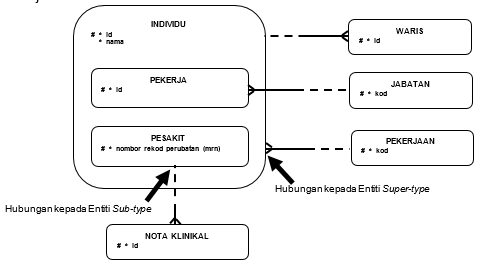

**Rajah 46 : Contoh Hubungan Entiti Lain Kepada Entiti Super-type**

• Hubungan dengan entiti lain boleh sama ada kepada Entiti Super-type atau
Sub-type.
• Entiti ini dibaca seperti berikut:

o Setiap INDIVIDU mestilah sama ada dalam kategori PEKERJA, PESAKIT atau
KONTRAKTOR.
o PESAKIT merupakan seseorang INDIVIDU

iii) Wujudkan Hubungan Exclusive Arc. Hubungan Exclusive Arc menunjukkan
hubungan atau di antara dua entiti. Hubungan ini diwakili dengan notasi garis
separuh melengkung ‘)’.

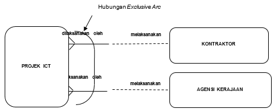

**Rajah 47 : Contoh Hubungan Exclusive Arc**

Cara pembacaan adalah:
Setiap PROJEK ICT mesti dilaksanakan oleh satu, dan hanya satu KONTRAKTOR atau
dilaksanakan oleh satu, dan hanya satu AGENSI KERAJAAN

iv) Wujudkan Hubungan Rekursif. Hubungan Rekursif merupakan model hierarki di
mana hubungan wujud pada entiti yang sama. Contohnya adalah seperti carta
organisasi seperti di bawah:

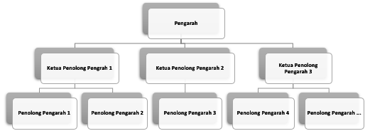

**Rajah 48 : Contoh Carta Organisasi**

Dalam model maklumat, hubungan yang wujud pada entity yang sama digambarkan
seperti rajah dibawah.

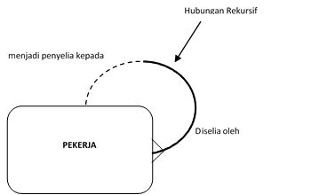

**Rajah 49 : Contoh Hubungan Rekursif**

Cara pembacaan adalah:
o Setiap PEKERJA mungkin menjadi penyelia kepada satu atau lebih PEKERJA
o Setiap PEKERJA mesti diselia oleh satu, dan hanya satu PEKERJA

**Langkah 5 : Merekod Definisi Kamus Data**

---

Penerangan terperinci mengenai ERD perlu dijelaskan dalam definisi kamus data.
Sila rujuk Apendiks 3 Definisi Kamus Data. Definisi Kamus Data adalah untuk
sistem yang dimodelkan perlu terdiri daripada definisi entiti dan definisi
atribut.

**Langkah 6 : Muktamadkan Model Maklumat Dengan SME**

---

Bergantung kepada saiz dan kompleksiti projek, aktiviti ini mungkin memerlukan
satu sesi bengkel dengan pengguna atau SME untuk memuktamadkan model maklumat
tersebut.

**Langkah 7 : Pengiraan Saiz Fungsi Data (Data Function)**

---

Berpandukan elemen-elemen dan peraturan-peraturan hubungan yang telah
dikenalpasti dalam modelan maklumat, pengiraan saiz sistem dari aspek keperluan
Fungsi Data dapat dikira. Kaedah pengiraan ini boleh dirujuk dalam Bab 8
Pengiraan Saiz Sistem Aplikasi.

**Langkah 8 : Dokumenkan Model Maklumat Konsepsual**

---

Dokumenkan semua output yang dihasilkan sebagai hasil serahan proses analisis
keperluan data ke dalam **D03 Spesifikasi Keperluan Sistem**. Dokumentasikan
mengikut susunan seperti berikut:

a) Rajah Hubungan Entiti (ERD)
b) Definisi Kamus Data (Entiti dan Atribut)

**Rujukan**

---

1. Richard Barker; CASE*Method: Entity Relationship Modeling (1990)
2. Graeme C. Simsion and Graham C. Witt; Data Modeling Essentials (2005)
