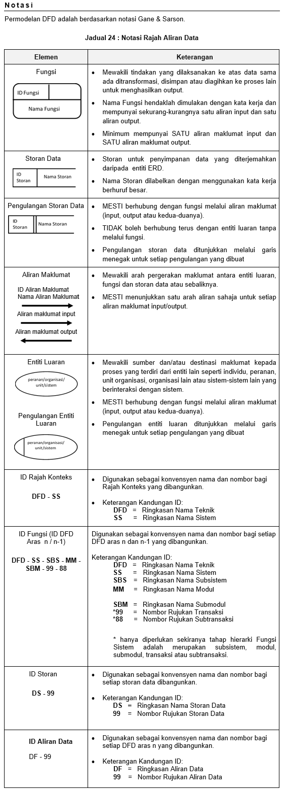
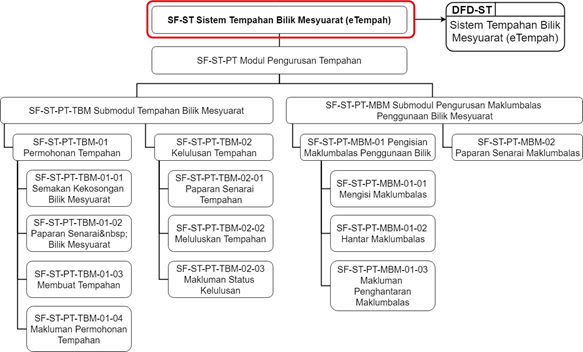
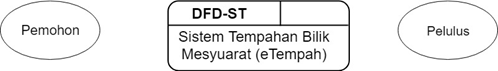
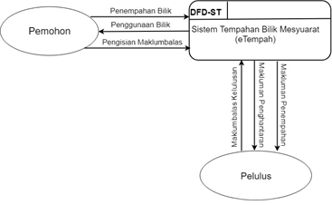
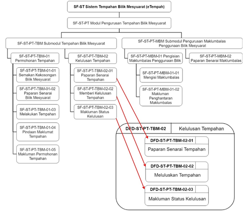
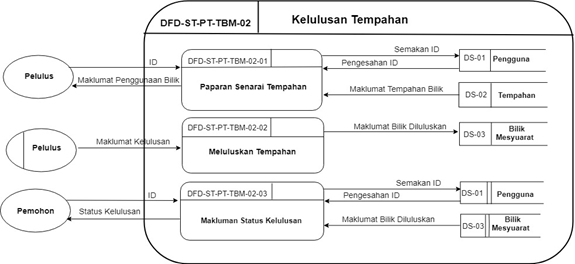
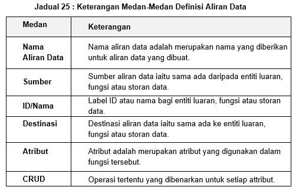

# 3.8 Pemodelan Proses Sistem [F2.4]

**Keterangan**

Permodelan Proses Sistem bertujuan untuk menyusun atur dan mendokumentasikan
struktur dan aliran data antara proses logikal. Teknik pemodelan proses yang
digunakan dalam metodologi ini adalah Data Flow Diagram (DFD). DFD menerangkan
pergerakan, pertukaran atau transformasi data antara fungsi-fungsi bisnes.
Terdapat dua peringkat DFD yang biasa digunakan iatu:

a) Rajah Konteks (Aras Tinggi) : menunjukkan skop sistem dan interaksi dengan
subsistem.
b) DFD Aras n: menunjukkan kebergantungan fungsi-fungsi sistem

**Objektif**
o Menghasilkan model proses sistem yang menerangkan pemprosesan yang akan
dilaksanakan oleh sistem
o Mengenal pasti sumber data dan destinasi maklumat yang diperlukan oleh proses
o Menetapkan sempadan proses dan sistem yang dibangunkan

**Langkah-langkah**
**Langkah 1 : Sediakan Rajah Konteks**

---

Langkah pertama dalam pemodelan proses sistem ialah penyediaan Rajah Konteks
yang merupakan gambaran secara kasar bagi keseluruhan skop sistem. Terdapat 3
perkara utama dalam sesebuah rajah konteks:
a) Kesemua entiti luaran yang terlibat
b) Fungsi yang mewakili keseluruhan skop sistem
c) Aliran maklumat input/output antara entiti luaran dan fungsi

Langkah-langkah untuk menyediakan Rajah Konteks adalah seperti berikut:
a) Ambil fungsi aras paling atas daripada rajah hierarki fungsi sistem yang
dihasilkan dari Pemodelan Fungsi Sistem [F2.2] dan lukiskan notasi fungsi
sebagai mewakili sistem aplikasi yang hendak dibangunkan.

b) Labelkan id fungsi serta nama fungsi dalam notasi fungsi berkenaan. Contoh
pemetaan daripada rajah hierarki fungsi sistem bagi melukis notasi fungsi adalah
seperti ditunjukkan dalam rajah di bawah.

**Rajah 50 : Contoh Pemetaan Hierarki Fungsi Sistem kepada Notasi Fungsi**

c) Terjemahkan ‘aktor’ daripada jadual Pemadanan Aktor dengan Fungsi Sistem,
rujuk Pemodelan Fungsi Sistem [F2.2] kepada notasi entiti luaran. Contoh seperti
Rajah di bawah

**Rajah 51 : Contoh Lakaran Fungsi dan Entiti Luaran**

d) Hubungkan antara entiti luaran dan fungsi melalui penggunaan notasi aliran
maklumat. Hubungan di antara entiti luaran dan fungsi serta input dan output
yang terlibat boleh dianalisis daripada keterangan di dalam Definisi Fungsi
Bisnes yang dihasilkan melalui Pemodelan Proses Bisnes [F1.4]. Contoh Rajah
Konteks DFD yang dihasilkan adalah seperti rajah di bawah.

**Rajah 52 : Contoh Rajah Konteks DFD**

**Langkah 2 : Menyediakan DFD Aras n**

---

a) Pemetaan hierarki fungsi sistem yang dihasilkan dari Pemodelan Fungsi Sistem
[F2.2] kepada notasi fungsi DFD dilakukan dengan memilih fungsi transaksi
seperti yang ditunjukkan dalam rajah di bawah.

**Rajah 53 : Contoh Pemetaan Hierarki Fungsi Sistem kepada Notasi Fungsi DFD**

b) Tentukan juga storan data yang terlibat berdasarkan ERD dalam Pemodelan
Keperluan Data [F2.3].

i) Lukiskan storan data yang telah dikenal pasti dan labelkan setiap storan
tersebut seperti yang telah dinyatakan dalam notasi di atas.
ii) Mana-mana storan data yang diselenggara sepenuhnya serta digunakan dalam
fungsi, mesti dilukis dalam rangka. Manakala data storan yang lain dilukis di
luar rangka.
iii) Sekiranya perlu, ulang melukis entiti luaran dan storan data bagi
mengelakkan banyak aliran data yang bersilang.

c) Hubungkan entiti luaran dan storan data ke fungsi dengan menggunakan aliran
maklumat bagi menunjukkan pergerakan maklumat yang berlaku antaranya. Labelkan
setiap aliran maklumat tersebut seperti dalam di bawah:

**Rajah 54 : Contoh Data Flow Diagram (DFD)**

Ulang langkah-langkah di atas untuk fungsi transaksi yang lain termasuk fungsi
sistem pada tahap transaksi yang umum sekiranya perlu.

**Langkah 3: Dokumenkan Definisi DFD**

---

a) Penuhi templat Definisi Aliran Data dengan mengisi maklumat berikut. Sila
rujuk templat di Apendiks 5 Definisi Aliran Data.

b) Pengemaskinian juga perlu dilakukan kepada maklumat di dalam **Pemodelan
Fungsi Sistem [F2.2]** berdasarkan input yang diperolehi dalam penyediaan DFD.

**Langkah 4: Memuktamadkan Model DFD Dengan SME**

---

Semak DFD yang dihasilkan dengan SME DFD yang dihasilkan perlulah difahami oleh
kedua-dua pihak iaitu pasukan pembangunan dan SME.

**Langkah 5 : Dokumenkan DFD**

---

Dokumenkan semua output yang dihasilkan sebagai hasil serahan analisis proses
sistem ke dalam D03 Spesifikasi Keperluan Sistem. Dokumentasikan mengikut
susunan berikut:

a) DFD Model - Data Flow Diagram
b) Definisi DFD

**Rujukan**

---

1. Joseph S.Valacich, Joey F. George, Jeffrey A. Hoffer; Essentials of Systems
   Analysis & Design (2012).
2. Arthur M.Langer; Analysis and design of Information Systems (2008)
3. Oracle, System Modelling Techniques (1992)
