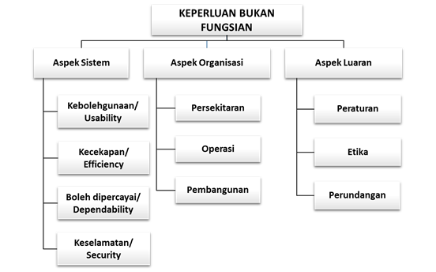
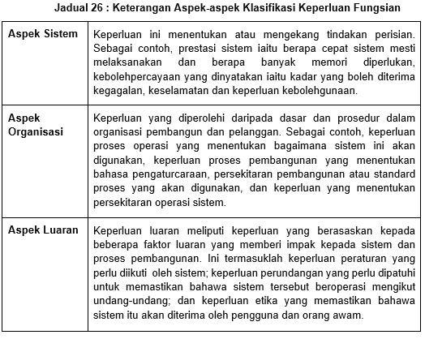
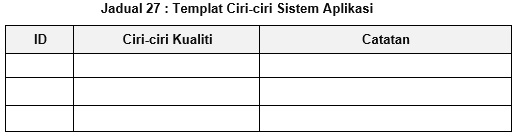
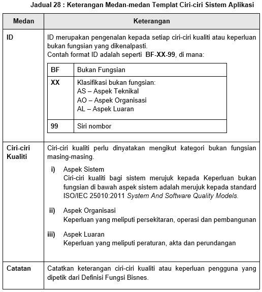
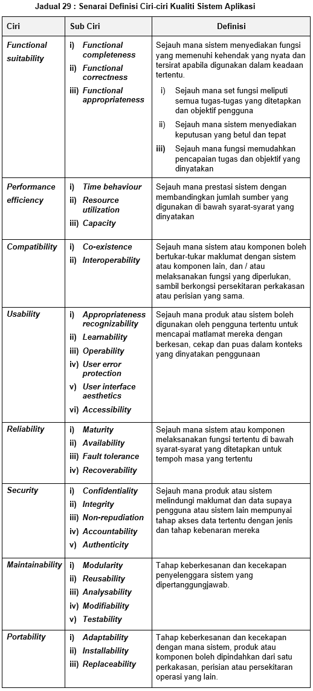

# 3.9 Penentuan Keperluan Bukan Fungsian [F2.5]

**Keterangan**
Keperluan bukan fungsian, adalah keperluan yang tidak berkenaan secara langsung
dengan servis atau fungsi yang tawarkan oleh sistem untuk penggunanya. Ianya
mungkin berkaitan dengan ciri-ciri sistem seperti kebolehpercayaan, prestasi,
keselamatan dan ketersediaan.
Kegagalan memenuhi keperluan bukan fungsian boleh membawa kepada sistem tidak
boleh digunakan. Sebagai contoh, jika sistem kawalan tidak memenuhi keperluan
kebolehpercayaan, ia tidak akan disahkan selamat untuk operasi.

Oleh itu cabaran yang paling penting yang dihadapi dalam kejuruteraan sistem
aplikasi adalah keyakinan dan kepercayaan bahawa sistem aplikasi yang
dibangunkan sentiasa tersedia apabila dilaksanakan sepertimana yang diharapkan.
Ini bermakna, isu-isu kewibawaan sistem aplikasi dan keselamatan data sistem
adalah sangat penting di samping fungsi sistem yang dibangunkan.

**Objektif**
o Memahami kepentingan keperluan bukan fungsian.
o Memahami bagaimana ciri-ciri keperluan bukan fungsian diperlukan untuk
menyokong pelaksanaan keperluan fungsian

**Langkah-langkah**

**Langkah 1 : Analisis Spesifikasi Keperluan Bisnes**

---

a) Sumber maklumat keperluan bukan fungsian sistem adalah daripada dokumen
Definisi Fungsi Bisnes yang telah didokumenkan dalan BRS semasa aktiviti
Pemodelan Proses Bisnes. Butiran keperluan bukan bisnes selalunya dicatat dalam
ruangan nota
b) Senaraikan keperluan bukan fungsian yang dikenalpasti. Contoh catatan
keperluan bukan fungsian adalah seperti berikut:

i) Sistem perlulah mudah dan senang digunakan.
ii) Sistem boleh berfungsi pada mana-mana perkakasan dan perisian.
iii) Masa tindak balas sistem adalah 2 saat bagi setiap transaksi.
iv) Mudah dipindah dan diselenggara.
v) Sistem perlu mempunyai tahap ketersediaan yang tinggi bagi menyokong operasi
harian.

**Langkah 2 : Terjemahkan Keperluan Bukan Fungsian Kepada Ciri-ciri Kualiti**

---

a) Keperluan bukan fungsian seringkali ditimbulkan kerana kekangan peruntukan,
polisi organisasi, keperluan untuk beroperasi dengan lain-lain perisian atau
perkakasan, atau faktor luaran seperti peraturan keselamatan atau perundangan
privasi. Merujuk kepada buku Software Engineering 9th edition, penulis Ian
Sommerville telah mengklasifikasikan keperluan bukan fungsian kemungkinan
diperolehi dari ciri-ciri sistem yang diperlukan, organisasi yang membangun
sistem berkenaan ataupun dari sumber luaran. Klasifikasi keperluan bukan
fungsian yang dimaksudkan adalah terbahagi kepada tiga (3) aspek seperti rajah
di bawah.

**Rajah 55 : Klasifikasi Keperluan Bukan Fungsian**

b) Penerangan lanjut bagi aspek-aspek klasifikasi keperluan fungsian adalah
seperti berikut:

**Langkah 3 : Lengkapkan Ciri-ciri Kualiti Sistem Aplikasi**

---

a) Lengkapkan templat Ciri-ciri Sistem Aplikasi mengikut kategori bukan fungsian
seperti jadual berikut:

b) Penerangan berkenaan medan-medan di dalam Templat Ciri-ciri Sistem Aplikasi
adalah seperti berikut:

c) ISO/IEC 25010:2011 System And Software Quality Models menyenaraikan definisi
ciri-ciri kualiti sistem aplikasi seperti berikut:

**Langkah 4 : Dokumenkan Keperluan Bukan Fungsian**

---

Dokumenkan hasil analisis bukan fungsian ke dalam D03 Spesifikasi Keperluan
Sistem di bawah seksyen keperluan bukan fungsian

**Rujukan**

---

1. Ian Sommerville, Software Engineering 9th edition
2. ISO/IEC 25010:2011 System And Software Quality Models
