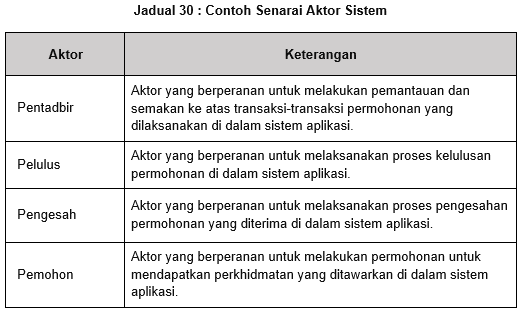

# 3.10 Penyediaan Spesifikasi Keperluan Sistem [F2.6]

**Keterangan**
Spesifikasi Keperluan Perisian (SRS) adalah penerangan terperinci berkenaan
sistem aplikasi yang akan dibangunkan merangkumi keperluan fungsian dan bukan
fungsian. Dokumen SRS menjelaskan secara menyeluruh keupayaan yang diperlukan
oleh satu-satu sistem aplikasi serta merekodkan syarat-syarat (conditions) dan
kekangan (constraints) bagi sistem aplikasi berkenaan. Rujuk kepada D03
Spesifikasi Keperluan Sistem untuk melihat format dokumen SRS di mana pengisian
kandungan-kandungannya adalah seperti langkah-langkah di bawah.

**Objektif**
o Menyediakan Model Fungsi Sistem hasil daripada langkah-langkah yang
dilaksanakan di dalam Pemodelan Fungsi Sistem [F2.2].
o Menyediakan Model Maklumat, Definisi Entiti dan Definisi Atribut dengan
merujuk kepada langkah-langkah di bawah Pemodelan Keperluan Data [F2.3].
o Menyediakan Model dan Definisi Proses Sistem dengan merujuk kepada
langkah-langkah di bawah Pemodelan Proses Sistem [F2.4].
o Menyertakan maklumat yang telah dikenal pasti di dalam Penentuan Keperluan
Bukan Fungsian [F2.5].
o Membangunkan dokumen D03 Spesifikasi Keperluan Sistem yang mengandungi
model-model seperti di atas serta elemen-elemen lain yang berkaitan.

| Bil. | Nama Dokumen | Muat Turun |
|---|---|---|
| 1. | D03 - Contoh Penyelesaian Dokumen Spesifikasi Keperluan Sistem |  |

**Langkah-langkah**

**Langkah 1 : Sediakan Pengenalan Kepada Keperluan Sistem**

---

Sila sedia dan lengkapkan pengenalan bisnes bagi perkara-perkara berikut:

a) **Tujuan Sistem**
Terangkan tujuan, objektif dan matlamat sistem aplikasi ini dibangunkan selaras
dengan objektif bisnes yang ingin dicapai.

b) **Skop Sistem**
Jelaskan skop sistem aplikasi berdasarkan skop keperluan bisnes yang telah
diperolehi di dalam D02 Spesifikasi Keperluan Bisnes. Skop sistem merangkumi
penerangan secara ringkas berkenaan sistem aplikasi yang ingin dibangunkan serta
komponen-komponen sistem yang berkaitan dengannya.

c) **Senarai Aktor Sistem**
Senarai aktor-aktor sistem yang terlibat serta keterangan fungsinya di dalam
sistem aplikasi yang akan dibangunkan. Berbeza dengan senarai pemegang taruh dan
pengguna di dalam Penyediaan Spesifikasi Keperluan Bisnes [F1.5], penentuan
aktor sistem adalah lebih tertumpu kepada peranan pengguna di dalam sistem
aplikasi berbanding dengan nama jawatan seseorang individu ataupun nama unit
organisasi yang terlibat. Contoh pengisian bagi senarai aktor sistem adalah
seperti jadual berikut:

**Langkah 2 : Dokumenkan Model Fungsi Sistem**

---

**Pemodelan Fungsi Sistem**

a) **Penggunaan Notasi**
Senaraikan notasi-notasi yang akan digunakan untuk menyediakan Model Fungsi
Sistem. Rujuk kepada Pemodelan Fungsi Sistem [F2.2] untuk menyediakan senarai
notasi berkenaan.

b) **Rajah Hierarki Fungsian Sistem**
Sediakan Rajah Hierarki Fungsian Sistem yang terdiri dari komponen-komponen
Fungsi Sistem pada tahap sistem, subsistem, modul, submodul dan transaksi. Sila
rujuk kepada langkah-langkah di dalam Pemodelan Fungsi Sistem [F2.2] bagi
penyediaan rajah serta jadual berkenaan.

c) **Jadual Pemadanan Aktor Dengan Fungsi Sistem**
Sediakan Jadual Pemadanan Aktor dengan Fungsi Sistem pada tahap transaksi. Rujuk
kepada langkah 3 di dalam Pemodelan Fungsi Sistem [F2.2] bagi penyediaan rajah
serta jadual berkenaan.

**Langkah 3 : Dokumenkan Model Use Case**

---

**Pemodelan Use Case**
a) **Penggunaan Notasi**
Senaraikan notasi-notasi yang akan digunakan untuk menyediakan Model Use Case.
Sila rujuk kepada Pemodelan Use Case [F2.1] untuk menyediakan senarai notasi
berkenaan.

b) **Model Use Case**
Sediakan Model Use Case yang terdiri daripada Rajah Use Case serta keterangan
bagi Use Case yang terlibat. Sila rujuk kepada langkah-langkah di dalam
**Pemodelan Use Case [F2.1]** bagi penyediaan rajah dan keterangan berkenaan.

**Langkah 4 : Dokumenkan Model Dan Definisi Maklumat**

---

**Pemodelan Maklumat**

a) **Penggunaan Notasi**
Senaraikan notasi-notasi yang akan digunakan untuk menyediakan Model Maklumat.
Sila rujuk kepada Pemodelan Keperluan Data [2.3] untuk menyediakan senarai
notasi berkenaan.

b) **Model Maklumat**
Sediakan Model Maklumat yang terdiri daripada Rajah Hubungan Entiti. Sila rujuk
kepada langkah 1 sehingga 3 di dalam Pemodelan Keperluan Data [2.3] bagi
penyediaan rajah berkenaan.

c) **Definisi Kamus Data**
Sedia dan lengkapkan Definisi Kamus Data bagi setiap entiti dan atribut yang
telah disediakan di dalam Rajah Hubungan Entiti. Sila rujuk kepada
langkah-langkah di dalam Pemodelan Keperluan Data [2.3] dan format templat di
Apendiks 3 Templat Definisi Kamus Data.

**Langkah 5 : Dokumenkan Model Dan Definisi Proses Sistem**

---

**Pemodelan Proses Sistem**

a) **Penggunaan Notasi**
Senaraikan notasi-notasi yang akan digunakan untuk menyediakan Model Proses
Sistem. Sila rujuk kepada Pemodelan Proses Sistem [F2.4] untuk menyediakan
senarai notasi berkenaan.

b) **Model Proses Sistem**
Sediakan Model Maklumat yang terdiri daripada Rajah Konteks dan Rajah Aliran
Data. Sila rujuk kepada langkah 1 sehingga 3 di dalam Pemodelan Proses Sistem
[F2.4] bagi penyediaan rajah-rajah berkenaan.

c) **Definisi Aliran Data**
Sedia dan lengkapkan Definisi Aliran Data berdasarkan kepada Rajah Konteks dan
Rajah Aliran Data yang telah dibangunkan. Sila rujuk kepada langkah-langkah di
dalam Pemodelan Proses Sistem [F2.4] dan format templat di Apendiks 5 Definisi
Aliran Data.

**Langkah 6 : Rekodkan Maklumat Keperluan Bukan Fungsian**

---

Maklumat Keperluan Bukan Fungsian yang perlu direkodkan perlu mengambil kira
aspek-aspek seperti berikut:

a) Aspek Sistem
b) Aspek Organisasi
c) Aspek Luaran

Lengkap dan sertakan jadual yang mengandungi maklumat keperluan bukan fungsian
seperti yang diterangkan di dalam **Penentuan Keperluan Bukan Fungsian [F2.4].**

**Langkah 7 : Kirakan Saiz Sistem Aplikasi**

---

Pengenalan kepada kepentingan pengiraan saiz sistem aplikasi telah diperjelas
dan diterangkan di dalam **1.6.6 Kepentingan Pengukuran Saiz Sistem Aplikasi**.
Manakala kaedah pengiraan saiz sistem aplikasi pula telah diterangkan di dalam
**Bab 8 Pengiraan Saiz Sistem Aplikasi**. Sehubungan dengan itu, laksanakan
pengiraan saiz sistem aplikasi dengan berdasarkan kepada elemen-elemen yang
telah dikenalpasti di dalam SRS. Rujuk kepada bab 8 di dalam **Langkah-langkah
Pengiraan Saiz Fungsian Sistem Aplikasi** di Fasa Analisis untuk mendapatkan
penerangan terperinci berkenaan kaedah serta contoh pengiraan saiz sistem
aplikasi.

**Langkah 8 : Sertakan Dokumen-dokumen Sokongan Sebagai Lampiran**

---

Sertakan dokumen-dokumen sokongan yang perlu dirujuk seperti format borang
fizikal, format laporan dan pelbagai lagi dokumen-dokumen lain yang berkaitan.

**Langkah 9 : Lakukan Semakan Dan Pengesahan Ke Atas Dokumen SRS**

---

Dokumen SRS perlu dilakukan semakan oleh Ketua Pasukan Analisis dan Reka bentuk,
atau pegawai-pegawai yang lain yang bersesuaian. Setelah semakan dilakukan,
dokumen SRS yang telah disediakan perlu disahkan oleh Pengurus Projek atau
Pengarah Bahagian atau pegawai-pegawai yang lain yang bersesuaian.

**Rujukan**

---

1. ISO/IEC/IEEE 29148-2011 Systems and software engineering — Life cycle
   processes — Requirements engineering (2011)
2. IEEE Std 830-1998 - IEEE Recommended Practice for Software Requirements
   Specifications (1998)
3. IEEE 1233-1998 - IEEE Guide for Developing System Requirements Specifications
   (1998)
4. Dokumen SRS Projek Sistem Bahagian Pengurusan Hartanah Versi 2 (2016)
5. Dokumen SRS Projek Sistem ePPAx (2016)
