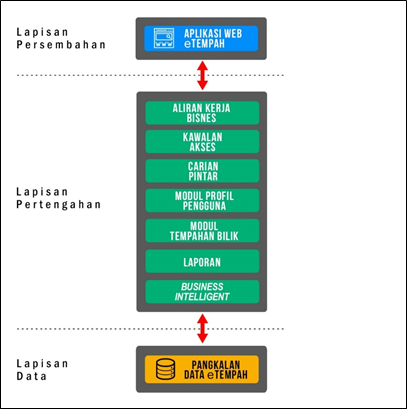
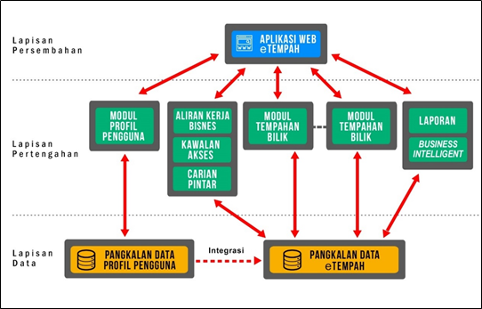
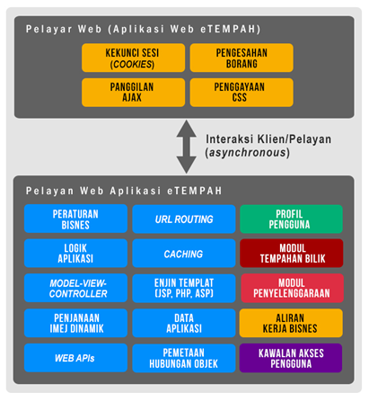
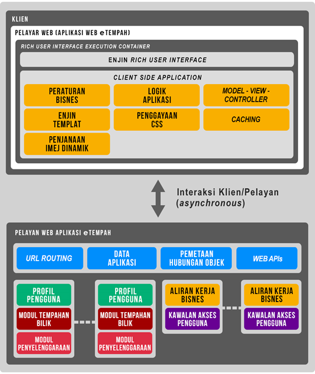
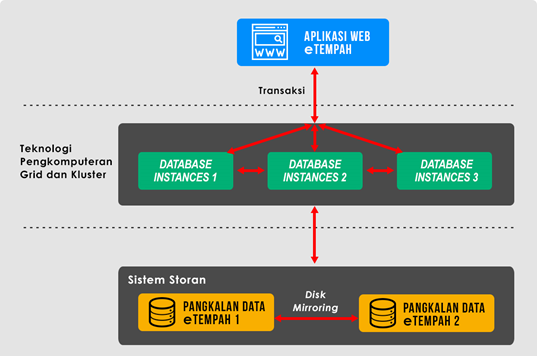
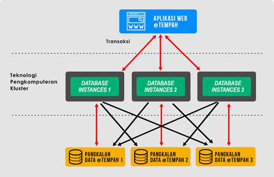

# 4.5 Reka bentuk Arkitektur [F3.1]

Pengenalan

Reka bentuk arkitektur adalah penyusunan dan pengaturan struktur-struktur bagi
sesuatu sistem yang ingin dibangunkan. Reka bentuk arkitektur merupakan hubungan
yang kritikal di antara reka bentuk dan kejuruteraan keperluan, di mana
penyediaannya bertujuan untuk mengenal pasti komponen-komponen berstruktur yang
utama di dalam sistem serta hubungan-hubungan di antara setiap komponen
tersebut. Reka bentuk arkitektur adalah penting untuk memenuhi keperluan
fungsian dan juga bukan fungsian oleh kerana impaknya kepada prestasi, keteguhan
(*robustness*), pengagihan (*distributability*) dan kebolehsenggaraan sistem
aplikasi.

Lapisan-lapisan bisnes, maklumat/data, aplikasi dan teknologi yang terkandung di
dalam arkitektur *enterprise* boleh dijadikan sebagai input dan rujukan semasa
penyediaan reka bentuk arkitektur yang dikehendaki. Output kepada proses reka
bentuk arkitektur adalah arkitektur perisian yang terdiri daripada arkitektur
perisian sistem aplikasi, arkitektur aplikasi dan arkitektur data. Arkitektur
yang akan dihasilkan ini menerangkan bagaimana sesuatu sistem disusun atur
sebagai set komponen yang saling berkomunikasi di antara satu sama lain.

**Arkitektur Sistem Aplikasi**

Arkitektur sistem aplikasi merupakan struktur bagi satu-satu sistem yang
merangkumi komponen-komponen perisian, sifat-sifat (*properties*) komponen
berkenaan serta hubungan di antara satu komponen dengan komponen-komponen yang
lain. Arkitektur sistem aplikasi boleh diperincikan kepada sub-sub arkitektur
seperti berikut :

a) Arkitektur Aplikasi

b) Arkitektur Pangkalan Data

Objektif

- Menyediakan arkitektur sistem aplikasi yang terdiri daripada arkitektur
  keseluruhan sistem aplikasi, arkitektur aplikasi dan arkitektur pangkalan data
  berpandukan kepada keperluan-keperluan yang diperolehi di dalam fasa permulaan
  projek dan fasa analisis.

**Langkah-langkah**

Langkah 1 : Kenal Pasti Keperluan Bisnes Dan Sistem

Rujuk dokumen-dokumen **D02 Spesifikasi Keperluan Bisnes** dan **D03 Spesifikasi
Keperluan Sistem** bagi mendapatkan keperluan fungsian dan bukan fungsian yang
telah diperolehi daripada pemegang-pemegang taruh. Sila rujuk juga arkitektur
*enterprise* untuk dijadikan sebagai input kepada arkitektur perisian yang ingin
dibangunkan.

Langkah 2 : Laksanakan Pertimbangan Reka bentuk

Pertimbangan reka bentuk perlu dilakukan berdasarkan keperluan yang telah
didapati semasa kajian keperluan sistem. Penilaian ke atas pertimbangan reka
bentuk perlu mengambil kira perkara-perkara seperti berikut:

a) Penentuan Jenis Aplikasi

Pemilihan jenis aplikasi yang sesuai adalah penting bagi proses reka bentuk
aplikasi. Pemilihan adalah tertakluk kepada keperluan yang telah diperolehi dan
batasan infrastruktur serta kemampuan teknologi sedia ada. Contoh jenis-jenis
aplikasi adalah seperti aplikasi mudah alih, *client-server application*,
portal, aplikasi web tradisional atau aplikasi web moden (*Rich Internet
Application*).

b) Penentuan Strategi Pelaksanaan

Pelaksanaan aplikasi boleh dilakukan di dalam pelbagai jenis persekitaran di
mana setiap persekitaran mempunyai kekangan-kekangan tersendiri, Contohnya
komponen-komponen yang perlu diasingkan secara fizikal dan perlu merentasi
pelayan yang berbeza-beza, kekangan konfigurasi bagi peranti-peranti dan
kekangan-kekangan yang lain. Keseimbangan di antara keperluan aplikasi dengan
kemampuan perkakasan adalah penting di mana faktor-faktor ini boleh mempengaruhi
kepada reka bentuk arkitektur yang dibangunkan.

c) Penentuan Ciri-ciri Kualiti

Ciri-ciri kualiti atau keperluan bukan fungsian seperti modular, keselamatan,
prestasi, capaian, ketersediaan dan kebolehgunaan semula merupakan faktor-faktor
yang perlu dipertimbangkan dalam penyediaan reka bentuk arkitektur. Pemilihan
ciri-ciri kualiti yang ingin diutamakan adalah bergantung kepada keperluan yang
telah diperoleh dan senario pelaksanaan aplikasi yang akan dijalankan kelak.
Pemilihan keutamaan ini perlu dilakukan terlebih dahulu sebelum sebarang reka
bentuk arkitektur dibangunkan bagi mengelakkan percanggahan di antara ciri-ciri
kualiti yang perlu disediakan di dalam sistem. Sebagai contoh, keutamaan kepada
keselamatan berkemungkinan boleh membebankan prestasi dan menyukarkan akses
pengguna kepada aplikasi.

Langkah 3 : Kenal Pasti Corak Arkitektur Yang Sesuai

a) Corak arkitektur yang sesuai perlulah dikenal pasti berdasarkan kepada
keperluan dan hasil pertimbangan reka bentuk. Corak reka bentuk arkitektur
adalah bergantung kepada jenis sistem yang akan dibangunkan. Antara corak reka
bentuk arkitektur yang sering digunakan adalah arkitektur lapisan (*layered
architecture*) atau dikenali juga sebagai arkitektur *n-tier.* Berikut adalah
fakta-fakta penting mengenai arkitektur lapisan:

1. Arkitektur lapisan merupakan gambaran aturan sistem dalam bentuk lapisan dan
   dihubungkan setiap lapisan tersebut dengan fungsi-fungsi yang berkaitan.
   Setiap lapisan di dalam arkitektur mengandungi komponen-komponen sistem yang
   berbeza dan melaksanakan tugasan serta logik yang tertentu. Arkitektur
   lapisan sesuai untuk digunakan bagi pembangunan aplikasi web atau aplikasi
   mudah alih berbentuk sistem maklumat kerana ia mudah untuk difahami serta
   pengasingan komponen-komponen sistem kepada lapisan yang berbeza meningkatkan
   kebolehsenggaraan dan keboleh-skalaan (*scalability*) sesuatu sistem.

2. Secara amnya, arkitektur ini merangkumi lapisan-lapisan seperti lapisan
   persembahan (*presentation tier*), lapisan pertengahan (*middle tier*) dan
   lapisan data (*data* *tier*).

- Lapisan persembahan merupakan lapisan di mana pengguna berinteraksi dengan
  aplikasi. Lapisan ini bertanggungjawab dalam mengendalikan kesemua antaramuka
  pengguna serta logik komunikasi pelayar web.
- Lapisan pertengahan atau dikenali juga sebagai lapisan aplikasi (*application
  tier*) atau lapisan bisnes merupakan lapisan pengantaraan yang menghubungkan
  di antara lapisan persembahan dan lapisan data. Lapisan pertengahan ini
  terdiri dari komponen-komponen yang melibatkan fungsi logik bisnes aplikasi,
  perkhidnmatan aplikasi atau/dan komponen utiliti (perisian utiliti) yang
  digunakan oleh komponen-komponen aplikasi yang lain.
- Lapisan data pula merupakan lapisan di mana maklumat-maklumat aplikasi
  disimpan di dalam pelayan pangkalan data.

b) Corak-corak arkitektur lain seperti *event-driven, microkernel, space-based*
dan *client-server* boleh juga diguna pakai tetapi bergantung kepada kesesuaian
dan juga keperluan yang telah diperolehi. Untuk mendapatkan keterangan lanjut
berkenaan corak-corak arkitektur yang lain, buku-buku seperti di bawah boleh
dirujuk:

1. *Software Architecture Patterns - Understanding Common Architecture Patterns
   and When to Use Them* (2015) oleh Mark Richards
2. *Software Engineering – Chapter 6 Architectural Design (9th Edition 2011)*
   oleh Ian Sommerville

Langkah 4 : Sediakan Arkitektur Keseluruhan Sistem Aplikasi

a) Arkitektur Keseluruhan Sistem Aplikasi adalah merupakan:

1. komponen-komponen perisian iaitu antaramuka sistem, aplikasi dan respositori
   (data)
2. sifat-sifat luaran (external properties) komponen berkenaan
3. hubungan di antara satu komponen dengan komponen-komponen yang lain

b) Arkitektur Sistem Aplikasi boleh dibahagikan kepada dua jenis seperti
berikut:

1. Arkitektur Monolitik

Arkitektur monolitik adalah arkitektur yang menggabungkan semua komponen
fungsian perisian seperti kawalan akses, aliran kerja, modul profil pengguna dan
laporan, menjadi satu unit sahaja. Perisian yang mengguna pakai arkitektur
monolitik direka bentuk supaya ia bersifat *self-contained*, di mana
komponen-komponen perisian berkenaan saling berhubung (*interconnected*) dan
saling bergantung (*interdependent*) di antara satu sama lain. Dengan kata lain,
arkitektur monolitik merupakan arkitektur yang bersifat *tightly-coupled*,
setiap komponen yang berkaitan perlu disediakan bersama bagi membolehkan ia
dilaksanakan. Berikut adalah contoh arkitektur bagi Sistem Tempahan Bilik
Mesyuarat (eTempah) yang direka bentuk berpandukan arkitektur monolitik:

**Rajah** **57** **:** **Arkitektur Monolitik Bagi Perisian Sistem Aplikasi**

2. Arkitektur Mikroservis

Arkitektur mikorservis adalah arkitektur yang mengagihkan perisian atau sistem
aplikasi di pihak pelayan (*server side*) kepada servis-servis atau
komponen-komponen perisian yang berasingan. Setiap servis atau komponen
merupakan satu proses kecil yang tidak bergantung kepada mana-mana proses lain
(*independent*). Mikroservis melaksanakan satu-satu tugas (*task*) secara
autonomi tanpa menggangu komponen-komponen lain di dalam sistem aplikasi.
Komunikasi di antara satu servis dengan servis-servis yang lain dilaksanakan
secara dalam talian. Berikut adalah contoh arkitektur bagi Sistem Tempahan Bilik
Mesyuarat (eTempah) yang direka bentuk berpandukan arkitektur mikroservis:

**Rajah** **58** **:** **Arkitektur Mikroservis Bagi Perisian Sistem Aplikasi**

Perbandingan di antara arkitektur monolitik dengan mikroservis adalah seperti
berikut:

Jadual 31 : Perbandingan Arkitektur Monolitik dan Mikroservis

| **Ciri-ciri** | **Arkitektur Monolitik** | **Arkitektur Mikrosevis** |
|---|---|---|
| Pengurusan Sumber | Sukar untuk menentukan jumlah sumber yang diperlukan oleh setiap komponen-komponen perisian. | i) Keperluan sumber bagi setiap komponen/servis boleh diukur secara berasingan. ii) Arkitektur ini juga membolehkan penggunaan sumber dilaksanakan secara optimum mengikut keperluan modul dan komponen/servis. |
| Pembangunan | Pembangunan perisian dilaksanakan secara konvensional. Variasi di dalam penggunaan teknologi, rangka kerja serta ahli pasukan yang terlibat dalam satu-satu projek sukar untuk dilaksanakan. | i) Pembangunan boleh dilakukan dengan mengguna pakai teknologi, bahasa pengaturcaraan dan rangka kerja yang berbeza oleh kerana setiap servis/komponen boleh berinteraksi dalam talian menggunakan kemudahan integrasi seperti *Application Progamming Interface* (API). ii) Disebabkan servis/komponen di dalam arkitektur ini berinteraksi secara dalam talian, ia juga boleh digunakan oleh perisian atau aplikasi yang lain. iii) Pengasingan komponen-komponen perisian membolehkan aplikasi dibangunkan oleh pasukan-pasukan kecil yang berlainan. iv) Pengaturcaraan lebih sukar kerana ia perlu melibatkan pengaturcaraan yang melibatkan interaksi di antara servis/komponen sama ada melalui panggilan API atau integrasi Sistem |
| Komunikasi dan Rangkaian | Perisian/Aplikasi monolitik adalah bersifat *self-contained* di mana semua komponen dikumpulkan dalam satu unit sahaja. Justeru, tidak timbul isu *latency* dan kebergantungan kepada prestasi rangkaian. | Komunikasi di antara servis/komponen berkemungkinan perlahan kerana bergantung kepada prestasi rangkaian. |
| Pengujian | i) Langkah pengujian adalah lebih ringkas kerana tidak memerlukan semakan lanjut kepada elemen-elemen tambahan yang melibatkan integrasi di antara komponen ataupun data. ii) Namun begitu, pengujian dan *debugging* secara berasingan untuk setiap komponen sukar untuk dilaksanakan. | i) Langkah pengujian lebih kompleks berbanding dengan arkitektur monolitik kerana semakan perlu melibatkan elemen-elemen integrasi di antara servis/komponen dan data. ii) Pengujian dan *debugging* secara berasingan lebih mudah untuk dilakukan kerana servis/komponen sudah sedia teragih. |
| Kebolehskalaan (*Scalability*) | Peningkatan sumber (memori dan CPU) adalah tidak fleksibel kerana peningkatan perlu mengambil kira kesemua komponen di dalam sistem aplikasi. | Peningkatan sumber (memori dan CPU) secara penskalaan menegak (*vertical scaling)* dan mendatar (*horizontal scaling*) lebih anjal kerana peningkatan boleh dibuat mengikut keperluan modul dan komponen/servis. |
| Kebolehsediaan (*Availability*) | Arkitektur ini mempunyai ciri kebolehsediaan yang tinggi (*High Availability* (HA)) di mana semua modul dan komponen/servis perlu dimasukkan ke dalam kluster HA. | Arkitektur ini mempunyai ciri kebolehsediaan yang tinggi (HA) di mana modul-modul dan komponen/servis yang tertentu boleh dipilih untuk dimasukkan ke dalam kluster HA. |
| Pelaksanaan | Pelaksanaan kebiasaannya perlu dilaksanakan secara menyeluruh kerana setiap komponen perisian bergantung di antara satu sama lain. | Pelaksanaan boleh dilaksanakan secara berasingan tanpa perlu melibatkan servis/komponen lain yang masih belum selesai dibangunkan. |
| Penyelenggaraan | i) Sebarang perubahan berkemungkinan memerlukan seluruh perisian/aplikasi untuk dibina semula (*rebuild*) atau *redeploy* disebabkan oleh kebergantungan komponen-komponen di antara satu sama lain*.* ii) Oleh yang demikian, masa yang diambil untuk sebarang penambahbaikan ataupun pembaikan (*error fixing*) adalah lama dan mudah terdedah dengan pelbagai kesilapan. iii) Sebarang kesilapan bukan sahaja boleh menjejaskan komponen/ servis yang lain malah ia juga berkemungkinan akan menyebabkan seluruh perisian/aplikasi terjejas. | Sebarang perubahan kepada satu-satu servis hanya melibatkan penyelenggaraan kepada servis/komponen berkenaan sahaja dan tidak menggangu kepada yang lain. Justeru, proses penambahbaikan dan pembaikan dapat diselesaikan dengan lebih pantas. |

d) Tentukan sama ada arkitektur perisian sistem aplikasi yang ingin dibangunkan
adalah berpandukan arkitektur monolitik atau mikroservis. Penentuan arkitektur
ini perlu diseimbangkan di antara halatuju agensi, kekangan-kekangan dan
infrastruktur sedia ada dengan keperluan fungsian dan bukan fungsian yang telah
diperolehi di fasa Analisis Keperluan.

e) Berdasarkan dua jenis arkitektur perisian sistem aplikasi seperti di atas
dengan mengambil kira perbandingan di antara kedua-duanya, sediakan arkitektur
yang ideal dan sesuai bagi reka bentuk perisian sistem aplikasi yang ingin
dibangunkan.

Langkah 5 : Sediakan Arkitektur Aplikasi

a) Arkitektur aplikasi merupakan subset kepada Arkitektur Keseluruhan Sistem
Aplikasi di mana ia tertumpu kepada penyusunan dan pengaturan sistem aplikasi
sahaja. Kemajuan teknologi di dalam pembangunan sistem aplikasi telah banyak
mempengaruhi perubahan kepada arkitektur aplikasi.

b) Dalam persekitaran web, arkitektur aplikasi boleh dibahagikan kepada dua
jenis seperti berikut:

1. Arkitektur Aplikasi Tradisional

Arkitektur aplikasi tradisional lebih tertumpu kepada penggunaan dan utilasi di
pihak pelayan (*server-side*), di mana pembentukkan setiap muka web adalah
berpandukan kepada skrip-skrip HTML dan kod pengaturcaraan lain yang dijana dan
ditarik dari pelayan. Akitektur ini adalah terdiri daripada aplikasi yang
merupakan muka-muka web (*web pages*). Bagi mendapatkan kandungan yang dinamik,
web aplikasi tradisional perlu sentiasa berhubung dengan pelayan web bagi
menjana semula muka web dan memaparkan permohonan-permohonan yang dilakukan oleh
pengguna (*user request*). Berikut adalah contoh arkitektur aplikasi bagi Sistem
Tempahan Bilik Mesyuarat (eTempah) yang direka bentuk berpandukan arkitektur
aplikasi tradisional:

**Rajah** **59** **: Arkitektur Aplikasi Tradisional**

2. Arkitektur Aplikasi Moden

Perkembangan teknologi bahasa pengaturcaraan seperti HTML5 dan CSS3, serta
pengenalan kepada persekitaran *runtime* Javascript telah banyak merubah
arkitektur aplikasi tradisional. Arkitektur aplikasi moden yang menggunakan
teknologi terkini adalah lebih tertumpu kepada utilasi di pihak klien
(*client-side*) dan meminimakan penggunaan serta beban di pihak pelayan.
Aplikasi dalam arkitektur ini bertindak sebagai aplikasi *single page* di mana :

- interaksi di antara klien dengan pelayan hanya melibatkan *unformatted data*
  sahaja
- pengesahan dapat dibuat secara langsung di klien (*live validation*)
- *unnecessary page reload*
- kemudahan *drag and drop*
- kemudahan animasi multimedia
- masa respon yang singkat
- *auto completion,*
- *periodic refresh*
- *rich text editors*
- *pull technology*

Ini menjadi aplikasi lebih kukuh (*robust*), meningkatkan *user experience*,
prestasi serta tahap responsif sistem. Berikut adalah contoh arkitektur aplikasi
bagi Sistem Tempahan Bilik Mesyuarat (eTempah) yang direka bentuk berpandukan
arkitektur aplikasi moden:

**Rajah** **60** **: Arkitektur Aplikasi Moden**

c) Perbandingan di antara arkitektur aplikasi tradisional dengan aplikasi moden
adalah seperti berikut:

Jadual 32 : Perbandingan Arkitektur Aplikasi Tradisional Dan Aplikasi Moden

| **Ciri-ciri** | **Arkitektur Aplikasi Tradisi** | **Arkitektur Aplikasi Moden** |
|---|---|---|
| Pengurusan Sumber | i) Arkitektur web aplikasi tradisional membebankan dan meningkatkan kompleksiti di pihak pelayan. Pelayan aplikasi perlu melaksanakan sebahagian besar daripada pemprosesan perisian termasuk juga pemprosesan yang dilaksanakan di dalam pelayar web dan antaramuka pengguna (UI). ii) Keperluan sumber yang tinggi di pihak pelayan ini bukan sahaja memerlukan kos yang tinggi malah ia juga boleh menjejaskan prestasi keseluruhan aplikasi sekiranya keperluan tersebut tidak dapat dipenuhi. | Arkitektur web aplikasi moden menawarkan *native-app-like experience* kepada pengguna di mana sebahagian besar daripada *runtime* aplikasi dilaksanakan di pihak klien. Oleh yang demikian, utilasi di pihak server dapat dilaksanakan secara efisien tanpa memerlukan sumber yang tinggi untuk memenuhi keperluan operasi satu-satu aplikasi. |
| Pembangunan | i) Disebabkan arkitektur ini adalah bersifat *tightly coupled* dan komponen aplikasi kian bergantung di antara satu sama lain, pembangunan perlu dilaksanakan secara menyeluruh dan bersekali di pihak klien dan juga pelayan. ii) Pendekatan pembangunan lebih kepada pembangunan muka web (*web pages*). | i) Pengasingan dalam kebergantungan (*loosely coupled*) di antara pihak klien dan pelayan membolehkan pembangunan aplikasi dijalankan secara teragih. Pembangunan boleh dilaksanakan oleh dua pasukan yang berbeza, di mana satu kumpulan akan lebih fokus kepada pengaturcaraan di pihak klien (pengaturcaraan HTML, CSS dan Javascript boleh dilakukan tanpa perlu untuk mengaturcara terlebih dahulu teknologi *templating* aplikasi seperti JSP, ASP dan PHP) manakala kumpulan yang lain membangunkan aplikasi dan juga API web di pihak klien. ii) Pendekatan pembangunan lebih kepada pembangunan aplikasi. |
| Komunikasi dan Rangkaian | Sebarang isu rangkaian yang timbul akan mengakibatkan aplikasi tidak boleh dicapai dan digunakan. Ini kerana, arkitertur aplikasi tradisional memerlukan komunikasi dengan pelayan untuk menjana fail-fail program seperti HTML dan imej dinamik (antaramuka pengguna) kepada pihak klien. | Arkitektur aplikasi moden boleh dimuatkan ke dalam pelayar web atau disimpan secara luar talian melalui *cache manifest*. Ini membolehkan fungsi-fungsi dalam aplikasi untuk terus digunakan walaupun terdapat gangguan rangkaian. |
| Pengujian | Pengujian aplikasi bagi arkitektur ini hanya boleh dilaksanakan secara *end-to-end* dan menyeluruh. Pengujian secara teragih atau *unit test* sukar untuk dilakukan oleh kerana kebergantungan yang tinggi di antara komponen-komponen aplikasi. | Arkitektur ini membolehkan pengujian dilaksanakan sama ada secara menyeluruh dan juga teragih (*unit test*) kerana kerbegantungan di antara komponen-komponen aplikasi adalah rendah. Contohnya, pengujian API web atau *Javascript* boleh dilaksanakan secara berasingan tanpa perlu melibatkan komponen teknologi *templating* aplikasi seperti JSP, ASP dan PHP. |
| Pelaksanaan | Pelaksanaan dijalankan secara konvensional di mana aplikasi diakses melalui alamat URL di dalam pelayar web. | Pelaksanaan adalah lebih fleksibel dan menawarkan pelbagai opsyen. Pelaksanaan aplikasi boleh dijalankan dengan menggunakan pelayan web (sama seperti arkitektur aplikasi tadisional) dan ia juga boleh dipakejkan dengan rangka-rangka kerja seperti *Apache* dan *Cordova* bagi pengedaran melalui *App Store* atau *Google Play*. |
| Prestasi | Aplikasi merupakan satu set *web pages* yang akan dijana di pelayan apabila pengguna klik pada alamat URL yang berkaitan. Proses ini akan memperlahankan sistem dan menjadi lebih kritikal apabila ramai pengguna membuat capaian secara serentak. | Merupakan aplikasi yang dimuatkan dalam pelayar web di mana hanya data sahaja yang ditarik daripada pelayan dan antaramuka pengguna (UI) dijana di pihak klien. Ini memberikan prestasi sistem yang lebih baik. |
| Penyelenggaraan | Penyelenggaraan aplikasi perlu dilaksanakan secara menyeluruh disebabkan oleh kebergantungan yang tinggi di antara komponen-komponen aplikasi (*tightly coupled*). Sebarang perubahan kod pengaturcaraan sama ada di klien atau pelayan perlu diselaraskan bagi membolehkan reka bentuk, ciri-ciri atau fungsi yang baru dipinda dapat berjalan dengan lancar. | Oleh kerana arkitektur ini adalah bersifat *loosely coupled* di mana kesemua logik persembahan diasingkan daripada komponen di pihak pelayan, sebarang pindaan di antaramuka aplikasi boleh dilaksanakan tanpa menggangu kod pengaturcaraan di pihak pelayan. Justeru, sebarang perubahan dan evolusi kepada reka bentuk dan ciri-ciri (*features*) aplikasi dapat diselesaikan dengan lebih pantas. |

d) Tentukan sama ada arkitektur aplikasi yang ingin dibangunkan merupakan
arkitektur aplikasi tradisional ataupun aplikasi moden. Penentuan arkitektur ini
perlu diseimbangkan di antara halatuju agensi, kekangan-kekangan dan
infrastruktur sedia ada dengan keperluan fungsian dan bukan fungsian yang telah
diperolehi di fasa Analisis Keperluan.

e) Berdasarkan dua jenis arkitektur aplikasi seperti di atas dengan mengambil
kira perbandingan di antara kedua-duanya, sediakan arkitektur yang ideal dan
sesuai bagi reka bentuk aplikasi yang ingin dibangunkan.

Langkah 6 : Sediakan Arkitektur Pangkalan Data

a) Arkitektur pangkalan data merupakan subset kepada arkitektur perisian sistem
aplikasi di mana ia tertumpu kepada penyusunan dan pengaturan pangkalan data
sahaja. Penyediaan arkitektur tersebut adalah berdasarkan kepada keperluan
fungsian dan bukan fungsian yang telah diperolehi serta corak arkitektur yang
telah ditentukan.

b) Arkitektur pangkalan data boleh dibahagikan kepada dua jenis seperti berikut:

1. Arkitektur *Shared-Disk*

Sistem-sistem yang wujud di dalam persekitaran *shared-disk* berkongsi peranti
cakera (*disk devices*) yang sama. Setiap pemproses mempunyai memori tersendiri
dan ia boleh mengakses kesemua cakera peranti. Arkitektur *shared disk*
membolehkan setiap nod mengakses keseluruhan set data di mana setiap nod
berkenaan akan memberi maklum balas kepada sebarang permohonan yang diterima
dari pangkalan data. Arkitektur *shared-disk* adalah sesuai bagi aplikasi yang
hanya memerlukan *shared access* yang sederhana ke pangkalan data, serta
aplikasi yang mempunyai beban kerja (*workload*) yang sukar untuk diagihkan
(*partition*). Berikut adalah contoh arkitektur pangkalan data bagi Sistem
Tempahan Bilik Mesyuarat (eTempah) yang direka bentuk berpandukan arkitektur
*shared-disk*:

**Rajah** **61** **:** **Arkitektur *Shared-Disk* Bagi Aplikasi Web eTempah**

2. Arkitektur *Shared-Nothing*

Sistem-sistem yang wujud di dalam persekitaran *shared-nothing* mempunyai memori
dan cakera peranti yang tersendiri. Arkitektur *shared-nothing* mempunyai
kemampuan penskalaan yang tinggi (*high scalability*) dan sesuai untuk aplikasi
yang kerap mengakses dan melaksanakan transasksi ke pangkalan data. Berikut
adalah contoh arkitektur pangkalan data bagi Sistem Tempahan Bilik Mesyuarat
(eTempah) yang direka bentuk berpandukan arkitektur *shared-nothing*:

**Rajah** **62** **:** **Arkitektur *Shared-Nothing* Bagi Aplikasi Web eTempah**

Perbandingan di antara arkitektur *shared-disk* dengan *shared-nothing* adalah
seperti berikut:

Jadual 33 : Perbandingan Arkitektur Shared-Disk Vs Shared-Nothing

| **Ciri-ciri** | **Arkitektur *Shared-Disk*** | **Arkitektur *Shared-nothing*** |
|---|---|---|
| Pemasangan dan Penyelenggaraan | **Tidak Memerlukan Usaha Tambahan** Arkitektur ini tidak bergantung kepada *data partioning* kerana setiap nod di dalam kluster mempunyai akses penuh untuk memaparkan dan mengemaskini seluruh data. | **Jadual *Re-Partitioning* Dan *Routing*** Berikut adalah langkah-langkah pemasangan bagi pangkalan data *shared-nothing*: i) Sediakan skema *partitioning* untuk meminimakan atau menghapuskan secara terus mesej antara-nodal. ii) Asingkan data di antara server-server dalam kluster. iii) Selenggara jadual *routing.* iv) Ulangi semula langkah-langkah di atas bagi setiap *re-partition.* |
| **Prestasi dan *Overhead*** |  |  |
| Fungsi / *Data Shipping* | **Meningkatkan Prestasi** Tiada fungsi/*data shipping, overhead* tambahan tidak diperlukan. | **Mengehadkan Prestasi Dan Masalah Penalaan (*Tuning*)** Arkitektur ini bergantung kepada fungsi/*data shipping* untuk memenuhi permintaan (*request*) kepada pangkalan data (seperti *joins*) yang merentasi pelbagai nod. Arkitektur ini boleh mengehadkan prestasi serta kebolehskalaan nodal berdasarkan skema *partitioning* yang dibangunkan, saiz data dan bilangan nod yang terlibat. |
| *2-Phase Commit* (2PC) | **Prestasi yang Lebih Pantas** Setiap nod boleh menyelaras nod masing-masing tanpa perlu menunggu nod yang paling perlahan untuk dilaksanakan. | **Prestasi 2PC Teragih (*Distributed*) Merentangi Pelbagai Nod Adalah Sangat Perlahan** 2PC teragih menguncikan data pada seluruh nod yang terlibat. Ini mengakibatkan prestasi semua permintaan data-data menjadi perlahan. |
| Kelajuan Mengakses Data | **Latensi Mengakses Data SAN** Bagi kluster-kluster penskalaan secara luaran (*scale-out*), kelajuan antarahubungan (*interconnect*) *shared-disk* adalah lebih perlahan berbanding dengan kelajuan *bus* (*bus speed*). | **Cakera Setempat (*Local disk),* Kelajuan Mengakses *Bus*** Akses kepada data setempat (*local data*) dapat dilaksanakan dengan pantas. |
| *Load Balancing* | **Mengoptimakan Utilasi CPU Merentasi Pelayan-pelayan (*Server*)** Setiap pelayan dapat berfungsi pada tahap utilasi CPU yang lebih tinggi kerana beban pemprosesan dapat diagihkan kepada pelayan-pelayan lain di dalam kluster yang sama. | **Mengoptimakan Utiliasi CPU Pada Setiap Nod** Setiap nod dan pelayan perlu menguruskan beban secara sendiri tanpa sebarang *load balancing* yang dinamik. |
| Mesej Antara-Nodal (*Inter-Nodal Messaging*) | ***Messaging Overhead*** Arkitektur ini bergantung kepada mesej antara-nodal. | **Tiada Mesej Antara-Nodal** Arkitektur ini tidak memerlukan mesej antara-nodal. |
| Ketersediaan Tinggi (*High Availbility*) | ***Master-master Failover*** a) Tidak memerlukan *partitioning,* justeru, *planned downtime* dapat dikurangkan secara dramatik. b) *Unplanned downtime* juga dapat dikurangkan. Sekiranya terdapat pelayan yang bermasalah (*failed*), arkitektur ini secara dinamiknya akan mengubah haluannya kepada server-server yang lain tanpa sebarang *downtime.* | **Keperluan *Planned* dan *Unplanned Downtime*** a) *Planned downtime* diperlukan untuk melaksanakan *re-partitioning*. b) Kegagalan (*failed*) kepada nod *master* akan mengakibatkan *downtime* sehingga satu-satu nod *slave* dinaik taraf menjadi nod *master.* |
| Konsistensi Data | **Tiada Masalah Konsistensi Data** Arkitektur ini tidak mengalami masalah konsistensi data oleh kerana ia mempunyai pelbagai salinan data sama dalam server yang berlainan. | **Mempunyai Masalah Konsistensi Data** Perlu melakukan konfigurasi kepada transaksi supaya ia merangkumi replikasi secara *synchronous* dalam transaksi berkenaan. Replikasi ini akan menyebabkan prestasi kelajuan satu-satu pangkalan data menjadi perlahan. |
| **Kebolehskalaan (*Scalability*)** |  |  |
| Penskalaan Secara Dalaman (*Scale-in*) : Satu Pendekatan Kebolehskalaan Dalam Pelayan-pelayan Moden *MultiCore* | **Menyokong Pendekatan Penskalaan Secara Dalaman** Arkitektur ini menyokong penskalaan secara dalaman kerana ia mengguna pakai dengan menyuluruh keupayaan *multiple cores* di dalam pelayan moden. Enjin *shared-disk* membolehkan permintaan kepada pangkalan data diagihkan kepada mana-mana *instances.* | ***Partioning*** **Data Kurang Sesuai Bagi Penskalaan Secara Dalaman** Arkitektur ini perlu merangkumi serta melibatkan pangkalan data dan enjin storan untuk menggunakan pendekatan penskalaan secara dalaman. Ia juga memerlukan capaian aplikasi kepada setiap *instance* secara berasingan. Selain itu, arkitektur ini memerlukan setiap cakera dibahagikan kepada storan yang berbeza bagi setiap *instance.* Oleh yang demikian, keperluan-keperluan ini akan mengakibatkan pangkalan data sukar untuk diuruskan. |
| Pengedaran Berdasarkan Geografi (*Geo-Distribution*) | **Isu *Latency* Bagi Lokasi yang Berbeza** Arkitektur ini mempunyai isu *latency* bagi lokasi pelayan-pelayan yang berbeza dari segi geografinya. Isu ini hanya boleh diselesaikan sekiranya dua atau lebih sistem *shared-disk* dibangunkan secara berasingan. | **Isu *Latency* Bagi Lokasi yang Berbeza** Sama seperti arkitektur *shared-disk,* arkitektur ini mempunyai isu *latency* bagi lokasi server-server yang berbeza dari segi geografinya. Isu ini boleh diminimakan dengan membahagi dan mengagih data berdasarkan geo-lokasi. Malah ia juga dapat mengurangkan atau menghapuskan fungsi/*data shipping* di antara dua lokasi berkenaan. |
| Pengkomputeran *Cloud : Database-as-a-Service* (DaaS) | **Menyokong Kebolehskalaan Nodal Secara Dinamik** Arkitektur ini adalah sesuai bagi penskalaan nodal atau keanjalan nodal (*nodal* *elasticity*). Memandangkan semua nod berhubung dengan *shared data store* yang sama, bilangan nod-nod boleh dubah dengan mudah tanpa memberi sebarang implikasi kepada data. | **Pembahagian Tidak Optimal** Pembahagian atau *partitioning* merupakan isu yang kerap dihadapi bagi pangkalan data *cloud.* Pembahagian ini dilaksanakan secara automasi dan sesuai bagi keanjalan nodal. Namun begitu, pembahagian secara automasi ini hanyalah separa optimal sahaja. Ia akan meningkatkan fungsi/*data-shipping* yang akan menyebabkan prestasi keseluruhan pangkalan data terganggu. Prestasi pangkalan data akan kian merosot sekiranya bilangan nod semakin bertambah. |

d) Tentukan sama ada arkitektur pangkalan data yang ingin dibangunkan merupakan
arkitektur *shared-disk* ataupun *shared-nothing*. Penentuan arkitektur ini
perlu diseimbangkan di antara halatuju agensi, kekangan-kekangan dan
infrastruktur sedia ada dengan keperluan fungsian dan bukan fungsian yang telah
diperolehi di fasa Analisis Keperluan.

e) Berdasarkan dua jenis arkitektur pangkalan data seperti di atas dengan
mengambil kira perbandingan di antara kedua-duanya, sediakan arkitektur yang
ideal dan sesuai untuk reka bentuk pangkalan data yang akan dibangunkan.

Langkah 7 : Sediakan Arkitektur-Arkitektur Secara Iteratif

Penyediaan dan pembangunan arkitektur perlu dilaksanakan secara iteratif bagi
meningkatkan tahap komprehensif dan memenuhi keperluan-keperluan yang telah
diperolehi. Disyorkan supaya iterasi proses penyediaan arkitektur dilaksanakan
sekurang-kurangnya sebanyak dua kali untuk meminimakan sebarang kesilapan dan
kekurangan di dalam reka bentuk arkitektur.

Rujukan

1. Narayan Prusty, Modern Javascripts Application (2016).
2. Mark Richards, Software Architecture Patterns (2015).
3. Danny Brian, Kirk Knoernschild. Modern Web Architecutre (2016).
   [http://www.gartner.com/](http://www.gartner.com/).
4. Ben Stopford. Shared Nothing v.s. Shared Disk Architectures: An Independent
   View (2009).
   http://www.benstopford.com/2009/11/24/understanding-the-shared-nothing-architecture/.
