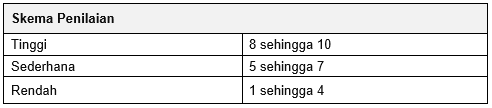
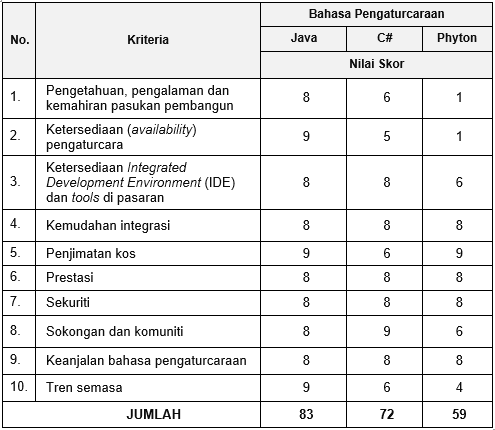

# 4.6 Penentuan Teknologi [F3.2]

Pengenalan

Penentuan teknologi dan *tool* yang sesuai bagi pembangunan sistem aplikasi
merupakan salah satu aspek yang penting untuk dipertimbangkan. Teknologi dan
*tool* yang dipilih akan digunakan bagi memandu dalam reka bentuk antaramuka,
reka bentuk proses dan reka bentuk logikal pangkalan data. Teknologi yang
dipilih juga akan digunakan semasa pelaksanaan fasa pembangunan, pengujian,
pengoperasian dan penyelenggaraan sistem aplikasi. Bagi menentukan teknologi
yang akan digunakan, beberapa aspek perlu diambil kira:

1. Memenuhi dan mematuhi reka bentuk arkitektur sistem aplikasi
2. Keserasian dengan keperluan fungsian dan bukan fungsian
3. Selaras dengan visi dan misi organisasi
4. Teknologi-teknologi yang mudah diperolehi dan diselenggara

Matriks Alternatif

Matriks alternatif ialah salah satu kaedah yang digunakan untuk memilih
teknologi yang memenuhi keperluan. Matriks alternatif digunakan sebagai kaedah
untuk menentukan reka bentuk yang akan dibangunkan. Matriks alternatif juga
digunakan untuk mengurus dan menyusun reka bentuk alternatif supaya penyelesaian
yang terbaik dapat diperolehi. Matriks alternatif menggabungkan beberapa analisa
kebolehlaksanaan seperti berikut:

1. Kebolehlaksanaan Teknikal - penilaian kematangan atau keupayaan teknologi
   untuk berfungsi dengan teknologi yang lain.
2. Kebolehlaksanaan Operasi - keselesaan dan kesesuaian pihak pengurusan,
   pegawai dan pengguna dengan teknologi yang dicadangkan.
3. Kebolehlaksanaan Ekonomi - penilaian sama ada teknologi yang digunakan
   berpatutan dan kos efektif.

Bagi setiap kategori *tools* yang diperlukan, analisis matriks alternatif perlu
dijalankan. Ini kerana setiap kategori *tool* mempunyai kriteria-kriteria yang
berebeza. Matriks alternatif boleh disediakan seperti dalam contoh di bawah.
Tahap/Pemberat dan skor-skor dirangkumi bersekali bagi mewujudkan kad skor yang
mengenalpasti kriteria-kriteria utama projek dan pilihan alternatif yang
terbaik.

Contoh analisis matriks alternatif adalah seperti berikut:

Sebuah organisasi ingin membuat pilihan yang terbaik di antara bahasa
pengaturcaraan yang akan digunakan dalam sistem aplikasi yang ingin dibangunkan.
Sebanyak 10 kriteria telah ditentukan bagi membantu organisasi dalam membuat
pemilihan tersebut. Terdapat tiga jenis skema penilaian yang merangkumi nilai
skor dari 1 sehingga 10 bertujuan untuk menyediakan kad skor dalam menentukan
alternatif yang terbaik. Jadual matriks alternatif seperti di bawah digunakan
untuk membantu organisasi berkenaan melakukan penilian kepada bahasa
pengaturcaraan yang sesuai. Bahasa pengaturcaraan **Java** telah dikenalpasti
sebagai pilihan yang terbaik bagi sistem aplikasi yang ingin dibangunkan.

**Jadual** **34** **:** **Nilai Skor Skema Penilaian Teknikal**

****

Jadual 35 : Matriks Alternatif Bagi Penentuan Bahasa Pengaturcaraan

