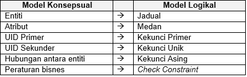
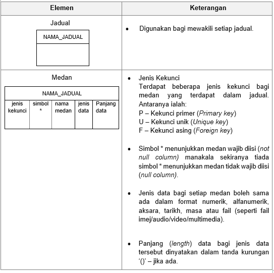
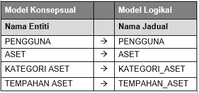
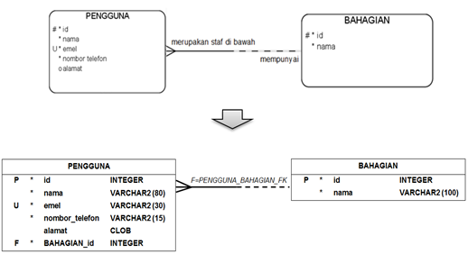
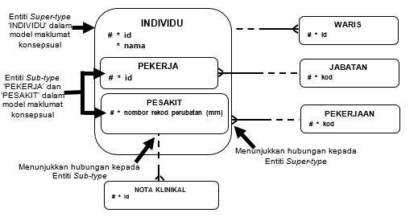
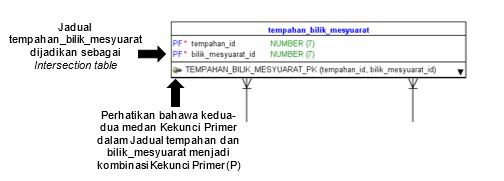
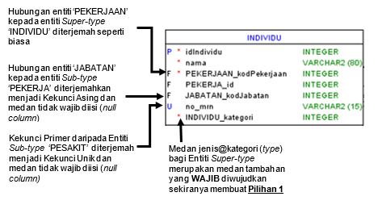
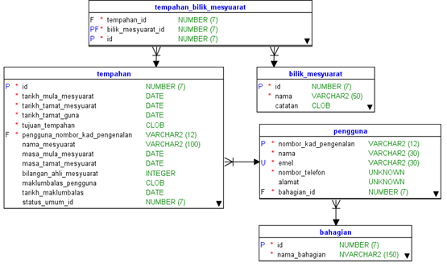

# 4.7 Reka bentuk Pangkalan Data [F3.3]

Keterangan

Reka Bentuk Pangkalan Data Logikal merupakan aktiviti untuk menterjemah model
maklumat konsepsual kepada model maklumat logikal. Model maklumat logikal
merupakan model perantara yang akan digunakan untuk mereka bentuk pangkalan data
fizikal, seterusnya membangunkan pangkalan data yang sebenar. Model ini
menerangkan empat (4) komponen utama iaitu spesifikasi jadual (*table
specification*), spesifikasi medan (*column specification*), spesifikasi kekunci
primer (*primary key specification*) dan spesifikasi kekunci asing (*foreign key
specification*).

Peristilahan yang digunakan dalam penterjemahan model maklumat konsepsual kepada
model maklumat logikal adalah seperti berikut.

Objektif

- Menyediakan model maklumat logikal.
- Mengenalpasti spesifikasi jadual dan medan.
- Mengenalpasti spesifikasi kekunci utama dan kekunci asing.
- Implementasi entiti berjenis *Super-type* dan *Sub-type*.

Notasi

Model maklumat logikal adalah berdasarkan model maklumat konsepsual rujuk
**Pemodelan Keperluan Data [F2.2]**:

**Jadual** **36** **: Notasi Reka bentuk Keperluan Data**

Langkah-Langkah

Langkah 1 : Sediakan Spesifikasi Jadual

a) Kenalpasti entiti yang mempunyai maklumat yang tidak perlu disimpan dalam
pangkalan data terlebih dahulu. Entiti tersebut tidak perlu diterjemahkan ke
dalam model maklumat logikal.

b) Setiap entiti tunggal (bukan berjenis Entiti *Super-type* atau *Sub-type*)
akan diterjemahkan terus kepada jadual. Contoh penterjemahan adalah seperti
berikut.

Contoh entiti tunggal yang diterjemahkan terus kepada jadual adalah seperti di
rajah dibawah.

**Rajah** **63** **:** **ERD - Entiti Tunggal**

c) Sekiranya *Intersection Entity* diwujudkan bagi menyelesaikan hubungan
banyak-ke-banyak (*many-to-many*) di antara dua entiti, terjemahkan model
tersebut kepada model maklumat logikal adalah sama seperti entiti tunggal.

d) Sekiranya Entiti Super-type atau Sub-type wujud, penterjemahan ke model
logikal akan membabitkan hubungan dengan entiti lain sama ada kepada Entiti
*Super-type* atau *Sub-type* tersebut.

**Rajah** **64** **: ERD – Penggunaan Entiti Supertype**

Terdapat **tiga pilihan** untuk menterjemahkan model maklumat konsepsual ini
kepada model maklumat logikal iaitu :

1. Pilihan 1 – Pelaksanaan *Super-type* Pilihan ini akan menghasilkan satu
   jadual tunggal sahaja bagi pelaksanaan ketiga-tiga Entiti INDIVIDU, PEKERJA
   dan PESAKIT. Pelaksanaan ini juga dikenali sebagai pelaksanaan satu jadual
   tunggal.

2. Pilihan 2 – Pelaksanaan *Sub-type*  Pilihan ini akan menghasilkan **satu
   jadual bagi setiap Entiti *Sub-type***. Bagi contoh ini, dua jadual akan
   dihasilkan iaitu Jadual PEKERJA dan PESAKIT.

3. Pilihan 3 – Pelaksanaan kedua-dua *Super-type* dan *Sub-type* (“Arc”)
 Pilihan ini akan menghasilkan **satu jadual bagi setiap entiti** sama ada
 entiti tersebut berjenis *Super-type* atau *Sub-type*. Bagi contoh ini, tiga
 jadual akan dihasilkan iaitu Jadual INDIVIDU, PEKERJA dan PESAKIT

e) Nama jadual mesti dimulakan dengan huruf. Gantikan ruang kosong atau aksara
khas yang tidak dibenarkan seperti %, *, –, !, / dan lain-lain kepada aksara
garis bawah ‘_’ (underscore). Elakkan pengunaan perkataan-perkataan rizab
(reserved words) yang biasa terdapat dalam bahasa pengaturcaraan seperti
*number, value, type* dan lain-lain.

f) Nama jadual mestilah unik (nama yang sama tidak boleh digunakan berulang
kali) dalam satu skema pangkalan data.

Langkah 2 : Sediakan Spesifikasi Medan

1. Setiap atribut akan diterjemahkan kepada medan (*field*).
2. Nama atribut akan menjadi nama medan (*field*). Nama medan mesti dimulakan
   dengan huruf. Gantikan ruang kosong/aksara khas yang tidak dibenarkan kepada
   aksara garis bawah ‘_’. Elakkan pengunaan perkataan-perkataan rizab, dan beri
   nama singkatan jika boleh.
3. Nama medan mestilah unik (nama yang sama tidak boleh digunakan berulang kali)
   dalam satu jadual.
4. Atribut Mandatori akan menjadi medan wajib diisi (*not-null column*),
   manakala Atribut Pilihan menjadi medan tidak wajib diisi (*null column*).
5. Tentukan jenis data (*data type*) bagi setiap medan. Jenis data boleh sama
   ada dalam format numerik, alfanumerik, aksara, tarikh, masa atau fail
   (seperti fail imej/audio/video/multimedia). Nyatakan panjang (*length*) bagi
   jenis data tersebut dalam tanda kurungan ‘()’ – jika ada.
6. Sesetengah peraturan bisnes diterjemahkan kepada CHECK Constraint bagi
   memastikan data yang sah sahaja diterima. Contohnya medan ‘tarikh_tamat_guna’
   dalam jadual TEMPAHAN_ASET mestilah lebih besar atau sama dengan medan
   ‘tarikh_mula_guna’.

    

7. Bagi peraturan bisnes yang lebih kompleks, pengekodan/pengaturcaraan tambahan
   mungkin diperlukan sama ada di komputer pelayan (*server site*), di komputer
   pelanggan/klien (*client site*), atau kedua-duanya sekali.

Langkah 3 : Sediakan Spesifikasi Kekunci Primer

1. Terjemahkan UID Primer menjadi Kekunci Primer (*Primary Key*).
2. Terjemahkan UID Sekunder akan menjadi Kekunci Unik (*Unique Key*).

Langkah 4 : Sediakan Spesifikasi Kekunci Asing

1. Hubungan antara dua entiti akan diterjemah menjadi Kekunci Asing (*Foreign
   Key*).
2. Medan Kekunci Asing biasanya dinamakan dengan menggabungkan nama jadual yang
   dirujuk, dengan nama atribut yang menjadi Kekunci Primer dalam jadual yang
   dirujuk itu.

Langkah 5 : Sediakan Spesifikasi Medan *Intersection Entity*

1. Bagi model yang mempunyai *Intersection Entity* yang menyelesaikan hubungan
   banyak-ke-banyak (many-to-many) di antara dua entiti, UID Primer daripada
   kedua-dua entiti akan digabungkan untuk menjadi UID Primer bagi *Intersection
   Entity

    *  **Rajah** **65** **: Kekunci Primer daripada *composite key***

2. Dalam model logikal, gabungan UID Primer daripada kedua-dua entiti akan
   menjadi *Composite Primary key.*
3. Merujuk kepada rajah di atas, medan-medan yang terdapat dalam *Intersection
   Table* ‘ITEM_TEMPAHAN’, hubungan antara dua entiti diterjemah menjadi Kekunci
   Asing F1 dan F2, dan kedua-dua Kekunci Asing ini membentuk kombinasi Kekunci
   Primer (P) (*composite primary key*) dalam jadual berkenaan. Sama ada
   modaliti hubungan bersifat mandatori atau sebaliknya, medan Kekunci Asing
   dalam *Intersection Table* akan sentiasa menjadi medan wajib diisi (*not-null
   column*).

Langkah 6 : Sediakan Spesifikasi Medan Entiti *Super-Type* Dan *Sub-Type*

Terjemahan bagi atribut yang terlibat dalam Entiti *Super-type* atau *Sub-type*,
terdapat beberapa peraturan bagi pilihan yang perlu dipatuhi mengikut jenis
terjemahan model maklumat.

**a) Pilihan 1 – Pelaksanaan** ***Super-type

***

Rajah 67 : Contoh Model Maklumat Logikal Sistem

1. Atribut yang terdapat dalam Entiti *Super-type* diterjemahkan terus seperti
   biasa.
2. Kesemua atribut daripada Entiti *Sub-type* akan menjadi medan tidak wajib
   diisi (*null column*). Sekiranya atribut tersebut merupakan UID, atribut
   diterjemah menjadi Kekunci Unik (*Unique Key*) atau *CHECK Constraint*.
3. Satu medan mandatori **WAJIB** diwujudkan bagi membezakan antara Entiti
   *Sub-type* Medan tersebut biasanya dinamakan dengan
   ***<nama_entiti_supertype>_jenis@kategori*** seperti **INDIVIDU_kategori**
   kerana medan inilah yang akan membezakan sama ada INDIVIDU tersebut kategori
   PESAKIT atau PEKERJA. Penggunaan *CHECK Constraint* atau tambahan pengekodan
   dalam aturcara aplikasi boleh diaplikasikan di sini bagi menjamin
   integriti/kesahihan data.
4. Hubungan kepada Entiti *Super-type* juga diterjemahkan terus seperti biasa,
   manakala Hubungan kepada Entiti *Sub-type* akan diterjemah menjadi Kekunci
   Asing dan menjadi medan yang tidak wajib diisi (*null column*)

**b)** **Pilihan 2 – Pelaksanaan Sub-type**

Atribut yang terdapat dalam Entiti *Sub-type* diterjemahkan terus seperti biasa
ke dalam jadual yang berasingan. Manakala Kekunci Primer bagi atribut yang
terdapat dalam Entiti *Sub-type* adalah UID Primer Entiti *Super-type*.

**c) Pilihan 3 – Pelaksanaan kedua-dua Super-type dan Sub-type (*Arc*)**

1. Atribute yang terdapat dalam kesemua entiti tersebut diterjemahkan seperti
   biasa ke dalam jadual yang berasingan. Manakala Kekunci Primer bagi atribut
   yang terdapat dalam Entiti *Super-type* dan *Sub-type* adalah UID Primer
   Entiti *Super-type*.
2. Bagi Entiti *Super-type*, satu medan mandatori **WAJIB** diwujudkan bagi
   membezakan antara Entiti *Sub-type* Medan tersebut biasanya dinamakan dengan
   ***<nama_entiti_supertype>_jenis@kategori*** seperti **INDIVIDU_kategori**
   kerana medan inilah yang akan membezakan sama ada INDIVIDU tersebut kategori
   PESAKIT atau PEKERJA. Penggunaan *CHECK Constraint* atau tambahan pengekodan
   dalam aturcara aplikasi boleh diaplikasikan di sini bagi menjamin
   integriti/kesahihan data.

Langkah 7 : Perkemaskan Model Maklumat Logikal

Setelah semua entiti siap diterjemah ke model logikal, lengkapkan dan
perkemaskan lagi model maklumat logikal mengikut jenis teknologi yang hendak
digunakan.

Contoh model maklumat logikal Sistem Tempahan Bilik Mesyuarat (eTempah) adalah
seperti rajah berikut.

Rajah 67 : Contoh Model Maklumat Logikal Sistem

Langkah 8 : Dokumenkan Model Maklumat Logikal

Dokumenkan semua output yang dihasilkan sebagai hasil serahan proses reka bentuk
pangkalan data logikal ke dalam **D04 Spesifikasi Reka bentuk Sistem**.
Dokumentasi mengikut susunan berikut:

1. Model Maklumat Logikal
2. Rujuk **Apendiks 4 Template Skema Logikal Pangkalan Data** (*Database Logical
   Schema*).

Rujukan

1. https://en.wikipedia.org/wiki/Data_modeling#Conceptual.2C_logical_and_physical_schemes.
2. Jan Speelpenning, Patrice Daux and Jeff Gallus; Data Modeling and Relational
   Database Design (2001).
