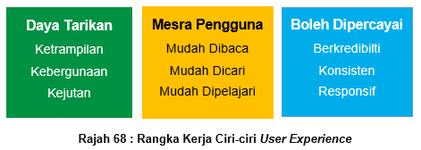
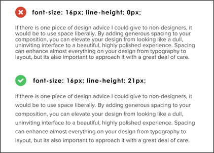
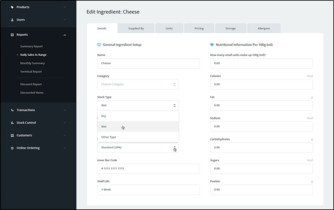
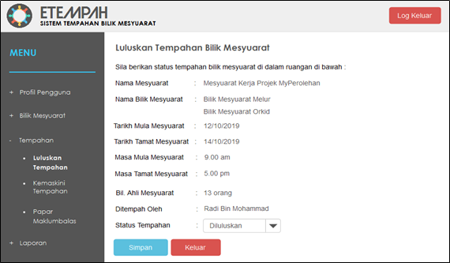
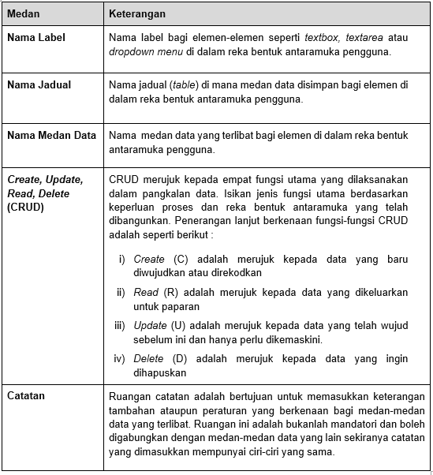

# 4.8 Reka bentuk Antaramuka Pengguna [F3.4]

Keterangan

Penyediaan Reka Bentuk Antaramuka Pengguna (UI) adalah proses untuk menentukan
kaedah interaksi di antara pengguna dengan sistem yang akan dibangunkan. Memberi
keutamaan kepada reka bentuk antaramuka pengguna, khususnya kepada peningkatan
*user experience* (UX), dapat menjadikan sesuatu aplikasi mudah untuk dilayari,
efektif dan selesa untuk digunakan.

Di samping itu, antaramuka-antaramuka pengguna yang telah dibangunkan perlu
dipadankan dengan medan-medan data di dalam jadual (*table*) pangkalan data.
Pemetaan data ini bertujuan untuk memudahkan seseorang pembangun sistem
mengetahui senarai medan data yang diperlukan bagi satu-satu antaramuka pengguna
yang telah dibangunkan.

Objektif

- Membangunkan antaramuka pengguna yang berpandukan kepada rangka kerja, prinsip
  dan elemen asas UI/UX dan selaras dengan *trend* reka bentuk yang terkini.
- Menyediakan jadual rujukan bagi pemetaan di antara antaramuka pengguna dengan
  medan di dalam pangkalan data.

Langkah-langkah

Langkah 1 : Kenalpasti Dan Pilih *Use Case*

a) Rujuk kepada rajah *Use Case* yang telah dibangunkan di dalam Pemodelan *Use
Case* (Fungsian) [F2.1].

b) Kenalpasti dan pilih setiap *Use Case* yang terlibat untuk menyediakan semua
reka bentuk antaramuka pengguna yang terlibat.

Langkah 2 : Kenalpasti Aliran Data

a) Rujuk kepada Rajah Aliran Data (DFD) yang telah disediakan di dalam Pemodelan
Proses Sistem [F2.3].

b)Kenalpasti aliran data yang keluar dan masuk dari fungsi yang berkaitan dengan
reka bentuk antaramuka pengguna yang ingin dibangunkan

Langkah 3 : Kenalpasti Elemen-elemen Data

a) Rujuk kepada rajah hubungan entiti (ERD) dan logikal pangkalan data yang
telah disediakan di dalam Pemodelan Keperluan Data [F2.2] dan Reka bentuk
Pangkalan Data [F3.4].

b) Kenalpasti elemen-elemen data yang akan diguna pakai di dalam ruangan-ruangan
teks reka bentuk antaramuka pengguna.

Langkah 4 : Pertimbangkan Keperluan *User Experience* (UX)

a) Lakukan pertimbangan keperluan UX sebelum antaramuka-antaramuka pengguna
dibangunkan. Pertimbangan keperluan UX ini boleh dilaksanakan dengan berpandukan
kepada rangka kerja seperti berikut:

**Rangka Kerja Ciri-ciri *User Experience* (UX)**

Rangka Kerja Ciri-ciri UX merupakan panduan asas kepada pereka dan pembangun
sistem dalam menyediakan reka bentuk antaramuka pengguna yang efektif serta
memilik tahap kebolehgunaan yang tinggi. Rangka kerja ini mengambil kira
kajian-kajian yang telah dilaksanakan berkenaan dengan *human-computer
interaction* (HCI), *human factors* (HFs) dan *user-centered design* (UCD).
Rangka kerja yang dimaksudkan adalah seperti berikut :-

1. Daya Tarikan
 Daya tarikan adalah merupakan keupayaan untuk menarik perhatian dan
 membangkitkan minat pengguna untuk melayari aplikasi yang dibangunkan.
 Ciri-cirinya merangkumi kepada ketrampilan sesuatu antaramuka pengguna,
 kebolehgunaan sesuatu aplikasi dan persembahan elemen-elemen kejutan kepada
 pengguna.

    - Keterampilan

    Keterampilan visual akan mempengaruhi kepada tanggapan dan ekspetasi
    pengguna kepada sesuatu aplikasi. Penekanan kepada warna, *font*, imej dan
    susun atur yang kemas dan konsisten mampu untuk meningkatkan keselesaan
    pengguna kepada aplikasi yang dilayari. Trend-trend terkini yang selaras
    dengan Reka bentuk *Flat 2.0*, seperti reka bentuk material yang
    dipopularkan oleh Syarikat Google dan Metro UI yang diguna pakai di dalam
    sistem pengoperasian Windows, boleh dijadikan sebagai rujukan dalam usaha
    untuk mepertingkatkan ketrampilan visual aplikasi yang dibangunkan.

    - Kebergunaan

    Kebergunaan antaramuka yang dibangunkan akan menentukan sama ada aplikasi
    akan terus dan kerap digunakan oleh pengguna. Aplikasi yang dibangunkan
    perlu sentiasa menitik beratkan nilai praktikaliti serta dapat membantu
    pengguna melaksanakan tugasan dengan lancar.

    - Kejutan

    Inovasi di dalam reka bentuk antaramuka yang melangkaui ekspetasi pengguna
    mampu untuk meningkatkan daya tarikan sesuatu aplikasi. Inovasi di dalam
    reka bentuk antaramuka bukan sahaja tertakluk kepada kemajuan perisian
    terkini, malah kemudahan-kemudahan yang dimiliki oleh perkakasan pintar
    seperti kemudahan GPS atau kamera pada telefon bimbit boleh juga
    diintegrasikan dengan aplikasi untuk menjadikan sesuatu reka bentuk
    antaramuka kelihatan lebih moden dan canggih.

2. Mesra Pengguna
 Mesra pengguna merupakan keupayaan pengguna untuk mempelajari dan memahami
 penggunaan sesuatu aplikasi. Ciri-cirinya merangkumi kebolehan sesuatu aplikasi
 untuk memudahkan pengguna membaca kandungannya, melakukan carian dan
 mempelajari penggunaannya.

    - Mudah Dibaca

    Pereka bentuk perlulah terdahulu mengenal pasti kategori dan jenis pengguna
    aplikasi sebelum sesuatu reka bentuk antaramuka dibangunkan.
    Pengguna-pengguna aplikasi boleh terdiri sama ada daripada orang awam,
    kakitangan kerajaan, kumpulan profesional, golongan belia ataupun muda. Oleh
    yang demikian, seseorang pereka bentuk perlulah bijak dalam menentukan saiz
    dan warna *font* yang sesuai serta cerdik dalam menyusun atur kandungan
    aplikasi dengan kemas dan tidak mengelirukan.

    - Mudah Dicari

    Kebolehcarian sesuatu aplikasi diukur melalui bagaimana mudahnya seseorang
    pengguna melakukan carian kepada sesuatu maklumat yang tertentu. Contohnya,
    antaramuka yang dibangunkan perlulah dilengkapi dengan fungsi carian yang
    pintar, serta susun atur kandungan dan menu perlu diletakkan di ruangan yang
    strategik.

    - Mudah Dipelajari

    Reka bentuk antaramuka yang efisien perlu mempunyai konsep dan aliran kerja
    yang konsisten bagi membolehkan aplikasi mudah untuk difahami dan dipelajari
    oleh pengguna. Penyediaan manual pengguna atau fungsi bantuan berbentuk
    interaktif bukan sahaja dapat membantu, malah dapat mempercepatkan lagi
    proses pembelajaran bagi seseorang pengguna.

3. Boleh Dipercayai
 Boleh dipercayai merupakan keupayaan sesuatu aplikasi untuk mendapatkan
 kepercayaan daripada penggunanya. Ciri-cirinya merangkumi kebolehan aplikasi
 untuk meningkatkan imej kredibiliti organisasi yang memiliki aplikasi berkenaan
 (*owner*), menunjukkan konsistensi di dalam reka bentuk antaramukanya serta
 memiliki tahap responsif yang tinggi.

    - Berkredibiliti

    Kualiti dan pemilihan visual yang bersesuaian bagi antaramuka pengguna
    sesuatu aplikasi, contohnya dari segi gambar yang dipaparkan, ikon yang
    digunakan serta susun atur yang kemas, mampu untuk meningkatkan imej
    kredibiliti sesuatu organisasi dari perspektif pengguna. Pemilihan dan
    kawalan kualiti visual ini bukan sahaja bertujuan untuk menarik perhatian
    pengguna, malah ia juga menggambarkan tahap profesional organisasi yang
    memiliki aplikasi berkenaan.

    - Konsisten

    Elemen-elemen antarmuka pengguna seperti warna, *font,* susun atur dan
    label-label perlu diselaraskan bagi mencapai aplikasi yang konsisten.
    Penyelarasan antaramuka pengguna juga dapat membantu pengguna untuk memahami
    dan mempelajari penggunaan aplikasi dengan lebih pantas.

    - Responsif

    Kelajuan maklumbalas dan prestasi sesuatu aplikasi perlu dititik beratkan di
    dalam reka bentuk antaramuka pengguna. Saiz imej yang dipaparkan serta
    teknologi antaramuka yang dipilih perlu bersesuaian dengan kebolehan
    infrastruktur sistem dan selari dengan keperluan yang diperolehi.

Langkah 5 : Bangunkan Reka Bentuk Antaramuka Pengguna

Bangunkan semua reka bentuk antaramuka pengguna untuk memenuhi setiap *use case*
yang telah dikenalpasti di dalam fasa analisa dengan berpandukan kepada Rangka
Kerja Ciri-ciri *User Experience* (UX) termasuk Prinsip dan Elemen Asas Reka
bentuk Antaramuka Pengguna seperti berikut:

**Prinsip Dan Elemen Asas Reka Bentuk Antaramuka Pengguna (UI)**

Prinsip dan Elemen Asas Reka bentuk Antaramuka Pengguna adalah seperti
berikut**:** a) Garisan

Garisan (*line*) merupakan asas pembentukkan semua komponen dalam reka bentuk
visual. Penggunaan garisan di dalam antaramuka pengguna adalah bertujuan untuk
memberi penekanan dan menarik perhatian pengguna kepada ruangan-ruangan
tertentu, contohnya garisan disertakan dalam satu-satu muka web untuk memisah
dan menonjolkan ruangan seperti kandungan, tajuk, label, pautan dan panel sisi.

b) Warna

Penerapan warna di dalam antaramuka pengguna adalah bertujuan untuk mencetus
suasana dan emosi yang spesifik kepada pengguna, malah ia juga merupakan satu
mekanisme penceritaan berkenaan dengan satu-satu organisasi, produk dan
perkhidmatan yang terlibat. Penggunaan warna di dalam antaramuka pengguna boleh
berdasarkan kepada peraturan 60-30-10, di mana 60% ruangan dalam satu-satu muka
web perlu mengandungi penggunaan warna dominan, 30% merupakan warna sekunder dan
10% pula adalah warna *accent.* Namun begitu, pematuhan kepada peraturan ini
bukanlah mandatori oleh kerana bilangan dan jumlah peratusan warna yang ingin
digunakan adalah bergantung kepada kompetensi dan kreativiti seseorang pereka
antaramuka dalam mengharmoni serta mengimbangi komposisi warna-warna yang
dipilih.

c) Tipografi

Tipografi merupakan elemen utama antaramuka untuk menyampaikan mesej dan
maklumat kepada pengguna. Oleh yang demikian, pereka antaramuka perlulah memilih
*typeface* atau *font family* yang sesuai mengikut ruangan-ruangan di dalam
satu-satu antaramuka pengguna, sama ada ruangan tersebut merupakan tajuk, logo,
label dan teks kandungan. *Font family* yang dipilih secara amnya perlu mudah
untuk dibaca, jelas dan bersesuaian dengan tema yang ingin disampaikan. Sebagai
contoh, *font family* yang standard seperti Arial, Sans Serif, Calibri dan
Trebuchet MS sesuai digunakan bagi antaramuka yang berteraskan kepada aplikasi
bisnes dan profesional. Bagi ruangan-ruangan yang ingin ditonjolkan seperti
tajuk atau logo, pereka antaramuka boleh mempraktikkan kreativiti masing-masing
dengan menggunakan *font family* yang lebih progresif dan unik bertujuan untuk
menarik perhatian pengguna kepada aplikasi yang dibangunkan. Namun begitu, perlu
diingatkan bahawa bilangan jenis *font family* dalam antaramuka pengguna tidak
seharusnya digunakan secara berlebihan. Secara amnya, jumlah bilangan *font
family* yang dipilih dalam satu-satu antaramuka aplikasi tidak seharusnya
melebih dari tiga jenis.

Salah satu aspek lain yang perlu juga dilihat dalam tipografi adalah jarak di
antara satu baris ayat dengan baris ayat seterusnya, atau terma teknikalnya
lebih dikenali sebagai *line-height*. Pereka antaramuka perlulah menyediakan
jarak yang bersesuaian supaya kandungan maklumat atau label yang dipaparkan
tidaklah terlalu rapat dan menyukarkan untuk dibaca oleh pengguna. Secara amnya,
jumlah jarak di antara baris ayat atas dan bawah adalah 30% lebih besar dari
saiz *font* yang ditetapkan. Contohnya, sekiranya saiz *font* yang diguna pakai
adalah 16 piksel, nilai *line-height* atau jarak di antara baris adalah sebanyak
21 piksel. Rujuk rajah di bawah bagi melihat contoh perbezaan di antara
penggunaan *line height* yang ideal dalam antaramuka pengguna.

**Rajah** **69** **:** **Penggunaan *Line-Height* Yang Berkesan Dalam Antaramuka
Pengguna** d) Ruang Negatif (*Negative Space*)

Ruang negatif, atau juga dikenali sebagai *white space,* adalah ruangan yang
dibiarkan kosong di antara satu komponen antaramuka pengguna dengan
komponen-komponen yang lain. Ruang negatif diimplementasi bertujuan untuk
menarik fokus pengguna kepada maklumat atau mesej yang ingin ditonjolkan,
memudahkan pengguna berinteraksi dan melakukan navigasi dalam aplikasi, serta ia
dapat meningkatkan kekemasan satu-satu antaramuka. Penggunaan ruang negatif yang
efisien adalah sejajar dengan pendekatan dan trend reka bentuk minimalis yang
kini kian popular digunakan.

Penggunaan ruang negatif yang efisien boleh dilaksanakan dengan meningkatkan
saiz margin di antara komponen-komponen antaramuka seperti gambar, logo, tajuk,
label dan kotak teks. Dalam masa yang sama, komponen-komponen, informasi dan
kandungan yang disertakan dalam setiap antaramuka tidak perlulah terlalu banyak
sehingga membuatkan skrin tersebut menjadi terlalu sesak dan sukar untuk dibaca.
Rujuk rajah di bawah untuk melihat contoh penggunaan ruang negatif yang efektif
dalam satu-satu muka web atau aplikasi.

Rajah 70 : Contoh Penggunaan Ruang Negatif Yang Berkesan

Berikut adalah satu contoh reka bentuk antaramuka pengguna bagi menu Kemaskini
Profil Pengguna di bawah Sistem Tempahan Bilik Mesyuarat (eTempah):

**Rajah** **71** **:** **Contoh Reka bentuk Antaramuka Pengguna Bagi** **Menu
Luluskan Tempahan Bilik Mesyuarat, Sistem Tempahan Bilik Mesyuarat (eTempah)**

Langkah 6 : Padankan Reka Bentuk Antaramuka Pengguna Dengan Elemen Data

a) Padankan reka bentuk antaramuka pengguna dan medan data yang berkaitan dengan
melengkapkan Apendiks 6 Templat Pemetaan Data Antaramuka seperti di.

b) Selain daripada medan data, masukkan juga objek-objek lain, seperti
butang-butang atau pautan, di dalam Jadual Pemetaan Data. Gunakan notasi ‘<Nama
Objek>’ apabila merekodkan objek berkenaan. Contoh penulisan menggunakan notasi
objek butang adalah seperti <Hantar>, <Simpan> dan <Keluar>.

c) Isikan maklumat-maklumat berikut:

**Jadual** **37** **: Keterangan Medan-Medan Templat Pemetaan Data**

d) Rujuk jadual di bawah bagi contoh pengisian Templat Pemetaan Data Bagi Menu
Luluskan Tempahan Bilik Mesyuarat, Sistem Tempahan Bilik Mesyuarat (eTempah)
berdasarkan kepada contoh antaramuka pengguna yang telah disediakan pada langkah
4.

**Jadual** **38** **:** **Contoh Pengisian Templat Pemetaan Data**

| **Nama Label** | **Jenis Objek** | **Nama Jadual** | **Nama Medan Data** | **CRUD** | **Catatan** |
|---|---|---|---|---|---|
| Nama Mesyuarat | Data | tempahan | nama_mesyuarat | R |  |
| Nama Bilik Mesyuarat | Data | tempahan tempahan_bilik _mesyuarat bilik_mesyuarat | id tempahan_id bilik_mesyuarat_id id nama | R | Paparkan semua senarai bilik dalam satu-satu tempahan |
| Tarikh Mula Mesyuarat | Data | tempahan | tarikh_mula_ mesyuarat | R | Format tarikh adalah dalam bentuk ‘DD/MM/YYY’. |
| Tarikh Tamat Mesyuarat | Data | tempahan | tarikh_tamat_ mesyuarat | R | Format tarikh adalah dalam bentuk ‘DD/MM/YYY’. |
| Masa Mula Mesyuarat | Data | tempahan | masa_mula _mesyuarat | R | Format tarikh adalah dalam bentuk ‘DD/MM/YYY’. |
| Masa Tamat Mesyuarat | Data | tempahan | masa_tamat _mesyuarat | R | Paparan masa adalah dalam format 12-jam. |
| Bil. Ahli Mesyuarat | Data | tempahan | bil_ahli_mesyuarat | R |  |
| Ditempah Oleh | Data | tempahan pengguna | no_kad_pengenalan no_kad_pengenalan nama | R |  |
| Status Tempahan | Data | tempahan status_umum | status_umum_id id nama | C/R/U |  |
| <Simpan> | Butang |  |  | C/U | Rekod atau pinda maklumat di dalam jadual yang berkaitan setelah butang Simpan diklik. Keluarkan notifikasi *pop-up* bagi mengesahkan pengguna ingin melakukan operasi simpan. |
| <Keluar> | Butang |  |  |  | Batalkan segala operasi dalam menu. Pengguna akan dikembalikan ke muka web/borang yang sebelumnya. |

Langkah 7 : Dokumenkan Antaramuka Pengguna dan Jadual Pemetaan Data

Dokumenkan semua antaramuka pengguna dan Jadual Pemetaan Data yang telah
disediakan ke dalam **D04 Spesifikasi Reka bentuk Sistem.**

Rujukan

1. Danny Brian. Attributes of a Great Web User Experience (2013).
   https://www.gartner.com/document/2447715
2. Danny Brian. Building a Great User Experience (2012).
   https://www.gartner.com/document/2251816
3. Ashley Gainer. Tips For Adding White Space To Your Website (2015).
4. https://getflywheel.com/layout/tips-for-adding-white-space-to-your-website/
5. Maryam Taheri. 10 Basic Elements of Design (2018).
6. https://creativemarket.com/blog/10-basic-elements-of-design
7. Mary Stribley. Design Elements & Principles.
8. https://www.canva.com/learn/design-elements-principles/
