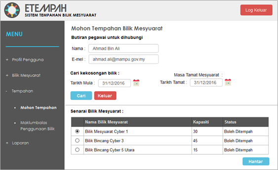
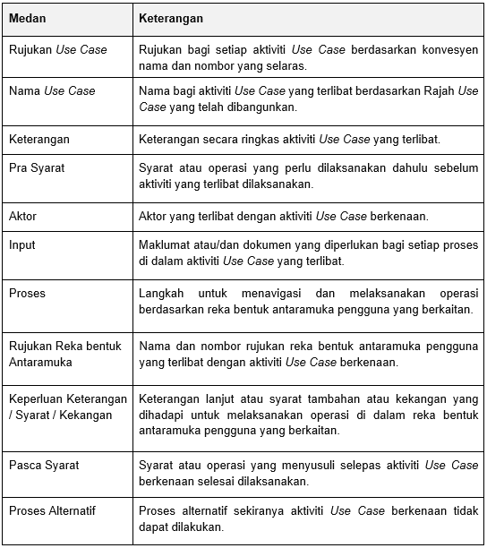

# 4.9 Reka bentuk Transaksi Sistem [F3.5]

Keterangan

Reka bentuk Transaksi Sistem merupakan spesifikasi terperinci sesuatu *Use
Case*. Ianya juga dipanggil Senario *Use Case*. Senario *Use Case* terdiri
daripada langkah-langkah aktiviti yang akan dilakukan dalam sesuatu *Use Case*
dengan disokong oleh reka bentuk antaramuka pengguna dan syarat-syarat/kekangan
bagi setiap langkah yang dinyatakan. Ia akan dijadikan sebagai panduan kepada
pasukan pembangunan untuk membangunkan kod pengaturcaraan yang lebih tersusun
bagi mencapai hasil yang diperlukan.

Objektif

- Membangun Senario *Use Case* bagi setiap *Use Case* selari dengan reka bentuk
  antaramuka pengguna yang telah dibangunkan.

Langkah-langkah

Langkah 1 : Penerangan Ringkas *Use Case*

a) Berdasarkan Rajah *Use Case* yang telah dibangunkan di dalam Pemodelan *Use
Case* [F2.1], pilih salah satu Rajah *Use Case* (Modul) sistem.

b) Ambil salah satu *Use Case* dan terangkan secara ringkas berkaitan *Use Case*

c) Kenalpasti aktor yang akan berinteraksi dengan *Use Case* yang dipilih

d) Nyatakan prasyarat atau aktiviti yang perlu dilaksanakan terlebih dahulu
sebelum *Use Case* yang terlibat dilaksanakan.

Contoh pra syarat bagi Mohon Tempahan Bilik Mesyuarat adalah:

“Pengguna yang sah berjaya log masuk sistem”.

Langkah 2 : Tentukan Langkah-langkah Aktiviti *Use Case*

a) Tentukan langkah-langkah aktiviti *Use Case* yang dipilih.

b) Bagi setiap langkah aktiviti, kenalpasti apakah input (butiran), antaramuka
pengguna dan keperluan/syarat-syarat/ kekangan.

Contoh :

Rajah *Use Case* Modul Tempahan Bilik Mesyuarat terdapat 9 *Use Case*, maka
sebanyak 9 Senario *Use Case*. Ambil *Use Case* pertama iaitu **UC-BM-MT-TBM-01
Mohon Tempahan Bilik Mesyarat** dan senaraikan aktiviti yang terlibat dalam
memohon tempahan.

Langkah aktiviti Mohon Tempahan Bilik Mesyarat:

1. Kemasukan profil pengguna untuk dihubungi
2. Pengguna cari kekosongan bilik berdasarkan Tarikh yang diperlukan

- Sistem akan paparkan senarai bilik mesyuarat dan kemudahan yang disediakan

1. Pengguna Pilih bilik mesyuarat yang dikehendaki dan tempoh penggunaan
2. Pengguna hantar permohonan tempahan

Antaramuka Pengguna yang berkaitan:

**UI-TBM-01** : Permohonan Tempahan Bilik Mesyuarat

**Rajah** **72** **: Contoh Antaramuka Pengguna** **Tempahan Bilik Mesyuarat**

Langkah 3 : Kenalpasti Pasca Syarat *Use Case*

Nyatakan pasca syarat selepas semua langkah aktiviti *Use Case* dilaksanakan.
Contoh pasca syarat *Use Case* Permohonan Tempahan Bilik Mesyuarat adalah:

“Permohonan tempahan bilik mesyuarat telah dihantar notifiaksi kepada pelulus
bagi kelulusan”

Langkah 4 : Nyatakan Proses Alternatif *Use Case*

Proses alternatif merupakan proses pilihan kepada sesuatu langkah aktiviti yang
tidak dapat dilaksanakan secara normal. Contohnya, sekiranya tempahan online
tidak dapat dilaksanakan maka pengguna boleh dilakukan secara emel dengan
menyatakan tarikh, nama bilik mesyuarat.

Langkah 5 : Sedia Dan Lengkapkan Templat Senario *Use Case*

a) Lengkapkan dengan terperinci **Apendiks 7 Templat Senario *Use Case*** bagi
setiap aktiviti *Use Case* yang telah dikenalpasti.

b) Maklumat-maklumat Senario *Use Case* adalah seperti berikut :

**Jadual** **39** **:** **Keterangan Medan-medan Templat Senario *Use Case***

****

c) Sila rujuk jadual 10, contoh pengisian Jadual Senario *Use Case*.

Langkah 4 : Dokumenkan Senario *Use Case*

Dokumenkan semua senario *Use Case* yang telah disediakan ke dalam **D04
Spesifikasi Reka bentuk Sistem.**

**Jadual** **40** **: Pengisian Templat Senario *Use Case***

| **Rujukan *Use Case*** | **UC-BM-TM-TBM-01** |  |  |
|---|---|---|---|
| **Nama *Use Case*** | Mohon Tempahan Bilik Mesyuarat |  |  |
| **Keterangan** | Transaksi bagi memohon tempahan penggunaan bilik Mesyuarat |  |  |
| **Pra Syarat** | Pengguna yang sah berjaya log masuk sistem |  |  |
| **Aktor** | Pemohon |  |  |
| **Input** | **Langkah** | **Rujukan Antaramuka Pengguna** | **Keperluan Keterangan / Syarat / Kekangan** |
| Nama dan emel pegawai untuk dihubungi | 1. Kemasukan profil pengguna untuk dihubungi | UI-TBM-01 | Secara *default* nama dan emel login yang dipaparkan. Nama & emel yang dikemaskini perlu divalidasi dengan senarai warga agensi. Sekira nama @ emel bukan warga agensi, mesej perlu dipaparkan |
| Tarikh Mula dan Tarikh Tamat | 2. Pengguna cari kekosongan bilik berdasarkan Tarikh yang diperlukan. Masukkan Tarikh mula dan tamat dan tekan semak | UI-TBM-01 | Perlu semak: a) Tarikh mula >= Tarikh sistem semasa b) Tarikh tamat > Tarikh mula |
|  | 3. Sistem akan paparkan senarai bilik mesyuarat dan kemudahan yang disediakan | UI-TBM-01 | Sistem akan menyemak semua aset bilik yang berstatus kekosongan dan paparkan butiran Nama, kapasiti dan status |
|  | 4. Pengguna memilih bilik mesyuarat yang dikehendaki dengan *tick* pada ruangan yang disediakan | UI-TBM-01 | Pengguna boleh memilih lebih daripada satu bilik untuk sesuatu tempahan. |
|  | 5. Pengguna hantar permohonan tempahan | UI-TBM-01 | Sistem perlu papar mesej sekiranya hantar permohonan tanpa tick pada senarai bilik. |
| **Pasca Syarat** | Sistem akan menghantar notifikasi kelulusan permohoann tempahan kepada pelulus. |  |  |
| **Proses Alternatif** | Pengguna dapat mengemelkan tarikh dan kapasiti bilik yang diperlukan kepada pentadbir untuk tempahan. |  |  |

Rujukan

1. Dokumen Spesifikasi Reka bentuk Sistem (SDS) ePPAx.
2. Slaid Bootcamp Pembangunan Sistem Pasukan Perunding ICT MAMPU.
