# 4.11 Migrasi Data

Migrasi data merupakan proses memindahkan data daripada satu sumber asal (sama
ada daripada sumber sistem legasi, format excel, *hardcopies* atau sebagainya)
ke destinasi baharu yang berbeza daripada sumber asal.

Proses migrasi ini biasanya dijalankan atas sebab-sebab seperti berikut:

1. Pengembangan skop bisnes yang memerlukan pembangunan/peningkatan sistem;
2. Penggabungan beberapa sistem kepada satu sistem;
3. Penaiktarafan perkakasan dan perisian; dan
4. Proses normalisasi/ semakan semula pangkalan data.

Objektif migrasi data adalah untuk memastikan data daripada sistem legasi dapat
digunakan dalam sistem baharu selaras dengan keperluan bisnes.

2 aktiviti utama dalam migrasi data iaitu:

1. Penyediaan Pelan Migrasi Data; dan
2. Reka bentuk Migrasi Data.

**4.11.1 Penyediaan Pelan Migrasi Data [F3.7]**

Keterangan

Keperluan migrasi data dapat dikenal pasti semasa proses mengenal pasti proses
bisnes sebagaimana diterangkan dalam **Pemodelan Proses Bisnes [F1.4].**
Analisis keperluan migrasi data perlu dijalankan bagi menentukan skop kerja
proses migrasi data, impak migrasi kepada bisnes dan mengenal pasti risiko serta
isu-isu berkaitan proses migrasi data.

Pelan Migrasi Data akan dibangunkan sebagai panduan dan rujukan bagi keseluruhan
pelaksanaan migrasi data hasil daripada analisis keperluan data. Pelan ini
menggariskan strategi, kaedah dan jadual pelaksanaan migrasi data yang perlu
dipatuhi semasa pelaksanaan migrasi data. Penyediaan pelan ini dapat melancarkan
pelaksanaan migrasi data.

Objektif

- Menjalankan analisis keperluan data bagi menghasilkan Pelan Migrasi Data
  sebagai sumber rujukan yang menetapkan strategi, kaedah dan jadual pelaksanaan
  yang akan digunakan dalam pelaksanaan migrasi data.

Langkah-Langkah

Langkah 1 : Analisis Keperluan

Analisis keperluan migrasi akan melibatkan kajian dan perbincangan antara
pemilik proses, pembangun sistem dan pasukan migrasi data. Proses ini dijalankan
bagi menentukan perkara-perkara seperti berikut:

**Jadual** **41** **: Analisa Keperluan Migrasi Data**

**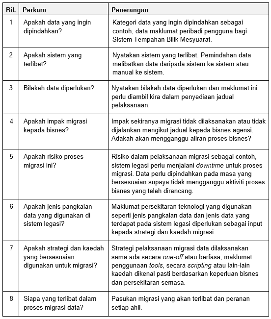**

Langkah 2 : Bangunkan Pelan Migrasi Data

Pelan Migrasi Data dihasilkan selepas analisis keperluan migrasi data selesai
dijalankan dan mengandungi **sekurang-kurangnya** perkara seperti berikut :

**Jadual** **42** **: Isi Kandungan Pelan Migrasi Data**

| **Tajuk** | **Isi Kandungan** |
|---|---|
| Tujuan Dokumen | Penerangan tujuan dokumen dihasilkan adalah untuk dijadikan panduan pagi pelaksanaan migrasi data bagi sistem legasi kepada sistem baharu. Nama sistem perlu dinyatakan dengan jelas. |
| Latar Belakang | Pengenalan ringkas sistem iaitu objektif dan fungsi sistem serta impak pelaksanaan migrasi data kepada bisnes. |
| Objektif Migrasi | Penerangan objektif migrasi data dilaksanakan. |
| Skop Migrasi | Penerangan sistem dan modul yang terlibat dan skop data yang terlibat. a) Nama sistem terlibat – contoh : data daripada Sistem Sumber Manusia akan dipindahkan ke Sistem Tempahan Bilik Mesyuarat b) Modul yang terlibat – contoh : data bagi Modul Pengurusan Pengguna sahaja c) Julat data yang terlibat – contoh : data daripada tahun 2010 hingga 2017 sahaja atau data pegawai gred 41 dan ke atas sahaja. |
| Pendekatan Migrasi Data | Penjelasan tentang pendekatan pelaksanaan migrasi data sama ada berfasa mengikut modul atau sebaliknya. Kaedah migrasi dijalankan iaitu sama ada menggunakan *tools, scripting* atau lain-lain kaedah juga diterangkan dalam bab ini. Bab ini juga mengandungi maklumat sekurang-kurangnya seperti berikut : a) Penambahbaikan atau penyediaan *Service Level Agreement* (SLA) sekiranya perlu; b) Persediaan perkakasan (*hardware*) dan perisian (*software*) diperlukan; c) Aspek teknologi mengenai persekitaran semasa dan persekitaran migrasi yang perlu diambil kira; dan d) Kaedah pengujian dan verifikasi data yang akan digunakan |
| Pasukan Projek | Struktur organisasi bagi pasukan projek dan menyertakan nama-nama pegawai terlibat. |
| Jadual Pelaksanaan | Penerangan jadual pelaksanaan migrasi data yang dicadangkan dalam bentuk gantt chart atau yang bersesuaian. Ia mengandungi aktiviti migrasi bermula daripada analisis keperluan sehingga penyediaan laporan. Jadual pelaksanaan juga perlu mengambil kira aspek seperti berikut : a) Susunan keutamaan data yang ingin dipindahkan; dan b) Tempoh *downtime* yang dibenarkan untuk sistem semasa sekiranya melibatkan sistem yang sedang beroperasi. |

Pelaksanaan migrasi data akan dilaksanakan berdasarkan pelan yang dihasilkan.
Rujuk format **D05 Pelan Migrasi Data.**

Langkah 3 : Sahkan Pelan Migrasi Data

Pelan Migrasi Data yang didokumenkan perlu dibentang dan mendapat pengesahan
pemilik sistem bagi memastikan strategi, kaedah dan jadual pelaksanaan migrasi
data memenuhi keperluan dan mendapat sokongan serta kerjasama daripada pemilik
sistem dan pembangun migrasi data.

Rujukan

1. Pelan Migrasi Data Sistem eRoses.
2. Oracle White Paper (2011). Successful Data Migration.
   http://www.oracle.com/technetwork/middleware/oedq/successful-data-migration-wp-1555708.pdf
3. Credesoft White Paper. Eight key steps which help ensure a successful data
   migration project: A white paper for inspection management professionals.
   http://credosoft.com/wp/wp-content/uploads/2014/01/Eight-key-steps-which-help-ensure-a-successfu-data-migration-project.pdf
4. SAGA Group (2012). Methods of Data Migration.

**4.11.2 Reka bentuk Migrasi Data [F3.8]**

Keterangan

Proses reka bentuk dan pemetaan akan dilakukan selepas selesai pembangunan pelan
migrasi. Proses ini terbahagi kepada empat langkah utama iaitu :

1. Pemetaan jadual (*table*);
2. Pemetaan medan data (*field*);
3. Pemetaan kod; dan
4. Pemetaan rekod (data) disebabkan perubahan kod/id.

Proses ini boleh dilakukan secara manual atau menggunakan *tools*. Antara
*tools* yang boleh digunakan dalam reka bentuk migrasi ialah Altova MapForce,
Talend dan Navicat.

Objektif

- Proses reka bentuk dan pemetaan akan memastikan data yang dipindahkan
  dipetakan dari sumber asal ke destinasi baharu.

Langkah-Langkah

Langkah 1 : Pemetaan Jadual

Langkah pertama ini akan mengenal pasti bagaimana data daripada pangkalan data
sistem legasi dipetakan kepada pangkalan data sistem baharu. Proses ini
melibatkan pengenalpastian jadual yang terlibat pada kedua-dua pangkalan data
sistem legasi dan sistem baharu. Sumber rujukan bagi proses ini adalah Model
Maklumat Logikal bagi pangkalan data sistem yang terlibat.

Contoh pengenalpastian dan pemetaan jadual yang dijalankan dalam proses migrasi
adalah seperti berikut:

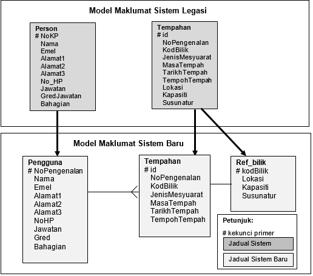

**Rajah** **73** **:** **Pemetaan Jadual antara Pangkalan Data Sistem Legasi dan
Sistem Baharu**

Langkah 2 : Pemetaan Medan Data

a) Kenal pasti elemen data berdasarkan kepada Skema Logikal Pangkalan Data bagi
sistem legasi serta sistem baharu.

b) Bangunkan peraturan bisnes dalam mengendalikan kesemua proses ini. Sebagai
contoh:

1) Alamat lokasi aset disimpan dalam 3 baris berlainan pada pangkalan data
sumber iaitu Address1, Address2 dan Address3. Tentukan sama ada alamat lokasi
aset di destinasi baharu akan mengikut format sumber atau disimpan dalam 1 baris
sahaja pada *field* “Alamat’.

2) Tinggi dan lebar aset direkodkan dalam format sentimeter pada pangkalan data
sistem baharu. Oleh yang demikian, data dalam format inci pada pangkalan data
sistem legasi perlu ditukar kepada sentimeter.

3) Kod aset pada pangkalan data sistem baharu akan diselaraskan menggunakan kod
standard pada *Data Dictionary* Sektor Awam (DDSA).

c) Lengkapkan Apendiks 8a Templat Pemetaan Data Migrasi.

Contoh pengisian pemetaan data :

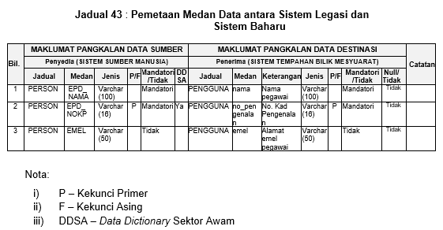

Langkah 3 : Sediakan Keperluan Pemetaan Kod

Proses pemetaan kod dijalankan sekiranya ada keperluan untuk menyesuai dan
menyelaraskan kod (atau ID) bagi atribut daripada sumber data dengan destinasi
baharu data. Proses ini biasanya dijalankan ke atas jadual rujukan.

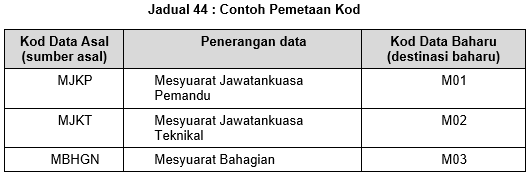

Aktiviti yang terlibat dalam proses keperluan pemetaan kod adalah seperti
berikut.

a) Kenal pasti kod yang berubah.

Kod yang berubah adalah seperti berikut:

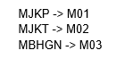

b) Kenal pasti jadual dan medan yang menyimpan maklumat kod tersebut. Contoh
jadual yang dikenalpasti adalah jadual sumber asal: ref_Mesyuarat dan jadual
destinasi baru: ruj_JenisMesyuarat (jadual baharu) seperti jadual dibawah.

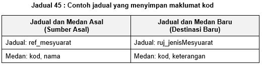

Langkah 4 : Sediakan Keperluan Pemetaan Rekod (Data) Disebabkan Perubahan Kod/ID

a) Adakalanya perubahan kod yang berlaku menyebabkan perubahan ke atas data
dalam rekod maklumat. Perubahan yang berlaku ke atas data memerlukan pemetaan
data berdasarkan perubahan kod (atau ID). Proses pemetaan data dijalankan bagi
menyesuai dan menyelaraskan rekod data berdasarkan kod data baharu. Contoh bagi
keperluan pemetaan rekod (data) disebabkan perubahan kod/ID adalah seperti
berikut.

Dalam sistem lama, rekod skim dan perjawatan adalah dalam jadual sumber asal
iaitu Jadual : ref_skimJwtn seperti dibawah.

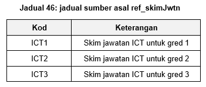

Manakala dalam sistem baru pula, terdapat perubahan dalam kod skim jawatan ICT.
Rekod skim dan gred perjawatan yang baru (dalam sistem baru) adalah dalam jadual
destinasi baru iaitu Jadual : ref_skimGredJwtn seperti dibawah.

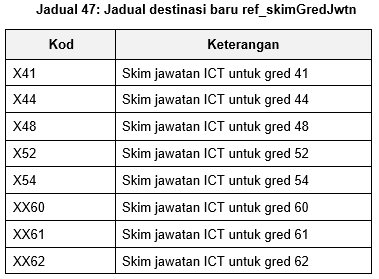

Kedua-dua jadual di atas adalah contoh jadual yang menyimpan rekod skim dan
perjawatan bagi sumber asal dan jadual destinasi baru yang telah dikenalpasti.

Berikut adalah sebahagian daripada medan yang terdapat dalam jadual sumber asal
Jadual : pekerja. Jadual ini menunjukkan rekod pekerja yang mengandungi maklumat
rekod peribadi iaitu termasuklah skim dan gred jawatan serta gaji. Medan ‘gred’
menggunakan gred skim perjawatan yang lama. Jadual dibawah adalah contoh jadual
sumber asal iaitu Jadual : pekerja yang telah dikenalpasti.

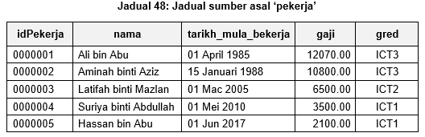

Jadual berikut adalah maklumat yang mengandungi perubahan gred perjawatan bagi
skim ICT yang terlibat berdasarkan gaji dan tempoh perkhidmatan.

Jadual 49: Contoh Maklumat Perubahan Gred Perjawatan

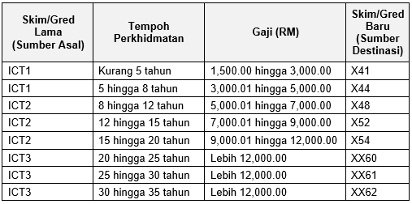

b) Berdasarkan contoh di atas, berikut adalah langkah-langkah yang perlu diambil
bagi melaksanakan pemetaan rekod (data) disebabkan perubahan kod/ID:

i) Kenal pasti data atau rekod yang perlu dikemaskini disebabkan perubahan kod
tersebut. Data atau rekod yang perlu dikemaskini disebabkan perubahan kod adalah
data gred bagi setiap pekerja. Dalam pangkalan data sumber asal, rekod pekerja
disimpan dalam jadual ‘pekerja’ dan medan yang akan mengalami perubahan kod
adalah medan ‘gred’.

Kenalpasti jadual dan medan yang terlibat dalam proses pemetaan data. Jadual
yang terlibat dalam proses pemetaan data adalah jadual sumber asal iaitu Jadual:
ref_skimJwtn dan Jadual: pekerja seperti yang telah dinyatakan di atas.

ii) Sediakan peraturan pemetaan data bagi rekod yang terlibat seperti dibawah.
Contoh pemetaan bagi kod baru (medan ‘gred’) untuk rekod kakitangan di jadual
destinasi baru iaitu Jadual : PERSONEL. Peraturan yang digunakan adalah seperti
yang terdapat dalam jadual perubahan gred perjawatan bagi skim ICT berdasarkan
gaji dan tempoh perkhidmatan. Berdasarkan rajah diatas, peraturan yang terlibat
dalam jadual pekerja adalah dalam medan ‘tarikh_mula_bekerja’ dan medan ‘gaji’.

Contoh pengiraan bagi formula pemetaan data (andaian *current* tarikh adalah 15
Oktober 2018) bagi idPekerja ‘0000001’ adalah seperti berikut.

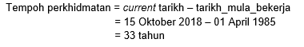

Contoh Jadual bagi idPekerja ‘0000001’ adalah seperti berikut.

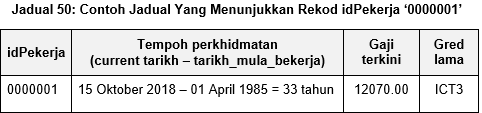

Contoh pemetaan data bagi idPekerja ‘0000001’ berdasarkan jadual Pekerja dan
maklumat perubahan gred perjawatan adalah seperti rajah berikut.

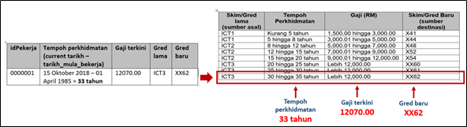

Rajah 74 : Contoh pemetaan data

Pemetaan bagi rekod yang menunjukkan maklumat gred lama dan gred baru adalah
seperti jadual di bawah.

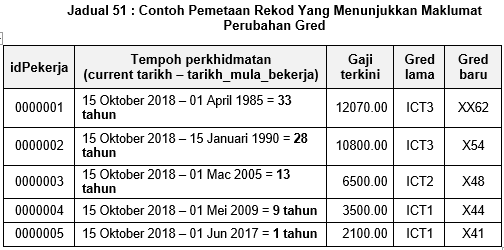

Dalam pangkalan data destinasi, rekod pekerja disimpan dalam jadual pesonel dan
medan yang perlu dikemaskini ialah ‘gred’. Jadual dibawah (jadual: pesonel)
adalah contoh rekod pesonel bagi jadual pesonel di destinasi baru. Medan ‘gred’
menggunakan skim gred perjawatan yang baru. Formula perubahan adalah berdasarkan
jadual perubahan gred perjawatan bagi skim ICT berdasarkan gaji dan tempoh
perkhidmatan seperti di atas. Contoh data yang terlibat dalam perubahan dalam
kod skim jawatan ICT adalah di jadual destinasi baru Jadual : Personel seperti
jadual di bawah.

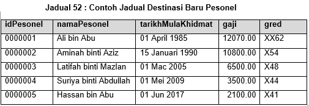

c) Lengkapkan Apendiks 8b) Templat Peraturan Pemetaan Data bagi rekod yang
terlibat.

Contoh pengisian peraturan pemetaan data seperti jadual dibawah.

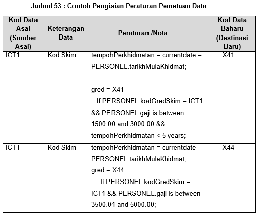

Langkah 5 : Sediakan Spesifikasi Migrasi Data

a) Spesifikasi Migrasi Data perlu dibangunkan dan dijadikan rujukan dalam
pelaksanaan migrasi data bersama-sama Pelan Migrasi Data. Spesifikasi ini akan
mendokumenkan langkah 1 hingga 3 yang telah diterangkan di atas iaitu
mengandungi perkara seperti berikut:

**Jadual** **54** **: Isi Kandungan Spesifikasi Migrasi Data**

**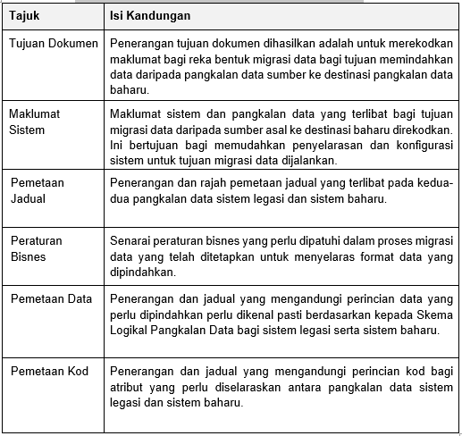**

b) Rujuk format dokumen D06 Spesifikasi Migrasi Data. Dokumen ini juga boleh
dijadikan sebagai lampiran dalam D05 Pelan Migrasi Data.

c) Langkah seterusnya iaitu proses Pelaksanaan Migrasi Data [F6.1] yang mana
terdiri daripada aktiviti Pelaksanaan, Pengujian dan Penyediaan Laporan Migrasi
data.

Langkah 6 : Sahkan Spesifikasi Migrasi Data

**D06 Spesifikasi Migrasi Data** yang didokumenkan perlu dibentang dan mendapat
pengesahan pemilik sistem bagi memastikan kesahihan dan spesifikasi yang
dihasilkan memenuhi keperluan migrasi data.

Rujukan

1. Pelan Migrasi Data Sistem eRoses.
2. Oracle White Paper (2011). Successful Data Migration.
   http://www.oracle.com/technetwork/middleware/oedq/successful-data-migration-wp-1555708.pdf
3. Credesoft White Paper. Eight key steps which help ensure a successful data
   migration project: A white paper for inspection management professionals.
   http://credosoft.com/wp/wp-content/uploads/2014/01/Eight-key-steps-which-help-ensure-a-successfu-data-migration-project.pdf
4. SAGA Group (2012). Methods of Data Migration.
