# 4.12 Integrasi Sistem

Terdapat pelbagai sistem aplikasi dibangunkan untuk menyokong fungsi sesebuah
organisasi. Kewujudan pelbagai sistem aplikasi yang beroperasi secara silo
menyebabkan pertindihan fungsi dan duplikasi data. Integrasi sistem dilaksanakan
untuk membolehkan sistem-sistem aplikasi yang berasingan dapat melaksanakan
tugas secara bersepadu dan *seamless*. Ini dapat meningkatkan produktiviti
pekerja dan memudahkan organisasi mencapai matlamatnya. Selain itu, integrasi
sistem juga dapat meningkatkan ketepatan dan kebolehpercayaan data.

2 aktiviti utama Integrasi Sistem dalam Fasa Reka bentuk iaitu:

1. Penyediaan Pelan Integrasi Sistem; dan
2. Reka bentuk Integrasi Sistem.

**4.12.1 Penyediaan Pelan Integrasi Sistem [F3.9]**

Keterangan

Pelan integrasi dibangunkan sebagai panduan dan rujukan bagi keseluruhan
pelaksanaan integrasi sistem. Pelan integrasi menggariskan kaedah, strategi dan
jadual pelaksanaan integrasi yang perlu dipatuhi.

Objektif

- Menghasilkan Pelan Integrasi berfungsi sebagai rujukan yang menetapkan kaedah
  dan strategi yang akan digunakan serta jangkamasa yang diperlukan semasa
  pelaksanaan integrasi.

Langkah-Langkah

Langkah 1 : Analisis Keperluan

Analisis Keperluan Integrasi perlu dilaksana untuk tujuan penyediaan Pelan
Integrasi. Kajian dan perbincangan perlu melibatkan antara pemilik proses,
pemilik sistem dan pasukan pembangun integrasi. Berikut adalah perkara-perkara
yang perlu diambil kira untuk tujuan penyediaan Pelan Integrasi:

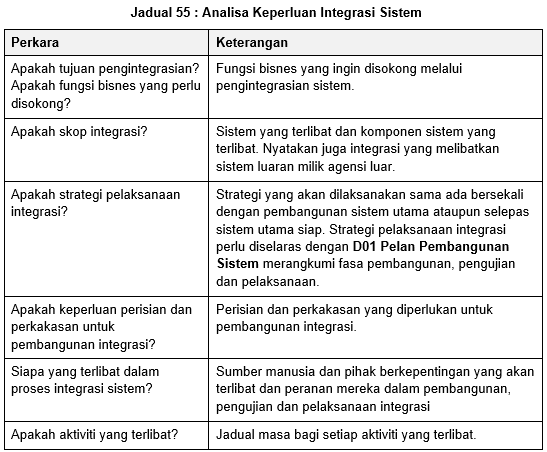

Langkah 2 : Sediakan Pelan Integrasi

Pelan Integrasi dihasilkan selepas analisa keperluan selesai dijalankan dan
mengandungi sekurang-kurangnya perkara seperti berikut:

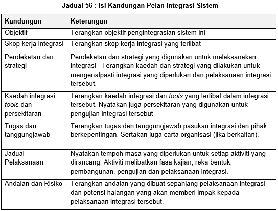

Pelaksanaan integrasi akan dilaksanakan berdasarkan pelan yang dihasilkan. Rujuk
format **D07 Pelan Integrasi Sistem.**

Langkah 3 : Sahkan Pelan Integrasi

Pelan Integrasi yang didokumenkan perlu dibentang dan mendapat pengesahan
kesemua pemilik sistem yang terlibat dengan integrasi bagi memastikan aktiviti
integrasi mendapat sokongan dan kerjasama.

**4.12.2 Reka bentuk Integrasi Sistem [F3.10]**

Keterangan

Integrasi sistem dilaksanakan bagi membolehkan sistem-sistem aplikasi yang
berasingan bertukar maklumat secara automatik dan *seamless*. Ini kerana
terdapat pelaksanaan proses bisnes yang memerlukan fungsi-fungsi daripada sistem
aplikasi berlainan berinteraksi antara satu sama lain.

*Service Orientation Architecture* (SOA) merupakan kaedah integrasi yang
menggunakan servis untuk berinteraksi antara sistem aplikasi. Servis merupakan
logik fungsian yang dibangunkan mewakili proses bisnes. Ia boleh dikemaskini
tanpa mengganggu servis lain dan ini menggalakkan pengintegrasian dilaksanakan
secara *loosely coupled*. Selain itu, servis yang dibangunkan tidak terikat
dengan platform, bahasa pengaturcaraan, sistem pengoperasian dan persekitaran
sistem aplikasi. Ini kerana ia berkomunikasi menggunakan format data yang sama.

Objektif

- Menghasilkan spesifikasi integrasi bagi pelaksanaan keperluan proses bisnes
  yang merentasi fungsi bisnes agensi atau unit bisnes dalam agensi.

Langkah-Langkah

Langkah 1 : Kenal Pasti Keperluan Integrasi

Kenal pasti kebergantungan sistem yang sedang dibangunkan dengan sistem-sistem
lain. Maklumat tersebut boleh diperolehi daripada hasil kajian keperluan sistem
yang terdapat D03 Spesifikasi Keperluan Sistem . Pemodelan *Use Case* dan Rajah
Konteks DFD turut digunakan dalam dokumen tersebut untuk menggambarkan skop
interaksi sistem dengan pengguna atau sistem luaran secara menyeluruh.

Contoh Kajian Kes:

Rajah Konteks Sistem Pengurusan Tempahan Bilik Mesyuarat, **DFD-BM**
menggambarkan secara keseluruhan hubungan sistem dengan entiti luaran.
Berdasarkan Rajah Konteks tersebut, Sistem Pengurusan Tempahan Bilik Mesyuarat
berintegrasi dengan Sistem Sumber Manusia dan Sistem Senggara Aset. Maka langkah
seterusnya akan tertumpu kepada proses yang berlaku dan maklumat yang dikongsi
antara sistem tersebut.

Langkah 2 : Kenalpasti Servis Integrasi Yang Diperlukan

1. Senaraikan keperluan integrasi yang diperlukan. Nyatakan secara ringkas
   keperluan integrasi tersebut. Maklumat terperinci berkaitan servis tersebut
   boleh diperolehi daripada pemodelan *Use Case* dan *Data Flow Diagram* (DFD)
   dalam **D03 Spesifikasi Keperluan Sistem** serta perincian Rajah Aliran
   Proses Bisnes (PFD) dalam **D02 Spesifikasi Keperluan Bisnes.**
2. Maklumat yang perlu ada bagi keperluan servis integrasi adalah seperti di
   Apendiks 9 a) Maklumat Servis Integrasi. Jadual dibawah menunjukkan
   keterangan templat maklumat servis integrasi.

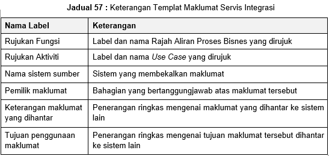

Contoh Kajian Kes:

Penguraian **DFD-BM-MA** menunjukkan bahawa integrasi berlaku semasa menguruskan
aduan kerosakan. Perincian aktiviti berkaitan integrasi tersebut boleh
diperolehi daripada Definisi Fungsi Bisnes pada Pemodelan Proses Bisnes (PFD),
**PFD-BM-MA** dan Rajah *Use Case* **UC-BM-MA.** Senaraikan maklumat yang
diperlukan seperti jadual berikut:

**Jadual** **58** **:** Contoh Maklumat Aktiviti yang Memerlukan Integrasi

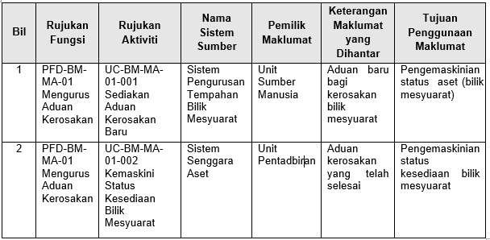

Berdasarkan jadual di atas, terdapat dua servis integrasi yang perlu dibangunkan
iaitu:

1. Sistem Pengurusan Tempahan Bilik Mesyuarat akan menghantar maklumat aduan
   bagi bagi kerosakan bilik mesyuarat.
2. Sistem Senggara Aset akan menghantar maklumat aduan kerosakan yang telah
   selesai.

Langkah 3 : Muktamadkan Format Pertukaran Data (*Data Exchange Format*)

a) Berdasarkan senarai integrasi yang telah dikenalpasti, berikan nama servis
untuk setiap integrasi tersebut dan pendekatan kaedah integrasi yang digunakan.
Terangkan format pertukaran data yang akan digunakan. Rujuk Apendiks 9 b) Format
Pertukaran Data. Keterangan bagi templat Format Pertukaran Data adalah seperti
jadual di bawah.

**Jadual** **59** **: Keterangan Templat Format Pertukaran Data**

**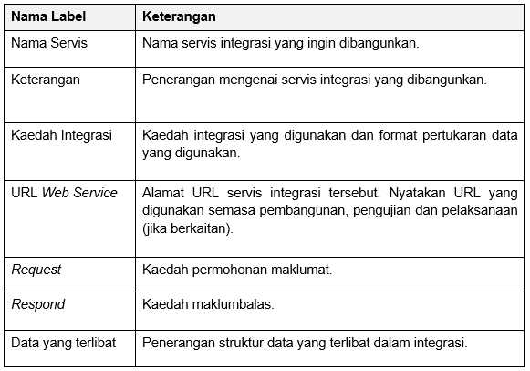**

Contoh Kajian Kes:

Berdasarkan contoh kajian kes, jadual dibawah menunjukkan keterangan servis
integrasi dan data yang terlibat dalam integrasi tersebut.

**Jadual** **60** **:** **Contoh Penerangan Servis Integrasi dan Data yang
Terlibat**

**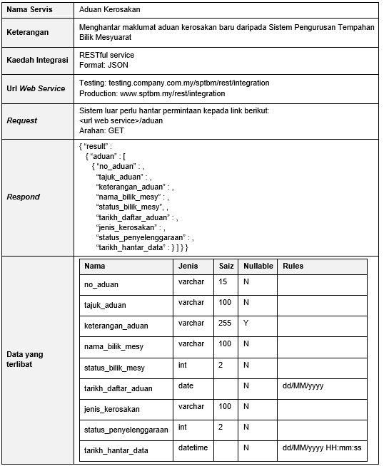**

Jadual di atas menerangkan servis integrasi yang akan dibangunkan untuk
membolehkan Sistem Pengurusan Tempahan Bilik Mesyuarat menghantar maklumat aduan
kerosakan bilik mesyuarat ke sistem luar (Sistem Senggara Aset).

Langkah 4 : Sediakan Pemetaan Data (*Data Mapping*)

a) Kenalpasti struktur data yang diperlukan oleh sistem dan struktur data yang
dihantar oleh sistem sumber. Petakan struktur data tersebut. Apendiks 9 c)
Pemetaan Struktur Data. Keterangan bagi templat pemetaan struktur data adalah
seperti di jadual dibawah.

**Jadual** **61** **: Keterangan Templat Pemetaan Struktur Data**

**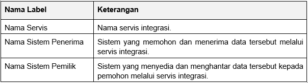**

**Contoh Kajian Kes:**

Berdasarkan contoh kajian kes, jadual dibawah menunjukkan contoh pemetaan
struktur data yang terlibat.

**Jadual** **62** **:** **Contoh Pemetaan Struktur Data**

**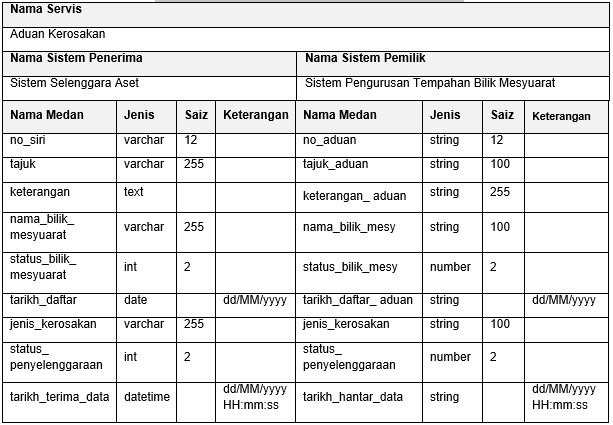**

Jadual 62 menunjukkan pemetaan data aduan kerosakan bilik mesyuarat antara
Sistem Senggara Aset dengan Sistem Pengurusan Tempahan Bilik Mesyuarat. Ini
untuk memastikan data yang diterima daripada Sistem Pengurusan Tempahan Bilik
Mesyuarat memenuhi keperluan Sistem Senggara Aset.

Langkah 5 : Sediakan Peraturan Integrasi Sistem

Kenalpasti aliran proses yang terlibat semasa pertukaran data berlaku. Nyatakan
peraturan yang dilaksanakan semasa pertukaran data tersebut seperti logik
integrasi dan transformasi data. Terdapat 2 jenis proses integrasi iaitu:

a) Proses Khusus (*Specialized Processes*)

Proses Khusus merupakan pengintegrasian untuk melaksanakan proses yang khusus
untuk sistem tertentu. Ini bermakna hanya ada satu output sahaja yang dihasilkan
oleh proses tersebut untuk diproses oleh sistem tertentu.

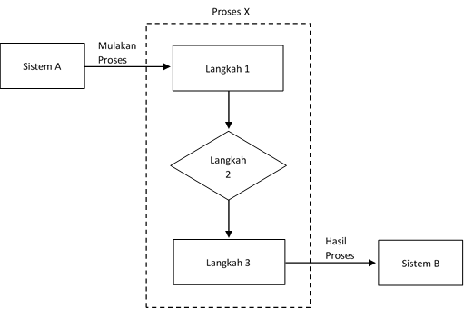

**Rajah** **75** **:** **Proses Khusus**

Berdasarkan rajah di atas, Sistem A akan memulakan Proses X yang terdapat pada
server integrasi. Output yang dihasilkan oleh Proses X akan dihantar kepada
Sistem B untuk diproses. Proses X ini diwujudkan untuk menyokong Sistem B agar
sistem lain boleh melaksanakan prosedur tersebut tanpa perlu mengetahui senarai
proses yang perlu dilakukan.

b) Proses Berbilang Langkah (*Multistep Process*)

Proses Berbilang Langkah melibatkan pengintegrasian lebih dari satu sistem untuk
melaksanakan proses tertentu. Aliran proses yang diwujudkan dalam server
integrasi akan mengendalikan interaksi antara sistem tersebut. Semua transaksi
antara proses dan sistem tersebut perlu mematuhi kekangan transaksi *atomic*.
Ini bermakna sekiranya salah satu transaksi gagal, maka proses tersebut akan
gagal. Maka semua perubahan yang telah berlaku kepada data perlu kembali kepada
asal seolah-olah proses tersebut tidak berlaku. Mekanisma pengurusan
pengecualian (*exception handling mechanism*) perlu diwujudkan untuk
melaksanakan pembalikan (*rollback*) tersebut.

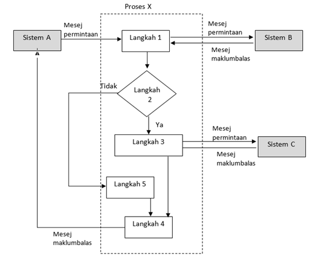

**Rajah** **76** **:** **Proses Berbilang Langkah**

Rajah di atas menunjukkan Sistem A perlu berintegrasi dengan Sistem B dan Sistem
C untuk melaksanakan Proses X. Mesej permintaan digunakan untuk meminta
menggunakan servis atau data yang dikongsi oleh sistem lain manakala mesej
maklumbalas ialah hasil proses servis atau data yang diminta oleh mesej
permintaan tersebut.

Contoh Senario Proses Integrasi:

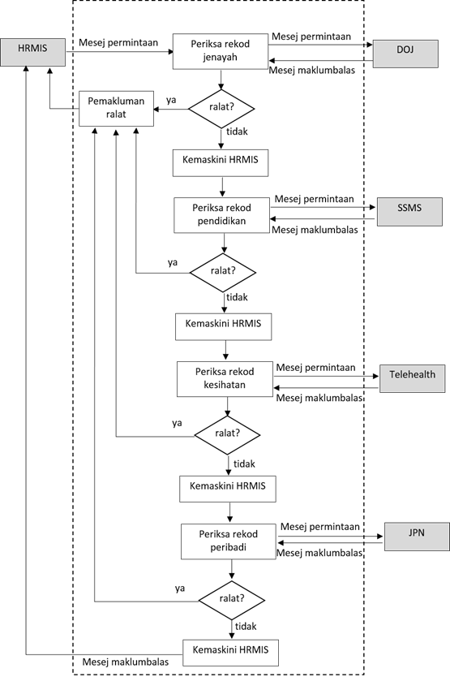

**Rajah** **77** **:** **Contoh Senario Proses Integrasi**

Berdasarkan proses di atas, Sistem Maklumat Rekod Pekerja (HRMIS) akan
menghantar maklumat pekerja kepada proses integrasi untuk memeriksa rekod
jenayah daripada Sistem Maklumat Kehakiman (DOJ), rekod pendidikan daripada
Sistem Maklumat Pendidikan (SSMS), rekod kesihatan daripada Sistem Maklumat
Kesihatan (Telehealth) dan rekod peribadi daripada Sistem Maklumat Pendaftaran
(JPN). Jika semua rekod memenuhi kriteria, proses pengemaskinian akan dilakukan
kepada sistem Telehealth dan HRMIS. Jika berlaku kegagalan semasa transaksi,
mekanisma pengurusan pengecualian (exception handling mechanism) akan memainkan
peranan untuk melaksanakan pembalikan (rollback) proses tersebut. Segala
perubahan yang telah berlaku kepada sistem yang terlibat akan dibatalkan dan
proses tersebut perlu diulang semula.

**Contoh Kajian Kes:**

Sistem Senggara Aset (SSA) akan memohon maklumat aduan kerosakan daripada Sistem
Pengurusan Tempahan Bilik Mesyuarat (SPTBM). Sistem Pengurusan Tempahan Bilik
Mesyuarat akan mendapatkan maklumat aduan kerosakan baru dan menghantar maklumat
tersebut bersama tarikh_hantar_data yang telah dikemaskini. Sistem Senggara Aset
akan menerima maklumat tersebut dan menyimpannya untuk tindakan seterusnya.

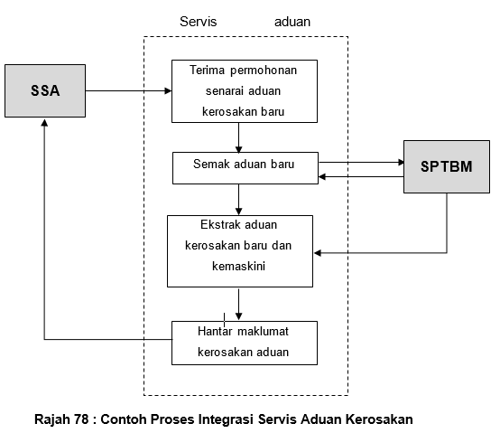

Langkah 6 : Sediakan Reka Bentuk Arkitektur Integrasi

Reka bentuk arkitektur integrasi adalah bergantung kepada cara dan peraturan
integrasi tersebut dilakukan. Penerangan di bawah menunjukkan kaedah integrasi
menggunakan SOAP, *RESTful* dan *messaging*.

a) Arkitektur SOAP

SOAP bermaksud *Simple Object Access Protocol*. Terdapat tiga peranan utama
dalam arkitektur *web service*:

1. Pembekal (*Provider*) - mewujudkan servis dan menjadikannya tersedia untuk
   sistem aplikasi yang ingin menggunakannya.
2. Pemohon (*Requestor*) - menggunakan servis sedia ada dengan menghantar
   permintaan kepada pembekal servis.
3. Pendaftar (*Registry*) – menyimpan maklumat servis yang disediakan oleh
   pembekal servis.

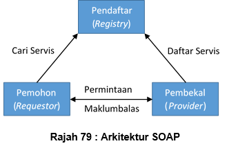

Pembekal servis akan memaklumkan kepada pendaftar tentang servis yang disediakan
dan cara menggunakannya. Pemohon akan mencari servis yang dikehendaki dalam
pendaftar. Setelah mendapat maklumat mengenai servis yang diperlukan, pemohon
akan menghantar permintaan kepada pembekal servis tersebut. Pembekal akan
memberi maklumbalas berdasarkan jenis permintaan tersebut.

b) Arkitektur *RESTful*

REST bermaksud *REpresentational State Transfer*. Ia mempunyai ciri-ciri
berikut:

1. Setiap sumber seperti maklumat boleh diakses melalui URL.
2. Kata arahan GET, POST, PUT atau DELETE akan digunakan semasa mengakses sumber
   tersebut.

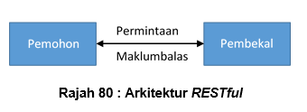

Arkitektur *RESTful* berkonsepkan *client-server*. Permintaan akan dilakukan
oleh klien/pemohon dengan cara menghantar URL sumber yang diperlukan dan kata
arahan. Pelayan/pembekal servis akan memberi maklumbalas berdasarkan URL dan
kata arahan permintaan tersebut.

c) Arkitektur *Messaging*

Penghantaran Mesej (*Messaging*) membolehkan setiap sistem aplikasi
berkomunikasi menggunakan mesej melalui saluran mesej (*message* *channel*) yang
sama. Mesej yang dihantar oleh sistem aplikasi akan diuruskan oleh sistem
penghantaran mesej (*messaging* *system*). Perkongsian data dan arahan adalah
menggunakan mesej.

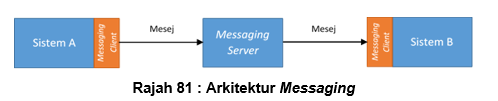

Setiap sistem aplikasi akan dipasang dengan *messaging client* untuk
membolehkannya menghantar dan menerima mesej. *Messaging server* bertindak
sebagai orang tengah yang menguruskan penghantaran mesej.

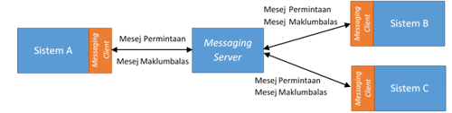

**Rajah** **82** **:** **Arkitektur *Messaging* untuk Pengintegrasian Berbilang
*Server***

Arkitekur *messaging* memudahkan pengintegrasian yang melibatkan proses
berbilang langkah (*multistep step*) kerana ia menyokong pengintegrasian
berbilang sistem. Proses integrasi tersebut akan dibangunkan dalam *messaging
server*.

Langkah 7 : Dokumenkan Spesifikasi Integrasi sistem

Kompilkan hasil langkah-langkah yang telah dilaksanakan ke dalam dokumen **D08
Spesifikasi Integrasi Sistem.**

Langkah 8 : Dapatkan Pengesahan Pengguna

Spesifikasi Integrasi Sistem yang didokumenkan perlu dibentang dan mendapat
pengesahan pemilik sistem bagi memastikan kesahihan dan spesifikasi yang
dihasilkan memenuhi keperluan integrasi sistem.

Rujukan

1. Katalog Servis Pasukan Perunding ICT Sektor Awam (2013).
2. Dokumen SRDS Projek Perkongsian Maklumat Perkhidmatan Perguruan – Edu-XChange
   (2011).
3. Gregor Hohpe & Bobby Woolf (2003). Enterprise Integration Patterns.
   Addison-Wesley. ISBN: 0321200683.
4. MSC CFI Architecture – System Integration Architecture Version 3.0 (2004).
5. Dokumen uCustoms Penang Port Sdn Bhd (PPSB) Integration Specification Issue
   1.0 (2015).
