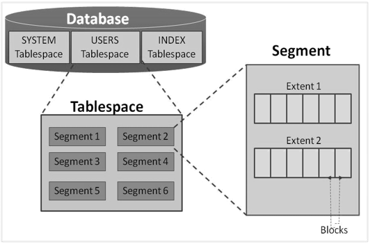
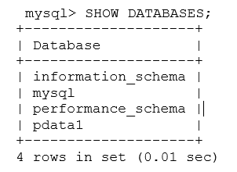
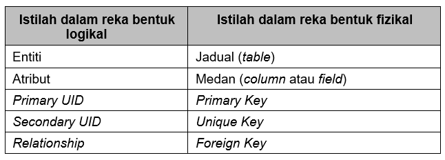

# 5.5 Pembangunan Pangkalan Data [F4.1]

**Keterangan**

Pembangunan Pangkalan Data merupakan proses mewujudkan pangkalan data fizikal
berdasarkan reka bentuk pangkalan data logikal dan arkitektur pangkalan data.
Model data fizikal menggambarkan bagaimana penstoran data dan capaian data
dilakukan. Model ini juga turut menggambarkan jadual, medan yang terdapat dalam
jadual serta spesifikasi bagi storan secara fizikal yang juga boleh merangkumi
pengagihan data dan mekanisma capaian. Ciri-ciri data model fizikal adalah
seperti berikut:-

a) Spesifikasi semua jadual dan medan;

b) Kekunci Asing digunakan bagi mengenalpasti hubungan antara jadual;

c) Data model fizikal adalah berbeza mengikut RDBMS.

Pembangunan Pangkalan Data dilaksanakan oleh Pentadbir Pangkalan Data atau lebih
dikenali sebagai *Database Administrator* (DBA). Terdapat beberapa bahasa yang
boleh digunakan untuk membangunkan pangkalan data, walau bagaimanapun buku
panduan ini hanya mengkhususkan kepada penggunaan *Structured Query Language*
(SQL). SQL merupakan bahasa khusus yang digunakan untuk pembangunan pangkalan
data dan mengurus data-data yang berada dalam Sistem Pengurusan Pangkalan Data
Hubungan (*Relational Database Management System*-RDBMS). SQL terdiri daripada:

a) Bahasa Kawalan Data (*Data Control Language*-DCL) seperti *GRANT, REVOKE*;

b) Bahasa Definisi Data (*Data Definition Language*-DDL) seperti *CREATE, DROP,
ALTER, RENAME, TRUNCATE;* dan

c) Bahasa Manipulasi Data (*Data Manipulation Language*-DML) seperti *SELECT,
INSERT, UPDATE, DELETE*.

**Objektif**

- Membangunkan pangkalan data fizikal untuk tujuan pembangunan dan pengujian
  sistem

**Langkah-Langkah**

**Langkah 1 : Pemasangan (*Install*) Perisian RDBMS**

Bagi membangunkan pangkalan data fizikal, perisian RDBMS yang dipilih perlu
dipasang terlebih dahulu. Sekiranya MySQL yang dipilih, perisian tersebut boleh
dimuat turun daripada laman web MySQL dan rujuk dokumentasi pemasangan langkah
demi langkah daripada laman web yang sama.

**Langkah 2 : Peruntukan Ruang Jadual (*Tablespace*)**

a) Struktur storan pangkalan data terdiri daripada struktur storan fizikal dan
struktur storan logikal. Struktur fizikal terdiri fail-fail seperti *datafiles,
redo log files* dan *control files.* Manakala struktur logikal pula terdiri
daripada beberapa *tablespace* iaitu ruang sebenar bagi menyimpan beberapa
*datafile*.

Rajah 84 : Struktur Storan Secara Logikal Dalam Pangkalan Data

Berdasarkan rajah di atas, t*ablespace* adalah storan logikal yang mengandungi
beberapa *segment. Segment* adalah objek pangkalan data yang terdiri daripada
jadual-jadual dan *index*. Satu *segment* mengandungi beberapa set *extent* yang
diperuntukkan bagi objek pangkalan data secara spesifik seperti jadual. Sebagai
contoh, jadual pengguna disimpan dalam data *segment* yang tersendiri manakala
*index* bagi jadual pengguna disimpan dalam *index segment* itu sendiri. Namun
begitu, semua *extent* yang diperuntukkan dalam satu *segment* adalah disimpan
dalam *tablespace* yang sama. Sebagai contoh, satu *segment* disimpan dalam
pengguna01.dbf manakala *segment* yang satu lagi adalah dalam pengguna02.dbf.
Setiap *extent* terdiri daripada beberapa data *block* yang diperuntukkan untuk
menyimpan data yang spesifik*.* Satu data *block* adalah ruang cakera yang
spesifik kepada jumlah bait (*byte)*. Sebagai contoh, satu data *block* adalah
ruang cakera fizikal berjumlah 2KB. Peruntukan bagi 24KB dalam satu *extent,*
sebanyak 12 data *block* diperlukan*.* Data *block* adalah unit terkecil dalam
storan pangkalan data yang diperuntukkan untuk menyimpan *datafile* secara
fizikal.

b) Ruang jadual adalah lokasi storan bagi data sebenar yang terdapat dalam objek
pangkalan data. Ruang jadual hanya memperuntukkan lokasi storan bagi pangkalan
data. Dengan menggunakan ruang jadual, DBA boleh mengawal bagaimana reka bentuk
penstoran dilakukan semasa proses pembangunan pangkalan data. Fungsi penggunaan
ruang jadual adalah untuk mengoptimumkan prestasi pangkalan data iaitu seperti
pengasingan lokasi atau jenis cakera bagi penyimpanan jenis pengaksesan ke atas
data. Iaitu seperti data yang kerap diindeks atau diakses perlu disimpan dalam
cakera yang lebih stabil seperti *solid-state drive* (SDD) manakala data yang
mengandungi data atau fail arkib disimpan dalam cakera yang biasa seperti
*standard hard drive* (HDD).

c) Arahan yang digunakan untuk mencipta ruang jadual bagi Oracle, DB2, Informix,
PostgreSQL, MySQL adalah seperti berikut.

**CREATE TABLESPACE <nama ruang jadual>;**

Manakala SQL pula arahan adalah seperti berikut.

**FILEGROUP <nama ruang jadual>;**

**Langkah 3 : Ciptakan Pangkalan Data (*Create A Database*)**

a) Pengguna yang mempunyai capaian *root* dibenarkan untuk mencipta pangkalan
data. Arahan yang digunakan untuk mencipta pangkalan data ialah:

**CREATE DATABASE <nama pangkalan data>;**

Contoh arahan untuk mencipta pangkalan data pdata1 adalah seperti berikut:

**mysql> CREATE DATABASE pdata1**

b) Bagi melihat senarai pangkalan data yang telah dicipta, arahan yang digunakan
adalah seperti berikut.

**SHOW DATABASES;**

Berikut adalah paparan bagi arahan tersebut.

Paparan di atas menunjukkan bahawa terdapat empat (4) pangkalan data yang
terdapat dalam hos pelayan (*server host*).

**Langkah 4 : Wujudkan Jadual (*Create Table*)**

a) Jadual diwujudkan setelah pangkalan data siap dibangunkan. Jadual adalah
terdiri daripada baris dan lajur yang mengandungi rekod maklumat dalam pangkalan
data. Dalam reka bentuk pangkalan data logikal (sila rujuk **Reka Bentuk
Pangkalan Data Logikal [F3.3]**) Entiti adalah merujuk kepada jadual (*table*)
bagi pangkalan data fizikal. Manakala atribut pula adalah medan (*field*).
Jadual berikut adalah pemadanan secara teknologi antara reka bentuk pangkalan
data logikal dan fizikal.

**Jadual 63 : Pemadanan Istilah antara reka bentuk logikal dan fizikal pangkalan
data**

****

b) Arahan bagi mencipta jadual adalah seperti berikut.

**CREATE TABLE <nama jadual> (<nama medan> <jenis medan> NOT NULL**

**PRIMARY KEY <AUTO_INCREMENT sekiranya jenis medan adalah INT>,**

<nama medan> <jenis medan>;

i) Untuk mengelakkan data tidak diisi ciri-ciri *NOT NULL* diberikan kepada
medan tersebut.

ii) Ciri medan *AUTO_INCREMENT* adalah bagi menambahkan satu nilai seterusnya
dalam medan dengan mengambil kira bahawa jenis medan adalah *INT*

iii) Medan yang ditakrif sebagai *PRIMARY KEY*adalah menunjukkan bahawa medan
tersebut adalah kunci utama dalam jadual. *PRIMARY KEY* boleh ditakrifkan kepada
satu atau lebih medan.

Contoh arahan bagi mencipta jadual aset adalah seperti berikut.

**CREATE TABLE aset (id INT NOT NULL PRIMARY KEY AUTO_INCREMENT,**

**nama VARCHAR(20),**

**catatan VARCHAR(50);**

**Langkah 5 : Wujudkan *VIEW* (*Create VIEW*)**

*a) VIEW* adalah merujuk kepada jadual maya yang dihasilkan melalui arahan
*SQL*. Jadual adalah terdiri daripada baris dan lajur yang mengandungi rekod
maklumat berdasarkan arahan *SQL* yang telah dilaksanakan.

b) Dalam satu pangkalan data, *view* dan jadual berkongsi ruang jadual. Namun
begitu, *view* dan jadual tidak boleh mempunyai nama yang sama.

c) Beberapa fungsi *SQL* boleh dimasukkan ke dalam arahan seperti *WHERE* dan
arahan *JOIN* daripada beberapa jadual lain kepada jadual maya yang mana fungsi
arahan tersebut dipaparkan sebagai satu jadual. Arahan bagi mencipta *view*
adalah seperti berikut.

**CREATE VIEW <nama_view> AS**

**SELECT <medan1>, <medan2>, ...**

**FROM <nama_jadual>**

**WHERE condition;**

Contoh arahan bagi mencipta view bagi tempahan bilik oleh pengguna adalah
seperti berikut.

**CREATE VIEW penggunaTempahBilik AS**

**SELECT pengguna.nama, bilik_mesy.namabilik, bilik_mesy.lokasi**

**FROM pengguna, bilik_mesy**

**WHERE pengguna.nokp == bilik_mesy.nokp;**

**Langkah 6 : Wujudkan *INDEX* (*Create INDEX*)**

a) Kebiasaannya data disimpan tidak mengikut urutan. Data baru yang dimasukkan
tidak disimpan mengikut susunan berdasarkan data yang dimasukkan terdahulu. Oleh
yang demikian, tempoh untuk menemui data berdasarkan arahan adalah kurang pantas
berbanding kemasukkan data. Dengan itu, index perlu dilakukan bagi membolehkan
data ditemui dengan lebih cepat.

b) Arahan *INDEX* digunakan untuk medan-medan tertentu dalam sesuatu jadual bagi
mempercepatkan carian data. Lokasi sesuatu data lebih pantas ditemui berbanding
carian satu- persatu baris yang terdapat dalam jadual jika tidak menggunakan
*INDEX*. Arahan bagi mencipta *index* adalah seperti berikut.

**create index <nama index> on <nama jadual> (<nama medan>);**

Contoh arahan bagi mencipta indeks no kad pengenalan pengguna adalah seperti
berikut.

**create index nokp_idx on pengguna(nokp);**

**Langkah 7 : Memuat Masuk (*Load*) Data Ke Dalam Pangkalan Data**

Sekiranya terdapat data daripada pangkalan data lama, data tersebut boleh dimuat
masuk ke dalam pangkalan data yang baru dibina. Terdapat dua cara untuk memuat
masuk data yang sedia ada ke dalam pangkalan data iaitu:

a) Menggunakan Penyataan INSERT

Penyataan ini adalah untuk memasukkan rekod ke dalam jadual. Sintaks bagi
penyataan INSERT adalah seperti berikut.

**INSERT INTO <nama jadual> (<nama medan>)**

**VALUES (data1),**

**(data2);**

Contoh penyataan untuk memasukkan rekod ke dalam jadual adalah seperti berikut.

**INSERT INTO pengguna (nama, emel, nombor_telefon, alamat,**

**BAHAGIAN_id)**

**VALUES (‘Sanem Can Divit’, ‘Alamat emel ini dilindungi dari Spambot. Anda
perlu hidupkan JavaScript untuk melihatnya.’, ’03-88723038’,**

**‘No.1, Jalan Albatross, 62300 Putrajaya’, ‘BPI’);**

b) Menggunakan Penyataan *LOAD DATA*

Penyataan *LOAD DATA* membolehkan data banyak yang terdapat dalam fail teks
dimasukkan ke dalam pangkalan dengan data menggunakan satu arahan sahaja.
Sintaks bagi penyataan *LOAD DATA* adalah seperti berikut.

**LOAD DATA INFILE <nama fail teks.txt> INTO TABLE <nama pangkalandata.nama
jadual>;**

Contoh penyataan untuk memasukkan rekod ke dalam jadual adalah seperti berikut.

**LOAD DATA INFILE pengguna.txt INTO TABLE dbtempahan.pengguna;**

**Langkah 8 : Wujudkan Pengguna Dan Kawalan Capaian**

a) Pengguna diwujudkan untuk mengakses sesuatu pangkalan data. Dengan itu,
pengguna perlu mempunyai capaian *root* untuk melaksanakan aktiviti-aktiviti
pembangunan pangkalan data dan juga mencipta pengguna. Berikut adalah arahan
yang digunakan untuk mencipta pengguna.

**CREATE USER '<nama pengguna> '@'<nama hos>' IDENTIFIED BY '<kata laluan>';**

Contoh arahan untuk mencipta pengguna nama1 adalah seperti berikut:

**mysql> CREATE USER 'nama1'@'localhost' IDENTIFIED BY 'katalaluan';**

b) Pentadbir pangkalan data (*Database Administrator* – DBA) boleh memberi
kebenaran pengguna untuk mencapai beberapa akses melalui arahan *GRANT* seperti
berikut:

**GRANT ALL PRIVILEGES ON database.table TO 'user'@'localhost';**

Arahan di atas memberikan semua kawalan akses ‘*GRANT ALL PRIVILEGES’* bagi
semua pangkalan data dan jadual ‘*database.table’* kepada pengguna ‘*user*’’.

c) Berikut adalah senarai arahan kebenaran yang digunakan mengikut kesesuaian
capaian.

*i) ALL PRIVILEGES* – membenarkan semua aktiviti

*ii) CREATE* – membenarkan pengguna mencipta pangkalan data dan jadual

*iii) DROP* – membenarkan pengguna menghapus pangkalan data dan jadual

*iv) DELETE* – membenarkan pengguna menghapuskan baris rekod dalam jadual

*v) INSERT* – membenarkan pengguna menambah baris rekod dalam jadual

*vi) SELECT* – membenarkan pengguna membaca rekod dalam pangkalan data

*vii) UPDATE* – membenarkan pengguna mengemaskini rekod dalam jadual

d) Pentadbir pangkalan data (*Database Administrator* – DBA) boleh memberi
menarik semula kebenaran pengguna melalui arahan REVOKE seperti berikut:

**REVOKE ALL PRIVILEGES ON database.table TO 'user'@'localhost';**

Arahan di atas menarik balik semua kebenaran kawalan akses ‘*REVOKE ALL
PRIVILEGES*’ bagi semua pangkalan data dan jadual ‘*database.table’* kepada
pengguna *‘user’’*.

**Langkah 9 : Dokumenkan Pangkalan Data**

Dokumenkan maklumat pangkalan data fizikal yang dibangunkan ke dalam **D09
Dokumen Pangkalan Data**. Dokumentasi mengikut susunan berikut:

a) Ringkasan maklumat pangkalan data fizikal.

b) Skrip yang mengandungi arahan-arahan

**Rujukan**

1. Oracle Database SQL Language Reference, 11g Release 2 (11.2).

2. MySQL 5.7 Reference Manual.
