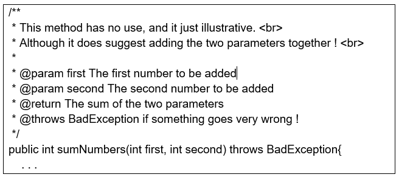
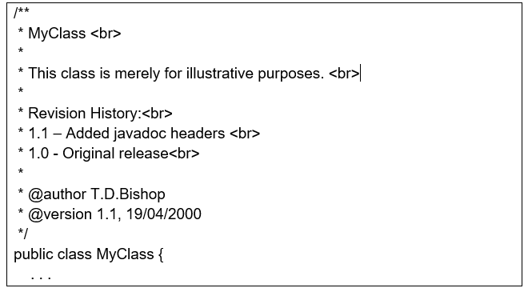
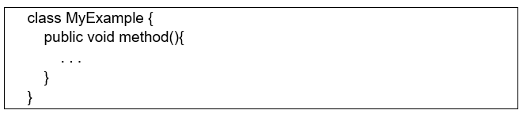
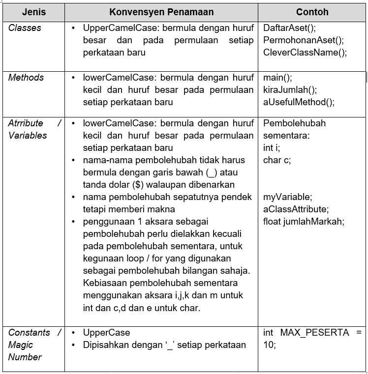

# 5.6 Pengaturcaraan Aplikasi [F4.2]

**Keterangan**

Pengaturcaraan aplikasi adalah proses untuk menulis kod aturcara bagi
menghasilkan satu sistem aplikasi. Kod ini menentukan tindakan yang perlu
dilaksanakan oleh sistem. Ia ditulis oleh pengaturcara program menggunakan
bahasa pengaturcaraan tertentu. Terdapat pelbagai bahasa pengaturcaraan dan
*tools* yang boleh digunakan.

Fasa ini sangat penting kerana ia mempengaruhi fasa seterusnya iaitu fasa
pengujian dan penyelenggaraan. Satu kod yang ditulis dengan baik mampu
mengurangkan kerja-kerja pada kedua-dua fasa tersebut. Sehubungan itu, tumpuan
harus diberikan semasa fasa pembangunan ini supaya dapat menghasilkan kod
aturcara yang berkualiti dan memenuhi keperluan pengguna.

Terdapat beberapa teknik dalam pengaturcaraan:

**a) Teknik Pengaturcaraan Tidak Berstruktur (*Unstructred Programming*)**

Kod ditulis tanpa berstruktur, semua arahan ditulis dalam fungsi main().

**b) Pengaturcaraan Berstruktur (*Structure Programming*)**

Pengaturcaraan berstruktur merupakan pengaturcaraan bertatacara. Kod yang besar
dipecahkan kepada kaedah-kaedah pendek (juga dikenali sebagai fungsi atau
tatacara) yang lebih kecil agar mudah difahami.

Pengaturcaraan berstruktur biasanya dikaitkan dengan reka bentuk yang
menggunakan pendekatan atas-bawah. Dengan pendekatan ini, pengaturcara memetakan
struktur yang besar dalam aturcara kepada bentuk operasi kecil, seterusnya
melaksanakannya dan menguji operasi-operasi kecil tersebut, dan akhirnya
menggabungkan kepada keseluruhan aturcara.

**c) Pengaturcaraan Berorientasikan Objek** **(O*****bject-Oriented
Programming*****)**

Pengaturcaraan berorientasikan objek merupakan aturcara komputer yang terdiri
daripada sekumpulan unit-unit atau objek. Setiap objek berupaya untuk menerima
dan menghantar mesej (pesanan) kepada objek lain. Dengan cara ini, mesej dapat
ditangani oleh sebahagian daripada kod. Konsep Asas pengaturcaraan
berorientasikan objek adalah seperti berikut:

i) Kelas*(class)* — sebuah kelas mentakrifkan ciri-ciri abstrak bagi sesuatu
benda. Ini termasuklah sifat-sifat yang ada padanya dan peranannya.

ii) Objek*(object)* — *instance* bagi suatu kelas.

iii) Kaedah*(method)* — kebolehan bagi sebuah objek.

iv) Pewarisan*(inheritance)* — lazimnya sebuah kelas boleh memiliki "subkelas"
yang mengkhususkan kelas tersebut. Semua subkelas ini akan "mewarisi" segala
sifat yang ada pada kelasnya.

v) Pengkapsulan*(encapsulation)* — mengasingkan pelaksanaan (implementasi)
daripada antaramuka.

vi) Pengabstrakan*(abstraction)* — mengurangkan struktur data dan operasi kepada
jenis data yang mudah dan hanya mengandungi *properties* yang penting untuk
tujuan tertentu.

vii) Polimorfisme*(polymorphism)* — menggunakan nama yang sama untuk memulakan
operasi yang berlainan pada objek yang menggunakan jenis data berbeza.

**d) Pengaturcaraan Web (*Web Programming*)**

Pengaturcaraan web merujuk kepada penulisan, *markup* dan pengekodan yang
terlibat dalam pembangunan web, ia termasuk kandungan web, pelanggan web, skrip
pelayan dan keselamatan rangkaian. Bahasa pengaturcaraan yang biasa digunakan
untuk pengaturcaraan web adalah XML, HTML, JavaScript, Perl, PHP dan lain-lain.

***e) Stored Procedure***

Satu set arahan komputer yang disimpan dalam pangkalan data untuk membuat
capaian data dari pangkalan data. *Store procedure* boleh menyimpan logik
pengaturcaraan yang pada asalnya dilaksanakan oleh kod aturcara. *Stored
procedure* dapat menjimatkan masa dan *memory* di mana proses yang komplek dan
memerlukan pelaksanaan beberapa kenyataan SQL dilaksanakan oleh *store
procedure*.

**Objektif**

- Menulis kod dalam struktur yang tersusun dan ringkas supaya mudah untuk dibaca
  dan difahami, diubahsuai / ditambahbaik dan diselengara.
- Menukarkan dokumen SDS kepada kod aturcara dan membuat ujian unit ke atas kod
  yang dibangunkan. Seterusnya menghasilkan produk iaitu Sistem Aplikasi yang
  memenuhi kehendak pengguna.

**Langkah-langkah**

**Langkah 1: Sediakan Keperluan Pra Pembangunan**

a) Menyediakan keperluan teknikal seperti pendekatan, teknik, *tools*, bahasa
pengaturcaraan, pangkalan data dan lain-lain keperluan teknikal yang berkaitan
sebelum aktiviti pembangunan dilaksanakan seperti dalam **Penyediaan Pelan
Pembangunan Sistem [F1.1]** - **Langkah 4: Proses Teknikal.**

b) Pasukan pembangunan perlu memahami dengan mendalam Spesifikasi keperluan
sistem dan Spesifikasi Reka bentuk Sistem.

**Langkah 2 : Pertimbang Dan Laksanakan Amalan Terbaik Dalam Pengaturcaraan**

a) Amalan baik dalam pengaturcaraan (*Best Programming Practise*) adalah satu
set peraturan tidak rasmi yang dihasilkan daripada pengalaman dan pembelajaran
oleh komuniti pembangun sistem dari semasa ke semasa. Setiap bahasa
pengaturcaraan mempunyai set peraturan yang tersendiri. Teknik dan amalan
pengaturcaan yang baik dapat meningkatkan kualiti dan prestasi perisian yang
dihasilkan. Berikut adalah cadangan-cadangan umum praktis pengaturcaraan yang
baik:

i) Penggunaan Konvensyen Ulasan (*Commenting Convention*)

Konvensyen ulasan adalah meletakkan ulasan / komen dalam bahasa yang difahami
oleh pembaca dalam kod aturcara. Ia menerangkan secara ringkas tentang apa yang
kod laksanakan. Komen-komen ini sangat penting supaya pengaturcara dapat menulis
perkara-perkara rumit/penting yang telah dilaksanakan dalam kod tersebut.
Melalui ulasan / komen, pengaturcara boleh mengetahui kegunaan kod tanpa perlu
membaca keseluruhan kod. Berikut adalah contoh maklumat yang direkodkan sebelum
sesuatu kod ditulis (format/*syntax* komen ini bergantung kepada Bahasa
pengaturcaraan yang digunakan):

- Bahagian atas setiap fail kod sumber (*File* *Header Comment)* - Pengaturcara
  asal,

    - Tarikh

    - Tujuan

    - Algorithma yang digunakan (merujuk kepada SDS mana)

    - Senarai pengubahsuaian kepada kod aturcara

- Fungsi / Method

- Purpose of method
 - Argument descriptions
 - Result descriptions
 - Exceptions thrown

Contoh catatan dalam fungsi:

- *In line*

Kod yang rumit dan kurang jelas, diletakkan komen pada bahagian atas sebelum kod
atau sebaris dengan kod yang ditulis, untuk memberi penerangan mudah berkaitan
kod yang ditulis.

- *Classes and Interfaces*

*- Nama Kelas
 - Keterangan berkaitan kelas dan tujuannya
 - Versi Semakan
 - Nama pengaturcara asal
 - Version*

Contoh penggunaan *classes* dan *interfaces*:

- Pembolehubah  *(Variables***)**

    Ulasan untuk pembolehubah sepatutnya ringkas sahaja, menerangkan secara
    ringkas apa kegunaannya.

    ii) Penggunaan Konvensyen Pemformatan (*Formatting Convention*)

    Pemformatan menjadikan kod yang dihasilkan tersusun, seragam, mudah dibaca
    dan dicetak. Penggunaan format haruslah konsisten sepanjang kod ditulis.
    Berikut adalah antara format-format yang di syorkan:

- *Indentation dan Layout*

*- Tetapkan saiz yang standard untuk inden. Secara global saiz inden ditetapkan
kepada 4 ruang (4 spaces) untuk setiap peringkat.
 - Baris kod tidak terlalu panjang, elakkan penggunakan horizontal scroll.
   Pecahkan kod-kod yang panjang (Break up long lines) kepada yang lebih pendek
   dan pastikan ia dipecahkan pada titik yang bersesuaian supaya mudah dibaca
   dan dicetak – maksimum 100 aksara untuk setiap baris.*

- *Bracketing –* selaraskan susunan penggunaan ‘{‘ dan ‘}’ supaya selari, atau
  menggunakan *slanting style*, di mana ‘{‘ adalah dihujung kod manakala ‘}’
  selari dengan permulaan kod.

Contoh penggunaan bracketing:

- Penulisan HTML – tetapkan format untuk *tags* dan *attributes*, seperti
  menggunakan huruf besar untuk semua *tags* dan huruf kecil untuk *attributes*.
- Penulisan penyataan SQL – gunakan huruf besar untuk kata kunci (SELECT,
  DELETE, UPDATE, WHERE, ORDER BY) dan huruf kecil elemen pangkalan data seperti
  nama *tables, columns* dan *views*.
- Susun setiap klausa SQL yang utama pada baris yang berasingan supaya kenyataan
  ini adalah lebih mudah untuk dibaca dan dipinda.

Penggunaan format haruslah konsisten dalam setiap kod yang ditulis. Penggunaan
gaya pengaturcaraan yang bercampur akan menyukarkan proses penyelenggaraan atau
penambahbaikan kod.

iii) Penggunaan Konvensyen Penamaan (*Naming Convention*)

Konvensyen penamaan adalah satu set peraturan untuk menentukan pemilihan nama
bagi pembolehubah, fungsi, kelas dan lain-lain entiti dalam kod sumber termasuk
nama fail dan folder yang terlibat.

- Gunakan nama yang memberi makna, mudah difahami dan sesuai dengan tujuannya.
  Contoh fungsi Cetak(), melaksanakan fungsi untuk mencetak.
- Penggunaan nama yang baik mampu menggambarkan kandungan/ tujuan entiti
  tersebut (*Self Describing*) dan mudah dicari.
- Elakkan penggunaan nama-nama yang hanya berbeza pada aksara, contoh cetak dan
  Cetak tetapi berbeza tujuan.
- Elakkan penggunakan nama yang boleh mengelirukan, contohnya x. Tidak memberi
  sebarang makna.

**Jadual** **64** **:** **Contoh Konvensyen Penamaan**

****

iv) Konvensyen Pengaturcaraan (*Programming Convention*)

Konvensyen pengaturcaraan menjadikan kod mudah dibaca dan membenarkan pasukan
memahami kod yang baru dengan lebih cepat.

**Kod Sumber**

- Kod yang ditulis perlu mudah dan jelas - elakkan penulisan kod yang panjang,
  contohnya melebihi 20 baris. Amalkan penggunaan pengaturcaraan berstruktur /
  bertatacara.
- Elakkan penggunaan nilai *hard-coded* / *magic numbers* – kod sumber
  seharusnya tidak menggunakan *hard-coded* untuk merujuk kepada mana-mana
  parameter seperti *paths, file, host*, alamat IP, URLs, *ports* dan lain-lain.
  Penggunaannya dalam kod menyebabkan ia sukar untuk dikenal pasti jika perlu
  diubah. Sebaiknya wujudkan pembolehubah dan ia dikonfigurasi dengan baik.

    private final int ST = 2;

    private final int E = 3;

    private final int S = 1;

- Mewujudkan *Program Versioning*
- Mewujudkan fungsi / method yang boleh dikongsi
- Direktori simpanan - Simpan fail dalam *folder* secara teratur untuk
  mrmudahkan carian
- Security - validation, code hard (SQL injection)
- Menyediakan mesej ralat yang menggambarkan ralat sebenar, agar mudah untuk
  mengesan punca ralat.
- Elakkan penggunaan penyataan bersarang yang melebihi 3 peringkat (deeply
  nested control statements).

**Pengaturcaraan Pangkalan Data**

- Elakkan penggunaan SELECT *, Biasakan menulis dengan jelas kolum-kolum yang
  dikehendaki.
- Gunakan *stored procedure* untuk menggantikan penyataan SQL dalam kod sumber
  bagi meningkatkan prestasi capaian data.
- Melakukan *data validation* pada client semasa data entry. Ini dapat
  mengelakkan capaian ke pangkalan data berulang kali dengan data yang tidak
  sah.

**Langkah 2 : Bangunkan Sistem**

a) Menyediakan persekitaran pembangunan (*development environment*).

i) Membina dan memasang perisian, perkakasan (*server*), rangkaian, *tools* dan
lain-lain peralatan yang berkaitan.

ii) Menguji persekitaran pembangunan supaya memenuhi keperluan pembangunan.

b) Mewujudkan dokumentasi *coding standard* (Rujuk Dokumentasi Kod Sumber).

c) Memulakan penulisan kod aturcara (Rujuk Amalan Baik dalam Pengaturcaraan).

d) Melaksanakan ujian unit bagi setiap komponen sistem dan mendokumenkan
keputusan dalam Laporan Ujian (Keterangan lanjut dalam perenggan **Ujian Sistem
[F4.3]**).

**Langkah 3 : Menyediakan Dokumentasi Kod Sumber**

a) Dokumentasi kod sumber adalah dokumen yang mengandungi senarai kod aturcara
yang meliputi struktur direktori dan hierarki fail serta garis panduan yang
mengesyorkan perkara berkaitan gaya pengaturcaraan (*style*), konvensyen
penamaan, *indentation*, ulasan / komen, pengistiharan pembolehubah, penyataan
SQL dan lain-lain yang perlu dipatuhi oleh semua pengaturcara. **Rujuk D10
Dokumen Kod Sumber.**

b) Tujuan pengwujudan dokumen ini adalah untuk mewujudkan habit / kebiasaan yang
baik dalam gaya penulisan kod dan mewujudkan keseragaman kepada semua
pengaturcara.

c) Kod aturcara yang telah dibangunkan adalah sangat penting untuk
didokumentasikan. Ia termasuk fail README yang menyimpan maklumat umum seperti
tujuan sistem, URL kepada kod sumber utama (*main source code*) dan lain-lain
maklumat asas berkaitan sistem. Fail ini menjadi rujukan pertama kepada pembaca
kod.

d) Pengaturcara sangat digalakkan untuk mengikuti garis panduan ini supaya:

i) meningkatkan kebolehbacaan dan kefahaman ke atas kod sumber mereka.

ii) memudahkan semakan, penambahbaikan dan penyelenggaraan ke atas perisian.

iii) proses pemindahan teknologi (*Transfer Of Technology*) kepada ahli pasukan
lain / baru menjadi mudah dan lebih cepat.

iv) memudahkan pasukan pengaturcara membuat carian kepada fungsi-fungsi atau
kelas dalam kod yang ditulis, seterusnya menggalakkan penggunaan semua kod sedia
ada (*reusability*) dan

v) sebagai rujukan pada masa depan.

e) Salah satu cabaran dalam mendokumentasikan kod sumber adalah memastikan
bahawa ulasan / komen dikemaskini selari dengan kod aturcara yang ditulis.
Kekangan masa menyebabkan pengaturcara hanya fokus kepada kod yang tulis dan
sangat sedikit masa diberikan kepada penulisan dokumen kod sumber.

f) Menjana dokumen secara automatik (*Documentation Generator*). Terdapat *tool*
yang membolehkan dokumen ini dijana secara automatik dari kod sumber yang
ditulis. Ia dikenali sebagai *documentation generator.*

i)  *Documentation generator* dijana dari kod sumber seperti ulasan (*comment*)
yang ditulis oleh pengaturcara, ini menjadikan dokumen mudah dikemaskini dari
masa ke masa selaras dengan kod yang ditulis.

ii) Setiap Bahasa pengaturcaraan mempunyai *documentation generator* Contoh:
Doxygen, NDoc, javadoc, EiffelStudio, Sandcastle, ROBODoc, POD, TwinText, atau
Universal Report dan lain-lain.

**Rujukan**

1. General Software Development Standard and Guidelines Version 3.5 - Science
   Infusion Software Engineering Process Group (SISEPG).
2. Java Languange Coding Standard - Sun Microsystem.
