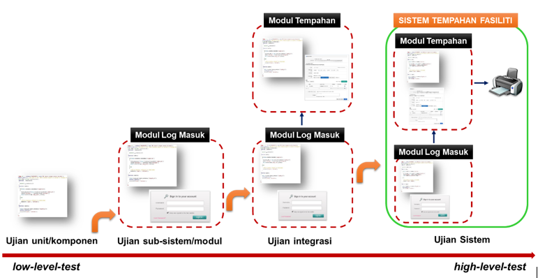
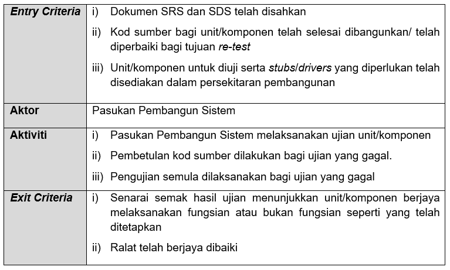
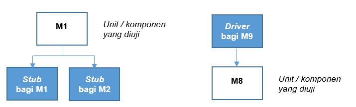
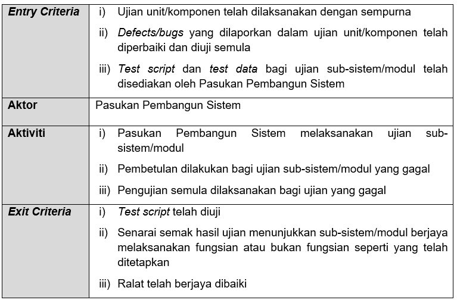
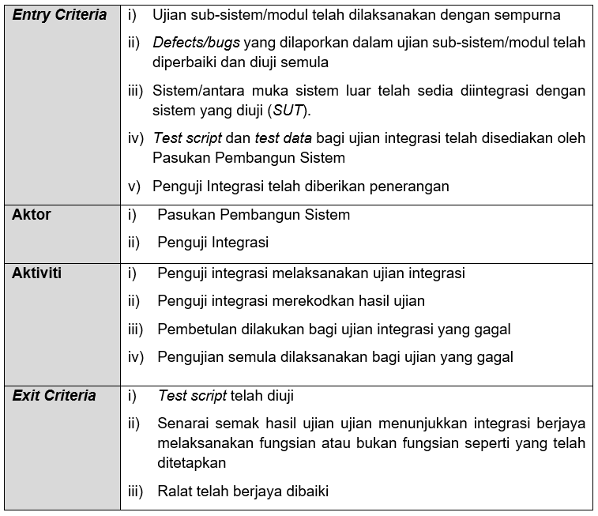
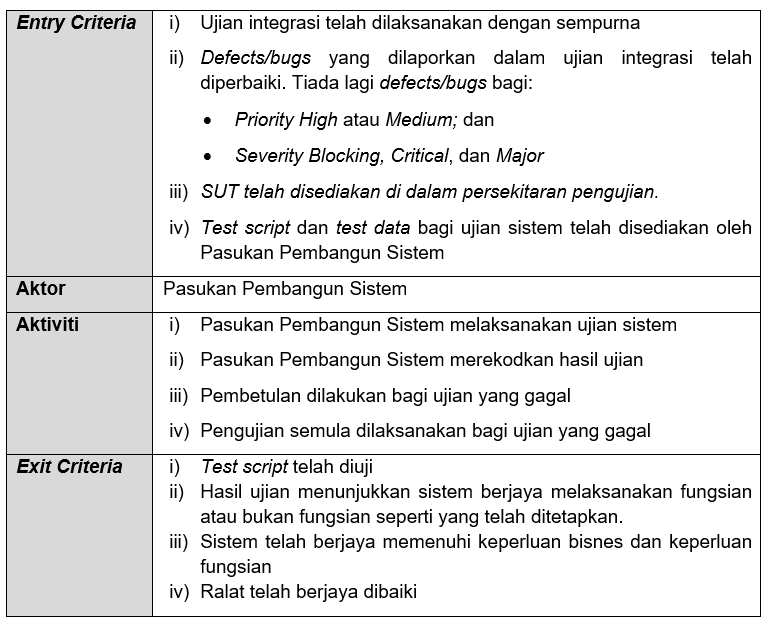
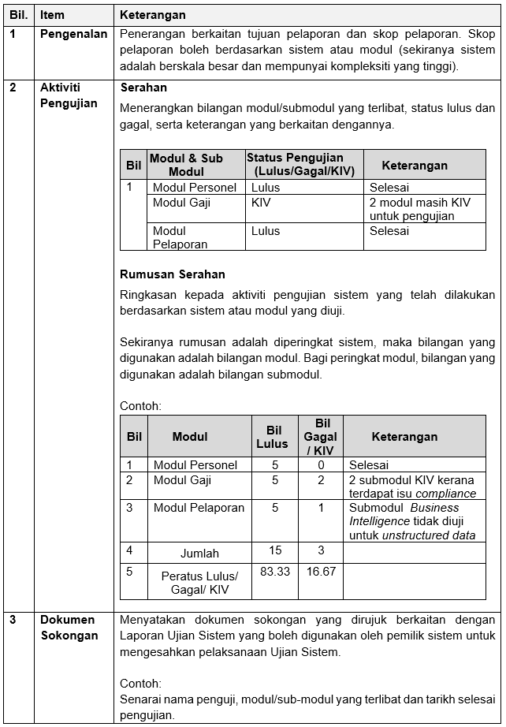

# 5.7 Pengujian Sistem [F4.3]

**Keterangan**

Pengujian Sistem merupakan aktiviti verifikasi yang dilakukan terhadap komponen
atau sistem (*test object*) untuk memastikan ia dibangunkan berdasarkan kepada
**spesifikasi keperluan dan reka bentuk sistem**. Pengujian sistem merangkumi
pelbagai peringkat ujian sebelum sistem diuji secara komprehensif di dalam fasa
pengujian penerimaan. Semasa pengujian ini dilaksanakan, ralat yang dikesan akan
diperbetulkan dan unit/komponen/modul yang berkaitan akan diuji semula sehingga
ralat berjaya diperbaiki.

Jenis-jenis pengujian yang dijalankan adalah **pengujian keperluan fungsian**,
**pengujian keperluan bukan fungsian (kualiti)** serta **verifikasi terhadap
ralat yang telah dibaiki**. Pengujian ini akan **dilaksanakan oleh Pasukan
Pembangun Sistem**.

Peringkat-peringkat ujian yang dilaksanakan mengikut turutan adalah seperti
rajah di bawah.

**Rajah** **85** **: Peringkat Pengujian Sistem**

Terdapat dua jenis pendekatan pengujian yang digunakan semasa melaksanakan
pengujian ke atas sistem aplikasi iaitu *big bang testing* dan *incremental
testing*. *Big bang testing* merupakan pengujian yang dilaksanakan terhadap
sistem aplikasi yang telah lengkap dibangunkan, manakala *incremental testing*
merupakan satu bentuk ujian modul di mana modul yang akan diuji digabungkan
dengan modul yang sudah diuji.

Pendekatan bagi aktiviti pengujian ini dikenali sebagai *incremental testing*
iaitu **pengujian dilakukan secara berperingkat** bermula daripada pengujian
unit/komponen terkecil sistem aplikasi seperti fungsi, kelas, prosedur dan
antara muka (**Ujian unit/komponen**); diikuti dengan ujian modul (**Ujian
sub-sistem/modul**); seterusnya menguji dua atau lebih modul/sistem/elemen
perkakasan yang disepadukan (**Ujian integrasi**); dan akhirnya semua modul yang
terlibat diuji secara menyeluruh (**Ujian sistem**).

Pendekatan ini menerangkan bahawa **ujian tahap rendah (*low-level-test*)**
perlu dilaksanakan terlebih dahulu bertujuan untuk mengesahkan bahawa ujian
segmen kod sumber telah dilaksanakan dengan betul sebelum ke peringkat ujian
berikutnya iaitu, **ujian tahap** **tinggi (*high-level test*)** yang bertujuan
mengesahkan fungsi-fungsi utama sistem aplikasi.

Bagi setiap peringkat pengujian, terdapat empat (4) elemen yang perlu ditetapkan
sebelum pelaksanaan ujian iaitu:

a)  *Entry Criteria* boleh merujuk kepada dokumen, status/ aktiviti serta tahap
pencapaian atau pengukuran yang menjadi pra-syarat untuk melaksanakan sesuatu
peringkat pengujian.

b) Aktor merujuk kepada individu/kumpulan yang terlibat dengan sesuatu ujian.

c) Aktiviti ialah aktiviti yang perlu dijalankan semasa ujian.

d) *E**xit Criteria* pula merujuk kepada dokumen, status/aktiviti serta tahap
pencapaian atau pengukuran yang menjadi syarat untuk menamatkan sesuatu
peringkat pengujian

**Objektif**

- Menilai kualiti keseluruhan sistem selepas pembangunan bagi memastikan sistem
  aplikasi yang dibangunkan sedia untuk diuji di peringkat pengujian penerimaan
  pengguna.

**Langkah-langkah**

**Langkah 1 : Laksana Ujian Unit/Komponen**

a) Tetapkan elemen *Entry Criteria*, aktor, aktiviti dan *Exit Criteria* bagi
Ujian Unit/ Komponen seperti jadual di bawah:

Jadual 65 : *Entry Criteria* dan *Exit Criteria* bagi Ujian Unit/Komponen

b) Kenalpasti unit/komponen adalah bahagian terkecil di dalam sistem aplikasi
yang boleh diuji (*testable*) seperti fungsi, kelas, prosedur dan antara muka.

c) Sediakan *stubs dan drivers* yang diperlukan di dalam ujian unit/ komponen
bagi menggantikan unit/ komponen/ modul yang perlu semasa berinteraksi dengan
unit/komponen yang diuji. *Stubs* adalah simulasi (*dummy module*) bagi
menggantikan unit/komponen selepas (*subordinate/ lower level*) unit/komponen
yang diuji. *Drivers* pula adalah simulasi bagi menggantikan unit/komponen
sebelum (*upper level*) unit/komponen yang diuji. Rajah di bawah menunjukkan
gambaran penggunaan *stubs* dan *drivers* di dalam ujian unit/komponen.

**Rajah** **86** **: Ujian Komponen - Stubs dan Drivers**

d) Laksana ujian unit/komponen bagi memastikan kod program yang dibangunkan
memenuhi fungsi unit/komponen dan mengenal pasti ralat di dalam unit/komponen
berkenaan. Ujian ini juga hendaklah merangkumi ujian fungsian dan ujian bukan
fungsian.

e) Rujuk asas ujian (*test basis*) yang berkaitan iaitu spesifikasi keperluan
unit/komponen, dokumen reka bentuk terperinci seperti SRS atau SDS dan kod
sumber program semasa melaksanakan ujian bagi memastikan ianya memenuhi
keperluan dan reka bentuk unit/ komponen yang telah ditetapkan.

f) Guna kombinasi teknik pengujian yang bersesuaian seperti teknik *white-box
testing* dan juga *black box testing*. *White-box testing* merupakan teknik
pengujian yang terperinci yang dilakukan terhadap logik dalam dan struktur kod.
Teknik ini memerlukan penguji mempunyai pengetahuan penuh tentang kod sumber.
Manakala *black box te*sting pula merupakan teknik pengujian berdasarkan kepada
spesifikasi sistem aplikasi. Pengujian ini dilaksanakan dengan memasukan *input*
dan *output* akan diperiksa sama ada memenuhi fungsi yang telah ditetapkan atau
tidak.

g) Uji pengendalian ralat (*error handling*) sekiranya input yang tidak sah
diberikan.

h) Baiki ralat yang ditemui dan uji semula unit/komponen berkenaan. Pengujian
akan dilaksanakan sehingga unit/ komponen memenuhi *Exit Criteria* yang telah
ditetapkan untuk ke peringkat ujian seterusnya iaitu Ujian Sub-Sistem/Modul.

**Langkah 2 : Laksana Ujian Sub-Sistem/Modul**

a) Tetapkan elemen *Entry Criteria*, aktor, aktiviti dan *Exit Criteria* bagi
Ujian Sub-Sistem/Modul seperti jadual di bawah:

**Jadual 66 : *Entry Criteria* dan *Exit Criteria* bagi Ujian Sub-Sistem/Modul**

b) Sediakan *test data*, bangunkan *test script* berdasarkan pertimbangan di
bawah bagi memastikan ujian sub-sistem/modul dilaksanakan dengan berkesan:

i)  *Module Interface Test*: bertujuan untuk menguji maklumat yang masuk dan
keluar daripada modul;

ii)  *Local data structures*: Struktur data tempatan diperiksa untuk memastikan
data yang disimpan secara sementara dapat mengekalkan integritinya semasa
pelaksanaan algoritma*.*

iii)  *Boundary conditions*: bertujuan untuk memastikan modul beroperasi dengan
betul di sempadan yang ditetapkan (*to limit* *or* *restrict processing*).

iv)  *Independent paths:* bertujuan untuk menguji semua *independent paths* yang
melalui struktur kawalan bagi memastikan bahawa semua kenyataan dalam modul
telah dilaksanakan sekurang-kurangnya sekali.

v) *Error handling paths*: untuk memastikan ralat ditangani dengan betul dan
*error handling paths* yang dikenalpasti dapat digunakan selepas melepasi
beberapa siri ujian.

c) Laksanakan ujian sub-sistem/modul untuk menguji interaksi di antara
unit/komponen dalam modul bagi memastikan ianya dapat berfungsi secara kolektif
bagi fungsi, kelas, prosedur dan antara muka yang terlibat di dalam sesebuah
modul.

d) Uji setiap modul yang terdapat dalam sistem aplikasi secara berasingan
sebelum ianya diuji secara bersepadu di peringkat ujian integrasi.

**Langkah 3 : Laksana Ujian Integrasi**

a) Tetapkan elemen *Entry Criteria*, aktor, aktiviti dan *Exit Criteria* bagi
Ujian Integrasi seperti jadual di bawah:

**Jadual 67 : *Entry Criteria* dan *Exit Criteria* bag Ujian Integrasi**

b) Sediakan *test data*, bangunkan *test script* bagi memastikan ujian
sub-sistem/modul dilaksanakan dengan berkesan. Objek yang akan dinilai semasa
ujian integrasi adalah sub-sistem, pangkalan data, infrastruktur, antara muka
serta konfigurasi sistem. Bagi tujuan ini, Pasukan Pembangun Sistem hendaklah
mempunyai kefahaman yang jelas terhadap reka bentuk dan keperluan integrasi
sebelum ujian ini dilaksanakan.

c) Laksanakan ujian integrasi yang merangkumi ujian fungsian dan ujian bukan
fungsian bagi menguji perkara berikut:

i) interaksi di antara sub-sistem/modul dalam sistem aplikasi;

ii) interaksi dalaman di antara sistem operasi, fail sistem dan API perkakasan
sistem; DAN

iii) integrasi di antara sistem yang dibangunkan dengan sistem luaran/antara
muka luaran (sekiranya ada).

d) Rujuk asas ujian (test basis) yang berkaitan iaitu reka bentuk dan arkitektur
sistem serta dokumen D02 Spesifikasi Keperluan Bisnes.

e) Laksanakan ujian integrasi dalam beberapa sesi mengikut keperluan integrasi
yang wujud dalam sistem aplikasi sehingga memenuhi *Exit Criteria* yang telah
ditetapkan untuk ke peringkat ujian seterusnya iaitu Ujian Sistem.

**Langkah 4 : Laksana Ujian Sistem**

a) Tetapkan elemen *Entry Criteria*, aktor, aktiviti dan *Exit Criteria* bagi
Ujian Sistem seperti jadual di bawah:

Jadual 68 : Entry Criteria dan Exit Criteria bag Ujian Sistem

b) Sediakan *test data*, bangunkan *test script* bagi memastikan ujian sistem
dilaksanakan dengan berkesan.

c) Laksanakan ujian sistem untuk menentukan keseluruhan sistem aplikasi telah
memenuhi spesifikasi yang ditetapkan sebelum ke fasa pengujian penerimaan.
Walaubagaimanapun, ujian ini sebaik-baiknya dilaksanakan di dalam persekitaran
yang hampir sama dengan persekitaran sebenar (*staging/pre-production).*

d) Rujuk dokumen spesifikasi keperluan, proses bisnes, *Use Case*, laporan
analisis risiko, interaksi sistem dengan sistem operasi dan *system resources*
semasa melaksanakan ujian sistem.

e) Laksanakan ujian sistem sehingga memenuhi *Exit Criteria* yang telah
ditetapkan.

**Langkah 5 : Sediakan Laporan Ujian Sistem**

a) Sediakan Laporan Ujian Sistem sebagai pengesahan aktiviti Pengujian Sistem
telah dilaksanakan sepenuhnya. Laporan Ujian Sistem menentukan tahap kesediaan
sistem dan merupakan *Entry Criteria* kepada Ujian Penerimaan Pengguna. Format
Laporan Ujian Sistem adalah seperti D11 Laporan Ujian Sistem.

b) Laporan Ujian Sistem hendaklah **mempunyai sekurang-kurangnya elemen**
berikut:

**Jadual** **69** **: Format Laporan Ujian Sistem**

****

**Rujukan**

1. Software Engineering: A Practitioner's Approach Eighth Edition, Roger S.
   Pressman, Ph.D, Bruce R. Maxim, Ph.D, Mc Graw Hill Education.
2. Software Quality Assurance From theory to implementation, G. Daniel.
3. Certified Tester Foundation Level Syllabus Version 2018.
4. Certified Tester Advanced Level Syllabus Test Analyst Version 2012.
