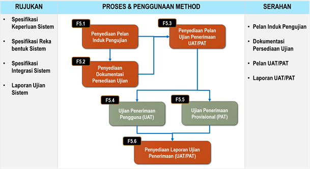

# 6.1 Gambaran Keseluruhan

**FASA PENGUJIAN PENERIMAAN**

Bab ini menerangkan berkenaan aktiviti-aktiviti pengujian penerimaan sistem
aplikasi yang merangkumi penyediaan pelan-pelan pengujian, Ujian Penerimaan
Pengguna (UAT), Ujian Penerimaan Provisional (PAT), dokumentasi persediaan ujian
dan Laporan Ujian Penerimaan.

**6.1 Gambaran Keseluruhan**

**Rajah 87 : Gambaran Keseluruhan Fasa 5 – Pengujian Penerimaan**
