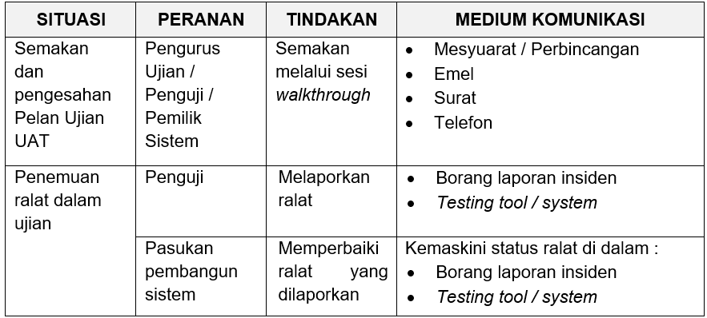
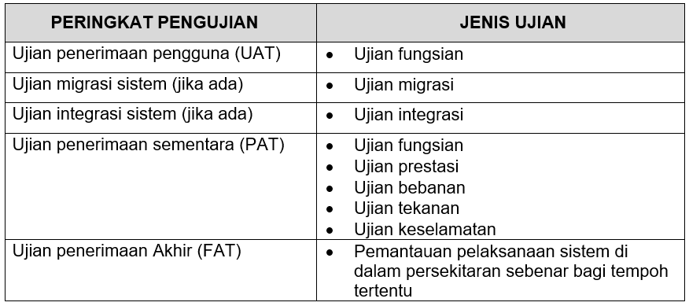
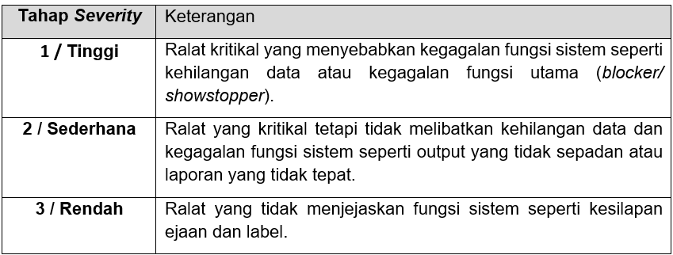
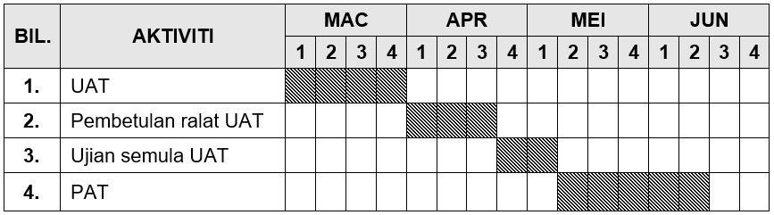
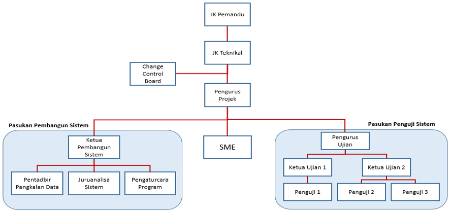
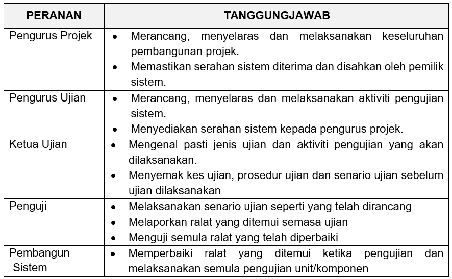

# 6.5 Penyediaan Pelan Induk Pengujian [F5.1]

Keterangan

Pelan Induk Pengujian (*Master Test Plan*) adalah pelan utama yang perlu
disediakan sebagai rujukan perancangan dan pengurusan aktiviti pengujian sistem
secara menyeluruh. Pelan ini mengandungi strategi pengujian, reka bentuk
pengujian, jenis pengujian, senarai serahan ujian dan jadual pelaksanaan
pengujian. Pelan Induk Pengujian hendaklah dibangunkan sebelum fasa pengujian.

OBJEKTIF

- Menghasilkan Pelan Induk Pengujian bagi merancang dan mengurus aktiviti
  pengujian sistem secara menyeluruh.

Langkah-langkah

Langkah 1 : Terangkan Pengenalan Projek

a) Pelan Induk Pengujian mempunyai pengenalan projek yang akan memberi gambaran
mengenai projek secara keseluruhannya. Kerangka pengenalan projek adalah:

1. Tujuan projek.
2. Skop projek.
3. Senarai Pemegang Taruh (Stakeholder).
4. Sumber rujukan.
5. Glosari/ definisi berkaitan dengan projek.

b) Sebahagian contoh pengenalan projek ini boleh dirujuk di Langkah 1,
Penyediaan Pelan Pembangunan Sistem [F1.1].

Langkah 2 : Terangkan Konteks Pengujian

a) Konteks ujian mengandungi perincian skop dan item yang akan diuji serta
kekangan yang dijangka dihadapi semasa aktiviti ujian. Kerangka bagi konteks
ujian adalah seperti berikut:

i) Item ujian

Item yang akan diuji perlu disenaraikan seperti contoh berikut :

Modul-modul yang terlibat pengujian ini adalah :

Modul 1 : Pendaftaran Pengguna
 Modul 2 : Tempahan bilik mesyuarat
 Modul 3 : Laporan
 Modul 4 : Pentadbir sistem

ii) Skop ujian

Skop ujian bertujuan untuk menetapkan perimeter ujian termasuk :

- ciri-ciri (fungsian dan kualiti/ bukan fungsian) yang akan diuji ke atas item
  ujian
- ciri-ciri yang tidak akan diuji ke atas item ujian

iii) Kekangan

Kekangan adalah sekatan atau halangan yang dijangka akan berlaku semasa
pengujian dilaksanakan. Kekangan ini boleh mengganggu perjalanan proses
pengujian dan berpotensi untuk memberi risiko ke atas sistem aplikasi. Kekangan
dengan kebarangkalian yang tinggi untuk berlaku perlu dinyatakan di dalam
dokumen ini.

Langkah 3 : Nyatakan Komunikasi Pengujian

1. Komunikasi ujian akan menjelaskan peranan, tindakan dan medium komunikasi
   bagi sesuatu situasi yang berlaku di dalam aktiviti pengujian. Komunikasi
   ujian boleh dinyatakan dalam bentuk jadual seperti contoh berikut :

Jadual 70 : Komunikasi Pengujian

Langkah 4 : Lengkapkan Daftar Risiko (*Risk Register*) Ujian

Rujuk item (b) dan (c), Langkah 3, **Penyediaan Pelan Pembangunan Sistem**
**[F1.1]** untuk panduan.

Langkah 5 : Terangkan Strategi Ujian

Strategi ujian menjelaskan bagaimana aktiviti pengujian akan dilaksanakan.
Strategi ujian diperincikan di dalam kerangka berikut:

a) Peringkat Ujian

Sub-proses ujian menerangkan tentang peringkat pengujian serta jenis-jenis ujian
yang terlibat seperti Jadual di bawah :

Jadual 71 : Contoh Peringkat dan Jenis-jenis Ujian

b) Senarai Dokumen Serahan Ujian

Dokumen serahan ujian adalah sebarang dokumen atau laporan yang dihasilkan dan
perlu diserahkan kepada pemilik sistem semasa fasa pengujian. Berikut adalah
contoh dokumen serahan ujian :

i) Dokumentasi Persediaan Ujian (rujuk kepada [F5.2])

ii) Pelan Ujian UAT/PAT

iii) Laporan Ujian Penerimaan UAT/PAT

iv) Laporan Penamatan Ujian

*c) Entry Criteria* Dan *Exit Criteria*

*Entry criteria* boleh merujuk kepada dokumen, status/ aktiviti serta tahap
pencapaian atau pengukuran yang menjadi pra-syarat untuk melaksanakan sesuatu
peringkat pengujian. *Exit criteria* pula merujuk kepada dokumen, status/
aktiviti serta tahap pencapaian atau pengukuran yang menjadi syarat untuk
menamatkan sesuatu peringkat pengujian.

*Entry* dan *Exit Criteria* boleh diperincikan di dalam Pelan Induk Pengujian
atau Pelan Ujian UAT/PAT mengikut kesesuaian. *Entry criteria* dan *Exit
criteria* yang ditetapkan hendaklah dibincang dan dipersetujui bersama oleh
pemilik projek dan pengurus / ketua ujian.

d) Metrik Pengukuran

Senaraikan metrik pengukuran yang digunakan semasa pengujian.

Contoh metrik pengukuran :

i) Bilangan dan peratus kes ujian yang gagal

ii) Bilangan dan peratus kes ujian yang lulus

iii) Purata masa tindak balas

e) Data Ujian / Simulasi

Data ujian yang akan digunakan perlu dijelaskan sama ada menggunapakai data
ujian/ simulasi atau data sebenar. Data ujian ini perlu dipersetujui oleh
pemilik sistem aplikasi dan pasukan penguji sebelum digunakan.

f) Persekitaran Pengujian

Persekitaran pengujian perlu dinyatakan sama ada persekitaran pembangunan,
persekitaran *staging* atau persekitaran produksi . Persekitaran pengujian ini
merangkumi infrastruktur (contoh : rangkaian), perkakasan (contoh : pelayan web,
pelayan pangkalan data, storan, sistem operasi, pengimbas, mesin pencetak),
perisian (contoh : DBMS, JAVA, Oracle) dan *Tools (*contoh : JIRA, Selenium,
JMeter*)* yang digunakan semasa pengujian.

g) Penetapan Tahap *Severity*

*Severity* bermaksud implikasi terhadap kegagalan fungsian atau penemuan ralat
semasa ujian. Tahap *severity* boleh dijadikan sebagai salah satu faktor dalam
menentukan keutamaan (priority) tindakan pembetulan. Merujuk kepada contoh di
bawah, tahap *severity* boleh dikategorikan secara numerik atau pernyataan
kelas.

Jadual 72 : Contoh Tahap *Severity* Hasil Ujian

Langkah 6 : Tetapkan Jadual Perancangan Pengujian

Jadual perancangan yang terperinci bagi aktiviti pengujian perlu disediakan.
Perancangan perlulah mengambilkira kebergantungan dan tarikh sasaran serahan.
Contoh jadual perancangan pengujian seperti berikut :

Jadual 73 : Contoh Jadual Perancangan Pengujian

Langkah 7 : Lengkapkan Struktur Perjawatan Pengujian

Struktur organisasi pasukan pengujian digambarkan dengan menggunakan sama ada
carta organisasi, rajah matriks atau notasi-notasi lain. Struktur organisasi
yang disediakan juga perlu menyertakan pasukan pengurusan projek, pasukan
pembangunan sistem, pasukan teknikal (keselamatan) serta tadbir urus projek
(Jawatankuasa Pemandu Projek dan Jawatankuasa Teknikal Projek) bagi
menggambarkan bidang kuasa, tanggungjawab dan komunikasi di dalam projek.

Contoh struktur organisasi adalah sebagaimana dibawah

**Rajah** **88** **: Contoh Struktur Pasukan Pengujian**

Jadual 74 : Contoh Peranan dan Tanggungjawab dalam Pengujian

Rujukan

ISO/IEC 29119-3:2013 Software and systems engineering -- Software testing --
Part 3: Test documentation.
