# 6.6 Penyediaan Dokumentasi Persediaan Ujian [F5.2]

Keterangan

Dokumentasi persediaan ujian adalah dokumen yang mengandungi maklumat terperinci
bagi memulakan aktiviti-aktiviti pengujian yang dirancang di dalam Pelan Induk
Pengujian dan merupakan lampiran bagi Pelan Ujian UAT dan PAT. Dokumen yang
perlu disediakan sebelum sesuatu ujian dilaksanakan adalah seperti berikut:

1. Senario Ujian (*Test Scenario*)
2. Kes Ujian (*Test Case*)
3. Prosedur/ Skrip Ujian (*Test Procedure/ Script*)
4. Data Ujian (*Test Data*)
5. *Traceability Matrix*

Objektif

- Memastikan skop pengujian menepati D03 Spesifikasi Keperluan Sistem dan D04
  Spesifikasi Reka bentuk Sistem aplikasi.
- Memastikan pelaksanaan ujian secara sistematik, teratur dan menyeluruh

Langkah-langkah

Langkah 1: Tentukan Senario Ujian

a) Keterangan Ringkas

Tujuan menentukan Senario Ujian adalah untuk memastikan setiap fungsi diuji
secara *end-to-end* bagi menjamin sistem aplikasi memenuhi keperluan proses
bisnes. Senario ujian dihasilkan berdasarkan analisis terhadap dokumen SRS dan
SDS. Setiap senario ujian perlu merujuk kepada sekurang-kurangnya satu fungsi
bisnes.

b) Langkah

i) Rujuk Rajah *Use Case* yang telah dibangunkan di dalam Pemodelan *Use Case*
[F2.1] dan Senario *Use Case* yang telah disediakan di dalam Reka bentuk
Transaksi Sistem [F3.5].

ii) Kenalpasti aliran transaksi yang ingin diuji sebagai satu senario ujian.
Satu senario ujian boleh mewakili satu aktiviti atau gabungan aktiviti yang
dapat melengkapkan sesuatu fungsi bisnes.

Contoh Senario:

i) Mohon Tempahan Bilik Mesyuarat – merangkumi aktiviti memasukkan profil
pengguna untuk memulakan tempahan, menyemak kekosongan bilik, membuat pilihan
bilik serta menghantar tempahan

ii) Pinda Maklumat Tempahan – hanya melibatkan aktiviti meminda maklumat
tempahan

iii) Senaraikan semua senario ujian yang telah dikenalpasti. Senario ini akan
dijadikan sebagai senario utama.

iv) Kenalpasti senario alternatif iaitu senario negatif atau senario lain yang
mungkin (jika ada) bagi *Use Case* atau senario utama tersebut berdasarkan
maklumat yang dinyatakan di dalam SRS.

Contoh :
Senario bagi *Use Case* Mohon Tempahan Bilik Mesyuarat

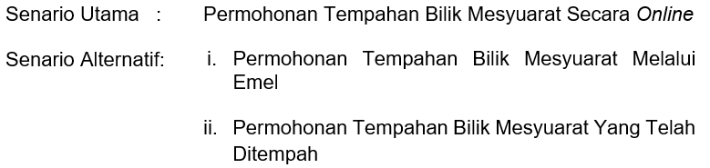

v) Senario ujian yang dikenalpati perlu disemak dengan SME bagi memastikan semua
fungsi dan keperluan diuji sewajarnya.

vi) Senarai senario ujian yang telah dipersetujui diisikan ke dalam Templat
Senario Ujian seperti di Apendiks 10a) Templat Senario Ujian. Bagi setiap
senario ujian, lengkapkan maklumat-maklumat seperti berikut:

Jadual 75 : Isi Kandungan Templat Senario Ujian

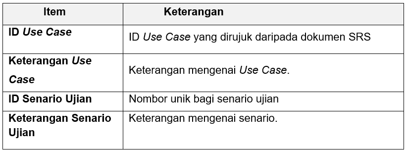

Contoh Templat Senario Ujian yang telah diisi adalah seperti di bawah:

Jadual 76 : Contoh Pengisian Templat Senario Ujian (Memohon Tempahan Bilik
Mesyuarat)

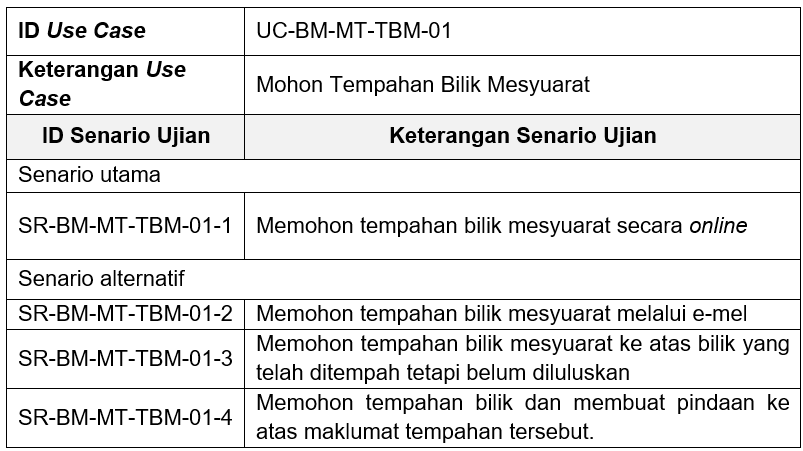

Jadual 77 : Contoh Pengisian Templat Senario Ujian (Melengkapkan maklumbalas
penggunaan bilik)

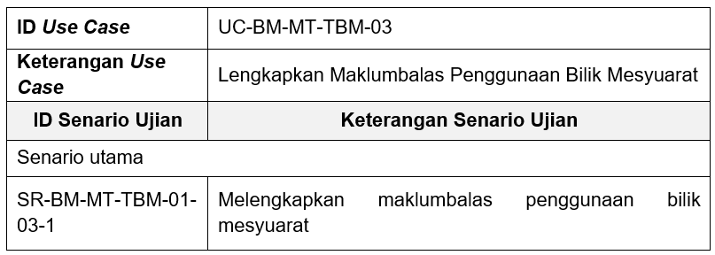

Bagi *Use Case* Lengkapkan Maklumbalas Penggunaan Bilik Mesyuarat, hanya satu
senario ujian dikenalpasti kerana hanya pemohon yang telah diluluskan tempahan
akan dipaparkan butang Isi Maklumbalas Penggunaan bagi pengisian maklumbalas
penggunaan bilik mesyuarat.

Langkah 2: Sediakan Kes Ujian

a) Keterangan Ringkas

Kes ujian adalah satu set pra-syarat, input/ langkah-langkah ujian dan hasil
jangkaan, yang dibangunkan untuk menguji sama ada sistem aplikasi memenuhi
keperluan yang ditetapkan serta berfungsi dengan betul. Kes ujian disediakan
berdasarkan fungsi asas yang terdapat di dalam senario ujian yang telah
dikenalpasti. Kes ujian perlu menerangkan secara terperinci bagaimana untuk
menguji fungsi asas tersebut serta mengambil kira situasi positif dan negatif.

Terdapat dua (2) pendekatan dalam menghasilkan kes ujian iaitu:

i) *High-level Test Case*

*High-level Test Case* ialah kes ujian yang mengandungi langkah-langkah umum
untuk menguji sesuatu fungsi asas. Kes ujian sebegini sesuai dihasilkan
sekiranya:

- Pengguna mempunyai pengetahuan tinggi terhadap proses bisnes serta kaedah
  navigasi di dalam sistem aplikasi yang dibangunkan; atau
- Kes ujian yang dibangunkan tidak memerlukan perincian bagi melaksanakan ujian
  (kurang kritikal).

Kes ujian *high-level* tidak menyatakan secara khusus sebarang nilai di dalam
input atau jangkaan hasil ujian contohnya:

- Pengguna memasukkan tarikh tempahan bilik mesyuarat.
- Sistem akan memaparkan ralat jika tarikh tempahan yang dimasukkan telah lepas
  atau tempoh tempahan melebihi had yang dibenarkan.

*ii) Low-level Test Case*

*Low-level Test Case* ialah adalah kes ujian yang mengandungi langkah-langkah
terperinci untuk menguji sesuatu fungsi asas. Kes ujian sebegini sesuai
dihasilkan sekiranya:

- Pengguna tidak mempunyai pengetahuan tinggi terhadap aplikasi yang dibangunkan
  (pengguna tidak pernah atau tidak biasa menggunakan aplikasi tersebut); atau
- Kes ujian yang dibangunkan bersifat kritikal dan perlu diuji secara
  terperinci.

Kes ujian *low-level* perlu menyatakan secara khusus nilai bagi input dan
jangkaan hasil ujian contohnya:

- Pengguna memasukkan 1 April 2017 di dalam ruangan tarikh mula guna dan 10
  April 2017 di dalam ruangan tarikh tamat guna untuk membuat tempahan bilik
  mesyuarat. Seterusnya pengguna klik butang Hantar.
- Sistem akan memaparkan mesej ralat “Tempoh tempahan melebihi had 3 hari yang
  dibenarkan”. Pengguna klik butang Tutup untuk menutup mesej ralat.

b) Langkah

i) Rujuk kepada Antaramuka Pengguna dan Senario *Use Case* yang terdapat di
dalam D04 Spesifikasi Reka bentuk Sistem.

ii) Kenalpasti pendekatan yang ingin digunakan untuk menghasilkan kes ujian.

iii) Berdasarkan Reka bentuk Antaramuka Pengguna [F3.4] dan Reka bentuk
Transaksi Sistem [F3.5], kenalpasti kes-kes ujian yang perlu disediakan serta
langkah-langkah ujian yang diperlukan.

iv) Bangunkan kes ujian dengan mengisikan Templat Kes Ujian seperti di Apendiks
10 b) Templat Kes Ujian dengan maklumat-maklumat seperti berikut:

Jadual 78 : Isi Kandungan Templat Kes Ujian

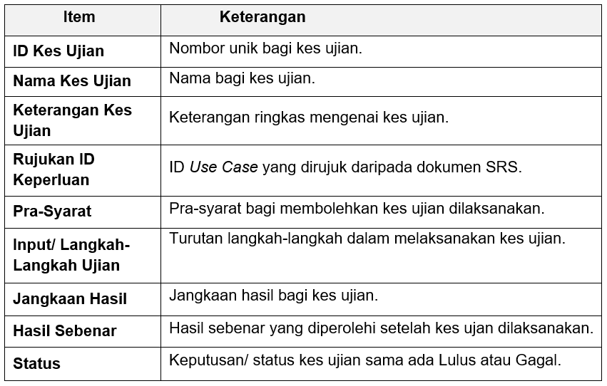

Contoh Templat Kes Ujian yang telah diisi adalah seperti di bawah:

Jadual 79 : Contoh Pengisian Templat Kes Ujian (Log Masuk Positif)

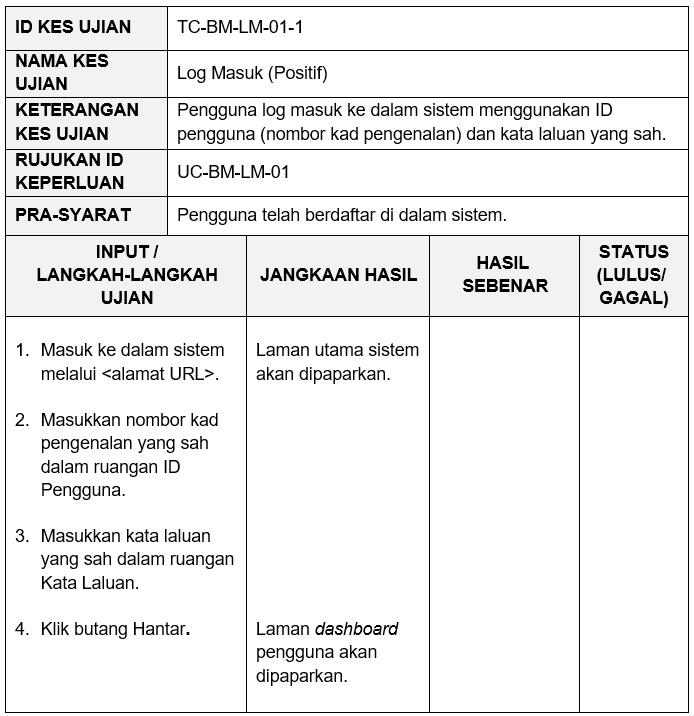

Jadual 80 : Contoh Pengisian Templat Kes Ujian (Log Masuk Negatif)

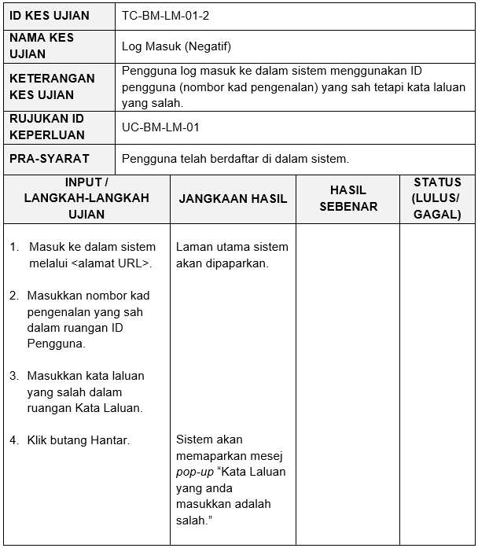

Jadual 81 : Contoh Pengisian Templat Kes Ujian (Tempahan Bilik Mesyuarat)

| **ID KES UJIAN** | TC- BM-MT-TBM-01-1 |  |  |
|---|---|---|---|
| **NAMA KES UJIAN** | Membuat Tempahan Bilik Mesyuarat |  |  |
| **KETERANGAN KES UJIAN** | Pengguna membuat tempahan bilik mesyuarat yang kosong. |  |  |
| **RUJUKAN ID KEPERLUAN** | UC-BM-MT-TBM-01 |  |  |
| **PRA-SYARAT** | · Pengguna yang sah berjaya log masuk ke dalam sistem. · Bilik mesyuarat yang ingin ditempah telah dipastikan kekosongannya. |  |  |
| **INPUT /** **LANGKAH-LANGKAH UJIAN** | **JANGKAAN HASIL** | **HASIL SEBENAR** | **STATUS** **(LULUS/ GAGAL)** |
| 1. Pilih menu Tempahan Bilik Mesyuarat. | · Antara muka Permohonan Tempahan Bilik Mesyuarat dipaparkan. · Secara *default* nama dan emel login dipaparkan di ruangan Butiran Pegawai untuk dihubungi. · Secara *default*, sistem akan akan memaparkan tarikh semasa sebagai Tarikh Mula dan Tarikh Tamat. |  |  |
| 2. Pilih tarikh bagi Tarikh Mula dan Tarikh Tamat bagi carian kekosongan bilik. 3. Klik butang Semak. | Sistem akan memaparkan senarai bilik yang berstatus kosong pada tarikh yang dipilih. Butiran yang dipaparkan adalah nama bilik, kapasiti bilik dan status bilik. |  |  |
| 4. Pilih dengan tick pada ruangan di sebelah Nama Bilik yang ingin ditempah. 5. Klik butang Hantar. | Sistem akan memaparkan mesej *pop-up* “Permohonan anda telah dihantar kepada pegawai tadbir untuk kelulusan.” |  |  |

Semak Kes Ujian yang dihasilkan dengan Ketua Ujian bagi memastikan setiap fungsi
asas yang terlibat dilaksanakan pengujian yang sesuai dan terperinci.

Langkah 3: Sediakan Prosedur/ Skrip Ujian

a) Keterangan Ringkas

Prosedur/ skrip ujian adalah turutan kes ujian (*test cases*) yang mengandungi
arahan terperinci untuk menguji senario ujian. Prosedur/ skrip ujian merujuk
kepada pelaksanaan kes-kes ujian yang terlibat terlibat secara manual atau
menggunakan peralatan ujian (*testing tool*).

b) Langkah

Sediakan prosedur/ skrip ujian dengan mengisi Templat Prosedur/ Skrip Ujian
seperti di Apendiks 10c Templat Prosedur/ Skrip Ujian dengan maklumat-maklumat
seperti berikut:

Jadual 82 : Isi Kandungan Templat Prosedur/ Skrip Ujian

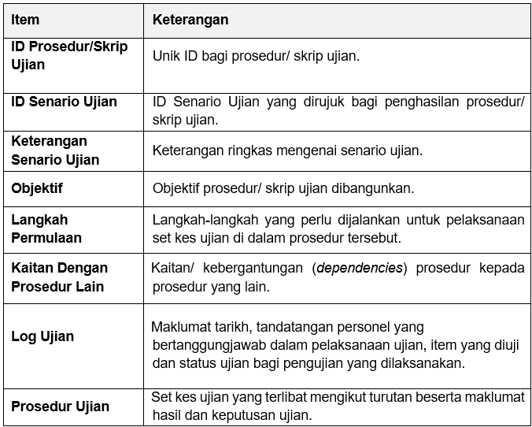

Contoh Templat Prosedur/ Skrip Ujian yang telah diisi adalah seperti di bawah:

Jadual 83 : Contoh Pengisian Templat Prosedur/ Skrip Ujian

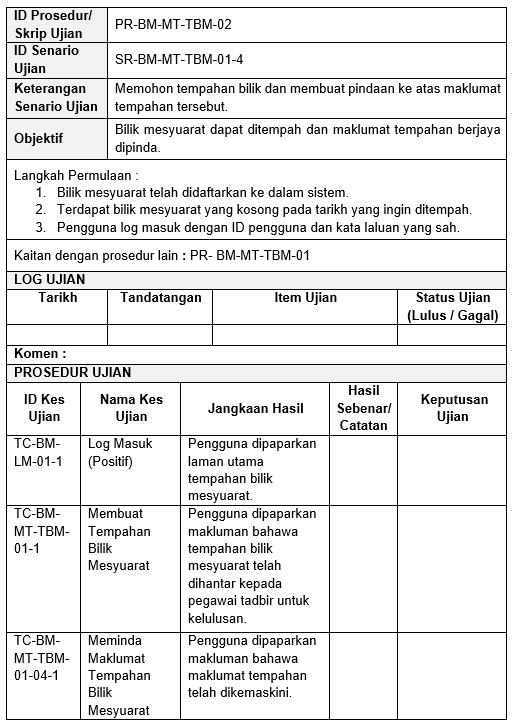

Langkah 4: Sediakan Data Ujian

a) Keterangan Ringkas

Data Ujian ialah data yang dicipta atau dipilih bagi dijadikan input untuk
melaksanakan pengujian ke atas kes ujian. Data ujian boleh dijana dengan:

1. Menyediakan secara manual;
2. Menyalin data daripada persekitaran produksi (*production*) ke persekitaran
   pengujian;

- Menyalin data ujian daripada sistem aplikasi terdahulu (*legacy*); atau

1. Menggunakan Alat Penjanaan Data Ujian Automatik (*Automated Test Data
   Generation Tools*).

b) Langkah

Sebagai persediaan untuk melaksanakan pengujian, sediakan data ujian bagi setiap
kes ujian dalam dua kategori iaitu positif dan negatif. Data ujian positif akan
menguji fungsi sistem aplikasi untuk menjana hasil seperti jangkaan. Manakala
data ujian negatif adalah bagi menguji keupayaan sistem aplikasi mengendalikan
input luar kebiasaan, ekstrim atau yang tidak dijangka.

Jadual 84 : Kategori Data Ujian

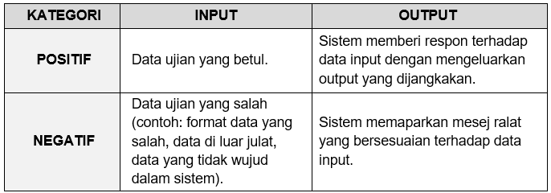

Penyediaan data ujian yang mencukupi dan merangkumi pelbagai situasi adalah amat
penting bagi menghasilkan sistem aplikasi yang berkualiti.

Langkah 5: Sediakan *Traceability Matrix*

a) Keterangan Ringkas

*Traceability Matrix* disediakan bagi tujuan menjejaki sesuatu keperluan
(*requirement*) dan hubungan sepanjang kitar hayat pembangunan sistem (SDLC). Ia
berupaya memastikan:

1. semua keperluan sistem telah dibangunkan;
2. keperluan atau fungsi yang dibangunkan telah dilaksanakan pengujian; dan
3. semua pindaan ke atas aktiviti yang berkaitan dilaksanakan.

Kelebihan penggunaan *Traceability Matrix* adalah seperti berikut:

1. Memastikan keseluruhan keperluan diuji dan berjaya dipenuhi.
2. Mengenal pasti keperluan yang tidak dinyatakan atau tidak konsisten.
3. Mengenal pasti ralat dan status pengujian berorientasikan keperluan bisnes.
4. Membantu mengenal pasti dan menganggarkan implikasi pembetulan ralat semasa
   pengujian atau pengurusan perubahan.

b) Langkah

Sediakan *traceability matrix* dengan mengisi Templat *Traceability Matrix*
seperti di Apendiks 10d Templat *Traceability Matrix* dengan maklumat-maklumat
seperti berikut:

Jadual 85 : Isi Kandungan Templat *Traceability Matrix*

*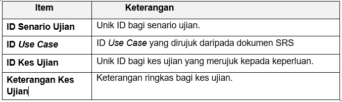*

Contoh Templat *Traceability Matrix* yang telah diisi adalah seperti di bawah:

**Jadual** **86** **: Contoh Pengisian Templat *Traceability Matrix***

| **ID Senario Ujian** | **ID *Use Case*** | **ID Kes Ujian** | **Keterangan Kes Ujian** |
|---|---|---|---|
| SR-BM-MP-DP-01-1 | UC-BM-MP-DP-01 | TC-BM-MP-DP-01-1 | Mendaftar akaun baharu. |
| SR-BM-MT-TBM-02 | UC-BM-LM-01 | TC-BM-LM-01-1 | Pengguna log masuk ke dalam sistem menggunakan ID pengguna (nombor kad pengenalan) dan kata laluan yang sah. |
| UC-BM-MT-TBM-01 | TC-BM-MT-TBM-01-1 | Pengguna membuat tempahan bilik mesyuarat yang kosong. |  |
| UC-BM-MT-TBM-01-04 | TC-BM-MT-TBM-01-04-1 | Pengguna membuat pindaan maklumat tempahan bilik mesyuarat. |  |

Rujukan

1. ISO/IEEE/IEC 29119-3: Software and systems engineering - Software testing -
   Test documentation.
2. Foundations of Software Testing- ISTQB by Rex Black,Erik Van Veenendaal,
   Dorothy Graham.
3. Test documentation by The Quest, winner of Test Design Competition SOFTEC
   Asia 2017.
4. "Software Test Documents - Test Plan, Test Scenario, Test Case, Traceability
   Matrix" - Jaiganesh Periyasamy, Senior Test Engineer.
   [http://jobsandnewstoday.blogspot.my/2013/05/software-test-documents-testplan-testscenario-testcase.html](http://jobsandnewstoday.blogspot.my/2013/05/software-test-documents-testplan-testscenario-testcase.html)
5. "What’s the difference between a Test Case and a Test Scenario?" - Jake
   Bartlett, Software Tester.
   [https://blog.testlodge.com/whats-the-difference-between-test-case-and-test-scenario/](https://blog.testlodge.com/whats-the-difference-between-test-case-and-test-scenario/)
6. "Tips and Tricks to Generate Test Data".
   [https://www.guru99.com/software-testing-test-data.html](https://www.guru99.com/software-testing-test-data.html)
7. "How to Review SRS Document and Create Test Scenarios".
   [http://www.softwaretestinghelp.com/rview-srs-document-and-create-test-scenarios-software-testing-training-course-day-2/](http://www.softwaretestinghelp.com/rview-srs-document-and-create-test-scenarios-software-testing-training-course-day-2/)
