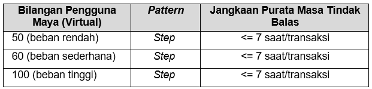
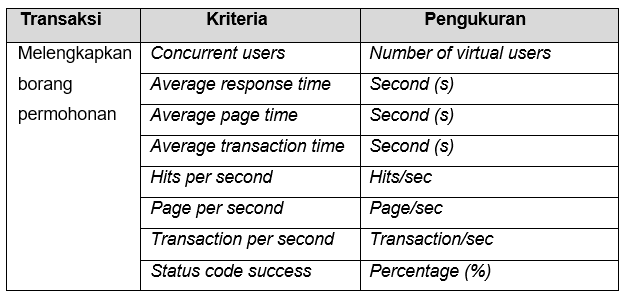
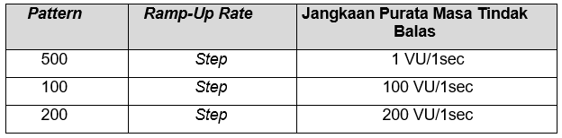
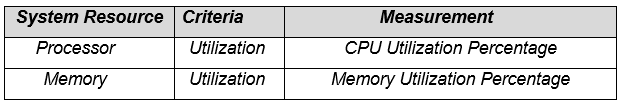
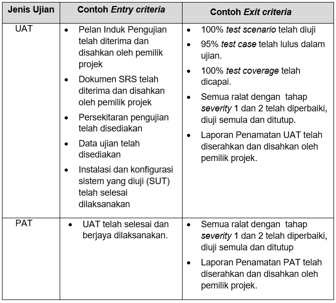
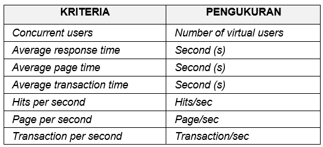

# 6.7 Penyediaan Pelan Ujian (UAT & PAT) [F5.3]

Keterangan

Pelan Ujian UAT dan Pelan Ujian PAT mengandungi strategi pengujian, reka bentuk
pengujian, jenis pengujian dan serahan ujian yang khusus bagi ujian di peringkat
UAT atau PAT. Pelan Ujian UAT dan PAT ini perlu dihasilkan secara berasingan.
Sebahagian perancangan bagi aktiviti UAT dan PAT berkemungkinan tidak dinyatakan
secara terperinci di dalam Pelan Induk Pengujian yang dihasilkan lebih awal.

Apabila Pelan Ujian UAT dan PAT dibangunkan, perlu ada rujukan silang terhadap
Pelan Induk Pengujian untuk menjamin kesinambungan aktiviti pengujian. Jika
terdapat sebarang perubahan terhadap Pelan Induk Pengujian, ia perlu direkodkan
dengan jelas di dalam Pindaan Dokumen.

Objektif

- Menghasilkan Pelan Ujian bagi merancang dan mengurus aktiviti Ujian Penerimaan
  Pengguna (UAT) atau Ujian Penerimaan Sementara (PAT).

Langkah-langkah

Langkah 1 : Sediakan Pengenalan Projek

Struktur dan kandungan pengenalan projek bagi Pelan UAT/PAT adalah sama seperti
di dalam Pelan Induk Pengujian. Ia boleh dirujuk dan disalin dari Langkah 1,
**Penyediaan Pelan Induk Pengujian [F5.1].**

Langkah 2 : Lengkapkan Konteks Ujian

Struktur konteks ujian bagi Pelan UAT/PAT adalah sama seperti di dalam Pelan
Induk Pengujian. Walau bagaimanapun, kandungan konteks ujian lebih terperinci
dan spesifik bagi pengujian UAT/PAT.

a) Item ujian

Rujuk item (a), Langkah 2, Penyediaan Pelan Induk Pengujian [F5.1] untuk panduan
melengkapkan item ujian UAT/PAT.

b) Skop ujian

Rujuk item (b), Langkah 2, Penyediaan Pelan Induk Pengujian [F5.1] untuk panduan
melengkapkan skop ujian UAT/PAT.

Contoh bagi penentuan skop ujian UAT adalah seperti berikut :

Skop ujian adalah untuk menguji fungsi-fungsi modul yang telah dinyatakan di
dalam Item Ujian (a).

Contoh bagi penentuan skop ujian PAT:

Ujian PAT yang akan dilaksanakan merangkumi skop berikut :

1. Ujian prestasi – untuk mengenal pasti bagaimana sistem bertindak di bawah
   beban kerja dan kekangan tertentu untuk melaksanakan sesuatu fungsi.
2. Ujian bebanan – untuk memastikan tindak balas sistem apabila berada di bawah
   beban yang berbeza (rendah, sederhana, tinggi)

c) Kekangan

Kekangan adalah sekatan atau halangan yang dijangka akan berlaku semasa
pengujian dilaksanakan. Bagi mendapatkan penerangan lebih terperinci berkenaan
kekangan, rujuk item (c), Langkah 2, Pelan Induk Pengujian [F5.1] untuk panduan.

Contoh kekangan di dalam Pelan Ujian PAT adalah seperti berikut :

Ujian Prestasi di dalam PAT tidak dapat dilaksanakan jika UAT belum selesai
sepenuhnya.

Langkah 3 : Lengkapkan Komunikasi Pengujian

Rujuk Langkah 3, **Pelan Induk Pengujian [F5.1]** untuk panduan.

Langkah 4 : Lengkapkan Daftar Risiko (*Risk Register*) Pengujian

Rujuk item (b) dan (c), Langkah 3, **Pelan Induk Pengujian [F1.1]** untuk
panduan.

Langkah 5 : Lengkapkan Strategi Ujian

Struktur strategi ujian bagi Pelan UAT/PAT adalah sama seperti di dalam Pelan
Induk Pengujian. Walau bagaimanapun, kandungan strategi ujian lebih terperinci
dan spesifik bagi pengujian UAT/PAT.

a) Peringkat ujian

Sub-proses ujian menerangkan tentang jenis-jenis ujian yang terlibat dan
strategi pelaksanaannya.

Berikut adalah contoh strategi ujian bagi ujian bebanan:

Ujian bebanan bagi Sistem Tempahan Mesyuarat diukur berdasarkan bilangan
pengguna seperti berikut :

1. 200 pengguna per saat (rendah)
2. 400 pengguna per saat (sederhana)
3. 1000 pengguna per saat (tinggi)

Bilangan pengguna maya yang akan digunakan untuk simulasi bebanan ke atas sistem
adalah seperti berikut :

Jadual 87 : Contoh Strategi Ujian Bagi Ujian Bebanan

Contoh strategi ujian bagi ujian prestasi :

Ujian ini bertujuan untuk menentukan bagaimana prestasi sistem di bawah
*workload* dan kekangan tertentu dapat mencapai purata masa tindak balas selama
10 saat.

Metrik pengukuran berikut akan digunakan dalam ujian prestasi tersebut:

Jadual 88 : Contoh Strategi Ujian Bagi Ujian Prestasi

Contoh strategi ujian bagi ujian tekanan:

Berikut adalah bilangan pengguna maya yang akan digunakan untuk simulasi bebanan
ke atas sistem :

Jadual 89 : Contoh Strategi Ujian Bagi Ujian Tekanan

Pada masa yang sama, *system resources* akan dipantau seperti berikut:

Jadual 90 : Contoh Strategi Ujian Bagi Pemantauan System Resources

Contoh strategi ujian bagi ujian keselamatan:

Ujian keselamatan bertujuan untuk mengenalpasti kelemahan terhadap ancaman
keselamatan sistem. Ujian keselamatan ini dilaksanakan berdasarkan sepuluh (10)
senarai teratas ancaman yang disenaraikan *Open Web Application Security
Project* (*OWASP*) 2017 seperti berikut :

Bagi mengenalpasti kelemahan atau ancaman keselamatan terhadap sistem, ujian
keselamatan dijalankan ke atas sistem aplikasi berdasarkan sepuluh (10) ancaman
yang disenaraikan *Open Web Application Security Project* (*OWASP*) 2013 seperti
berikut :

1. *SQL Injection* – data yang tidak sah disuntik ke dalam sistem untuk membuka
   ruang kepada capaian data di dalam pangkalan data sistem. Contoh ancaman:
   *SQL, OS* dan *LDAP injection*.
2. *Broken Authentication and Session Management* – kelemahan fungsi aplikasi
   berkaitan dengan proses pengesahan (*authentication*) dan pengurusan
   *session* membolehkan penyerang memanipulasi kata kunci dan token *session*
   untuk memanipulasi akses pengguna sedia ada.
3. *Sensitive Data Exposure –* sistem aplikasi hendaklah melindungi data
   sensitif seperti maklumat kad kredit, nombor akaun pengguna, nombor ID
   pengguna (seperti nombor passport, nombor kad pengenalan) serta maklumat
   akses pengguna agar tidak dimanipulasi oleh pihak tidak bertanggungjawab.
4. *XML External Entities (XXE) –* Kelemahan konfigurasi ke atas pemproses XML
   membuka ruang kepada serangan seperti serangan *denial of service* (DOS).
5. *Broken Access Control* – kelemahan kawalan dan penguatkuasaan terhadap
   aktiviti yang dibenarkan ke atas pengguna yang sah membuka ruang kepada
   capaian maklumat yang sulit dan terperingkat.
6. *Security Misconfiguration –* sesuatu sistem yang baik perlu dikonfigurasi di
   peringkat aplikasi, kerangka, pelayan aplikasi, pelayan web, pelayan
   pangkalan data dan platform serta tidak menggunakan konfigurasi *default*
   semata-mata. Selain itu, perisian juga perlu sentiasa dikemaskini.
7. *Cross-Site Scripting (XSS) –* penyerang akan melaksanakan skrip di dalam
   browser mangsa dan seterusnya berupaya memanipulasi *user sessions*, mengubah
   laman web sedia ada atau memesongkan pengguna kepada laman web lain.
8. *Insecure Deserialization -* penyerang berupaya membuat serangan bersiri ke
   atas kod aturcara secara
9. *Using Components with Known Vulnerabilities –* eksploitasi ke atas komponen
   seperti *libraries*, kerangka dan modul perisian boleh menyebabkan kehilangan
   data yang serius atau manipulasi ke atas pelayan.
10. *Insufficient Logging and Monitoring* – kelemahan kawalan ke atas log masuk
    sistem membolehkan penyerang memecah masuk dan merosakkan data di dalam
    sistem.

Ujian keselamatan ini biasanya dilaksanakan oleh pihak ketiga.

b) Serahan ujian

Sila rujuk item (b), Langkah 5 , Pelan Induk Pengujian [F5.1] untuk panduan .

*c) Entry Criteria* dan *Exit Criteria*

Struktur *Entry criteria* dan *Exit criteria* bagi Pelan UAT/PAT adalah sama
seperti di dalam Pelan Induk Pengujian. Walau bagaimanapun, kandungan *Entry
criteria* dan *Exit criteria* lebih terperinci dan spesifik bagi pengujian
UAT/PAT.

Contoh bagi *entry* *criteria* dan *exit criteria* untuk Pelan Ujian UAT/PAT
adalah seperti berikut:

Jadual 91 : Contoh *Entry* *Criteria* Dan *Exit Criteria* Untuk Pelan Ujian
UAT/PAT

d) Metrik Pengukuran

Metrik pengukuran yang digunakan semasa pengujian akan disenaraikan. Contoh
metrik pengukuran untuk Ujian Prestasi adalah seperti berikut:

Jadual 92 : Contoh Metrik Pengukuran

e) Data Ujian

Rujuk item (e), Langkah 5, Pelan Induk Pengujian [F5.1] untuk panduan.

f) Persekitaran ujian

Rujuk item (f), Langkah 5, Pelan Induk Pengujian [F5.1] untuk panduan.

g) Penetapan Tahap *Severity*

Rujuk item (g), Langkah 5, Pelan Induk Pengujian [F5.1] untuk panduan.

Langkah 6 : Lengkapkan Jadual Perancangan Pengujian

Rujuk Langkah 6, **Pelan Induk Pengujian [F5.1]** untuk panduan

Langkah 7 : Lengkapkan Struktur Perjawatan Pengujian

Rujuk Langkah 7, **Pelan Induk Pengujian [F5.1]** untuk panduan.

Langkah 8 : Lengkapkan Lampiran Bagi Pelan Pengujian UAT / PAT

Dokumen berkaitan pelaksanaan ujian UAT dan PAT seperti senario ujian, prosedur
ujian, kes ujian dan *traceability matrix* seperti yang diterangkan di
**Dokumentasi Persediaan Ujian [F5.2]** akan dilampirkan bersama Pelan Pengujian
UAT dan PAT ini. Dokumen yang dilampirkan boleh dikemaskini dari semasa ke
semasa.

RUJUKAN

1. ISO/IEC 29119-3:2013 : Software Testing - Part 2 : Test Processes.
