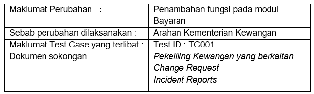
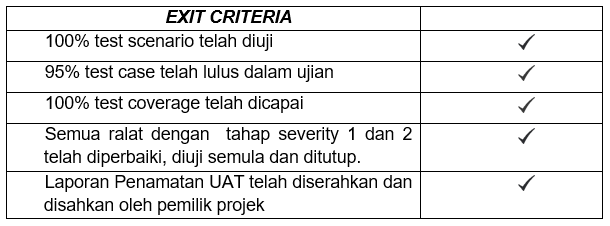
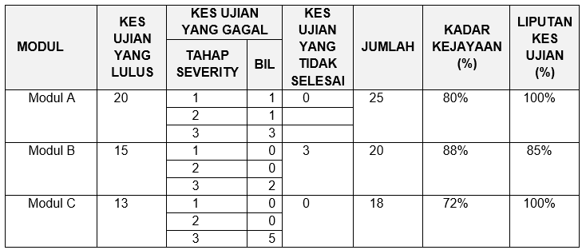

# 6.10 Laporan Ujian Penerimaan (UAT & PAT) [F5.6]

Keterangan

Laporan Ujian Penerimaan (UAT & PAT) adalah laporan yang perlu dikeluarkan
setelah pelaksanaan Ujian Penerimaan Pengguna (UAT) atau Ujian Penerimaan
Provisional (PAT) disempurnakan. Objektif laporan ini dikeluarkan adalah untuk
melapor keupayaan sistem bagi persediaan pelaksanaan. Laporan Ujian Penerimaan
adalah merujuk kepada ISO/IEC/IEEE 29119. Format Laporan Ujian Penerimaan (PAT)
adalah merujuk kepada **D14 Laporan Ujian Penerimaan Pengguna**

Objektif

- Melaporkan keupayaan sistem untuk sesuatu sesi Ujian Penerimaan telah
  dilakukan.

Langkah-langkah

Langkah 1 : Terangkan Maklumat Spesifik Dokumen

Maklumat spesifik dokumen perlu mengandungi maklumat asas Pelan Ujian UAT/PAT
seperti nombor ID, versi, tarikh dihasilkan dan tarikh dikemaskini, organisasi,
pengesahan serta rekod pindaan dokumen. Rujuk **Penyediaan Dokumentasi
Persediaan Ujian [F5.2]** **Langkah 2.**

Langkah 2 : Nyatakan Ringkasan Ujian Yang Dijalankan

Penerangan ringkas terhadap ujian UAT/PAT yang telah dijalankan. Rujuk
**Penyediaan Pelan Ujian UAT/PAT [F5.4]** **Langkah 2(b) Skop Ujian.**

Langkah 3 : Nyatakan Perubahan Dari Pelan Ujian

Penerangan perubahan yang berlaku semasa pelaksanaan pengujian berbanding dengan
Pelan Ujian (UAT/PAT).

**Contoh:**

****

Langkah 4 : Jelaskan Kriteria Penamatan Ujian PAT

Ringkasan situasi yang membolehkan penamatan ujian. Rujuk **Ujian Penerimaan
Provisional (PAT) [F5.5]** **Langkah 1** untuk panduan.

Langkah 5 : Nyatakan Faktor Yang Menghalang Kemajuan

Penerangan faktor-faktor yang menghalang atau melewatkan kemajuan ujian.

Contoh :

Ujian migrasi lewat dilaksanakan kerana saiz data migrasi yang besar dan perlu
tapisan semula (*cleansing*).

Langkah 6 : Nyatakan Pengukuran Hasil Ujian

Seksyen ini menerangkan dapatan hasil ujian.

Contoh :

Penerangan risiko baru, perubahan risiko dan risiko sedia ada (yang belum dapat
diselesaikan) setelah ujian dilaksanakan. Rujuk **Penyediaan Pelan Induk
Pengujian [F5.1], Langkah 5.**

Langkah 7 : Nyatakan Risiko

Penerangan risiko baru, perubahan risiko dan risiko sedia ada (yang belum dapat
diselesaikan) setelah ujian dilaksanakan. Rujuk **Penyediaan Pelan Induk
Pengujian [F5.1], Langkah 5.**

Langkah 8 : Nyatakan Serahan Ujian

Senarai serahan ujian yang perlu dihantar. Rujuk **Penyediaan Pelan Induk
Pengujian [F5.1], Langkah 6(b).**

Langkah 9 : Nyatakan Aset Ujian Yang Boleh Diguna Semula

Senarai spesifikasi ujian, persekitaran ujian dan data ujian yang boleh
digunakan semula bagi kitaran ujian seterusnya.

Langkah 10 : Nyatakan *Lesson Learned*

Pengajaran yang boleh dijadikan sumber rujukan dan diperbaiki dalam kitaran
ujian akan datang.

Rujukan

1. ISO/IEC 29119-3:2013: *Software And Systems Engineering* - *Software Testing*
   - Part 3: *Test Documentation.*
