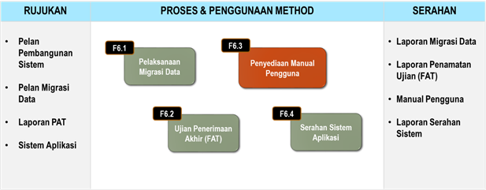

# 7.1 Gambaran Keseluruhan

**FASA PELAKSANAAN**

Bab ini menerangkan aktiviti-aktiviti pelaksanaan sistem yang melibatkan migrasi
data dari sistem yang lama kepada sistem yang baharu, Ujian Penerimaan Akhir
(FAT), penyediaan Manual Pengguna dan penyempurnaan serahan akhir.

**7.1 Gambaran Keseluruhan**

**Rajah 89 : Gambaran Keseluruhan Fasa 6 – Pelaksanaan**
