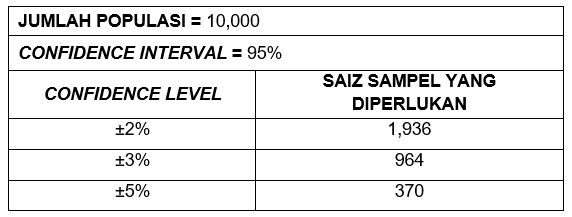
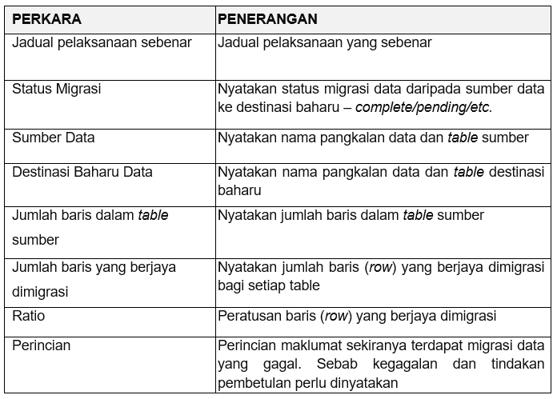

# 7.5 Pelaksanaan Migrasi Data [F6.1]

Keterangan

Pelaksanaan Migrasi Data melibatkan proses pemindahan data dilakukan mengikut
**D05 Pelan Migrasi Data** dan **D06 Spesifikasi Migrasi Data** yang telah
disediakan dalamFasa Reka bentuk Langkah-langkah yang terlibat adalah seperti
berikut:

1. Pembangunan Migrasi Data;
2. Pengujian Sampel;
3. Pelaksanaan Migrasi Data;
4. Pengujian dan Verifikasi Data;dan
5. Penyediaan Laporan.

Objektif

- Memindahkan data daripada sumber asal ke destinasi baharu; dan
- Memastikan data yang dipindahkan adalah berintegriti dan berkualiti.

Langkah-Langkah

Langkah 1 : Laksanakan Pembangunan Migrasi Data

a) Pembangunan migrasi data melibatkan proses mengekstrak data daripada sumber
asal dan menjalankan proses transformasi data (bagi membersihkan data dan
memastikan integriti data) sebelum dipindahkan (*load*) ke destinasi baharu.
Proses ini perlu dilakukan mengikut *data mapping template* pada Spesifikasi
Migrasi Data yang telah disediakan.

b) Kaedah yang biasa digunakan bagi pembangunan migrasi data adalah seperti:

1. Penghasilan skrip untuk migrasi data; dan
2. Penggunaan *tools* untuk migrasi data;

c) Contoh kaedah penghasilan skrip migrasi adalah melalui Notepad++, SQL
scripting, UNIX/Windows command dan *bash scripting*. Manakala sebahagian contoh
kaedah penggunaan *tools* untuk migrasi data pula ialah melalui perisian adalah
seperti:

1. Navicat bagi pangkalan data MySQL, MariaDB, Oracle, PostgreSQL dan lain-lain;
2. Aqua Data Studio bagi Oracle, DB2, MS SQL dan lain-lain;
3. Entity Framework – Code First Migration; dan
4. Oracle Data Pump bagi pangkalan data Oracle.

d) Pada peringkat pembangunan migrasi data, data dipindahkan daripada pangkalan
data sumber ke pangkalan data baharu di persekitaran *staging*/pembangunan
melalui kaedah yang telah dikenal pasti. Data yang hendak dipindahkan perlu
dibuat salinan pendua atau *backup* terlebih dahulu sebagai persediaan untuk
sebarang risiko.

Langkah 2 : Lakukan Pengujian Sampel

1. Ujian sampel dijalankan setelah data dipindahkan daripada pangkalan data
   sumber ke pangkalan data baharu di persekitaran *staging*/pembangunan.
2. Pengujian boleh dijalankan melalui kaedah *scripting, SQL command* atau
   menggunakan fungsi pengujian yang disediakan pada *tools* yang digunakan.
   Perbandingan jumlah data yang dipindahkan dilakukan semasa pengujian ini.
3. Proses verifikasi data juga boleh dilakukan mengikut kaedah yang akan
   diterangkan lanjut pada Langkah 4.
4. Lakukan pembaikan pada *script/command* atau *tools* digunakan jika berlaku
   *error* atau ketidaktepatan data yang dipindahkan.
5. Setelah pengujian di persekitaran *staging*/pembangunan berjaya, kenal pasti
   dan *backup* kesemua data yang perlu dimigrasi sekali lagi sebelum proses
   seterusnya.

Langkah 3 : Laksanakan Migrasi Data

a) Pelaksanaan migrasi data melibatkan perpindahan data daripada pangkalan data
sumber ke pangkalan data baharu di persekitaran Data akan dipindahkan
menggunakan kaedah yang sama pada Langkah 1 iaitu sama ada melalui *scripting*
atau menggunakan *tools.* Sebelum migrasi data dijalankan, pastikan data yang
ingin dipindahkan telah dibuat salinan pendua atau *backup.* Aktiviti seperti
berikut dijalankan semasa pelaksanaan migrasi data :

1. Pastikan ketersediaan pangkalan data baharu di persekitaran *production*;
2. *Run* skrip migrasi atau gunakan *tools* untuk *load* data ke destinasi
   baharu pada persekitaran *production*;
3. Dapatkan statistik data yang berjaya dan gagal dimigrasi; dan

b) Lakukan verifikasi data bagi data yang telah dipindahkan daripada pangkalan
data sumber ke pangkalan data baharu pada *server production*;

Langkah 4 : Lakukan Pengujian dan Verifikasi Data

a) Fasa Pengujian dan Verifikasi pula melibatkan pengujian dan verifikasi bagi
data yang telah dipindahkan. Pengujian ini dilakukan oleh pasukan pengujian yang
telah dikenal pasti iaitu yang terdiri daripada pegawai agensi bersama-sama
pasukan pembekal sekiranya dijalankan secara

b) Proses pengujian biasanya dijalankan untuk menguji ketepatan bilangan data.
Manakala proses verifikasi pula dijalankan untuk mengesahkan kesahihan dan
integriti data. Selain itu, jaminan kualiti data (*data quality assurance*) yang
berterusan perlu dijalankan untuk mengelakkan pertindihan data dan memastikan
kesahihah data. Proses pengujian dan verifikasi data yang biasa dijalankan
adalah seperti berikut:

1. Pengujian bilangan data dipindah dalam setiap table : menggunakan *SQL
   statement* (*Select Count*) atau *tools* tertentu; dan
2. Pensampelan statistik untuk verifikasi nilai data: mendapatkan saiz rekod
   (sampel) yang bersesuaian. Persampelan ini mengambil kira saiz populasi,
   *confidence level* (*margin of error*, ±X %) dan *confidence interval*
   (peratus keyakinan kesahihah data dalam linkungan *margin of error* pilihan).

Contoh pengiraan sampel data yang perlu diuji adalah seperti berikut :

Jadual 93 : Contoh Pengiraan Sampel Data Bagi Ujian Migrasi Data

Sumber rujukan :
[http://www.surveysystem.com/sscalc.htm#one](http://www.surveysystem.com/sscalc.htm#one)

Langkah 4 : Sediakan Laporan Migrasi Data

Di akhir proses migrasi data, satu Laporan Migrasi yang mengandungi maklumat
berkaitan proses migrasi yang telah dijalankan akan dihasikan.

a) Laporan Migrasi Data disediakan selepas semua aktiviti migrasi termasuk
pengujian selesai dijalankan. Laporan akan dijadikan makluman kepada pemegang
taruh yang terlibat mengenai status pelaksanaan migrasi dan boleh dijadikan
sebagai panduan untuk aktiviti migrasi yang akan datang.

b) Kandungan Laporan adalah terdiri daripada:

Jadual 94 : Isi Kandungan Laporan Migrasi Data

Rujuk **D15 Laporan Migrasi Data** sebagai panduan.

Rujukan

1. Pelan Migrasi Data Sistem eRoses.
2. Oracle White Paper (2011). Successful Data Migration.
   http://www.oracle.com/technetwork/middleware/oedq/successful-data-migration-wp-1555708.pdf
3. Credesoft White Paper. Eight key steps which help ensure a successful data
   migration project: A white paper for inspection management professionals.
   http://credosoft.com/wp/wp-content/uploads/2014/01/Eight-key-steps-which-help-ensure-a-successfu-data-migration-project.pdf
4. SAGA Group (2012). Methods of Data Migration.
