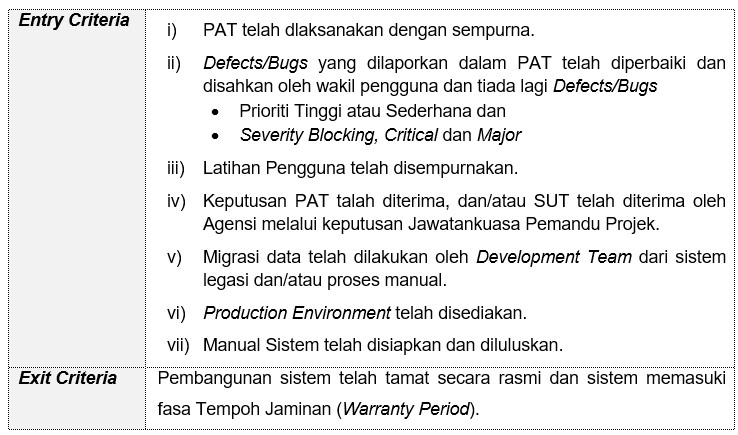
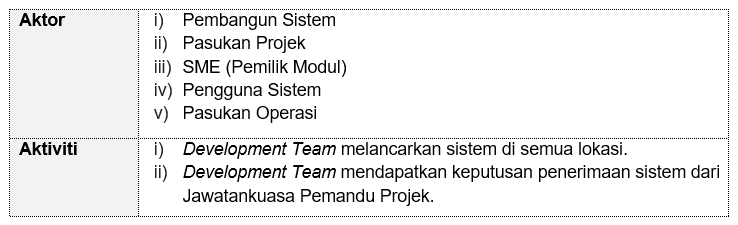

# 7.6 Ujian Penerimaan Akhir [F6.2]

**Keterangan**

Ujian Penerimaan Akhir (FAT) merupakan proses formal untuk mendapatkan
persetujuan dari Agensi bagi membolehkan sistem yang diuji memasuki fasa
produksi dan juga Tempoh Jaminan (Warranty Period).

**Objektif**

- Mengesahkan bahawa sistem yang telah dibangunkan memenuhi keperluan yang telah
  digariskan pengguna
- Mengesahkan bahawa sistem bebas daripada ralat (high severity bugs) yang boleh
  mengganggu operasi sistem
- Mendapatkan keyakinan pengguna terhadap keseluruhan sistem

**Langkah-langkah**

**Langkah 1 : Tentukan *Entry Criteria* dan *Exit Criteria* Ujian Penerimaan
Akhir (*Final Acceptance Test* - FAT)**

*Entry Criteria* dan *Exit Criteria* FAT ditetapkan dan dipersetujui terlebih
dahulu di antara pembangun sistem, pasukan penguji, pemilik sistem dan pemegang
taruh yang berkenaan.

**Jadual 95 : Syarat Masuk dan Keluar Ujian Penerimaan akhir**

**Langkah 2 : Laksanakan FAT**

FAT melibatkan aktor dan aktiviti-aktiviti berikut :

**Jadual 96 : Aktor dan Aktiviti Ujian Penerimaan akhir**

**Langkah 3 : Sediakan Laporan Penamatan Ujian (*Test Completion Report*)**

a) Laporan Penamatan Ujian mengandungi ringkasan hasil ujian yang dilaksanakan.
Laporan Penamatan Ujian boleh disediakan bagi sesuatu peringkat ujian atau bagi
keseluruhan projek.

b) Merujuk kepada ISO/IEC/IEEE 29119, Laporan Penamatan Ujian mempunyai
elemen-elemen berikut:

**Jadual** **97** **:** **Isi Kandungan Laporan Penamatan Ujian**

| **Elemen** | **Keterangan** |  |  |  |  |
|---|---|---|---|---|---|
| Maklumat spesifik dokumen | Mengandungi maklumat asas seperti nombor ID, versi, tarikh dihasilkan dan tarikh dikemaskini, organisasi, pengesahan serta rekod pindaan dokumen |  |  |  |  |
| Objektif Ujian | Penerangan mengenai objektif ujian yang dijalankan |  |  |  |  |
| Skop Ujian | Skop ujian bertujuan untuk menetapkan perimeter ujian termasuk ciri-ciri (fungsian dan kualiti/ bukan fungsian) yang akan diuji ke atas item ujian dan ciri-ciri yang tidak akan diuji ke atas item ujian |  |  |  |  |
| Butiran Ujian | Seksyen ini menerangkan butiran tempoh Ujian Penamatan akan dilaksanakan dan peserta yang akan terlibat. Contoh: \| **Tarikh Mula FAT** \| 4hb Ogos 2018 \| \|---\|---\| \| **Tarikh Akhir FAT** \| 4hb September 2018 \| \| **Peserta FAT** \| Pengguna Sistem Tempahan Bilik \| |  |  |  |  |
| **Tarikh Mula FAT** | 4hb Ogos 2018 |  |  |  |  |
| **Tarikh Akhir FAT** | 4hb September 2018 |  |  |  |  |
| **Peserta FAT** | Pengguna Sistem Tempahan Bilik |  |  |  |  |
| Keperluan Persekitaran | Keperluan persekitaran merujuk kepada keperluan perkakasan dan perisian yang digunakan semasa sesi Ujian Penamatan. Contoh: \| Bil. \| **Keperluan Persekitaran** \| **Keterangan** \| \|---\|---\|---\| \| 1. \| *Production Environment* \| URL: [https://www.tempahan.gov.my](https://www.tempahan.gov.my) Pelayar: Chrome / Mozilla \| |  |  |  |  |
| Bil. | **Keperluan Persekitaran** | **Keterangan** |  |  |  |
| 1. | *Production Environment* | URL: [https://www.tempahan.gov.my](https://www.tempahan.gov.my) Pelayar: Chrome / Mozilla |  |  |  |
| Hasil Ujian | Seksyen ini menerangkan dapatan hasil ujian seperti berikut: i) Isu-isu FAT yang dilaporkan ii) Kategori Isu-isu FAT (*Functionality, Usability or Operational*) iii) Status Isu-isu FAT iv) Ulasan Keputusan Ujian Contoh \| **Sumber** \| **Status** \| ***Severity*** \| **Jumlah Isu** \|  \|  \| \|---\|---\|---\|---\|---\|---\| \| ***High*** \| ***Medium*** \| ***Low*** \|  \|  \|  \| \| Pasukan Projek \| *Open* \| 0 \| 2 \| 0 \| 2 \| \| *Closed* \| 0 \| 1 \| 0 \| 1 \|  \| \| **Sumber** \| **Status** \| ***Type*** \| **-** \|  \|  \| \| ***Request*** \| ***Incident*** \|  \| **-** \|  \|  \| \| Pasukan Operasi \| *Open* \| 1 \| 0 \| 1 \|  \| \| *Closed* \| 0 \| 1 \| 1 \|  \|  \| |  |  |  |  |
| **Sumber** | **Status** | ***Severity*** | **Jumlah Isu** |  |  |
| ***High*** | ***Medium*** | ***Low*** |  |  |  |
| Pasukan Projek | *Open* | 0 | 2 | 0 | 2 |
| *Closed* | 0 | 1 | 0 | 1 |  |
| **Sumber** | **Status** | ***Type*** | **-** |  |  |
| ***Request*** | ***Incident*** |  | **-** |  |  |
| Pasukan Operasi | *Open* | 1 | 0 | 1 |  |
| *Closed* | 0 | 1 | 1 |  |  |
| Rumusan | Mengandungi penerangan rumusan hasil daripada ujian FAT. Contoh: i. Tiada isu yang dibangkitkan dalam tempoh FAT. ii. Laporan FAT ini merangkumi semua skop seperti yang telah ditetapkan. iii. FAT ini telah diperaku dan diterima oleh Kerajaan. |  |  |  |  |

Templat **Laporan Penamatan** **Ujian** seperti dalam **D16 Laporan Penamatan
Ujian.**

**Langkah 4 : Sediakan Sijil Penerimaan Akhir**

Sijil Penerimaan Akhir atau *Final Acceptance Certificate* (FAC) akan
dikeluarkan oleh pemilik sistem kepada pembekal. Sijil ini menunjukkan bahawa
pemilik telah bersetuju menerima sistem yang dibangunkan dan diinstalasi di
persekitaran produksi. Tarikh sijil FAC ini menandakan tamatnya pembangunan dan
pengujian sistem dan bermulanya tempoh jaminan. Rujuk kepada Apendiks 11 Contoh
Sijil Penerimaan Akhir .

Rujukan

1. ISO/IEC 29119-3:2013: *Software And Systems Engineering - Software Testing* -
   Part 3: *Test Documentation.*
