# 8.2 Pengiraan Saiz Fungsian Sistem Aplikasi

**8.2.1 Definisi**

Kaedah pengiraan saiz fungsian sistem aplikasi yang ditetapkan oleh IFPUG
mengukur saiz ke atas dua kategori fungsi sistem iaitu fungsi transaksi dan
fungsi data. Fungsi transaksi merujuk kepada fungsi-fungsi transaksi asas yang
melaksanakan proses menyimpan, mengemaskini, menghapus dan mempamer data
logikal. Fungsi data merujuk kepada data logikal yang telah disimpan dan
tersedia untuk dikemaskini dan dicapai. Setiap fungsi ini mempunyai
komponen-komponen yang digunakan dalam pengiraan saiz fungsian sistem. Penentuan
klasifikasi setiap komponen ini perlu menurut peraturan-peraturan dan panduan
yang telah ditetapkan oleh IFPUG. Buku panduan ini tidak menerangkan secara
terperinci kaedah, peraturan dan panduan yang digunakan dalam FPA (*Function
Point Analysis*). Panduan FPA yang spesifik boleh didapati dengan merujuk kepada
literatur berkaitan FPA dan panduan yang dikeluarkan oleh IFPUG. Walau
bagaimanapun sebagai panduan asas, di bawah diberikan definisi ringkas setiap
komponen fungsi tersebut sebagaimana ditakrifkan oleh IFPUG.

**8.2.1.1 Komponen Fungsi**

***a) Internal Logical Files* (ILF’s)**

Berasaskan definisi ini, ILF ialah fail-fail, jadual-jadual (*table*) dalam
pangkalan data atau kumpulan-kumpulan data yang dimiliki dan diselenggara oleh
sistem aplikasi yang dibangun.

***b) External Interface Files* (EIF’s)**

Berasaskan definisi ini, EIF ialah fail-fail, jadual-jadual (*table*) dalam
pangkalan data atau kumpulan-kumpulan data yang dimiliki dan diselenggara oleh
sistem aplikasi lain tetapi dirujuk oleh sistem yang dibangun.

***c) External Inputs* (EI)**

**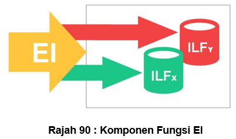**

Berasaskan definisi ini, EI ialah fungsi transaksi asas yang menyimpan,
mengemaskini dan/atau menghapus data dalam ILF. Fungsi transaksi asas ini
mungkin dalam bentuk skrin input atau antaramuka dengan sistem atau peralatan
lain.

***d) External Outputs* (EO)**

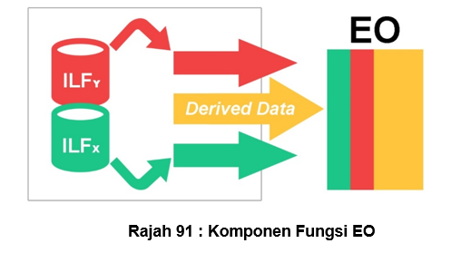

Berasaskan definisi ini, EO ialah fungsi transaksi asas yang menghantar maklumat
ke luar sempadan sistem, serta ia merangkumi pemprosesan tambahan melebihi dari
fungsi transaksi *external inquiry* (EQ). Tujuan utama EO adalah bukan sahaja
untuk menarik maklumat malah ia juga memaparkan maklumat kepada pengguna melalui
logik pemprosesan yang merangkumi sekurang-kurangnya satu pengiraan matematik,
menghasilkan *derived data*, menyelenggara satu atau lebih ILF, dan/atau merubah
tingkah laku (*behaviour*) sistem.

***e) External Inquiry* (EQ)**

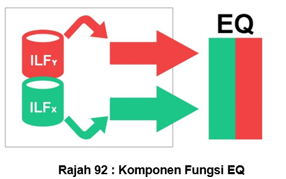

Berasaskan definisi ini, EQ ialah fungsi transaksi asas yang menghantar maklumat
keluar dari sempadan sistem. Tujuan utama EQ ialah untuk memaparkan maklumat
kepada pengguna melalui data yang ditarik dari ILF. Logik pemprosesan EQ tidak
mengandungi sebarang pengiraan matematik, tidak menghasilkan *derived data*,
tidak perlu menyelenggara sebarang ILF, dan tidak merubah tingkah laku
(*behaviour*) sistem.

***f) Files Type Reference* (FTR)**

*File type reference* (FTR) ialah objek atau jenis fail yang dirujuk oleh
transaksi di dalam EI, EO dan EQ. FTR adalah terdiri sama ada ILF atau EIF.

***g) Data Element Types* (DET)**

*Data element types* (DET) adalah merupakan *field* yang dinamik, *user
recognizable* dan unik (*non-repetitive*). Data elemen boleh terdiri daripada
bentuk kuantitatif seperti nombor, dan bentuk kualitatif seperti teks, foto,
video dan audio.

***h) Record Element Type* (RET)**

*Record Element Type* (RET) adalah merupakan sub kumpulan kepada elemen data
yang terkandung di dalam satu-satu ILF atau EIF.

Tahap kompleksiti EI, EO dan EQ ditentukan oleh bilangan *Files Type Reference*
(FTR) dan bilangan *Data Element Types* (DET). Dalam konteks pengurusan
pangkalan data, FTR ialah *table* dan DET ialah *field* atau *column*. Bagi ILF
dan EIF pula tahap kompleksitinya ditentukan oleh bilangan RET and bilangan DET.
Dalam model ERD, RET ialah entiti dan DET ialah atribut kepada entiti. Kaedah
dan peraturan penentuan ILF, EIF, EI, EO, EQ, FTR, RET dan DET hendaklah dirujuk
dalam panduan yang dikeluarkan oleh IFPUG. Secara keseluruhannya, gambarajah di
bawah menunjukkan bagaimana komponen-komponen tersebut diklasifikasikan.

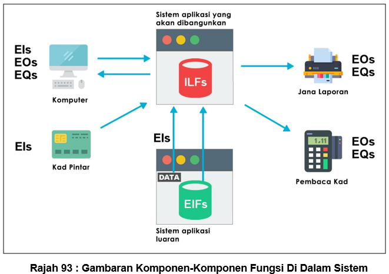

**8.2.1.2 Jadual Matriks Kompleksiti dan Jadual Penterjemahan**

**a) Jadual Fungsi Transaksi**

Jadual Matriks Kompleksiti dan Jadual Penterjemahan bagi Fungsi Transaksi adalah
seperti di bawah:

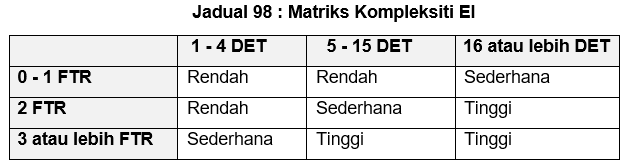

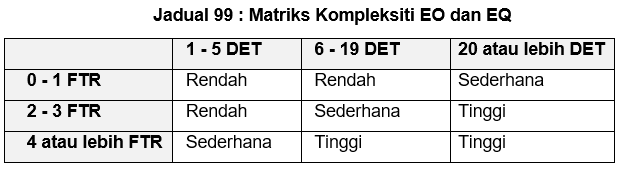

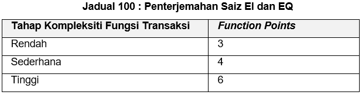

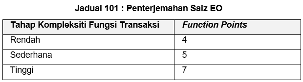

b) Jadual Fungsi Data

Jadual Matriks Kompleksiti dan Jadual Penterjemahan bagi Fungsi Data adalah
seperti di bawah:

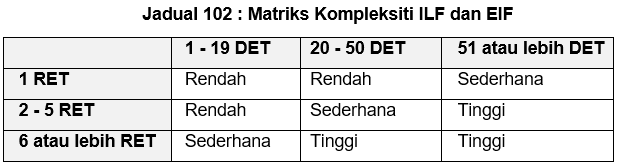

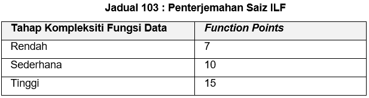

**8.2.1.3 Empat Belas Ciri-ciri Am Sistem (GSC)**

Pengiraan saiz ini berasaskan kepada kompleksiti keperluan fungsian sistem yang
diterima oleh pengguna. Faktor-faktor dari aspek keperluan teknikal dan kualiti
yang mempengaruhi kompleksiti sistem juga perlu diambil kira. IFPUG menetapkan
14 faktor teknikal dan kualiti seperti dalam jadual di bawah.

**Jadual** **105** **: 14 Ciri-ciri Am Sistem (GSC)**

| **Bil.** | **Faktor** | **Keterangan** |
|---|---|---|
| 1 | Komunikasi Data | Berapa banyak fasiliti komunikasi yang ada untuk membantu pemindahan atau pertukaran maklumat dengan sistem aplikasi? |
| 2 | Pemprosesan Data Teragih | Bagaimana data teragih (*distributed data*) dan fungsi pemprosesan dikendalikan? |
| 3 | Prestasi | Adakah pengguna memerlukan maklumat berkenaan masa tindakbalas dan daya pemprosesan (*throughput*)? |
| 4 | Konfigurasi yang Kerap Digunakan | Berapa kerap platfom perkakasan sedia ada akan digunakan untuk melaksanakan sistem aplikasi pada masa akan datang? |
| 5 | Kadar Transaksi | Berapa kerap transaksi dilaksanakan dalam masa sehari, seminggu, sebulan dan sebagainya? |
| 6 | Kemasukan Data Dalam Talian | Apakah peratusan maklumat yang direkodkan secara dalam talian? |
| 7 | Efisiensi Pengguna | Adakah aplikasi direka bentuk berdasarkan efisiensi pengguna? |
| 8 | Pengemaskinian Dalam Talian | Berapa banyak ILF yang dikemaskini melalui transaksi dalam talian? |
| 9 | Pemprosesan yang Kompleks | Adakah sistem aplikasi yang akan dibangunkan mengandungi logikal dan pemprosesan matematik yang kompleks? |
| 10 | *Reusability* | Adakah aplikasi dibangunkan bertujuan untuk memenuhi keperluan seseorang pengguna atau ia mengambil kira juga keperluan pengguna-pengguna yang lain? |
| 11 | *Installation Ease* | Berapa sukar proses instalasi yang akan dilaksanakan? |
| 12 | *Operational Ease* | Apakah tahap keberkesanan dan automasi bagi prosedur-prosedur *start-up, back-up* dan pemulihan? |
| 13 | Lokasi | Adakah sistem aplikasi direka bentuk, dibangun dan menyokong kepada pemasangan di pelbagai lokasi dan organisasi? |
| 14 | Perubahan Fasiliti | Adakah sistem aplikasi direka bentuk, dibangun dan menyokong kepada perubahan fasiliti? |

Faktor-faktor yang dinyatakan di atas merupakan empat belas (14) ciri-ciri am
sistem (GSC) yang ditetapkan oleh IFPUG untuk mengukur kefungsian teknikal dan
kualiti sistem. Setiap karakteristik ini mempengaruhi kompleksiti sistem dan
tahap pengaruhnya ditetapkan mengikut 6 skil ukuran iaitu 0 (*Not present/no
influence*), 1 (*Incidental influence*), 2 (*moderate influence*), 3 (*average
influence*) dan 4 (*significant influence*) dan 5 (*strong influence
throughout*). Keterangan terperinci faktor-faktor tersebut dan peraturan bagi
menetapkan tahap kesan dan pengaruh setiap faktor ke atas kompleksiti sistem
perlu dirujuk dalam panduan pengiraan yang disediakan oleh IFPUG.

**8.2.2 Pengiraan *Value Adjustment Factor* (VAF)**

Pengaruh empat belas (14) ciri-ciri am sistem (GSC) digunakan untuk mendapatkan
*Value Adjustment Factor* (VAF) dengan menggunakan formula IFPUG seperti
berikut:

**VAF = 0.65 + [( Σ Ci) / 100]**

**i** = 1 to 14 mewakili bilangan item GSC

**Ci** = kadar pengaruh setiap item GSC

**Σ** = jumlah kadar pengaruh semua 14 item GSC

Pengiraan *Unadjusted Function Points* (UFP)

Berpandukan kaedah pengiraan dan jadual kompleksiti yang telah diterangkan di
atas, pengiraan UFP boleh dikira dengan menggunakan jadual pengiraan dan contoh
di bawah.

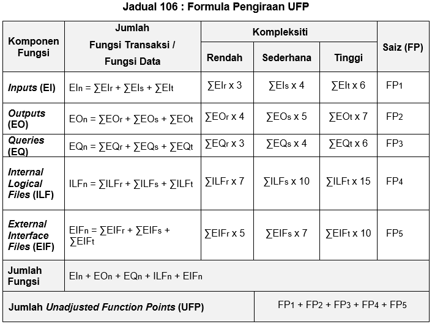

**8.2.4 Pengiraan *Adjusted Function Points* (AFP)**

Kompleksiti sesebuah sistem aplikasi tidak hanya bergantung komponen-komponen
sistem yang digunakan dalam pengiraan UFP tetapi juga bergantung kepada
faktor-faktor lain. Bagi mendapatkan saiz sistem yang lebih realistik,
faktor-faktor lain seperti *end-user efficiency, reusability*, aspek prestasi
dan lain-lain juga perlu diambil kira. Faktor-faktor ini digunakan untuk
mendapatkan nilai *value adjusted factor* (VAF). Saiz sistem aplikasi yang
realistik atau *adjusted function points* (AFP) dapat dikira menggunakan formula
di bawah:

**AFP = UFP x VAF**

Oleh kerana faktor-faktor yang digunakan untuk mengira VAF belum dapat
dikenalpasti di peringkat kajian keperluan bisnes, maka nilai VAF boleh diambil
antara 0.65 hingga 1.00 bagi sistem yang kecil dan 1.01 hingga 1.35 bagi sistem
sederhana dan besar bergantung kepada tahap kompleksiti sistem tersebut. Saiz
sistem samada kecil atau besar boleh diandaikan berpandukan kepada UFP iaitu
sistem bersaiz kecil sekiranya kurang daripada 100FP, bersaiz sederhana bagi
sistem aplikasi bersaiz antara 100FP hingga 999FP dan bersaiz besar bagi sistem
aplikasi bersaiz 1000FP ke atas.

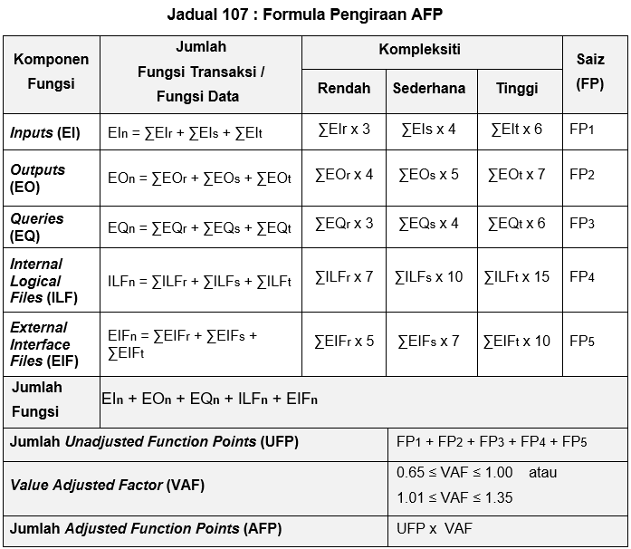

**8.2.5 Pengiraan Anggaran *Effort* (*man hours*) dan Kos Pembangunan Sistem**

Selepas jumlah AFP didapati, anggaran *effort*, saiz sumber manusia dan kos
pembangunan sistem boleh dilakukan. Anggaran ini boleh dibuat berdasarkan kepada
standard kadar produktivti (FP per masa), bilangan kategori sumber manusia per
FP dan kos per FP. Anggaran ini lebih tepat sekiranya standard yang digunakan
ialah berdasarkan pengalaman pasukan pembangunan agensi. Sekiranya tiada
standard di peringkat agensi atau sektor awam, standard antarabangsa atau
negara-negara lain yang bersesuaian boleh digunakan juga. Berdasarkan kepada
standard yang diguna pakai, formula bagi pengiraan *effort* dan masa pembangunan
adalah seperti berikut:

***Effort*** **Pembangunan Sistem** = *Adjusted Function Points* x Kadar
Produktiviti *man-hours* di Malaysia

= (AFP x 15 *man-hours*)

* 15 *man-hours* adalah nilai contoh bagi Kadar Produktiviti *man-hours* di
  Malaysia

**Masa Pembangunan Sistem** = *Adjusted Function Points* /

Kadar Produktiviti FP Sebulan di Malaysia

= AFP / 11.73 FP

* 11.73 FP adalah nilai contoh bagi Kadar Produktiviti FP Sebulan di Malaysia

Pengiraan kos pembangunan boleh dilakukan sama ada merujuk kepada kos
pembangunan per FP berdasarkan kepada *I**nternational Software Benchmarking
Standard Group* (ISBSG); atau dengan berpandukan kepada kos pasaran semasa
industri bagi bilangan *mandays* yang telah diperolehi dari nilai FP.

Oleh kerana maklumat kos pembangunan per FP bagi Malaysia pada ketika ini masih
belum lagi dikumpulkan di dalam respositori ISBSG, kadar kos pembangunan per FP
boleh dirujuk kepada kadar bagi negara-negara serantau asia negara seperti
Indonesia dan Thailand. Formula pengiraan kos pembangunan sistem mengikut kadar
ISBSG adalah seperti berikut:

**Kos Pembangunan Sistem** = *Adjusted Function Points* x Kos **(ISBSG)**
Pembangunan Per FP Semasa (Indonesia) x

Nilai Pertukaran USD kepada Ringgit Semasa

= AFP x USD275.00 x RM4.00

* USD275.00 adalah nilai contoh bagi Kos Pembangunan Per *Function Point* (FP)
  bagi negara Indonesia.

Bagi pengiraan kos pembangunan mengikut *mandays*, kos bagi setiap *mandays*
yang diperolehi dengan menggunakan kaedah FP boleh berpandukan sama ada kepada
kos pasaran semasa industri atau kos *mandays* yang ditentukan oleh agensi.
Formula pengiraan kos pembangunan sistem mengikut kadar *mandays* adalah seperti
berikut:

**Kos Pembangunan Sistem** = *Effort* Pembangunan Sistem x Kos **(*Mandays*)**
Per *Mandays*
