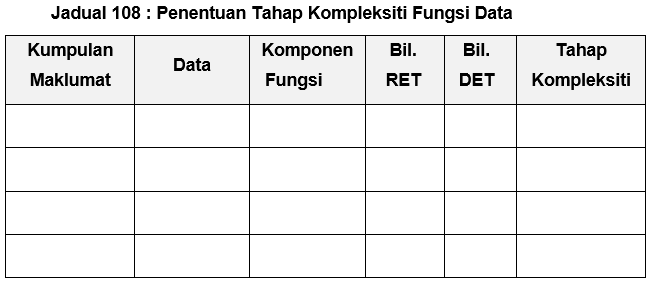
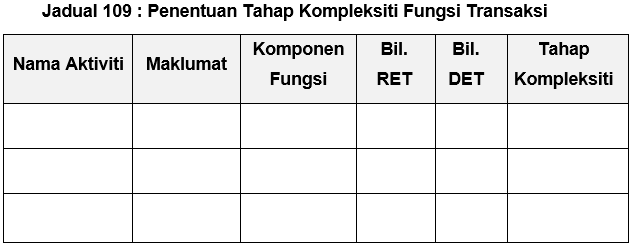

# 8.3 Pengiraan Saiz Fungsian Sistem Aplikasi di Fasa Permulaan Projek

Pengiraan saiz sistem aplikasi di Fasa Permulaan Projek adalah merupakan
pengiraan awal saiz bagi membantu satu-satu organisasi membuat anggaran sumber,
masa serta perancangan lain yang diperlukan bagi pembangunan sistem aplikasi
terlibat. Penentuan dan pengiraan saiz sistem aplikasi di Fasa Permulaan Projek
akan merujuk kepada model-model yang dibangunkan di dalam fasa ini, iaitu Rajah
Hierarki Bisnes **- Pemodelan Fungsi Bisnes [F1.3]**, Rajah Aliran Proses dan
Definisi Aktiviti Fungsi Bisnes **- Pemodelan Proses Bisnes [F1.4]**.
Langkah-langkah pengiraan saiz sistem aplikasi di Fasa Permulaan Projek adalah
seperti berikut:

**a) Kenalpasti Kompleksiti Komponen Fungsi bagi Fungsi Data**

i) Tentukan bilangan ILF / EIF

Penentuan bilangan ILF/EIF adalah berdasarkan kepada bilangan kumpulan maklumat
yang telah disenaraikan di dalam Definisi Aktiviti Fungsi Bisnes. Berikut adalah
kaedah-kaedah bagi menentu dan mengirakan bilangan ILF/EIF di dalam Fasa
Permulaan Projek:

- Setiap kumpulan maklumat boleh dianggap mempunyai hubungan *independent* di
  antara satu sama lain dan setiapnya mempunyai ILF/EIF yang berasingan. Namun
  begitu, andaian hubungan ini tidak terpakai sekiranya terdapat hubungan di
  antara kumpulan-kumpulan maklumat berkenaan telah jelas dikenalpasti.
- Individu yang melaksanakan penentuan ILF/EIF perlu juga melakukan andaian
  untuk merangkumkan bersekali kumpulan-kumpulan maklumat tambahan, seperti
  jadual rujukan (*look up table*), sekiranya maklumat tersebut tidak
  disenaraikan di dalam Definisi Aktiviti Fungsi Bisnes.
- Penentuan dan pengiraan bilangan ILF/EIF bagi kumpulan maklumat yang sama
  tidak boleh dilakukan secara berulang kali.

ii) Tentukan bilangan RET

Penentuan bilangan RET adalah berdasarkan kepada bilangan kumpulan-kumpulan
maklumat yang berhubung kait di dalam satu-satu ILF/EIF. Berikut adalah
kaedah-kaedah bagi menentu dan mengirakan bilangan RET di dalam Fasa Permulaan
Projek:

- Pengiraan bilangan RET boleh dilakukan dengan menganggap bahawa setiap ILF/EIF
  bagi kumpulan-kumpulan maklumat yang terlibat hanya mempunyai bilangan RET
  sebanyak 1 sahaja. Anggapan ini dibuat oleh kerana hubungan di antara
  kumpulan-kumpulan maklumat masih belum lagi dapat dikenalpasti secara
  terperinci pada fasa ini, melainkan individu yang melakukan pengiraan adalah
  serba mahir dalam bidang pemodelan keperluan maklumat serta mampu untuk
  melakukan andaian kepada struktur pangkalan data yang akan dibangunkan pada
  fasa-fasa berikutnya.
- Penentuan dan pengiraan bilangan RET bagi kumpulan maklumat yang sama tidak
  boleh dilakukan berulang kali walaupun kumpulan maklumat tersebut berhubung
  kait di bawah ILF/EIF yang berbeza.

iii) Tentukan bilangan DET

Penentuan bilangan DET bagi Fungsi Data adalah berdasarkan kepada bilangan data
di bawah satu-satu ILF/EIF dengan merujuk kepada kumpulan maklumat yang telah
dikenalpasti di dalam Definisi Aktiviti Fungsi Bisnes. Berikut adalah
kaedah-kaedah untuk menentu dan mengirakan bilangan DET di dalam Fasa Permulaan
Projek:

- Senaraikan dan kira bilangan data-data yang terkandung di bawah satu-satu
  kumpulan maklumat termasuk kumpulan maklumat tambahan yang telah diandaikan
  sebelum ini. Setiap data yang telah dikenalpasti mempunyai nilai DET sebanyak
  1 sahaja.
- Data-data yang dianggap sebagai kunci primer (*primary key*) bagi setiap
  kumpulan maklumat tidak akan ditentukan sebagai DET sekiranya data tersebut
  hanya merupakan artifak teknikal di mana ia tidak memberi makna kepada bisnes
  dan bukan terdiri dari maklumat yang boleh difahami oleh pengguna (*non*
  *user-recognizable*). Sekiranya data-data kunci primer tersebut digunakan
  sebagai kunci sekunder di dalam kumpulan maklumat yang lain, data kunci
  sekunder tersebut akan dianggap sebagai DET.
- Penentuan dan pengiraan bilangan DET bagi data yang sama tidak boleh dilakukan
  berulang kali melainkan data yang sama juga diletakkan di dalam kumpulan
  maklumat yang berbeza.

iv) Tentukan kompleksiti setiap ILF / EIF

Berdasarkan kepada bilangan ILF/EIF, FTR dan DET yang telah ditentukan, rujuk
kepada Jadual Matriks Kompleksiti bagi Fungsi Data seperti di 8.2.1.2 Jadual
Matriks Kompleksiti dan Jadual Penterjemahan untuk menentukan tahap kompleksiti
setiap komponen fungsi yang telah dikenalpasti.

v) Lengkapkan Jadual Penentuan Tahap Kompleksiti Fungsi Data

Gunakan jadual di bawah untuk merekodkan nama kumpulan maklumat, data yang
terlibat, bilangan ILF/EIF, FTR, DET serta kompleksitinya yang telah
dikenalpasti di dalam langkah-langkah yang sebelum.

**b) Kenalpasti kompleksiti komponen fungsi bagi Fungsi Transaksi**

i) Kenalpasti Fungsi Transaksi Asas

Berdasarkan kepada Rajah Hierarki Fungsi yang telah disediakan di dalam
Pemodelan Fungsi Bisnes [F.1.2]­, kenalpasti setiap Fungsi Transaksi Asas
(*Elementary Function*) yang terlibat dengan bisnes dan sistem yang ingin
dibangunkan.

ii) Tentukan bilangan EI, EO dan EQ

Penentuan bilangan komponen fungsi EI, EO dan EQ berdasarkan kepada interaksi
pengguna dengan aktiviti-aktiviti bisnes di dalam Rajah Aliran Proses dan
Definisi Aktiviti Fungsi Bisnes. Berikut adalah kaedah-kaedah untuk menentu dan
mengirakan bilangan EI, EO dan EQ di dalam Fasa Permulaan Projek:

- Bagi setiap aktiviti bisnes yang telah dikenalpasti di dalam Rajah Aliran
  Proses, tentukan sama ada aktivit-aktiviti tersebut adalah terdiri daripada
  komponen fungsi EI, EO atau/dan EQ.
- Setiap akitiviti bisnes di dalam Rajah Aliran Proses boleh mengandungi lebih
  dari satu jenis komponen fungsi sama ada kombinasi di antara EI dengan EO
  ataupun EQ.
- Jenis komponen fungsi yang sama tidak boleh bertindih dan dikira berulang kali
  di bawah satu-satu aktiviti bisnes yang sama.

iii) Tentukan bilangan FTR

Penentuan bilangan FTR adalah berpandukan kepada bilangan dan hubungan di antara
kumpulan-kumpulan maklumat yang terlibat di dalam transaksi aktiviti bisnes bagi
setiap komponen fungsi EI, EO dan EQ yang telah dikenalpasti. Rujuk kepada
Definisi Aktiviti Fungsi Bisnes dan juga senarai ILF/EIF yang telah ditentukan
di dalam Fungsi Data untuk menentukan bilangan kumpulan maklumat yang terlibat
serta hubungannya di antara satu sama lain. Berikut adalah kaedah-kaedah untuk
menentu dan mengirakan bilangan FTR di dalam Fasa Permulaan Projek:

- Berdasarkan kepada senarai ILF/EIF di dalam Fungsi Data, kenalpasti bilangan
  dan hubungan di antara kumpulan-kumpulan maklumat yang berinteraksi dengan
  aktiviti bisnes di bawah satu-satu komponen fungsi EI, EO atau EQ.
- Jumlah bilangan komponen fungsi ILF/EIF yang terlibat dengan aktiviti bisnes
  berkenaan adalah merupakan bilangan FTR yang akan diperolehi.

iv) Tentukan bilangan DET

Penentuan bilangan DET bagi Fungsi Transaksi adalah bergantung kepada bilangan
data yang digunakan di dalam transaksi setiap komponen fungsi EI, EO atau EQ
bagi satu-satu aktiviti bisnes. Rujuk kepada ruangan Pengguna Maklumat di dalam
Definisi Aktiviti Fungsi Bisnes untuk mengetahui maklumat/data yang terlibat
bagi setiap aktiviti bisnes terlibat. Berikut adalah kaedah-kaedah untuk menentu
dan mengirakan bilangan FTR di dalam Fasa Permulaan Projek:

- Bagi komponen fungsi EI, kirakan bilangan DET yang hanya melibatkan data yang
  dimasukkan, dikemaskini atau/dan dihapuskan.
- Bagi komponen fungsi EO, kirakan bilangan DET yang hanya melibatkan data data
  yang dipaparkan melalui pengiraan atau logik pengaturcaraan.
- Bagi komponen fungsi EQ, kirakan bilangan DET yang hanya melibatkan data-data
  yang dipaparkan secara terus tanpa melalui pengiraan atau logik
  pengaturcaraan.
- Berbeza dengan pengiraan bilangan DET di dalam Fungsi Data, penentuan dan
  pengiraan bilangan DET bagi Fungsi Transaksi boleh dilakukan berulang kali
  bagi data-data yang sama di bawah fungsi atau aktiviti bisnes yang berbeza.

v) Tentukan kompleksiti setiap EI. EO dan EQ

Berdasarkan kepada bilangan EI, EO, EQ, FTR dan DET yang telah ditentukan, rujuk
kepada Jadual Matriks Kompleksiti bagi Fungsi Transaksi seperti di 8.2.1.2
Jadual Matriks Kompleksiti dan Jadual Penterjemahan untuk menentukan tahap
kompleksiti setiap komponen fungsi yang telah dikenalpasti.

vi) Lengkapkan Jadual Penentuan Tahap Kompleksiti Fungsi Data

Gunakan jadual di bawah untuk merekodkan nama aktiviti, kumpulan maklumat dan
data yang terlibat, bilangan EI, EO, EQ, RET, DET serta kompleksitinya yang
telah dikenalpasti di dalam langkah-langkah yang sebelum.

**c) Kirakan *Value Adjustment Function* (VAF)**

i) Tentukan dahulu kadar pengaruh bagi empat belas (14) Ciri-Ciri Am Sistem
(GSC) seperti yang disenarai dan diperjelaskan di dalam 8.2.1.3 Empat Belas
Ciri-ciri Am Sistem (GSC). Tambahkan skor-skor yang telah diberikan kepada
ciri-ciri am berkenaan untuk mendapatkan nilai ΣCi.

ii) Dengan berpandukan kepada formula pengiraan seperti yang diterangkan di
dalam 8.2.2 Pengiraan *Value Adjustment Factor*, masukkan nilai ΣCi yang telah
diperolehi ke dalam formula di bawah untuk mendapatkan nilai VAF.

VAF = 0.65 + [(ΣCi) / 100]

**d) Kirakan *Unadjusted Function Points* (UFP)**

i) Berdasarkan maklumat kompleksiti yang telah diperolehi melalui penentuan
berdasarkan Fungsi Transaksi dan Fungsi Data, rujuk kepada Jadual Penterjemahan
Saiz seperti di 2.1.2 Jadual Matriks Kompleksiti dan Jadual Penterjemahan untuk
mendapatkan nilai *Function Points* (FP) bagi setiap komponen fungsi yang telah
dikenal pasti.

ii) Gunakan jadual serta formula pengiraan seperti di dalam 8.2.3 Pengiraan
*Unadjusted Function Points* untuk mendapatkan nilai UFP.

**e) Kirakan *Adjusted Function Points* (AFP)**

Berpandukan kepada nilai **VAF** dan **UFP,** gunakan formula pengiraan seperti
di **8.2.4 Pengiraan *Adjusted Function Points* (AFP)** untuk mendapatkan nilai
AFP.

**f) Kirakan Anggaran *Effort,* Masa dan Kos Pembangunan**

Berikutan daripada nilai AFP yang telah diperolehi, nilai tersebut akan
digunakan untuk melakukan pengiraan anggaran *effort*, masa dan kos pembangunan
keseluruhan sistem aplikasi ataupun fungsi-fungsi di dalamnya. Rujuk 8.2.5
Pengiraan Anggaran *Effort* dan Kos Pembangunan Sistem untuk mendapatkan
keterangan lanjut berkenaan dengan formula-formula pengiraan *effort*, masa dan
kos.
