# 8.4 Pengiraan Saiz Fungsian Sistem Aplikasi di Fasa Analisis

Pengiraan saiz sistem aplikasi perlu dilakukan semula di dalam Fasa Analisis
untuk mendapatkan nilai pengiraan yang lebih tepat dan jitu berbanding dengan
pengiraan sebelumnya. Berbeza dengan pengiraan di dalam Fasa Permulaan Projek,
pengiraan saiz sistem aplikasi di Fasa Analisis akan merujuk kepada model-model
yang dibangunkan di dalam fasa ini, iaitu Rajah Aliran Data (DFD) **- Pemodelan
Proses Sistem [F2.3]**, Rajah Hubungan Entiti (ERD) dan Definisi Aliran Data **-
Pemodelan Keperluan Data [F2.2]**. Langkah-langkah pengiraan saiz sistem
aplikasi di Fasa Analisis adalah seperti berikut:

**a) Tentukan Kompleksiti Berdasarkan Fungsi Data**

i) Rujuk dan patuhi peraturan penentuan komponen fungsi

Penentuan dan pengiraan komponen fungsi ILF, EIF, RET dan DET bagi Fungsi Data
perlulah mematuhi kepada peraturan-peraturan hubungan di antara entiti-entiti
seperti yang disenaraikan di dalam jadual di bawah:

**Jadual** **110** **: Peraturan Penentuan Komponen Fungsi Bagi Fungsi Data**

| **Rajah ERD** | **Jenis Hubungan** | **Peraturan** | **Bil. Komponen Fungsi** |
|---|---|---|---|
| 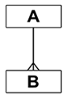 | 1:N | Sekiranya B adalah *dependent* kepada A | 1 ILF/EIF, 2 RET dan jumlahkan DET bagi A dan B |
| Sekiranya B adalah in*dependent* dari A | 2 ILF/EIF, setiapnya mempuyai RET dan DET yang berasingan |  |  |
| 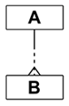 | (1):N | Sekiranya A adalah *dependent* kepada B | 1 ILF/EIF, 2 RET dan jumlahkan DET bagi A dan B |
| Sekiranya A adalah in*dependent* dari B | 2 ILF/EIF, setiapnya mempuyai RET dan DET yang berasingan |  |  |
| 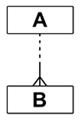 | 1:(N) | Sekiranya B adalah *dependent* kepada A | 1 ILF/EIF, 2 RET dan jumlahkan DET bagi A dan B |
| Sekiranya B adalah in*dependent* dari A | 2 ILF/EIF, setiapnya mempuyai RET dan DET yang berasingan |  |  |
| 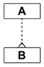 | (1):(N) | A dan B adalah *independent* di antara satu sama lain. | 2 ILF/EIF, setiapnya mempuyai RET dan DET yang berasingan |
|  | 1:1 | A dan B adalah *dependent* di antara satu sama lain. | 1 ILF/EIF, 2 RET dan jumlahkan DET bagi A dan B |
| 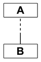 | 1:(1) | Sekiranya B adalah *dependent* kepada A | 1 ILF/EIF, 2 RET dan jumlahkan DET bagi A dan B |
| Sekiranya B adalah in*dependent* dari A | 2 ILF/EIF, setiapnya mempuyai RET dan DET yang berasingan |  |  |
| 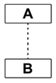 | (1):(1) | A dan B adalah *independent* di antara satu sama lain. | 2 ILF/EIF, setiapnya mempuyai RET dan DET yang berasingan |
| 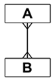 | N:M | Sekiranya B adalah *dependent* kepada A | 1 ILF/EIF, 2 RET dan jumlahkan DET bagi A dan B |
| Sekiranya B adalah in*dependent* dari A | 2 ILF/EIF, setiapnya mempuyai RET dan DET yang berasingan |  |  |
| 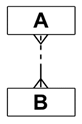 | N:(M) | Sekiranya B adalah *dependent* kepada A | 1 ILF/EIF, 2 RET dan jumlahkan DET bagi A dan B |
| Sekiranya B adalah in*dependent* dari A | 2 ILF/EIF, setiapnya mempuyai RET dan DET yang berasingan |  |  |
| 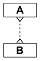 | (N):(M) | A dan B adalah *independent* di antara satu sama lain. | 2 ILF/EIF, setiapnya mempuyai RET dan DET yang berasingan |

ii) Tentukan bilangan ILF / EIF

Penentuan bilangan ILF/EIF adalah berdasarkan kepada bilangan entiti yang telah
disediakan di dalam ERD. Penentuan bilangan ILF dan EIF juga adalah bergantung
kepada hubungan modaliti dan kardinaliti di antara satu entiti dengan entiti
yang lain di dalam ERD yang telah dibangunkan. Berikut adalah kaedah-kaedah bagi
menentu dan mengirakan bilangan ILF/EIF di dalam Fasa Analisis:

- Rujuk kepada DFD untuk menentukan sama ada satu-satu entiti itu terdiri
  daripada ILF sekiranya ia merupakan entiti yang diselenggara di dalam sistem
  aplikasi yang akan dibangunkan, ataupun EIF sekiranya entiti tersebut ditarik
  dari sistem luar.
- Kenalpasti hubungan di antara entiti-entiti yang terlibat sama ada ia bersifat
  *dependent* atau *independent* dengan merujuk kepada ERD yang telah
  disediakan.
- Tentu dan kirakan bilangan ILF/EIF berpandukan kepada peraturan-peraturan yang
  disenaraikan di dalam Jadual 104 : Peraturan Penentuan Komponen Fungsi Bagi
  Fungsi Data.
- Penentuan dan pengiraan bilangan ILF/EIF bagi entiti yang sama tidak boleh
  dilakukan secara berulang kali.

iii) Tentukan bilangan RET

Penentuan bilangan RET adalah berdasarkan kepada bilangan entiti yang berhubung
kait di dalam satu-satu ILF/EIF. Berikut adalah kaedah-kaedah bagi menentu dan
mengirakan bilangan RET di dalam Fasa Analisis:

- Berikutan dari penentuan bilangan ILF/EIF dan hubungan di antara entiti pada
  langkah yang sebelum, kirakan bilangan entiti yang berhubung kait dengan
  satu-satu entiti yang lain dengan merujuk kepada ERD yang telah disediakan.
- Berdasarkan kepada Jadual 104 : Peraturan Penentuan Komponen Fungsi Bagi
  Fungsi Data, kirakan bilangan RET secara bersekali bagi entiti-entiti yang
  mempunyai hubungan yang bersifat *dependent* di antara satu sama lain.
  Sekiranya entiti-entiti tersebut mempunyai hubungan bersifat *independent*,
  kirakan bilangan RET secara berasingan bagi setiap ILF/EIF yang telah
  dikenalpasti.
- Penentuan dan pengiraan bilangan RET bagi entiti yang sama tidak boleh
  dilakukan berulang kali walaupun entiti tersebut berhubung kait di bawah
  ILF/EIF yang berbeza.

iv) Tentukan bilangan DET

Penentuan bilangan DET bagi Fungsi Data adalah berdasarkan kepada bilangan
atribut di bawah satu-satu ILF/EIF dengan merujuk kepada entiti yang telah
dikenalpasti di dalam ERD. Berikut adalah kaedah-kaedah untuk menentu dan
mengirakan bilangan DET di dalam Fasa Analisa:

- Senaraikan dan kira bilangan atribut yang terkandung di bawah satu-satu
  entiti. Setiap data yang telah dikenalpasti mempunyai nilai DET sebanyak 1
  sahaja.
- Sama seperti di dalam penentuan di dalam Fasa Permlulaan Projek, atribut yang
  disetkan sebagai kunci primer (*primary key*) bagi setiap entiti tidak akan
  ditentukan sebagai DET sekiranya atribut tersebut hanya merupakan artifak
  teknikal di mana ia tidak memberi makna kepada bisnes dan bukan terdiri dari
  maklumat yang boleh difahami oleh pengguna (*non* *user-recognizable*).
  Sekiranya atribut kunci primer tersebut digunakan sebagai kunci sekunder di
  dalam entiti yang lain, atribut kunci sekunder tersebut akan dianggap sebagai
  DET.
- Pengiraan bilangan DET juga bergantung kepada hubungan di antara
  entiti-entiti. Merujuk kepada Jadual 104 : Peraturan Penentuan Komponen Fungsi
  Bagi Fungsi Data, bilangan DET akan digabungkan bersekali bagi entiti-entiti
  yang berbeza sekiranya hubungan di antaranya adalah *dependent* di antara satu
  sama lain. Manakala pula, bilangan DET perlu dikira secara berasingan
  sekiranya hubungan di antara entiti-entiti yang berbeza adalah bersifat
  *independent*.
- Penentuan dan pengiraan bilangan DET bagi atribut yang sama tidak boleh
  dilakukan berulang kali melainkan atribut yang sama ditempatkan juga di dalam
  entiti yang berbeza.

v) Tentukan kompleksiti setiap ILF / EIF

Berdasarkan maklumat EIF/ILF, FTR dan DET, rujuk kepada Jadual Matriks
Kompleksiti bagi Fungsi Data seperti di 8.2.1.2 Jadual Matriks Kompleksiti dan
Jadual Penterjemahan untuk menentukan tahap kompleksiti setiap entiti yang telah
dikenalpasti.

vi) Lengkapkan Jadual Penentuan Tahap Kompleksiti Fungsi Data

Gunakan jadual di bawah untuk merekodkan nama entiti, atribut yang terlibat,
bilangan ILF/EIF, FTR, DET serta kompleksitinya yang telah dikenalpasti di dalam
langkah-langkah yang sebelum.

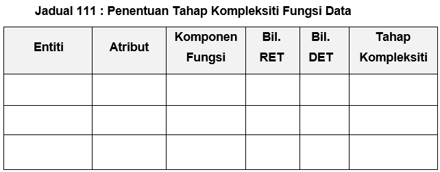

b) Tentukan Kompleksiti Berdasarkan Fungsi Transaksi

i) Kenalpasti penguraian DFD yang terendah

Berpandukan kepada rajah-rajah DFD yang telah dibangunkan di dalam Pemodelan
Proses Sistem [F.2.3], kenalpasti setiap pengurairan DFD yang berada pada aras
yang terendah. Penentuan kompleksiti berdasarkan Fungsi Transaksi akan dilakukan
kepada setiap penguaraian DFD yang terendah sahaja tanpa perlu mengambil kira
rajah DFD pada aras-aras yang lain.

ii) Kenalpasti bilangan EI, EO dan EQ

Penentuan bilangan komponen fungsi EI, EO dan EQ berdasarkan kepada aliran data
yang menghubungkan di antara entiti dengan fungsi bisnes dan storan data di
dalam DFD. Berikut adalah kaedah-kaedah untuk menentu dan mengirakan bilangan
EI, EO dan EQ di dalam Fasa Analisis:

- Bagi setiap aliran data yang telah dikenalpasti di dalam DFD serta
  penerangannya di dalam Definisi Aliran Data, tentukan sama ada
  aktiviti-aktiviti tersebut adalah terdiri daripada komponen fungsi EI, EO
  atau/dan EQ. Penentuan komponen fungsi ini boleh dikenalpasti berdasarkan
  kepada arah pergerakan aliran-aliran data sama ada yang bermula dari entiti,
  fungsi bisnes dan berakhir storan data ataupun bermula dan tamat pada arah
  sebaliknya.
- Setiap aliran data di dalam Rajah Aliran Proses tidak semestinya boleh
  mengandungi lebih dari satu jenis komponen fungsi EI, EO atau EQ. Bagi arah
  aliran data yang bermula dari entiti, aliran data tersebut hanya terdiri dari
  komponen fungsi EI sahaja. Manakala bagi arah aliran data yang bermula dari
  storan data pula, komponen fungsinya boleh terdiri sama ada dari EO, EQ atau
  kedua-duanya sekali.
- Jenis komponen fungsi yang sama tidak boleh bertindih dan dikira berulang kali
  di bawah satu-satu aliran data yang sama.

iii) Tentukan bilangan FTR

Penentuan bilangan FTR adalah berpandukan kepada bilangan dan hubungan di antara
entiti yang terlibat di dalam aliran data bagi setiap komponen fungsi EI, EO dan
EQ yang telah dikenalpasti. Rujuk kepada senarai ILF/EIF yang telah ditentukan
di dalam Fungsi Data untuk menentukan bilangan entiti yang terlibat serta
hubungannya di antara satu sama lain. Berikut adalah kaedah-kaedah untuk menentu
dan mengirakan bilangan FTR di dalam Fasa Analisis:

- Berdasarkan kepada senarai ILF/EIF di dalam Fungsi Data, kenalpasti bilangan
  dan hubungan di antara entiti pangkalan data yang berinteraksi dengan fungsi
  bisnes di bawah satu-satu komponen fungsi EI, EO atau EQ.
- Jumlah bilangan komponen fungsi ILF/EIF yang terlibat dengan satu-satu fungsi
  bisnes adalah merupakan bilangan FTR yang akan diperolehi.

iv) Tentukan bilangan DET

Penentuan bilangan DET bagi Fungsi Transaksi adalah bergantung kepada bilangan
atribut yang terlibat di dalam setiap komponen fungsi EI, EO atau EQ bagi
satu-satu aliran data. Dalam masa yang sama juga, rujuk kepada Definisi Aliran
Data untuk mengetahui atribut yang terlibat pada aliran data berkenaan. Berikut
adalah kaedah-kaedah untuk menentu dan mengirakan bilangan FTR di dalam Fasa
Analisis:

- Bagi komponen fungsi EI, kirakan bilangan DET yang hanya melibatkan data yang
  dimasukkan, dikemaskini atau/dan dihapuskan.
- Bagi komponen fungsi EO, kirakan bilangan DET yang hanya melibatkan data data
  yang dipaparkan melalui pengiraan atau logik pengaturcaraan.
- Bagi komponen fungsi EQ, kirakan bilangan DET yang hanya melibatkan data-data
  yang dipaparkan secara terus tanpa melalui pengiraan atau logik
  pengaturcaraan.
- Berbeza dengan pengiraan bilangan DET di dalam Fungsi Data, penentuan dan
  pengiraan bilangan DET bagi Fungsi Transaksi boleh dilakukan berulang kali
  bagi atribut yang sama di dalam aliran data yang berbeza.

v) Tentukan kompleksiti setiap EI. EO dan EQ

Berdasarkan kepada bilangan EI, EO, EQ, FTR dan DET yang telah ditentukan, rujuk
kepada Jadual Matriks Kompleksiti bagi Fungsi Transaksi seperti di 8.2.1.2
Jadual Matriks Kompleksiti dan Jadual Penterjemahan untuk menentukan tahap
kompleksiti setiap komponen fungsi yang telah dikenalpasti.

vi) Lengkapkan Jadual Penentuan Tahap Kompleksiti Fungsi Data

Gunakan jadual di bawah untuk merekodkan nama aktiviti, kumpulan maklumat dan
data yang terlibat, bilangan EI, EO, EQ, RET, DET serta kompleksitinya yang
telah dikenalpasti di dalam langkah-langkah yang sebelum.

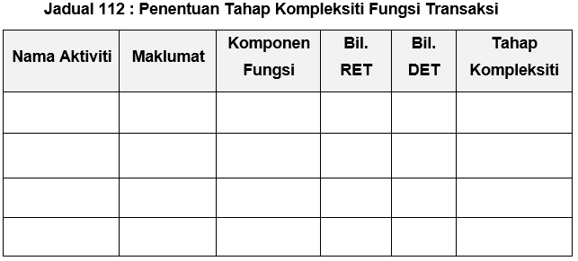

**c) Kirakan *Value Adjustment Function* (VAF)**

Semak dan kemaskini kadar pengaruh bagi empat belas (14) GSC yang telah
diperoleh di dalam pengiraan saiz pada fasa sebelumnya. Pengemaskinian kadar
pengaruh dilakukan berdasarkan kepada maklumat dan informasi projek terkini yang
telah diperolehi. Kaedah-kaedah pengiran VAF adalah sama seperti yang telah
dijelaskan di dalam Fasa Analisis, iaitu:

i) Tentukan kadar pengaruh bagi empat belas (14) Ciri-Ciri Am Sistem (GSC)
seperti yang disenarai dan diperjelaskan di dalam 8.2.1.3 Empat Belas Ciri-ciri
Am Sistem (GSC). Tambahkan skor-skor yang telah diberikan kepada ciri-ciri am
berkenaan untuk mendapatkan nilai ΣCi.

ii) Dengan berpandukan kepada formula pengiraan seperti yang diterangkan di
dalam 8.2.2 Pengiraan *Value Adjustment Factor*, masukkan nilai ΣCi yang telah
diperolehi ke dalam formula di bawah untuk mendapatkan nilai VAF.

**VAF = 0.65 + [(ΣCi) / 100]**

**d) Kirakan *Unadjusted Function Points* (UFP)**

i) Berdasarkan maklumat kompleksiti yang telah diperolehi melalui penentuan
berdasarkan Fungsi Transaksi dan Fungsi Data, rujuk kepada Jadual Penterjemahan
Saiz seperti di 2.1.2 Jadual Matriks Kompleksiti dan Jadual Penterjemahan untuk
mendapatkan nilai *Function Points* (FP) bagi setiap komponen fungsi yang telah
dikenal pasti.

ii) Gunakan jadual serta formula pengiraan seperti di dalam 8.2.3 Pengiraan
*Unadjusted Function Points* untuk mendapatkan nilai UFP.

**e) Kirakan *Adjusted Function Points* (AFP)**

Berpandukan kepada nilai **VAF** dan **UFP,** gunakan formula pengiraan seperti
di **8.2.4 Pengiraan Adjusted Function Points (AFP)** untuk mendapatkan nilai
AFP.

**f) Kirakan Anggaran *Effort,* Masa dan Kos Pembangunan**

Berikutan daripada nilai AFP yang telah diperolehi, nilai tersebut akan
digunakan untuk melakukan pengiraan anggaran *effort*, masa dan kos pembangunan
keseluruhan sistem aplikasi ataupun fungsi-fungsi di dalamnya. Rujuk 8.2.5
Pengiraan Anggaran *Effort* dan Kos Pembangunan Sistem untuk mendapatkan
keterangan lanjut berkenaan dengan formula-formula pengiraan *effort*, masa dan
kos.
