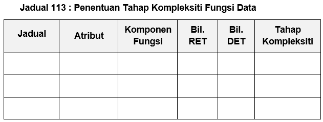
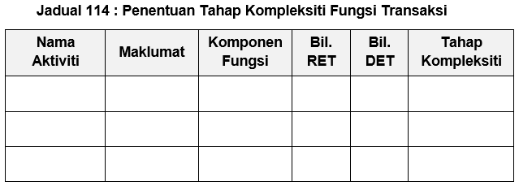

# 8.5 Pengiraan Saiz Fungsian Sistem Aplikasi di Fasa Pelaksanaan

Berbeza dengan pengiraan di dalam fasa-fasa sebelumnya, pengiraan saiz sistem
aplikasi di Fasa Pelaksanaan akan merujuk kepada model-model yang dibangunkan di
dalam fasa ini, iaitu Model Maklumat Logikal **– Reka bentuk Pangkalan Data
[F3.4]**, Spesifikasi Integrasi sistem **– Reka bentuk Integrasi Sistem
[F3.10]**, skrin-skrin antaramuka pengguna dan Jadual Pemetaan Data **-
Pemodelan Antaramuka Pengguna [F3.5]**. Langkah-langkah pengiraan saiz sistem
aplikasi di Fasa Pelaksanaan adalah seperti berikut:

**a) Tentukan Kompleksiti Berdasarkan Fungsi Data**

i) Rujuk dan patuhi peraturan penentuan komponen fungsi

Penentuan dan pengiraan komponen fungsi ILF, EIF, RET dan DET bagi Fungsi Data
perlulah mematuhi kepada peraturan-peraturan hubungan di antara entiti-entiti
atau adual-jadual pangkalan data seperti yang disenaraikan di dalam Jadual
Peraturan Penentuan Komponen Fungsi Bagi Fungsi Data.

ii) Tentukan bilangan ILF/EIF

Penentuan bilangan ILF/EIF adalah berdasarkan kepada bilangan jadual yang telah
disediakan di dalam Model Maklumat Logikal dan juga senarai data di dalam
Spesifikasi Integrasi Sistem. Penentuan bilangan ILF dan EIF adalah bergantung
kepada hubungan modaliti dan kardinaliti di antara satu entiti dengan entiti
yang lain. Berikut adalah kaedah-kaedah bagi menentu dan mengirakan bilangan
ILF/EIF di dalam Fasa Pelaksanaan:

- Rujuk kepada Model Maklumat Logikal untuk menentukan entiti-entiti yang
  terdiri dari komponen fungsi ILF, dan Spesifikasi Integrasi Sistem untuk
  menentukan komponen fungsi EIF.
- Kenalpasti hubungan di antara jadual-jadual yang terlibat sama ada ia bersifat
  *dependent* atau *independent* dengan merujuk kepada Model Maklumat Logikal
  dan Spesifikasi Integrasi Sistem yang telah disediakan.
- Tentu dan kirakan bilangan ILF/EIF berpandukan kepada peraturan-peraturan yang
  disenaraikan di dalam Jadual Peraturan Penentuan Komponen Fungsi Bagi Fungsi
  Data.
- Penentuan dan pengiraan bilangan ILF/EIF bagi jadual yang sama tidak boleh
  dilakukan secara berulang kali.

iii) Tentukan bilangan RET

Penentuan bilangan RET adalah berdasarkan kepada bilangan jadual yang berhubung
kait di dalam satu-satu ILF/EIF. Berikut adalah kaedah-kaedah bagi menentu dan
mengirakan bilangan RET di dalam Fasa Pelaksanaan:

- Berikutan dari penentuan bilangan ILF/EIF dan hubungan di antara jadual pada
  langkah yang sebelum, kirakan bilangan jadual yang berhubung kait dengan
  satu-satu jadual yang lain dengan merujuk kepada Model Maklumat Logikal dan
  Spesifikasi Integrasi Sistem yang telah disediakan.
- Berdasarkan kepada Jadual Peraturan Penentuan Komponen Fungsi Bagi Fungsi
  Data, kirakan bilangan RET secara bersekali bagi jadual-jadual yang mempunyai
  hubungan yang bersifat *dependent* di antara satu sama lain. Sekiranya
  jadual-jadual tersebut mempunyai hubungan bersifat *independent*, kirakan
  bilangan RET secara berasingan bagi setiap ILF/EIF yang telah dikenalpasti.
- Penentuan dan pengiraan bilangan RET bagi jadual yang sama tidak boleh
  dilakukan berulang kali walaupun jadual tersebut berhubung kait di bawah
  ILF/EIF yang berbeza.

iv) Tentukan bilangan DET

Penentuan bilangan DET bagi Fungsi Data adalah berdasarkan kepada bilangan
atribut di bawah satu-satu ILF/EIF dengan merujuk kepada jadual pangkalan data
yang telah dikenalpasti di dalam Model Maklumat Logikal dan Spesifikasi
Integrasi Sistem. Berikut adalah kaedah-kaedah untuk menentu dan mengirakan
bilangan DET di dalam Fasa Pelaksanaan:

- Senaraikan dan kira bilangan atribut yang terkandung di bawah satu-satu
  jadual. Setiap data yang telah dikenalpasti mempunyai nilai DET sebanyak 1
  sahaja.
- Sama seperti di dalam penentuan di dalam fasa-fasa sebelum, atribut yang
  disetkan sebagai kunci primer (*primary key*) bagi setiap jadual tidak akan
  ditentukan sebagai DET sekiranya atribut tersebut hanya merupakan artifak
  teknikal di mana ia tidak memberi makna kepada bisnes dan bukan terdiri dari
  maklumat yang boleh difahami oleh pengguna (*non* *user-recognizable*).
  Sekiranya atribut kunci primer tersebut digunakan sebagai kunci sekunder di
  dalam entiti yang lain, atribut kunci sekunder tersebut akan dianggap sebagai
  DET.
- Pengiraan bilangan DET juga bergantung kepada hubungan di antara
  jadual-jadual. Merujuk kepada Jadual 104 : Peraturan Penentuan Komponen Fungsi
  Bagi Fungsi Data, bilangan DET akan digabungkan bersekali bagi jadual-jadual
  yang berbeza sekiranya hubungan di antaranya adalah *dependent* di antara satu
  sama lain. Manakala pula, bilangan DET perlu dikira secara berasingan
  sekiranya hubungan di antara jadual-jadual yang berbeza adalah bersifat
  *independent*.
- Penentuan dan pengiraan bilangan DET bagi atribut yang sama tidak boleh
  dilakukan berulang kali melainkan atribut yang sama ditempatkan juga di dalam
  jadual yang berbeza.

v) Tentukan kompleksiti setiap ILF / EIF

Berdasarkan maklumat EIF/ILF, FTR dan DET, rujuk kepada Jadual Matriks
Kompleksiti bagi Fungsi Data seperti di 8.2.1.2 Jadual Matriks Kompleksiti dan
Jadual Penterjemahan untuk menentukan tahap kompleksiti setiap entiti yang telah
dikenalpasti.

vi) Lengkapkan Jadual Penentuan Tahap Kompleksiti Fungsi Data

Gunakan jadual di bawah untuk merekodkan nama jadual, atribut yang terlibat,
bilangan ILF/EIF, FTR, DET serta kompleksitinya yang telah dikenalpasti di dalam
langkah-langkah yang sebelum.

b) Tentukan Kompleksiti Berdasarkan Fungsi Transaksi

i) Kenalpasti bilangan EI, EO dan EQ

Penentuan bilangan komponen fungsi EI, EO dan EQ berdasarkan kepada skrin
antaramuka pengguna dan Jadual Pemetaan Data yang menghubungkan di antara
pengguna dengan sistem aplikasi yang dibangunkan. Berikut adalah kaedah-kaedah
untuk menentu dan mengirakan bilangan EI, EO dan EQ di dalam Fasa Pelaksanaan:

- Bagi setiap skrin antaramuka pengguna yang telah dibangunkan, tentukan sama
  ada skrin-skrin tersebut mengandungi komponen-komponen fungsi EI, EO atau/dan
  EQ.
- Rujuk juga kepada ruangan CRUD di dalam Jadual Pemetaan Data bagi membantu
  dalam menentukan komponen-komponen fungsi yang terlibat.
- Setiap skrin antaramuka pengguna boleh mengandungi lebih dari satu jenis
  komponen fungsi sama ada kombinasi di antara EI dengan EO ataupun EQ.
- Jenis komponen fungsi yang sama tidak boleh bertindih dan dikira berulang kali
  di bawah satu-satu skrin antaramuka.
- Skrin-skrin antaramuka pengguna tambahan, seperti skrin *popup*, kotak mesej
  (*message box*) dan notifikasi, tidak perlu diambil kira sebagai komponen
  fungsi EI, EO atau/dan EQ, di mana skrin-skrin tambahan tersebut akan hanya
  diletakkan di bawah komponen fungsi DET sahaja.

ii) Tentukan bilangan FTR

Penentuan bilangan FTR adalah berpandukan kepada bilangan dan hubungan di antara
jadual-jadual pangkalan data yang terlibat di bawah setiap komponen fungsi EI,
EO dan EQ seperti yang telah dikenalpasti pada langkah yang sebelumnya. Rujuk
kepada senarai ILF/EIF yang telah ditentukan di dalam Fungsi Data serta Jadual
Pemetaan Data untuk menentukan bilangan jadual pangkalan data yang terlibat
serta hubungannya di antara satu sama lain. Berikut adalah kaedah-kaedah untuk
menentu dan mengirakan bilangan FTR di dalam Fasa Pelaksanaan:

- Berdasarkan kepada senarai ILF/EIF serta Jadual Pemetaan Data, kenalpasti
  bilangan dan hubungan di antara jadual pangkalan data yang berinteraksi dengan
  fungsi bisnes di bawah satu-satu komponen fungsi EI, EO atau EQ.
- Jumlah bilangan komponen fungsi ILF/EIF yang terlibat dengan skrin antaramuka
  pengguna berkenaan adalah merupakan bilangan FTR yang akan diperolehi.

iii) Tentukan bilangan DET

Penentuan bilangan DET bagi Fungsi Transaksi adalah bergantung kepada bilangan
atribut yang terlibat di dalam setiap komponen fungsi EI, EO atau EQ bagi
satu-satu skrin antaramuka pengguna. Dalam masa yang sama juga, rujuk kepada
Jadual Pementaan Data untuk mengenalpasti atribut yang diperlukan pada skrin
terlibat. Berikut adalah kaedah-kaedah untuk menentu dan mengirakan bilangan FTR
di dalam Fasa Pelaksanaan:

- Bagi komponen fungsi EI, kirakan bilangan DET yang hanya melibatkan data yang
  dimasukkan, dikemaskini atau/dan dihapuskan.
- Bagi komponen fungsi EO, kirakan bilangan DET yang hanya melibatkan data data
  yang dipaparkan melalui pengiraan atau logik pengaturcaraan.
- Bagi komponen fungsi EQ, kirakan bilangan DET yang hanya melibatkan data-data
  yang dipaparkan secara terus tanpa melalui pengiraan atau logik
  pengaturcaraan.
- Berbeza dengan pengiraan bilangan DET di dalam Fungsi Data, penentuan dan
  pengiraan bilangan DET bagi Fungsi Transaksi boleh dilakukan berulang kali
  bagi atribut yang sama kecuali atribut yang berada di bawah komponen fungsi
  dan skrin antarmuka yang sama.

iv) Tentukan kompleksiti setiap EI. EO dan EQ

Berdasarkan kepada bilangan EI, EO, EQ, FTR dan DET yang telah ditentukan, rujuk
kepada Jadual Matriks Kompleksiti bagi Fungsi Transaksi seperti di 8.2.1.2
Jadual Matriks Kompleksiti dan Jadual Penterjemahan untuk menentukan tahap
kompleksiti setiap komponen fungsi yang telah dikenalpasti.

v) Lengkapkan Jadual Penentuan Tahap Kompleksiti Fungsi Data

Gunakan jadual di bawah untuk merekodkan nama aktiviti, kumpulan maklumat dan
data yang terlibat, bilangan EI, EO, EQ, RET, DET serta kompleksitinya yang
telah dikenalpasti di dalam langkah-langkah yang sebelum.

**c) Kirakan *Value Adjustment Function* (VAF)**

Semak dan kemaskini kadar pengaruh bagi empat belas (14) GSC yang telah
diperoleh di dalam pengiraan pada fasa-fasa sebelumnya. Pengemaskinian kadar
pengaruh dilakukan berdasarkan kepada maklumat dan informasi projek terkini yang
telah diperolehi. Kaedah-kaedah pengiran VAF adalah sama seperti yang telah
dijelaskan di dalam fasa-fasa sebelumnya, iaitu:

i) Tentukan kadar pengaruh bagi empat belas (14) Ciri-Ciri Am Sistem (GSC)
seperti yang disenarai dan diperjelaskan di dalam 8.2.1.3 Empat Belas Ciri-ciri
Am Sistem (GSC). Tambahkan skor-skor yang telah diberikan kepada ciri-ciri am
berkenaan untuk mendapatkan nilai ΣCi.

ii) Dengan berpandukan kepada formula pengiraan seperti yang diterangkan di
dalam 8.2.2 Pengiraan *Value Adjustment Factor*, masukkan nilai ΣCi yang telah
diperolehi ke dalam formula di bawah untuk mendapatkan nilai VAF.

**VAF = 0.65 + [(ΣCi) / 100]**

**d) Kirakan *Unadjusted Function Points* (UFP)**

i) Berdasarkan maklumat kompleksiti yang telah diperolehi melalui penentuan
berdasarkan Fungsi Transaksi dan Fungsi Data, rujuk kepada Jadual Penterjemahan
Saiz seperti di 2.1.2 Jadual Matriks Kompleksiti dan Jadual Penterjemahan untuk
mendapatkan nilai *Function Points* (FP) bagi setiap komponen fungsi yang telah
dikenal pasti.

ii) Gunakan jadual serta formula pengiraan seperti di dalam 8.2.3 Pengiraan
*Unadjusted Function Points* untuk mendapatkan nilai UFP.

**e) Kirakan *Adjusted Function Points* (AFP)**

Berpandukan kepada nilai **VAF** dan **UFP,** gunakan formula pengiraan seperti
di **8.2.4 Pengiraan Adjusted Function Points (AFP)** untuk mendapatkan nilai
AFP.

**d) Kirakan Anggaran *Effort,* Masa dan Kos Pembangunan**

Berikutan daripada nilai AFP yang telah diperolehi, nilai tersebut akan
digunakan untuk melakukan pengiraan anggaran *effort*, masa dan kos pembangunan
keseluruhan sistem aplikasi ataupun fungsi-fungsi di dalamnya. Rujuk 8.2.5
Pengiraan Anggaran *Effort* dan Kos Pembangunan Sistem untuk mendapatkan
keterangan lanjut berkenaan dengan formula-formula pengiraan *effort*, masa dan
kos.

Rujukan

1. David Garmus, Janet Russac & Royce Edwards (2011). Certified Function Point
   Specialist Examination Guide.
2. ISO/IEC 20926 Systems and software engineering - Software measurement - IFPUG
   functional size measurement method (2009).
3. Adri Timp (2010). IFPUG Function Point Counting Practices Manual Release 4.3
