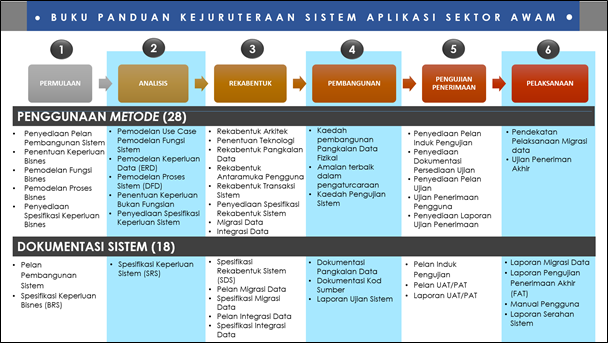

# Ringkasan Eksekutif

Buku ini ditulis dengan mengambil kira amalan terbaik teknik dan kaedah yang
digunakan dalam melaksanakan aktiviti-aktiviti pembangunan sistem aplikasi. Buku
ini menyediakan panduan dalam proses pembangunan sistem aplikasi dengan memberi
fokus kepada bagaimana melaksanakan aktiviti-aktiviti tersebut dan apakah
serahan yang perlu dihasilkan pada setiap fasa kitar hayat pembangunan sistem.
Proses pembangunan sistem aplikasi yang diperkenalkan dalam buku ini dikenali
sebagai Buku Kejuruteraan Sistem Aplikasi Sektor Awam (KRISA).

Metodologi KRISA meliputi 6 fasa utama yang perlu difahami, diguna pakai dan
dilaksanakan oleh agensi. Setiap fasa menerangkan aktiviti, teknik dan
pendekatan, serta dokumentasi serahan. Rajah 1 Rangka Kerja Panduan
Kejuruteraaan Sistem Aplikasi Sektor Awam dan Jadual 1 menyenaraikan fasa,
aktiviti dan dokumen serahan.

**Rajah 1: Rangka Kerja Panduan Kejuruteraaan Sistem Aplikasi Sektor Awam**

Beberapa pertimbangan utama perlu diambil kira bagi menjamin kejayaan
pelaksanaan projek pembangunan sistem aplikasi, di samping memastikan sistem
aplikasi yang dibangunkan adalah berkualiti dan memenuhi keperluan pengguna.
Pertimbangan- pertimbangan tersebut adalah:

a) Tadbir Urus Pengurusan Projek ICT

b) Penglibatan Pemegang Taruh

c) Pengurusan Kawalan Pindaan

d) Jaminan Kualiti Perisian (SQA)

e) Faktor Keselamatan ICT

f) Kepentingan Pengukuran Saiz Sistem

**Jadual 1: Rangka Kerja Metodologi Kejuruteraan Pembangunan Sistem Aplikasi**

|  | **Fasa** | **Aktiviti** | **Dokumen Serahan** |
|---|---|---|---|
| **F1** | **Permulaan dan Keperluan Projek** | [F1.1] Penyediaan Pelan Pembangunan Sistem [F1.2] Penentuan Keperluan Bisnes [F1.3] Pemodelan Fungsi Bisnes [F1.4] Pemodelan Proses Bisnes [F1.5] Penyediaan Spesifikasi Keperluan Bisnes | D01 Pelan Pembangunan Sistem D02 Spesifikasi Keperluan Bisnes (BRS) |
| **F2** | **Analisis** | [F2.1] Pemodelan Use Case (Fungsian) [F2.2] Pemodelan Fungsi Sistem (DFD) [F2.3] Pemodelan Keperluan Data (ERD) [F2.4] Pemodelan Proses Sistem [F2.5] Penentuan Keperluan Bukan Fungsian [F2.6] Penyediaan Spesifikasi Keperluan Sistem | D03 Spesifikasi Keperluan Sistem (SRS) |
| **F3** | **Reka bentuk** | [F3.1]Reka bentuk Arkitek [F3.2]Penentuan Teknologi [F3.3]Reka bentuk Pangkalan Data [F3.4]Reka bentuk Antaramuka Pengguna [F3.5]Reka bentuk Transaksi Sistem [F3.6]Penyediaan Spesifikasi Reka bentuk Sistem **Migrasi Data** [F3.7]Penyediaan Pelan Migrasi Data [F3.8]Reka bentuk dan Penyediaan Spesifikasi Migrasi Data **Integrasi Data** [F3.9]Penyediaan Pelan Integrasi Sistem [F3.10]Reka bentuk dan Penyediaan Spesifikasi Integrasi Sistem | D04 Spesifikasi Reka bentuk Sistem (SDS) D05 Pelan Migrasi Data D06 Spesifikasi Migrasi Data |
| **F4** | **Pembangunan** | [F4.1] Pembangunan Pangkalan Data [F4.2] Pengaturcaraan Aplikasi [F4.3] Pengujian Sistem | D09 Dokumentasi Pangkalan Data D10 Dokumentasi Kod Sumber D11 Laporan Ujian Sistem |
| **F5** | **Pengujian** | [F5.1] Penyediaan Pelan Induk Pengujian [F5.2] Penyediaan Dokumentasi Persediaan Ujian [F5.3] Penyediaan Pelan Ujian (UAT dan PAT) [F5.4] Ujian Penerimaan Pengguna (UAT) [F5.5] Ujian Penerimaan Provisional (PAT) [F5.6] Penyediaan Laporan Ujian Penerimaan | D12 Pelan Induk Pengujian D13 Pelan Ujian Penerimaan (UAT/PAT) D14 Laporan UAT/PAT |
| **F6** | **Pelaksanaan** | [F6.1] Pelaksanaan Migrasi Data [F6.2] Ujian Penerimaan Akhir (FAT) [F6.3] Penyediaan Manual Pengguna [F5.4] Serahan Sistem Aplikasi | D15 Laporan Migrasi Data D16 Laporan Penamatan Ujian D17 Manual Pengguna Sistem D18 Laporan Serahan Sistem |
